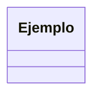

# <Nombre del módulo> (p. ej. "Adapter y Facade")

<!-- Un párrafo de 2-3 frases: qué familia de problemas cubre este módulo y cómo se conecta con los módulos anteriores (enlace real hacia atrás, texto plano hacia adelante). -->

## <Nombre del patrón, exactamente como en la tabla MODULOS de verificar.py>

### El problema

<!-- Situación de la tienda online en 2-4 frases. Luego código "malo" en Python (el dolor debe verse). -->

```python
# código malo
```

### La idea en pocas palabras

<!-- Analogía cotidiana de 1-2 frases. Luego la explicación simple del patrón en un párrafo corto y la lista de participantes (rol -> clase de la tienda). -->

### Diagrama



### Código

#### Python

```python
# solución
```

#### TypeScript

```typescript
// solución
```

#### Go

```go
// solución
```

> **Nota Go:** <!-- solo si el patrón se simplifica o casi desaparece en Go; si no aplica, borrar esta línea -->

#### PHP

```php
// solución
```

### Cuándo usarlo y cuándo no

<!-- Usar cuando..., no usar cuando... Nombrar el principio SOLID que aplica o refuerza usando las siglas (SRP, OCP, LSP, ISP o DIP) y explicar el vínculo en 1-2 frases. -->

## Comparación

<!-- Opcional, solo en módulos con varios patrones o con un patrón fácil de confundir: tabla corta "se parece a / se diferencia en". Borrar la sección si no se usa. -->

## Preguntas de entrevista

**P1. ¿...?**
Respuesta modelo de 2 a 4 frases.

**P2. ¿...?**
Respuesta modelo.

**P3. ¿...?**
Respuesta modelo.

**P4. ¿...?**
Respuesta modelo.
