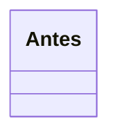

# <Sigla>: <Nombre del principio> (p. ej. "SRP: Responsabilidad única")

<!-- Enunciado formal del principio en una frase y su versión en lenguaje simple. -->

## La violación

<!-- Situación de la tienda en 2-4 frases. Luego código "malo" en Python donde el principio se rompe y el síntoma concreto (qué cambio obliga a tocar qué). -->

```python
# código malo
```

## La idea en pocas palabras

<!-- Analogía cotidiana de 1-2 frases + explicación simple. -->

## Diagrama



## Código

### Python

```python
# refactor
```

### TypeScript

```typescript
// refactor
```

### Go

```go
// refactor
```

> **Nota Go:** <!-- solo si aplica -->

### PHP

```php
// refactor
```

## Cuándo aplicarlo y cuándo no

<!-- Señales de que se viola, y el riesgo de pasarse (sobre-ingeniería). Conectar con patrones que vienen más adelante en texto plano. -->

## Ejercicio: detecta la violación

<!-- Un fragmento corto en Python (otra situación de la tienda) y la pregunta "¿qué principio viola y por qué?". La solución va dentro de <details><summary>Solución</summary> ... </details>. -->

## Preguntas de entrevista

**P1. ¿...?**
Respuesta modelo de 2 a 4 frases.

**P2. ¿...?**
Respuesta modelo.

**P3. ¿...?**
Respuesta modelo.

**P4. ¿...?**
Respuesta modelo.
