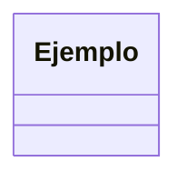
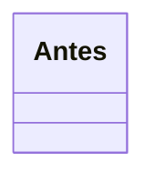

# Curso de patrones de diseño, SOLID y buenas prácticas — Plan de implementación

> **For agentic workers:** REQUIRED SUB-SKILL: Use superpowers:subagent-driven-development (recommended) or superpowers:executing-plans to implement this plan task-by-task. Steps use checkbox (`- [ ]`) syntax for tracking.

**Goal:** Escribir un curso autodidacta en español neutro con 21 módulos (buenas prácticas, SOLID y los 23 patrones GoF), cada concepto con explicación simple, diagrama Mermaid y código en Python, TypeScript, Go y PHP, más preguntas de entrevista.

**Architecture:** Un archivo Markdown por módulo en `teoria/`, con estructura fija que valida un script (`scripts/verificar.py`). Las preguntas de entrevista viven en cada módulo y un segundo script las consolida en `preguntas-entrevista.md`. Un tercer script revisa la sintaxis de los fragmentos de código y un cuarto valida los diagramas Mermaid. El hilo conductor de todos los ejemplos es una tienda online.

**Tech Stack:** Markdown + Mermaid; scripts en Python 3 (solo librería estándar); Node/npm solo para el chequeo de sintaxis TypeScript (instala `typescript@5` en `.tmp/`); `php` en el PATH para `php -l`.

**Spec:** `docs/superpowers/specs/2026-10-02-curso-patrones-diseno-design.md`

## Global Constraints

Estas restricciones forman parte de cada tarea.

- Directorio de trabajo: `C:\Users\josec\Development\personal\curso-patrones-diseno` (repo git, rama `main`).
- Idioma: español neutro/latinoamericano. **Nunca voseo** (vos, tenés, podés, grabás, parás, mirá...). Usar tuteo o impersonal. Tildes y eñes siempre completas. Términos técnicos en inglés cuando son el estándar (Singleton, Builder, callback, middleware).
- Alcance: GoF completo (23 patrones). Sin patrones de arquitectura (CQRS, Hexagonal, etc.).
- Código: solo fragmentos dentro del Markdown, sin archivos ejecutables ni tests del código del curso.
- Dominio hilo conductor: tienda online. Un patrón solo usa otro dominio si la tienda no lo representa de forma natural (Interpreter usa un mini-lenguaje de reglas de cupones, que sigue siendo de la tienda).
- Lenguajes y versiones de referencia: Python 3.12+, TypeScript 5.x, Go 1.22+ (1.23 para `iter.Seq` en Iterator), PHP 8.3.
- Go idiomático: interfaces implícitas, composición por embedding, funciones de primera clase y errores como valores. Cuando un patrón se simplifica o casi desaparece en Go, agregar una nota `> **Nota Go:** ...`.
- Estilo de explicación: párrafos cortos, una analogía cotidiana de 1 a 2 frases al abrir "La idea en pocas palabras", sin jerga sin definir. Glosa inline de una frase la primera vez que aparece un término técnico en el módulo, con enlace al glosario: `acoplamiento (qué tanto depende un módulo de otro; [glosario](../glosario.md#acoplamiento))`.
- Referencias entre módulos: hacia atrás, enlace real (`[módulo 03](03-ocp.md)`); hacia adelante, texto plano ("más adelante, en el módulo de Strategy").
- Diagramas: Mermaid. `classDiagram` para estructura, `sequenceDiagram` para flujos. En `flowchart`/`graph`, los labels con paréntesis van entre comillas: `A["f(x)"]`. Genéricos con `~T~`, no `<T>`. Máximo 15 nodos por diagrama. Sin etiquetas HTML.
- Código: cada bloque ≤ 40 líneas, **sintácticamente completo por sí solo** (Python, TypeScript y PHP deben parsear solos; en PHP la etiqueta `<?php` es opcional). En Go se omiten `package` e `import` salvo cuando el snippet los necesita para entenderse, y se revisa a mano que no queden imports ni variables sin usar. Cada implementación termina con 3 a 6 líneas de uso y su resultado esperado en un comentario (`# => Total: 25000`).
- Los 4 lenguajes implementan **las mismas clases con los mismos nombres de dominio** y producen el mismo resultado. Convenciones de nombres: Python `snake_case` + `dataclass`; TypeScript `camelCase` + `interface`/`class`; Go `PascalCase` para lo exportado y `camelCase` para lo interno; PHP `camelCase` en métodos, propiedades tipadas.
- Dinero: pesos chilenos como `int` (sin decimales). Ejemplo: `precio=12990`.
- Commits en español, un commit por módulo, con el trailer `Co-Authored-By: Claude Sonnet 5.5 <noreply@anthropic.com>`.

### Vocabulario fijo del dominio (nombres que todo módulo reutiliza)

| Concepto | Nombre en el código (Python / TS / PHP; Go en PascalCase) |
|---|---|
| Producto | `Producto(id, nombre, precio)` |
| Línea del carrito | `ItemCarrito(producto, cantidad)` |
| Carrito | `Carrito` con `agregar(producto, cantidad)` y `subtotal()` |
| Cliente | `Cliente(id, nombre, email)` |
| Pedido | `Pedido(id, cliente, items, estado)` con `total()` |
| Pago | interfaz `MetodoPago` con `pagar(monto) -> ResultadoPago(ok, referencia)` |
| Descuento | interfaz `ReglaDescuento` con `aplicar(subtotal) -> int` |
| Notificación | interfaz `Notificador` con `notificar(destinatario, mensaje)` |
| Persistencia | interfaz `PedidoRepository` con `guardar(pedido)` y `obtener(id)` |

En Python: `calcular_total`, `agregar`; en TypeScript/PHP: `calcularTotal`; en Go: `CalcularTotal`.

### Procedimiento estándar de módulo (tareas 2 a 22)

Cada tarea de módulo sigue estos pasos; los pasos de cada tarea repiten los comandos exactos.

1. **Prueba que falla:** `python scripts/verificar.py --modulo NN` debe imprimir `[ERR] ... falta teoria/<archivo>.md`.
2. **Escribir el módulo** copiando la plantilla indicada (`docs/plantillas/modulo-patron.md` o `modulo-solid.md`) a `teoria/<archivo>.md` y completándola según el "Contenido" de la tarea. Borrar todos los comentarios `<!-- ... -->` de la plantilla.
3. **Glosario:** agregar a `glosario.md` cada término de la tarea (`## Término`, 1 a 2 frases, y una línea `Ver también: [módulo NN](teoria/<archivo>.md)`), en orden alfabético. Los enlaces `glosario.md#slug` usan el título en minúsculas con espacios como guiones (`## Ley de Demeter` → `#ley-de-demeter`).
4. **Verificar:** `python scripts/verificar.py --modulo NN` → `[OK ]` y `python scripts/sintaxis.py` → `0 error(es)`. Corregir hasta que ambos pasen. Después `python scripts/verificar.py` sin argumentos para confirmar que los enlaces siguen sanos.
5. **Revisión manual** (lo que el script no ve): (a) los 4 lenguajes tienen las mismas clases y el mismo resultado esperado; (b) en Go no sobran imports ni variables; (c) el código "malo" realmente duele (se ve el problema) y el refactor lo resuelve; (d) cada respuesta de entrevista se puede decir en voz alta en 2 a 4 frases; (e) hay una `> **Nota Go:**` si el patrón se simplifica en Go.
6. **Actualizar el checklist** del `README.md` (cambiar `- [ ] NN` por `- [x] NN`) y hacer commit.

## Review Focus

Entradas y fallas que el spec implica y que ninguna prueba obvia cubre. Cada línea tiene su comprobación en la tarea que se indica.

1. **Diagramas Mermaid que no renderizan** (paréntesis sin comillas en flowchart, genéricos `<T>` en classDiagram, llaves sin cerrar). Lo esperable: todos los diagramas se ven. Comprobación: `verificar.py` detecta el caso flowchart en cada módulo; la tarea 24 valida **todos** los diagramas con `validar_mermaid.py` en el navegador.
2. **Fragmentos que no parsean** (llaves o paréntesis sin cerrar, sintaxis de otra versión del lenguaje). Comprobación: `sintaxis.py` en el paso 4 de cada módulo (Python, PHP, TypeScript).
3. **Go con imports o variables sin usar**, que no compila aunque la sintaxis sea correcta; no hay toolchain Go instalado. Comprobación: revisión manual del paso 5(b) y repaso final en la tarea 24.
4. **Los 4 lenguajes divergen** (una versión hace algo distinto o con otro nombre). Comprobación: revisión manual del paso 5(a), con el resultado esperado en comentario en cada uso.
5. **Voseo o enlaces rotos hacia el glosario/otros módulos** que se cuelan por copiar texto. Comprobación: `verificar.py` revisa voseo y enlaces en cada ejecución.

---

## Estructura de archivos

| Archivo | Responsabilidad |
|---|---|
| `README.md` | Temario y checklist de estado (spec vivo), convenciones, cómo verificar |
| `glosario.md` | Términos técnicos, un `## Término` por entrada, orden alfabético |
| `preguntas-entrevista.md` | **Generado** por `scripts/consolidar_preguntas.py`; no se edita a mano |
| `teoria/NN-*.md` | Un módulo por archivo (21 módulos) |
| `teoria/_transversales.md` | Preguntas que cruzan módulos (se anexan al consolidado) |
| `docs/plantillas/modulo-patron.md`, `modulo-solid.md` | Esqueletos de módulo |
| `scripts/verificar.py` | Estructura, lenguajes, diagramas, preguntas, enlaces, voseo |
| `scripts/consolidar_preguntas.py` | Genera `preguntas-entrevista.md` |
| `scripts/sintaxis.py` | Sintaxis de Python, PHP y TypeScript en los bloques de código |
| `scripts/validar_mermaid.py` | Genera una página que valida todos los diagramas en el navegador |
| `.gitignore` | `.tmp/`, `__pycache__/` |

---

### Task 1: Andamiaje, scripts de verificación y plantillas

**Files:**
- Create: `.gitignore`, `README.md`, `glosario.md`
- Create: `scripts/verificar.py`, `scripts/consolidar_preguntas.py`, `scripts/sintaxis.py`, `scripts/validar_mermaid.py`
- Create: `docs/plantillas/modulo-patron.md`, `docs/plantillas/modulo-solid.md`

**Interfaces:**
- Produces: `scripts.verificar` exporta `MODULOS`, `RAIZ`, `TEORIA`, `PREGUNTAS`, `parsear(texto)`, `rango(secs, i)`; los otros tres scripts los importan. La tabla `MODULOS` fija los nombres de archivo `teoria/NN-*.md` de las tareas 2 a 22.

- [ ] **Step 1: Crear `.gitignore`**

```
.tmp/
__pycache__/
```

- [ ] **Step 2: Crear `scripts/verificar.py`** con exactamente este contenido

```python
#!/usr/bin/env python3
"""Verifica la estructura de los módulos del curso.

Uso:
    python scripts/verificar.py --modulo 7    # un módulo
    python scripts/verificar.py               # todos los módulos + enlaces
    python scripts/verificar.py --final       # lo anterior + README, glosario y preguntas
"""
import argparse
import pathlib
import re
import sys

RAIZ = pathlib.Path(__file__).resolve().parent.parent
TEORIA = RAIZ / "teoria"
LENGUAJES = ["Python", "TypeScript", "Go", "PHP"]
FENCE = {"Python": "python", "TypeScript": "typescript", "Go": "go", "PHP": "php"}

# número -> (archivo, tipo, patrones GoF que debe contener)
MODULOS = {
    0: ("00-introduccion", "intro", []),
    1: ("01-buenas-practicas", "intro", []),
    2: ("02-srp", "solid", []),
    3: ("03-ocp", "solid", []),
    4: ("04-lsp", "solid", []),
    5: ("05-isp", "solid", []),
    6: ("06-dip", "solid", []),
    7: ("07-singleton", "patron", ["Singleton"]),
    8: ("08-factory-method", "patron", ["Factory Method"]),
    9: ("09-abstract-factory", "patron", ["Abstract Factory"]),
    10: ("10-builder", "patron", ["Builder"]),
    11: ("11-prototype", "patron", ["Prototype"]),
    12: ("12-adapter-facade", "patron", ["Adapter", "Facade"]),
    13: ("13-decorator-proxy", "patron", ["Decorator", "Proxy"]),
    14: ("14-composite-flyweight", "patron", ["Composite", "Flyweight"]),
    15: ("15-bridge", "patron", ["Bridge"]),
    16: ("16-strategy-state-template-method", "patron",
         ["Strategy", "State", "Template Method"]),
    17: ("17-observer-mediator-chain", "patron",
         ["Observer", "Mediator", "Chain of Responsibility"]),
    18: ("18-command-memento-iterator", "patron",
         ["Command", "Memento", "Iterator"]),
    19: ("19-visitor-interpreter", "patron", ["Visitor", "Interpreter"]),
    20: ("20-antipatrones-y-cierre", "cierre", []),
}

PREGUNTAS = "Preguntas de entrevista"
H3_PATRON = ["El problema", "La idea en pocas palabras", "Diagrama", "Código",
             "Cuándo usarlo y cuándo no"]
H2_SOLID = ["La violación", "La idea en pocas palabras", "Diagrama", "Código",
            "Cuándo aplicarlo y cuándo no", "Ejercicio: detecta la violación",
            PREGUNTAS]
H2_CIERRE = ["Antipatrones", "Cuándo no usar patrones", "Caso de cierre", PREGUNTAS]
H2_NO_PATRON = {PREGUNTAS, "Comparación", "Resumen"}
SOLID_RE = re.compile(r"\b(SRP|OCP|LSP|ISP|DIP)\b")
VOSEO_RE = re.compile(
    r"\b(vos|tenés|podés|querés|sabés|grabás|parás|hacé|mirá|fijate|usá|ponés|"
    r"decís|sos|andá|elegí|pensá|escribí|aplicá|fijá)\b", re.I)
PREGUNTA_RE = re.compile(r"^\*\*P\d+\.")


def parsear(texto):
    """Divide el Markdown en secciones; los bloques de código quedan aparte."""
    secs = [{"nivel": 0, "titulo": "", "lineas": [], "fences": []}]
    en_fence, lang, buf = False, "", []
    for linea in texto.splitlines():
        if en_fence:
            if linea.startswith("```"):
                secs[-1]["fences"].append((lang, "\n".join(buf)))
                en_fence = False
            else:
                buf.append(linea)
            continue
        if linea.startswith("```"):
            en_fence, lang, buf = True, linea[3:].strip().lower(), []
            continue
        h = re.match(r"^(#{1,6}) +(.*?)\s*$", linea)
        if h:
            secs.append({"nivel": len(h.group(1)), "titulo": h.group(2),
                         "lineas": [], "fences": []})
        else:
            secs[-1]["lineas"].append(linea)
    return secs


def rango(secs, i):
    """La sección i y todas sus subsecciones."""
    fin = i + 1
    while fin < len(secs) and secs[fin]["nivel"] > secs[i]["nivel"]:
        fin += 1
    return secs[i:fin]


def titulos(sub, nivel):
    return [s["titulo"] for s in sub if s["nivel"] == nivel]


def fences(sub, lang):
    return sum(1 for s in sub for (l, _) in s["fences"] if l == lang)


def revisar_lenguajes(sub, etiqueta, minimo_python, errs):
    for leng in LENGUAJES:
        minimo = minimo_python if leng == "Python" else 1
        n = fences(sub, FENCE[leng])
        if n < minimo:
            errs.append(f"{etiqueta}: {n} bloque(s) {FENCE[leng]}, mínimo {minimo}")


def revisar_preguntas(secs, errs):
    idx = [i for i, s in enumerate(secs) if s["nivel"] == 2 and s["titulo"] == PREGUNTAS]
    if not idx:
        errs.append(f"falta la sección '## {PREGUNTAS}'")
        return
    lineas = [l for s in rango(secs, idx[0]) for l in s["lineas"]]
    n = sum(1 for l in lineas if PREGUNTA_RE.match(l))
    if not 4 <= n <= 6:
        errs.append(f"{PREGUNTAS}: {n} preguntas con formato '**P1. ...**', se esperan 4 a 6")


def revisar_mermaid(secs, errs):
    mermaid = [c for s in secs for (l, c) in s["fences"] if l == "mermaid"]
    for c in mermaid:
        if c.lstrip().startswith(("flowchart", "graph")) and \
                re.search(r'\[[^\]"]*[()][^\]"]*\]', c):
            errs.append("mermaid: label con paréntesis sin comillas en un flowchart")
    return len(mermaid)


def errores_modulo(num):
    nombre, tipo, patrones = MODULOS[num]
    ruta = TEORIA / f"{nombre}.md"
    if not ruta.exists():
        return [f"falta teoria/{nombre}.md"]
    secs = parsear(ruta.read_text(encoding="utf-8"))
    errs = []
    if not any(s["nivel"] == 1 for s in secs):
        errs.append("falta el título '# ...'")
    n_mermaid = revisar_mermaid(secs, errs)
    revisar_preguntas(secs, errs)

    if tipo == "patron":
        bloques = [i for i, s in enumerate(secs)
                   if s["nivel"] == 2 and s["titulo"] not in H2_NO_PATRON]
        nombres = [secs[i]["titulo"] for i in bloques]
        for p in patrones:
            if p not in nombres:
                errs.append(f"falta el patrón '## {p}'")
        for n in nombres:
            if n not in patrones:
                errs.append(f"sección '## {n}' no es un patrón esperado en este módulo")
        for i in bloques:
            sub = rango(secs, i)
            et = secs[i]["titulo"]
            for h in H3_PATRON:
                if h not in titulos(sub, 3):
                    errs.append(f"{et}: falta '### {h}'")
            codigo = [j for j, s in enumerate(sub) if s["nivel"] == 3 and s["titulo"] == "Código"]
            if codigo:
                hijos = rango(sub, codigo[0])
                for leng in LENGUAJES:
                    if leng not in titulos(hijos, 4):
                        errs.append(f"{et}: falta '#### {leng}' en Código")
            revisar_lenguajes(sub, et, 2, errs)
            if fences(sub, "mermaid") < 1:
                errs.append(f"{et}: falta el diagrama mermaid")
            cuando = [s for s in sub if s["titulo"] == "Cuándo usarlo y cuándo no"]
            if cuando and not SOLID_RE.search(" ".join(cuando[0]["lineas"])):
                errs.append(f"{et}: 'Cuándo usarlo...' no nombra un principio SOLID (SRP/OCP/LSP/ISP/DIP)")
    elif tipo == "solid":
        h2 = titulos(secs, 2)
        for h in H2_SOLID:
            if h not in h2:
                errs.append(f"falta '## {h}'")
        codigo = [i for i, s in enumerate(secs) if s["nivel"] == 2 and s["titulo"] == "Código"]
        if codigo:
            hijos = rango(secs, codigo[0])
            for leng in LENGUAJES:
                if leng not in titulos(hijos, 3):
                    errs.append(f"falta '### {leng}' en Código")
        revisar_lenguajes(secs, "módulo", 2, errs)
        if n_mermaid < 1:
            errs.append("falta el diagrama mermaid")
    else:  # intro y cierre
        if tipo == "cierre":
            for h in H2_CIERRE:
                if h not in titulos(secs, 2):
                    errs.append(f"falta '## {h}'")
        revisar_lenguajes(secs, "módulo", 1, errs)
        if n_mermaid < 1:
            errs.append("falta el diagrama mermaid")

    for s in secs:
        for l in s["lineas"]:
            m = VOSEO_RE.search(l)
            if m:
                errs.append(f"voseo: '{m.group(0)}' en: {l.strip()[:60]}")
    return errs


def slug(titulo):
    return re.sub(r"[^\w\- ]", "", titulo.lower().replace("`", "")).replace(" ", "-")


def anclas(ruta):
    secs = parsear(ruta.read_text(encoding="utf-8"))
    return {slug(s["titulo"]) for s in secs if s["nivel"] >= 1}


def errores_enlaces():
    errs = []
    archivos = list(RAIZ.glob("*.md")) + list(TEORIA.glob("*.md"))
    for md in archivos:
        texto = re.sub(r"```.*?```", "", md.read_text(encoding="utf-8"), flags=re.S)
        for destino in re.findall(r"\]\(([^)\s]+)\)", texto):
            if destino.startswith(("http://", "https://", "mailto:")):
                continue
            ruta, _, ancla = destino.partition("#")
            objetivo = md if not ruta else (md.parent / ruta).resolve()
            if not objetivo.exists():
                errs.append(f"{md.name}: enlace roto a {destino}")
            elif ancla and objetivo.suffix == ".md" and ancla not in anclas(objetivo):
                errs.append(f"{md.name}: ancla inexistente en {destino}")
    return errs


def main():
    sys.stdout.reconfigure(encoding="utf-8")
    ap = argparse.ArgumentParser()
    ap.add_argument("--modulo", type=int)
    ap.add_argument("--final", action="store_true")
    args = ap.parse_args()
    nums = [args.modulo] if args.modulo is not None else sorted(MODULOS)
    total = 0
    for n in nums:
        errs = errores_modulo(n)
        total += len(errs)
        print(f"[{'OK ' if not errs else 'ERR'}] módulo {n:02d} {MODULOS[n][0]}")
        for e in errs:
            print(f"      - {e}")
    if args.modulo is None:
        enl = errores_enlaces()
        total += len(enl)
        print(f"[{'OK ' if not enl else 'ERR'}] enlaces")
        for e in enl:
            print(f"      - {e}")
    if args.final:
        for f in ["README.md", "glosario.md", "preguntas-entrevista.md"]:
            if not (RAIZ / f).exists():
                total += 1
                print(f"[ERR] falta {f}")
    print(f"\n{total} error(es)")
    sys.exit(1 if total else 0)


if __name__ == "__main__":
    main()
```

- [ ] **Step 3: Crear `scripts/consolidar_preguntas.py`**

```python
#!/usr/bin/env python3
"""Genera preguntas-entrevista.md juntando la sección de preguntas de cada módulo.

Las preguntas transversales (que cruzan módulos) viven en
teoria/_transversales.md y se anexan al final.

Uso:  python scripts/consolidar_preguntas.py
"""
import pathlib
import re
import sys

sys.path.insert(0, str(pathlib.Path(__file__).resolve().parent))
from verificar import MODULOS, PREGUNTAS, RAIZ, TEORIA  # noqa: E402

GRUPOS = [
    ("Introducción y buenas prácticas", [0, 1]),
    ("Principios SOLID", [2, 3, 4, 5, 6]),
    ("Patrones creacionales", [7, 8, 9, 10, 11]),
    ("Patrones estructurales", [12, 13, 14, 15]),
    ("Patrones de comportamiento", [16, 17, 18, 19]),
    ("Antipatrones y cierre", [20]),
]


def extraer(num):
    nombre = MODULOS[num][0]
    texto = (TEORIA / f"{nombre}.md").read_text(encoding="utf-8")
    titulo = re.search(r"(?m)^# (.+)$", texto).group(1).strip()
    m = re.search(rf"(?ms)^## {re.escape(PREGUNTAS)}\s*\n(.*?)(?=^## |\Z)", texto)
    if not m:
        raise SystemExit(f"módulo {num:02d}: no tiene '## {PREGUNTAS}'")
    return nombre, titulo, m.group(1).strip()


def main():
    sys.stdout.reconfigure(encoding="utf-8")
    out = ["# Preguntas de entrevista\n",
           "> Archivo generado por `scripts/consolidar_preguntas.py`. "
           "No editar a mano: edita la sección de preguntas del módulo.\n"]
    for grupo, nums in GRUPOS:
        out.append(f"\n## {grupo}\n")
        for n in nums:
            nombre, titulo, cuerpo = extraer(n)
            out.append(f"\n### {titulo} ([módulo {n:02d}](teoria/{nombre}.md))\n\n{cuerpo}\n")
    transv = TEORIA / "_transversales.md"
    if transv.exists():
        out.append("\n## Preguntas transversales\n\n" + transv.read_text(encoding="utf-8").strip() + "\n")
    destino = RAIZ / "preguntas-entrevista.md"
    destino.write_text("\n".join(out), encoding="utf-8", newline="\n")
    print(f"escrito {destino.name}")


if __name__ == "__main__":
    main()
```

- [ ] **Step 4: Crear `scripts/sintaxis.py`**

```python
#!/usr/bin/env python3
"""Chequea la sintaxis de los bloques de código de teoria/*.md.

- Python: ast.parse
- PHP: php -l (agrega '<?php' si falta)
- TypeScript: transpileModule (instala typescript en .tmp/ la primera vez)
- Go: no se revisa automáticamente (no hay toolchain); revisar a mano

Cada bloque debe ser sintácticamente completo por sí solo.
Uso:  python scripts/sintaxis.py
"""
import ast
import json
import pathlib
import shutil
import subprocess
import sys
import tempfile

sys.path.insert(0, str(pathlib.Path(__file__).resolve().parent))
from verificar import RAIZ, TEORIA, parsear  # noqa: E402

TMP = RAIZ / ".tmp"
JS_TS = """
const ts = require(process.argv[1]);
const bloques = JSON.parse(require("fs").readFileSync(0, "utf8"));
const res = bloques.map(b => {
  const r = ts.transpileModule(b, {reportDiagnostics: true,
    compilerOptions: {target: "ES2022", module: "ESNext"}});
  return (r.diagnostics || []).map(d => ts.flattenDiagnosticMessageText(d.messageText, "\\n"));
});
console.log(JSON.stringify(res));
"""


def bloques():
    for md in sorted(TEORIA.glob("[0-9]*.md")):
        for s in parsear(md.read_text(encoding="utf-8")):
            for lang, codigo in s["fences"]:
                yield md.name, s["titulo"], lang, codigo


def etiqueta(md, titulo, codigo):
    primera = next((l.strip() for l in codigo.splitlines() if l.strip()), "")
    return f"{md} > {titulo}: {primera[:50]}"


def revisar_python(items):
    errs = []
    for md, titulo, codigo in items:
        try:
            ast.parse(codigo)
        except SyntaxError as e:
            errs.append(f"{etiqueta(md, titulo, codigo)} -> {e.msg} (línea {e.lineno})")
    return errs


def revisar_php(items):
    php = shutil.which("php")
    if not php:
        print("aviso: php no está instalado, se omite PHP")
        return []
    errs = []
    for md, titulo, codigo in items:
        fuente = codigo if codigo.lstrip().startswith("<?php") else "<?php\n" + codigo
        with tempfile.NamedTemporaryFile("w", suffix=".php", delete=False, encoding="utf-8") as f:
            f.write(fuente)
        r = subprocess.run([php, "-l", f.name], capture_output=True, text=True)
        pathlib.Path(f.name).unlink()
        if r.returncode != 0:
            msg = (r.stdout + r.stderr).strip().splitlines()[0]
            errs.append(f"{etiqueta(md, titulo, codigo)} -> {msg}")
    return errs


def revisar_typescript(items):
    node, npm = shutil.which("node"), shutil.which("npm")
    if not (node and npm):
        print("aviso: node/npm no están instalados, se omite TypeScript")
        return []
    modulo = TMP / "node_modules" / "typescript"
    if not modulo.exists():
        TMP.mkdir(exist_ok=True)
        subprocess.run([npm, "install", "--prefix", str(TMP), "typescript@5",
                        "--no-audit", "--no-fund", "--silent"], check=True)
    r = subprocess.run([node, "-e", JS_TS, str(modulo)], capture_output=True, text=True,
                       input=json.dumps([c for _, _, c in items]))
    if r.returncode != 0:
        return [f"typescript: {r.stderr.strip()[:200]}"]
    resultado = json.loads(r.stdout)
    return [f"{etiqueta(md, titulo, codigo)} -> {d}"
            for (md, titulo, codigo), diags in zip(items, resultado) for d in diags]


def main():
    sys.stdout.reconfigure(encoding="utf-8")
    por_lang = {"python": [], "php": [], "typescript": []}
    n_go = 0
    for md, titulo, lang, codigo in bloques():
        if lang in por_lang:
            por_lang[lang].append((md, titulo, codigo))
        elif lang == "go":
            n_go += 1
    errs = (revisar_python(por_lang["python"]) + revisar_php(por_lang["php"])
            + revisar_typescript(por_lang["typescript"]))
    for e in errs:
        print("ERR", e)
    print(f"revisados: {len(por_lang['python'])} python, {len(por_lang['php'])} php, "
          f"{len(por_lang['typescript'])} typescript; {n_go} bloques go sin revisar (manual)")
    print(f"{len(errs)} error(es)")
    sys.exit(1 if errs else 0)


if __name__ == "__main__":
    main()
```

- [ ] **Step 5: Crear `scripts/validar_mermaid.py`**

```python
#!/usr/bin/env python3
"""Genera .tmp/mermaid-check.html para validar todos los diagramas en un navegador.

Uso:
    python scripts/validar_mermaid.py
    python -m http.server 8765 --bind 127.0.0.1 --directory .tmp
    # abrir http://127.0.0.1:8765/mermaid-check.html; la página lista OK/ERR por diagrama
    # (no funciona como file://; necesita internet para cargar mermaid desde jsdelivr)
"""
import json
import pathlib
import sys

sys.path.insert(0, str(pathlib.Path(__file__).resolve().parent))
from verificar import RAIZ, TEORIA, parsear  # noqa: E402

HTML = """<!doctype html>
<meta charset="utf-8"><title>Validación Mermaid</title>
<h1 id="resumen">validando...</h1>
<pre id="detalle"></pre>
<script type="module">
import mermaid from "https://cdn.jsdelivr.net/npm/mermaid@11/dist/mermaid.esm.min.mjs";
mermaid.initialize({startOnLoad: false});
const bloques = __BLOQUES__;
let errores = 0, lineas = [];
for (const b of bloques) {
  try { await mermaid.parse(b.codigo); lineas.push("OK  " + b.donde); }
  catch (e) { errores++; lineas.push("ERR " + b.donde + " -> " + String(e.message || e).split("\\n")[0]); }
}
document.getElementById("detalle").textContent = lineas.join("\\n");
document.getElementById("resumen").textContent =
  "RESULTADO: " + bloques.length + " diagramas, " + errores + " con error";
</script>
"""


def main():
    sys.stdout.reconfigure(encoding="utf-8")
    bloques = []
    for md in sorted(TEORIA.glob("[0-9]*.md")):
        for s in parsear(md.read_text(encoding="utf-8")):
            for lang, codigo in s["fences"]:
                if lang == "mermaid":
                    bloques.append({"donde": f"{md.name} > {s['titulo']}", "codigo": codigo})
    destino = RAIZ / ".tmp" / "mermaid-check.html"
    destino.parent.mkdir(exist_ok=True)
    destino.write_text(HTML.replace("__BLOQUES__", json.dumps(bloques)), encoding="utf-8")
    print(f"{len(bloques)} diagramas -> {destino}")


if __name__ == "__main__":
    main()
```

- [ ] **Step 6: Crear `docs/plantillas/modulo-patron.md`**

````markdown
# <Nombre del módulo> (p. ej. "Adapter y Facade")

<!-- Un párrafo de 2-3 frases: qué familia de problemas cubre este módulo y cómo se conecta con los módulos anteriores (enlace real hacia atrás, texto plano hacia adelante). -->

## <Nombre del patrón, exactamente como en la tabla MODULOS de verificar.py>

### El problema

<!-- Situación de la tienda online en 2-4 frases. Luego código "malo" en Python (el dolor debe verse). -->

```python
# código malo
```

### La idea en pocas palabras

<!-- Analogía cotidiana de 1-2 frases. Luego la explicación simple del patrón en un párrafo corto y la lista de participantes (rol -> clase de la tienda). -->

### Diagrama



### Código

#### Python

```python
# solución
```

#### TypeScript

```typescript
// solución
```

#### Go

```go
// solución
```

> **Nota Go:** <!-- solo si el patrón se simplifica o casi desaparece en Go; si no aplica, borrar esta línea -->

#### PHP

```php
// solución
```

### Cuándo usarlo y cuándo no

<!-- Usar cuando..., no usar cuando... Nombrar el principio SOLID que aplica o refuerza usando las siglas (SRP, OCP, LSP, ISP o DIP) y explicar el vínculo en 1-2 frases. -->

## Comparación

<!-- Opcional, solo en módulos con varios patrones o con un patrón fácil de confundir: tabla corta "se parece a / se diferencia en". Borrar la sección si no se usa. -->

## Preguntas de entrevista

**P1. ¿...?**
Respuesta modelo de 2 a 4 frases.

**P2. ¿...?**
Respuesta modelo.

**P3. ¿...?**
Respuesta modelo.

**P4. ¿...?**
Respuesta modelo.
````

- [ ] **Step 7: Crear `docs/plantillas/modulo-solid.md`**

````markdown
# <Sigla>: <Nombre del principio> (p. ej. "SRP: Responsabilidad única")

<!-- Enunciado formal del principio en una frase y su versión en lenguaje simple. -->

## La violación

<!-- Situación de la tienda en 2-4 frases. Luego código "malo" en Python donde el principio se rompe y el síntoma concreto (qué cambio obliga a tocar qué). -->

```python
# código malo
```

## La idea en pocas palabras

<!-- Analogía cotidiana de 1-2 frases + explicación simple. -->

## Diagrama



## Código

### Python

```python
# refactor
```

### TypeScript

```typescript
// refactor
```

### Go

```go
// refactor
```

> **Nota Go:** <!-- solo si aplica -->

### PHP

```php
// refactor
```

## Cuándo aplicarlo y cuándo no

<!-- Señales de que se viola, y el riesgo de pasarse (sobre-ingeniería). Conectar con patrones que vienen más adelante en texto plano. -->

## Ejercicio: detecta la violación

<!-- Un fragmento corto en Python (otra situación de la tienda) y la pregunta "¿qué principio viola y por qué?". La solución va dentro de <details><summary>Solución</summary> ... </details>. -->

## Preguntas de entrevista

**P1. ¿...?**
Respuesta modelo de 2 a 4 frases.

**P2. ¿...?**
Respuesta modelo.

**P3. ¿...?**
Respuesta modelo.

**P4. ¿...?**
Respuesta modelo.
````

- [ ] **Step 8: Crear `glosario.md`**

```markdown
# Glosario

Términos técnicos del curso, en orden alfabético. Cada módulo agrega los suyos.
```

- [ ] **Step 9: Crear `README.md`**

````markdown
# Curso de patrones de diseño, SOLID y buenas prácticas

Curso autodidacta, nivel entrevista: entender cada concepto, saber explicarlo y reconocer cuándo usarlo. Todos los ejemplos usan una **tienda online** y están en **Python, TypeScript, Go y PHP**. Cada concepto trae una explicación simple, un diagrama Mermaid y preguntas de entrevista.

## Cómo está organizado

- `teoria/` — un módulo por archivo, en el orden del temario.
- `glosario.md` — términos técnicos.
- `preguntas-entrevista.md` — todas las preguntas juntas (generado).

## Convenciones

- Dinero en pesos chilenos como entero (`12990`).
- Dominio fijo: `Producto`, `ItemCarrito`, `Carrito`, `Cliente`, `Pedido`, `MetodoPago`, `ReglaDescuento`, `Notificador`, `PedidoRepository`.
- Cada patrón sigue el mismo orden: El problema, La idea en pocas palabras, Diagrama, Código, Cuándo usarlo y cuándo no, Preguntas de entrevista.
- Go se escribe de forma idiomática; cuando un patrón casi desaparece en Go, hay una nota.

## Temario y estado

- [ ] 00 [Introducción y repaso de OOP](teoria/00-introduccion.md)
- [ ] 01 [Buenas prácticas](teoria/01-buenas-practicas.md)
- [ ] 02 [SRP](teoria/02-srp.md)
- [ ] 03 [OCP](teoria/03-ocp.md)
- [ ] 04 [LSP](teoria/04-lsp.md)
- [ ] 05 [ISP](teoria/05-isp.md)
- [ ] 06 [DIP](teoria/06-dip.md)
- [ ] 07 [Singleton](teoria/07-singleton.md)
- [ ] 08 [Factory Method](teoria/08-factory-method.md)
- [ ] 09 [Abstract Factory](teoria/09-abstract-factory.md)
- [ ] 10 [Builder](teoria/10-builder.md)
- [ ] 11 [Prototype](teoria/11-prototype.md)
- [ ] 12 [Adapter y Facade](teoria/12-adapter-facade.md)
- [ ] 13 [Decorator y Proxy](teoria/13-decorator-proxy.md)
- [ ] 14 [Composite y Flyweight](teoria/14-composite-flyweight.md)
- [ ] 15 [Bridge](teoria/15-bridge.md)
- [ ] 16 [Strategy, State y Template Method](teoria/16-strategy-state-template-method.md)
- [ ] 17 [Observer, Mediator y Chain of Responsibility](teoria/17-observer-mediator-chain.md)
- [ ] 18 [Command, Memento e Iterator](teoria/18-command-memento-iterator.md)
- [ ] 19 [Visitor e Interpreter](teoria/19-visitor-interpreter.md)
- [ ] 20 [Antipatrones y caso de cierre](teoria/20-antipatrones-y-cierre.md)

## Verificación (para quien mantiene el curso)

```bash
python scripts/verificar.py            # estructura, lenguajes, diagramas, enlaces, voseo
python scripts/sintaxis.py             # sintaxis de Python, PHP y TypeScript
python scripts/consolidar_preguntas.py # regenera preguntas-entrevista.md
python scripts/validar_mermaid.py      # genera .tmp/mermaid-check.html (ver docstring)
```
````

- [ ] **Step 10: Ejecutar la verificación y comprobar que falla por los 21 módulos faltantes**

Run: `python scripts/verificar.py`
Expected: 21 líneas `[ERR] módulo NN ...` con `falta teoria/...md`, una línea `[ERR] enlaces` con 21 "enlace roto" (los enlaces del README a módulos que todavía no existen) y `42 error(es)`, exit code 1.

- [ ] **Step 11: Commit**

```bash
git add .gitignore README.md glosario.md scripts docs/plantillas
git commit -m "feat: andamiaje del curso, scripts de verificación y plantillas" -m "Co-Authored-By: Claude Sonnet 5.5 <noreply@anthropic.com>"
```

---

### Task 2: Módulo 00 — Introducción y repaso de OOP

**Files:**
- Create: `teoria/00-introduccion.md`
- Modify: `glosario.md`, `README.md`

**Interfaces:**
- Consumes: el vocabulario fijo del dominio (Global Constraints).
- Produces: define `Producto`, `ItemCarrito`, `Carrito` en los 4 lenguajes; el glosario base (`clase`, `interfaz`, `herencia`, `composición`, `polimorfismo`, `encapsulamiento`, `patrón de diseño`, `UML`).

**Contenido** (tipo `intro`: sin plantilla de patrón; el script exige título `#`, ≥1 bloque de cada lenguaje, ≥1 diagrama Mermaid y `## Preguntas de entrevista` con 4 a 6 preguntas):

- `# Introducción y repaso de OOP`.
- `## Qué es un patrón de diseño y de dónde viene`: solución reutilizable a un problema recurrente (no es código copiable); el libro de la Banda de los Cuatro (GoF, 1994); las 3 familias (creacionales, estructurales, de comportamiento); cuándo no sirven. Un `flowchart` simple con las 3 familias y sus 23 patrones (labels entre comillas).
- `## Cómo usar este curso`: orden de lectura, estructura de cada módulo, qué es la tienda online, cómo leer los diagramas (`classDiagram`: `<|--` herencia, `*--` composición, `o--` agregación, `..>` dependencia, `<<interface>>`). Un `classDiagram` de `Carrito *-- ItemCarrito --> Producto`.
- `## Repaso de OOP en 4 lenguajes`: clase/objeto, encapsulamiento, herencia, composición, polimorfismo, interfaz. Tabla comparativa de los 4 lenguajes (cómo se declara una interfaz: `Protocol`/`ABC`, `interface`, implícita en Go, `interface` en PHP; herencia: simple en todos salvo Python que permite múltiple y Go que no tiene, usa embedding; visibilidad: convención `_x` en Python, `private`, mayúscula/minúscula en Go, `private`). Un bloque por lenguaje que define `Producto`, `ItemCarrito` y `Carrito` con `agregar` y `subtotal`, y un uso con un producto de precio 12990 y cantidad 2 que termina en `# => Subtotal: 25980`.
- `## Preguntas de entrevista` (4): ¿qué es un patrón de diseño y qué no es? · herencia vs composición, ¿cuál preferir y por qué? · ¿interfaz vs clase abstracta? · ¿qué es el polimorfismo y qué ventaja da?

**Términos de glosario:** clase, interfaz, herencia, composición, polimorfismo, encapsulamiento, patrón de diseño, UML.

- [ ] **Step 1:** `python scripts/verificar.py --modulo 0` → `[ERR] ... falta teoria/00-introduccion.md`.
- [ ] **Step 2:** Escribir `teoria/00-introduccion.md` según el Contenido (módulo tipo `intro`; no usa plantilla).
- [ ] **Step 3:** Agregar los términos al `glosario.md` (procedimiento estándar, paso 3).
- [ ] **Step 4:** `python scripts/verificar.py --modulo 0` → `[OK ]` y `python scripts/sintaxis.py` → `0 error(es)`.
- [ ] **Step 5:** Revisión manual del procedimiento estándar (paso 5).
- [ ] **Step 6:** Marcar `- [x] 00` en el README y commit:

```bash
git add teoria/00-introduccion.md glosario.md README.md
git commit -m "docs: módulo 00 — introducción y repaso de OOP" -m "Co-Authored-By: Claude Sonnet 5.5 <noreply@anthropic.com>"
```

---

### Task 3: Módulo 01 — Buenas prácticas

**Files:**
- Create: `teoria/01-buenas-practicas.md`
- Modify: `glosario.md`, `README.md`

**Interfaces:**
- Consumes: `Producto`, `Carrito`, `Pedido` del vocabulario fijo; enlace real a `00-introduccion.md`.
- Produces: términos de glosario `dry`, `kiss`, `yagni`, `ley de demeter`, `code smell`, `regla de tres`, `acoplamiento`, `cohesión`, `magic number`.

**Contenido** (tipo `intro`):

- `# Buenas prácticas de desarrollo`. Cada práctica: qué es, ejemplo "antes/después" breve con la tienda, y cuándo no aplicarla.
- Prácticas (una `##` cada una): **DRY** (cálculo de IVA copiado en 3 lugares → una función; matiz: duplicación accidental vs real, regla de tres), **KISS**, **YAGNI** (framework de "motor de reglas genérico" que nadie pidió), **Nombres que dicen la intención** (`d`, `tmp`, `data2` → `diasDesdeUltimaCompra`), **Funciones pequeñas y con un solo nivel de abstracción**, **Composición sobre herencia** (retoma módulo 00), **Ley de Demeter** (`pedido.cliente.direccion.comuna.region` → `pedido.regionDespacho()`), **Manejo de errores** (excepciones en Python/TS/PHP vs `error` como valor en Go; no tragarse errores; fallar rápido), **Code smells** (long method, feature envy, primitive obsession, magic numbers, shotgun surgery) en una tabla con el síntoma y el remedio.
- Código: el mismo ejemplo `calcular_total` con IVA 19 % y descuento, versión "mala" en Python (números mágicos, nombres crípticos, función larga) y versión limpia en los 4 lenguajes con subtotal 25000, descuento de 5000 e IVA 19 % sobre lo descontado, que termina en `# => Total: 23800`.
- Diagrama: `flowchart` "¿abstraigo o no?" con la regla de tres (labels entre comillas).
- `## Preguntas de entrevista` (6): ¿DRY significa nunca repetir código? · KISS vs YAGNI · ¿qué dice la ley de Demeter y qué problema evita? · excepciones vs error como valor, ¿cuándo cada uno? · nombra tres code smells y cómo los corriges · ¿cómo decides cuándo una función es demasiado larga?

**Términos de glosario:** DRY, KISS, YAGNI, ley de Demeter, code smell, regla de tres, acoplamiento, cohesión, magic number.

- [ ] **Step 1:** `python scripts/verificar.py --modulo 1` → `[ERR] ... falta teoria/01-buenas-practicas.md`.
- [ ] **Step 2:** Escribir `teoria/01-buenas-practicas.md` según el Contenido.
- [ ] **Step 3:** Glosario (paso 3 estándar).
- [ ] **Step 4:** `python scripts/verificar.py --modulo 1` → `[OK ]`; `python scripts/sintaxis.py` → `0 error(es)`.
- [ ] **Step 5:** Revisión manual (paso 5 estándar).
- [ ] **Step 6:** Marcar `- [x] 01` y commit:

```bash
git add teoria/01-buenas-practicas.md glosario.md README.md
git commit -m "docs: módulo 01 — buenas prácticas de desarrollo" -m "Co-Authored-By: Claude Sonnet 5.5 <noreply@anthropic.com>"
```

---

### Task 4: Módulo 02 — SRP

**Files:** Create `teoria/02-srp.md`; Modify `glosario.md`, `README.md`.

**Interfaces:**
- Consumes: `Pedido`, `Cliente`, `Notificador`, `PedidoRepository`.
- Produces: `GeneradorFactura` (interfaz con `generar(pedido) -> str`), reutilizada en los módulos 06 y 12.

**Contenido** (plantilla `modulo-solid.md`; título `# SRP: Responsabilidad única`):
- **Violación:** clase `Pedido` que calcula el total, se guarda en base de datos con SQL, envía el email de confirmación y arma el PDF de la factura. Síntoma: cambiar el formato de la factura obliga a tocar la misma clase que cambia cuando varía el IVA.
- **Idea:** "una clase, una razón para cambiar" (actor/razón de cambio, no "hace una sola cosa"). Analogía: un cocinero que además cobra, lava y reparte.
- **Diagrama:** un `classDiagram` con el antes (`Pedido` con 4 responsabilidades) y el después (`Pedido`, `PedidoRepository`, `Notificador`, `GeneradorFactura`).
- **Código:** refactor con esas 4 piezas y un servicio `ConfirmarPedido` que las orquesta; uso termina en `# => Pedido 101 confirmado`.
- **Cuándo aplicarlo y cuándo no:** señales (la clase se importa de muchos lados, tests que necesitan mocks de todo); riesgo: pulverizar en clases de un método sin razón.
- **Ejercicio:** `ReporteVentas` que consulta, calcula, formatea en CSV y lo envía por correo.
- **Preguntas (4):** ¿qué significa "razón para cambiar"? · ¿SRP es "una clase hace una sola cosa"? · ¿cómo detectas una violación en código existente? · ¿cuándo dividir es demasiado?
- **Nota Go:** los paquetes pequeños y los structs con métodos cohesivos aplican SRP de forma natural.

**Términos de glosario:** SOLID, SRP, razón para cambiar, God Object.

- [ ] **Step 1:** `python scripts/verificar.py --modulo 2` → `[ERR] ... falta teoria/02-srp.md`.
- [ ] **Step 2:** Copiar `docs/plantillas/modulo-solid.md` a `teoria/02-srp.md` y completarla según el Contenido.
- [ ] **Step 3:** Glosario.
- [ ] **Step 4:** `python scripts/verificar.py --modulo 2` → `[OK ]`; `python scripts/sintaxis.py` → `0 error(es)`.
- [ ] **Step 5:** Revisión manual.
- [ ] **Step 6:** Marcar `- [x] 02` y commit:

```bash
git add teoria/02-srp.md glosario.md README.md
git commit -m "docs: módulo 02 — SRP" -m "Co-Authored-By: Claude Sonnet 5.5 <noreply@anthropic.com>"
```

---

### Task 5: Módulo 03 — OCP

**Files:** Create `teoria/03-ocp.md`; Modify `glosario.md`, `README.md`.

**Interfaces:**
- Consumes: `MetodoPago`, `ResultadoPago`, `ReglaDescuento`.
- Produces: implementaciones `PagoTarjeta`, `PagoTransferencia`, `PagoWebpay` y `ReglaDescuentoCyber` (porcentaje) reutilizadas en 08, 09 y 16.

**Contenido** (plantilla SOLID; título `# OCP: Abierto/Cerrado`):
- **Violación:** `procesar_pago(pedido, tipo)` con `if tipo == "tarjeta" ... elif "transferencia" ... elif "webpay"`; agregar "billetera digital" obliga a editar la función (y a re-probar todo).
- **Idea:** abierto para extensión, cerrado para modificación: agregar comportamiento escribiendo código nuevo, no editando el viejo. Analogía: un enchufe múltiple.
- **Diagrama:** `classDiagram` con `<<interface>> MetodoPago` y 3 implementaciones; `ServicioPago` depende de la interfaz.
- **Código:** interfaz `MetodoPago` + implementaciones + `ServicioPago.cobrar(pedido, metodo)`; en el uso se agrega un 4.º método sin tocar `ServicioPago` (`# => Pago OK ref=WP-001`).
- **Cuándo no:** no abstraer "por si acaso" (YAGNI, módulo 01); esperar al segundo caso. Anticipa en texto plano que Strategy y Factory Method son formas de aplicar OCP.
- **Ejercicio:** cálculo de costo de envío con `if` por tipo de despacho.
- **Preguntas (4):** ¿cómo se rompe OCP con un `switch`? · ¿"cerrado para modificación" es absoluto? · ¿qué patrones sirven para cumplir OCP? · ¿cuándo NO aplicarlo?
- **Nota Go:** una interfaz implícita más un `map[string]MetodoPago` o una función `func(int) ResultadoPago` bastan.

**Términos de glosario:** OCP, extensión, abstracción.

- [ ] **Step 1:** `python scripts/verificar.py --modulo 3` → `[ERR] ... falta teoria/03-ocp.md`.
- [ ] **Step 2:** Copiar `docs/plantillas/modulo-solid.md` a `teoria/03-ocp.md` y completarla.
- [ ] **Step 3:** Glosario.
- [ ] **Step 4:** `python scripts/verificar.py --modulo 3` → `[OK ]`; `python scripts/sintaxis.py` → `0 error(es)`.
- [ ] **Step 5:** Revisión manual.
- [ ] **Step 6:** Marcar `- [x] 03` y commit:

```bash
git add teoria/03-ocp.md glosario.md README.md
git commit -m "docs: módulo 03 — OCP" -m "Co-Authored-By: Claude Sonnet 5.5 <noreply@anthropic.com>"
```

---

### Task 6: Módulo 04 — LSP

**Files:** Create `teoria/04-lsp.md`; Modify `glosario.md`, `README.md`.

**Interfaces:**
- Consumes: `Producto`, `Pedido`, `ReglaDescuento`.
- Produces: la jerarquía corregida `Producto` → `ProductoFisico` / `ProductoDigital` (envío solo en el físico), usada de ejemplo en 12 y 19.

**Contenido** (plantilla SOLID; título `# LSP: Sustitución de Liskov`):
- **Violación:** `ProductoDigital(Producto)` hereda `calcular_envio()` y lo implementa lanzando `NotImplementedError`/excepción; el código cliente `for p in carrito: total += p.calcular_envio()` revienta con un producto digital. Segundo síntoma: `DescuentoVIP` que devuelve un precio negativo (rompe la poscondición).
- **Idea:** donde se espera la base, la subclase debe poder usarse sin sorpresas; contrato = precondiciones (no endurecer), poscondiciones (no debilitar), invariantes. Analogía: un enchufe que encaja pero no da corriente.
- **Diagrama:** `classDiagram` antes (herencia rota) y después (`Producto` base sin envío + `ProductoFisico` con envío).
- **Código:** jerarquía corregida (+ composición `Envio` opcional); uso termina en `# => Envío total: 3990`.
- **Cuándo no:** no sobre-modelar; si la herencia incomoda, preferir composición (módulo 01).
- **Ejercicio:** `Cupon` y `CuponExpirado` que lanza error al aplicarse.
- **Preguntas (4):** enuncia LSP con tus palabras · señales de violación (excepciones `NotImplemented`, `isinstance` en el cliente, métodos vacíos) · ¿qué tiene que ver con diseño por contrato? · ¿LSP se cumple solo con que compile el tipo?
- **Nota Go:** las interfaces implícitas no garantizan el comportamiento; LSP en Go es un tema de contrato, no de tipos.

**Términos de glosario:** LSP, contrato, precondición, poscondición, invariante.

- [ ] **Step 1:** `python scripts/verificar.py --modulo 4` → `[ERR] ... falta teoria/04-lsp.md`.
- [ ] **Step 2:** Copiar `docs/plantillas/modulo-solid.md` a `teoria/04-lsp.md` y completarla.
- [ ] **Step 3:** Glosario.
- [ ] **Step 4:** `python scripts/verificar.py --modulo 4` → `[OK ]`; `python scripts/sintaxis.py` → `0 error(es)`.
- [ ] **Step 5:** Revisión manual.
- [ ] **Step 6:** Marcar `- [x] 04` y commit:

```bash
git add teoria/04-lsp.md glosario.md README.md
git commit -m "docs: módulo 04 — LSP" -m "Co-Authored-By: Claude Sonnet 5.5 <noreply@anthropic.com>"
```

---

### Task 7: Módulo 05 — ISP

**Files:** Create `teoria/05-isp.md`; Modify `glosario.md`, `README.md`.

**Interfaces:**
- Consumes: `Producto`, `PedidoRepository`.
- Produces: interfaces pequeñas `LectorProductos`, `EscritorProductos`, `ExportadorProductos`.

**Contenido** (plantilla SOLID; título `# ISP: Segregación de interfaces`):
- **Violación:** interfaz gorda `GestorProductos` con `crear`, `eliminar`, `buscar`, `exportar_csv`, `importar_csv`, `reindexar`; el `CatalogoSoloLectura` queda obligado a implementar `crear` y `eliminar` lanzando error.
- **Idea:** ningún cliente debe depender de métodos que no usa. Analogía: un control remoto con 80 botones cuando solo necesitas 3.
- **Diagrama:** `classDiagram` de la interfaz gorda y de las 3 interfaces pequeñas con quién implementa cuáles.
- **Código:** `LectorProductos`, `EscritorProductos`, `ExportadorProductos`; una implementación completa y una de solo lectura; uso termina en `# => 3 productos listados`.
- **Cuándo no:** no fragmentar a interfaces de un método sin razón de cambio distinta.
- **Ejercicio:** interfaz `ServicioNotificaciones` con `enviar_email`, `enviar_sms`, `enviar_push`, `enviar_whatsapp`.
- **Preguntas (4):** ISP vs SRP · ¿qué síntoma delata una interfaz gorda? · ¿cómo se relaciona con LSP? · ¿ISP en lenguajes sin interfaces (Python)?
- **Nota Go:** el proverbio "mientras más grande la interfaz, más débil la abstracción"; `io.Reader` y `io.Writer` como modelo; en Go la interfaz la define el consumidor.

**Términos de glosario:** ISP, interfaz gorda, duck typing.

- [ ] **Step 1:** `python scripts/verificar.py --modulo 5` → `[ERR] ... falta teoria/05-isp.md`.
- [ ] **Step 2:** Copiar `docs/plantillas/modulo-solid.md` a `teoria/05-isp.md` y completarla.
- [ ] **Step 3:** Glosario.
- [ ] **Step 4:** `python scripts/verificar.py --modulo 5` → `[OK ]`; `python scripts/sintaxis.py` → `0 error(es)`.
- [ ] **Step 5:** Revisión manual.
- [ ] **Step 6:** Marcar `- [x] 05` y commit:

```bash
git add teoria/05-isp.md glosario.md README.md
git commit -m "docs: módulo 05 — ISP" -m "Co-Authored-By: Claude Sonnet 5.5 <noreply@anthropic.com>"
```

---

### Task 8: Módulo 06 — DIP

**Files:** Create `teoria/06-dip.md`; Modify `glosario.md`, `README.md`.

**Interfaces:**
- Consumes: `PedidoRepository`, `Notificador`, `MetodoPago`.
- Produces: la composición por constructor de `ServicioPedidos(repo, notificador, pago)` y los dobles de prueba `PedidoRepositoryEnMemoria`, `NotificadorFalso`, reutilizados en 12 y 20.

**Contenido** (plantilla SOLID; título `# DIP: Inversión de dependencias`):
- **Violación:** `ServicioPedidos` hace `self.repo = MySQLPedidoRepository()` y `self.mailer = SmtpMailer()` dentro del constructor; no se puede probar sin base de datos ni servidor de correo, y cambiar de proveedor obliga a editarlo.
- **Idea:** los módulos de alto nivel no dependen de los de bajo nivel; ambos dependen de abstracciones. Aclarar la diferencia entre **DIP** (principio), **inyección de dependencias** (técnica) e **IoC/contenedor** (herramienta). Analogía: el enchufe de pared (estándar) y los aparatos.
- **Diagrama:** `flowchart` con las flechas antes (alto → bajo) y después (ambos → interfaz); labels entre comillas.
- **Código:** inyección por constructor, "composition root" que arma las piezas y un test mental con los dobles en memoria; uso termina en `# => Pedido 7 guardado y notificado`.
- **Cuándo no:** no inyectar todo (valores simples, clases de utilidad); no construir un contenedor antes de necesitarlo.
- **Ejercicio:** `GeneradorReporte` que instancia directamente un cliente HTTP.
- **Preguntas (4):** DIP vs inyección de dependencias vs IoC · ¿por qué "invertir"? · ¿cómo facilita las pruebas? · ¿es lo mismo que usar una interfaz?
- **Nota Go:** inyección manual por constructor (`NewServicioPedidos(repo, n)`), sin frameworks; interfaces pequeñas declaradas donde se consumen.

**Términos de glosario:** DIP, inyección de dependencias, IoC, composition root, test double.

- [ ] **Step 1:** `python scripts/verificar.py --modulo 6` → `[ERR] ... falta teoria/06-dip.md`.
- [ ] **Step 2:** Copiar `docs/plantillas/modulo-solid.md` a `teoria/06-dip.md` y completarla.
- [ ] **Step 3:** Glosario.
- [ ] **Step 4:** `python scripts/verificar.py --modulo 6` → `[OK ]`; `python scripts/sintaxis.py` → `0 error(es)`.
- [ ] **Step 5:** Revisión manual.
- [ ] **Step 6:** Marcar `- [x] 06` y commit:

```bash
git add teoria/06-dip.md glosario.md README.md
git commit -m "docs: módulo 06 — DIP" -m "Co-Authored-By: Claude Sonnet 5.5 <noreply@anthropic.com>"
```

---

### Task 9: Módulo 07 — Singleton

**Files:** Create `teoria/07-singleton.md`; Modify `glosario.md`, `README.md`.

**Interfaces:**
- Consumes: enlaces reales a `02-srp.md` y `06-dip.md`.
- Produces: `ConfiguracionTienda` (singleton con `iva` y `moneda`).

**Contenido** (plantilla de patrón; un solo bloque `## Singleton`):
- **Problema:** `ConfiguracionTienda` (IVA 19 %, moneda CLP) se instancia y se lee del disco en cada pedido; dos instancias discrepan.
- **Idea:** una única instancia con punto de acceso global. Analogía: la alcaldía de un pueblo. Participantes: `ConfiguracionTienda` (instancia privada + `obtener()`).
- **Diagrama:** `classDiagram` con constructor privado, atributo estático `instancia` y `obtener()`.
- **Código:** Python (módulo-singleton o `__new__`), TypeScript (constructor `private` + `static obtener()`), Go (`sync.Once`), PHP (`private __construct` + `static getInstance()`); uso: dos llamadas devuelven el mismo objeto (`# => True`).
- **Nota Go:** `sync.Once` da inicialización segura entre goroutines.
- **Cuándo usarlo y cuándo no:** casi nunca; es estado global (esconde dependencias, dificulta pruebas) → alternativa: inyectar una instancia única (DIP) y SRP (gestiona su creación y su lógica). Nombrar DIP y SRP.
- **Preguntas (4):** ¿cómo haces thread-safe un Singleton? · ¿por qué muchos lo consideran un antipatrón? · alternativas al Singleton · Singleton vs variable global.

**Términos de glosario:** Singleton, estado global, thread-safe.

- [ ] **Step 1:** `python scripts/verificar.py --modulo 7` → `[ERR] ... falta teoria/07-singleton.md`.
- [ ] **Step 2:** Copiar `docs/plantillas/modulo-patron.md` a `teoria/07-singleton.md` y completarla (borrar la sección `## Comparación` vacía).
- [ ] **Step 3:** Glosario.
- [ ] **Step 4:** `python scripts/verificar.py --modulo 7` → `[OK ]`; `python scripts/sintaxis.py` → `0 error(es)`.
- [ ] **Step 5:** Revisión manual.
- [ ] **Step 6:** Marcar `- [x] 07` y commit:

```bash
git add teoria/07-singleton.md glosario.md README.md
git commit -m "docs: módulo 07 — Singleton" -m "Co-Authored-By: Claude Sonnet 5.5 <noreply@anthropic.com>"
```

---

### Task 10: Módulo 08 — Factory Method

**Files:** Create `teoria/08-factory-method.md`; Modify `glosario.md`, `README.md`.

**Interfaces:**
- Consumes: `Notificador`; enlaces a `03-ocp.md` y `06-dip.md`.
- Produces: `NotificadorEmail`, `NotificadorSMS`, `NotificadorPush` y la fábrica `crearNotificador(canal)`; las usan 09, 15, 17.

**Contenido** (plantilla de patrón; `## Factory Method`):
- **Problema:** el código que notifica un pedido hace `if canal == "email": EmailNotificador() elif "sms": ...` en 5 lugares y `new` concretos por todos lados.
- **Idea:** delegar la creación a un método que las subclases (o una función) deciden. Analogía: pedir "un café" y que la sucursal decida cómo prepararlo. Participantes: `Creador` (`crearNotificador()`), `Producto` (`Notificador`), creadores concretos.
- **Diagrama:** `classDiagram` Creador/Producto clásico.
- **Código:** versión clásica con creador abstracto y subclases (`ServicioPedidoEmail`, `ServicioPedidoSMS`) en Python/TS/PHP; en Go una función `NuevoNotificador(canal string) (Notificador, error)`; uso termina en `# => Email enviado a ana@tienda.cl`.
- **Nota Go:** sin herencia, el Factory Method se reduce a una función constructora que devuelve una interfaz.
- **Cuándo usarlo y cuándo no:** cuando el tipo concreto depende del contexto; evita el `if` por tipo (OCP) y depender de clases concretas (DIP); no usar si solo hay un tipo.
- **Comparación:** tabla breve Factory Method vs Simple Factory (función) vs Abstract Factory (adelanto en texto plano).
- **Preguntas (5):** Factory Method vs Simple Factory vs Abstract Factory · ¿qué problema resuelve? · ¿cómo se relaciona con OCP? · ¿cómo se ve en Go? · ¿por qué no usar `new` directamente?

**Términos de glosario:** Factory Method, Simple Factory, método creador.

- [ ] **Step 1:** `python scripts/verificar.py --modulo 8` → `[ERR] ... falta teoria/08-factory-method.md`.
- [ ] **Step 2:** Copiar `docs/plantillas/modulo-patron.md` a `teoria/08-factory-method.md` y completarla.
- [ ] **Step 3:** Glosario.
- [ ] **Step 4:** `python scripts/verificar.py --modulo 8` → `[OK ]`; `python scripts/sintaxis.py` → `0 error(es)`.
- [ ] **Step 5:** Revisión manual.
- [ ] **Step 6:** Marcar `- [x] 08` y commit:

```bash
git add teoria/08-factory-method.md glosario.md README.md
git commit -m "docs: módulo 08 — Factory Method" -m "Co-Authored-By: Claude Sonnet 5.5 <noreply@anthropic.com>"
```

---

### Task 11: Módulo 09 — Abstract Factory

**Files:** Create `teoria/09-abstract-factory.md`; Modify `glosario.md`, `README.md`.

**Interfaces:**
- Consumes: `MetodoPago`, enlace real a `08-factory-method.md`.
- Produces: `FabricaRegional` con `crearProcesadorPago()`, `crearAntifraude()`, `crearDocumentoTributario()`; implementaciones `FabricaChile` (Webpay, antifraude local, boleta SII) y `FabricaInternacional` (tarjeta, antifraude global, invoice).

**Contenido** (plantilla de patrón; `## Abstract Factory`):
- **Problema:** la tienda opera en Chile e internacional; el código mezcla Webpay con boleta electrónica y Stripe con invoice según `if region`, y es fácil combinar piezas incompatibles (Webpay con invoice).
- **Idea:** una fábrica que crea **familias** de objetos que combinan entre sí. Analogía: un kit de muebles de la misma línea.
- **Diagrama:** `classDiagram` con la fábrica abstracta, 2 fábricas concretas y 3 productos abstractos.
- **Código:** las dos fábricas y su uso `cliente(fabrica)`; termina en `# => Chile: Webpay + Boleta SII`.
- **Cuándo usarlo y cuándo no:** cuando hay familias coherentes; costo: cada producto nuevo toca todas las fábricas (afecta OCP); enlaza con DIP.
- **Comparación:** Abstract Factory vs Factory Method (familia vs un producto).
- **Preguntas (4):** Abstract Factory vs Factory Method · ¿cuándo elegir uno? · ¿qué principio se resiente al agregar un producto nuevo? · ejemplo real (UI multiplataforma, drivers de base de datos).
- **Nota Go:** una interfaz con varios métodos de creación y un `struct` por familia.

**Términos de glosario:** Abstract Factory, familia de productos.

- [ ] **Step 1:** `python scripts/verificar.py --modulo 9` → `[ERR] ... falta teoria/09-abstract-factory.md`.
- [ ] **Step 2:** Copiar `docs/plantillas/modulo-patron.md` a `teoria/09-abstract-factory.md` y completarla.
- [ ] **Step 3:** Glosario.
- [ ] **Step 4:** `python scripts/verificar.py --modulo 9` → `[OK ]`; `python scripts/sintaxis.py` → `0 error(es)`.
- [ ] **Step 5:** Revisión manual.
- [ ] **Step 6:** Marcar `- [x] 09` y commit:

```bash
git add teoria/09-abstract-factory.md glosario.md README.md
git commit -m "docs: módulo 09 — Abstract Factory" -m "Co-Authored-By: Claude Sonnet 5.5 <noreply@anthropic.com>"
```

---

### Task 12: Módulo 10 — Builder

**Files:** Create `teoria/10-builder.md`; Modify `glosario.md`, `README.md`.

**Interfaces:**
- Consumes: `Pedido`, `Cliente`, `ItemCarrito`.
- Produces: `PedidoBuilder` con `conCliente`, `agregarItem`, `conCupon`, `conDespacho`, `conNota`, `construir()`.

**Contenido** (plantilla de patrón; `## Builder`):
- **Problema:** `Pedido(cliente, items, cupon=None, despacho=None, nota=None, regalo=False, ...)` con muchos parámetros opcionales: constructor telescópico, argumentos en el orden equivocado, objetos a medio armar.
- **Idea:** construir paso a paso y validar al final. Analogía: armar un sándwich eligiendo ingredientes. Participantes: `PedidoBuilder`, `Pedido`, (opcional) `Director`.
- **Diagrama:** `sequenceDiagram` del cliente llamando los pasos y `construir()`.
- **Código:** builder fluido en Python/TS/PHP con validación en `construir()` (no hay pedido sin items); en Go el idioma son las *functional options* (`NuevoPedido(cliente, ConCupon("X"), ConNota("..."))`); termina en `# => Pedido con 2 items, cupón BIENVENIDA`.
- **Nota Go:** las functional options reemplazan al Builder clásico.
- **Cuándo usarlo y cuándo no:** objetos con muchas opciones o validación; no si hay 2 o 3 parámetros (KISS); refuerza SRP (la construcción sale del objeto).
- **Preguntas (4):** Builder vs Factory · ¿qué es el constructor telescópico? · ¿cómo se garantiza que el objeto final sea válido e inmutable? · ¿cómo se hace en Go?

**Términos de glosario:** Builder, constructor telescópico, interfaz fluida, functional options.

- [ ] **Step 1:** `python scripts/verificar.py --modulo 10` → `[ERR] ... falta teoria/10-builder.md`.
- [ ] **Step 2:** Copiar `docs/plantillas/modulo-patron.md` a `teoria/10-builder.md` y completarla.
- [ ] **Step 3:** Glosario.
- [ ] **Step 4:** `python scripts/verificar.py --modulo 10` → `[OK ]`; `python scripts/sintaxis.py` → `0 error(es)`.
- [ ] **Step 5:** Revisión manual.
- [ ] **Step 6:** Marcar `- [x] 10` y commit:

```bash
git add teoria/10-builder.md glosario.md README.md
git commit -m "docs: módulo 10 — Builder" -m "Co-Authored-By: Claude Sonnet 5.5 <noreply@anthropic.com>"
```

---

### Task 13: Módulo 11 — Prototype

**Files:** Create `teoria/11-prototype.md`; Modify `glosario.md`, `README.md`.

**Interfaces:**
- Consumes: `Pedido`, `ItemCarrito`.
- Produces: `Pedido.clonar()` (copia profunda), usado en 18 (Memento).

**Contenido** (plantilla de patrón; `## Prototype`):
- **Problema:** la función "repetir pedido" arma un pedido nuevo copiando campo a campo; olvida uno, o comparte la lista de items con el original y editar el nuevo corrompe el viejo (copia superficial).
- **Idea:** crear objetos copiando un prototipo. Analogía: fotocopiar un formulario ya lleno. Explicar copia superficial vs profunda.
- **Diagrama:** `classDiagram` `Prototipo` con `clonar()`; `Pedido` lo implementa.
- **Código:** Python `copy.deepcopy`, TypeScript `structuredClone`, Go copia explícita de la slice (`append([]ItemCarrito(nil), p.Items...)`), PHP `__clone` con clonado de objetos internos; uso muestra que editar el clon no cambia el original (`# => original: 2 items, clon: 3 items`).
- **Nota Go:** no hay `clone` automático; asignar un struct copia solo el nivel superficial (slices y maps se comparten).
- **Cuándo usarlo y cuándo no:** objetos costosos de construir o con configuración compleja; cuidado con referencias circulares; refuerza OCP al evitar `if` por tipo concreto.
- **Preguntas (4):** copia superficial vs profunda · ¿cuándo usar Prototype en vez de un constructor? · ¿cómo evitar el bug de la lista compartida? · ¿cómo se hace en Go?

**Términos de glosario:** Prototype, copia superficial, copia profunda.

- [ ] **Step 1:** `python scripts/verificar.py --modulo 11` → `[ERR] ... falta teoria/11-prototype.md`.
- [ ] **Step 2:** Copiar `docs/plantillas/modulo-patron.md` a `teoria/11-prototype.md` y completarla.
- [ ] **Step 3:** Glosario.
- [ ] **Step 4:** `python scripts/verificar.py --modulo 11` → `[OK ]`; `python scripts/sintaxis.py` → `0 error(es)`.
- [ ] **Step 5:** Revisión manual.
- [ ] **Step 6:** Marcar `- [x] 11` y commit:

```bash
git add teoria/11-prototype.md glosario.md README.md
git commit -m "docs: módulo 11 — Prototype" -m "Co-Authored-By: Claude Sonnet 5.5 <noreply@anthropic.com>"
```

---

### Task 14: Módulo 12 — Adapter y Facade

**Files:** Create `teoria/12-adapter-facade.md`; Modify `glosario.md`, `README.md`.

**Interfaces:**
- Consumes: `MetodoPago`, `ResultadoPago`, `PedidoRepository`, `Notificador`; `PedidoRepositoryEnMemoria` y `NotificadorFalso` de DIP.
- Produces: `PasarelaLegadaAdapter` (adapta `PasarelaLegada.cobrar_en_centavos(...)` a `MetodoPago`) y `CheckoutFacade.confirmar(carrito, cliente)`; los usa 20.

**Contenido** (plantilla de patrón; **dos** bloques `## Adapter` y `## Facade`, más `## Comparación`):
- **Adapter, problema:** el SDK de un proveedor tiene `cobrar_en_centavos(monto, tarjeta)` y devuelve un diccionario; la tienda espera `MetodoPago.pagar(monto) -> ResultadoPago`. **Idea:** traducir una interfaz a otra. Analogía: el adaptador de enchufe de viaje. `classDiagram` con `Cliente`, `MetodoPago`, `Adapter`, `Adaptado`. Código con composición (el adapter tiene al adaptado). Uso termina en `# => Pago OK ref=LEG-77`. Principios: OCP y DIP.
- **Facade, problema:** el controlador de checkout llama por separado a inventario, pago, envío y notificación, en el orden correcto. **Idea:** una interfaz simple que oculta un subsistema complejo. Analogía: el mostrador de un hotel. `classDiagram` con `CheckoutFacade` → 4 subsistemas. Código con `confirmar(carrito, cliente)`; termina en `# => Pedido 55 confirmado`. Principio: SRP/ISP (cliente ve una superficie mínima); no es una "capa que prohíbe", el subsistema sigue accesible.
- **Comparación:** tabla Adapter vs Facade vs Proxy (adelanto) en intención, quién cambia la interfaz, cuántos objetos envuelve.
- **Preguntas (5):** Adapter vs Facade · Adapter vs Decorator · ¿Adapter de clase vs de objeto? · ¿Facade viola el principio de conocimiento mínimo o lo refuerza? · ejemplo real (un SDK de terceros).
- **Nota Go:** el adapter es un struct que embebe o contiene al adaptado y satisface la interfaz implícitamente.

**Términos de glosario:** Adapter, Facade, subsistema, wrapper.

- [ ] **Step 1:** `python scripts/verificar.py --modulo 12` → `[ERR] ... falta teoria/12-adapter-facade.md`.
- [ ] **Step 2:** Copiar `docs/plantillas/modulo-patron.md` a `teoria/12-adapter-facade.md`; duplicar el bloque del patrón (de `## <patrón>` hasta antes de `## Comparación`) para tener `## Adapter` y `## Facade`; completarla.
- [ ] **Step 3:** Glosario.
- [ ] **Step 4:** `python scripts/verificar.py --modulo 12` → `[OK ]`; `python scripts/sintaxis.py` → `0 error(es)`.
- [ ] **Step 5:** Revisión manual.
- [ ] **Step 6:** Marcar `- [x] 12` y commit:

```bash
git add teoria/12-adapter-facade.md glosario.md README.md
git commit -m "docs: módulo 12 — Adapter y Facade" -m "Co-Authored-By: Claude Sonnet 5.5 <noreply@anthropic.com>"
```

---

### Task 15: Módulo 13 — Decorator y Proxy

**Files:** Create `teoria/13-decorator-proxy.md`; Modify `glosario.md`, `README.md`.

**Interfaces:**
- Consumes: `ReglaDescuento`, `Producto`, enlace real a `12-adapter-facade.md`.
- Produces: interfaz `CalculadorPrecio.calcular(carrito) -> int` con `PrecioBase`, decoradores `ConIVA` y `ConCupon`; `CatalogoProductos` con `CatalogoRemoto` y `CatalogoProxyCache`.

**Contenido** (plantilla de patrón; bloques `## Decorator` y `## Proxy`, más `## Comparación`):
- **Decorator, problema:** combinaciones de cálculo (con IVA, con cupón, con despacho gratis, con las tres) hacen explotar las subclases (`PrecioConIVAYCupon`...). **Idea:** envolver un objeto para agregarle comportamiento en tiempo de ejecución, manteniendo la misma interfaz. Analogía: capas de ropa. `classDiagram` componente/decorador. Código: `PrecioBase(carrito)` envuelto por `ConIVA(ConCupon(PrecioBase))`; termina en `# => 23800`. **Nota Go:** funciones que envuelven funciones (middleware). Principios: OCP, SRP.
- **Proxy, problema:** el catálogo se consulta a un servicio remoto lento; se piden los mismos productos una y otra vez. **Idea:** un sustituto con la misma interfaz que controla el acceso (caché, carga perezosa, permisos, log). Analogía: el recepcionista que filtra llamadas. `sequenceDiagram` cliente → proxy → real (con acierto de caché). Código: `CatalogoProxyCache`; termina en `# => 1 consulta remota, 3 lecturas`. Principios: OCP, DIP (el cliente depende de la interfaz, no del real).
- **Comparación:** tabla Decorator vs Proxy vs Adapter: misma interfaz sí/no, intención (agregar comportamiento vs controlar acceso vs traducir).
- **Preguntas (5):** Decorator vs Proxy · Decorator vs herencia · tipos de proxy (virtual, de protección, remoto, de caché) · ¿en qué se parece al middleware? · ¿por qué la interfaz debe ser la misma?

**Términos de glosario:** Decorator, Proxy, middleware, lazy loading.

- [ ] **Step 1:** `python scripts/verificar.py --modulo 13` → `[ERR] ... falta teoria/13-decorator-proxy.md`.
- [ ] **Step 2:** Copiar `docs/plantillas/modulo-patron.md` a `teoria/13-decorator-proxy.md`; duplicar el bloque del patrón para tener `## Decorator` y `## Proxy`; completarla.
- [ ] **Step 3:** Glosario.
- [ ] **Step 4:** `python scripts/verificar.py --modulo 13` → `[OK ]`; `python scripts/sintaxis.py` → `0 error(es)`.
- [ ] **Step 5:** Revisión manual.
- [ ] **Step 6:** Marcar `- [x] 13` y commit:

```bash
git add teoria/13-decorator-proxy.md glosario.md README.md
git commit -m "docs: módulo 13 — Decorator y Proxy" -m "Co-Authored-By: Claude Sonnet 5.5 <noreply@anthropic.com>"
```

---

### Task 16: Módulo 14 — Composite y Flyweight

**Files:** Create `teoria/14-composite-flyweight.md`; Modify `glosario.md`, `README.md`.

**Interfaces:**
- Consumes: `Producto`.
- Produces: `ComponenteCatalogo` con `precio() -> int`, `ProductoHoja`, `Combo` (compuesto); `TipoProducto` compartido (flyweight) y `FabricaTipos`.

**Contenido** (plantilla de patrón; bloques `## Composite` y `## Flyweight`, más `## Comparación`):
- **Composite, problema:** un "Combo" contiene productos y otros combos; el código del carrito hace `if es_combo: for ... recursivo` en cada operación. **Idea:** tratar objetos individuales y compuestos de la misma forma (estructura de árbol). Analogía: carpetas y archivos. `classDiagram` con `Componente`, `Hoja`, `Compuesto` (`o--` a `Componente`). Código: `Combo` con precio recursivo y descuento; termina en `# => Combo Fiesta: 15980`. Principios: OCP, LSP (la hoja y el compuesto se sustituyen).
- **Flyweight, problema:** un catálogo de 200 000 `ItemCatalogo` repite en cada objeto la misma descripción larga e imagen del tipo de producto: memoria disparada. **Idea:** compartir la parte común (estado intrínseco) y pasar lo variable (extrínseco). Analogía: los moldes de una imprenta. `classDiagram` con `Fabrica`, `Flyweight`, `Contexto`. Código: `FabricaTipos.obtener(nombre)` cacheando `TipoProducto` inmutable; termina en `# => 1000 items, 3 tipos compartidos`. Principio: SRP (separar estado compartido y propio); advertir que es optimización, no punto de partida (YAGNI). **Nota Go:** un `map[string]*TipoProducto` con `sync.Mutex`.
- **Comparación:** Composite vs Decorator (ambos recursivos) y Flyweight vs Singleton vs Prototype (cuándo se comparte una instancia).
- **Preguntas (5):** ¿para qué sirve Composite? · Composite vs Decorator · estado intrínseco vs extrínseco · ¿cuándo NO usar Flyweight? · ¿Flyweight vs caché?

**Términos de glosario:** Composite, Flyweight, estado intrínseco, estado extrínseco, árbol.

- [ ] **Step 1:** `python scripts/verificar.py --modulo 14` → `[ERR] ... falta teoria/14-composite-flyweight.md`.
- [ ] **Step 2:** Copiar `docs/plantillas/modulo-patron.md` a `teoria/14-composite-flyweight.md`; duplicar el bloque del patrón para tener `## Composite` y `## Flyweight`; completarla.
- [ ] **Step 3:** Glosario.
- [ ] **Step 4:** `python scripts/verificar.py --modulo 14` → `[OK ]`; `python scripts/sintaxis.py` → `0 error(es)`.
- [ ] **Step 5:** Revisión manual.
- [ ] **Step 6:** Marcar `- [x] 14` y commit:

```bash
git add teoria/14-composite-flyweight.md glosario.md README.md
git commit -m "docs: módulo 14 — Composite y Flyweight" -m "Co-Authored-By: Claude Sonnet 5.5 <noreply@anthropic.com>"
```

---

### Task 17: Módulo 15 — Bridge

**Files:** Create `teoria/15-bridge.md`; Modify `glosario.md`, `README.md`.

**Interfaces:**
- Consumes: `Notificador` y los canales de `08-factory-method.md` (enlace real).
- Produces: abstracción `Aviso` (`AvisoPedido`, `AvisoPromocion`) y la implementación `Canal` (`CanalEmail`, `CanalSMS`, `CanalPush`).

**Contenido** (plantilla de patrón; `## Bridge`):
- **Problema:** tipos de aviso (pedido, promoción) × canales (email, SMS, push) generan `AvisoPedidoEmail`, `AvisoPedidoSMS`, `AvisoPromocionPush`...: 2 × 3 = 6 clases hoy, 12 mañana.
- **Idea:** separar la abstracción de su implementación para que varíen por separado; una compone a la otra. Analogía: el control remoto (abstracción) y el televisor (implementación). Participantes: `Aviso` (abstracción) tiene un `Canal` (implementor).
- **Diagrama:** `classDiagram` con las dos jerarquías unidas por composición.
- **Código:** `AvisoPedido(canal).enviar(pedido)`; termina en `# => [SMS] Tu pedido 12 está en camino`.
- **Cuándo usarlo y cuándo no:** cuando hay dos dimensiones de variación; no si solo varía una (basta Strategy o herencia); refuerza OCP y composición sobre herencia.
- **Comparación:** Bridge vs Adapter (se planifica de antemano vs arregla lo existente) vs Strategy (el cliente elige un algoritmo vs dos jerarquías que evolucionan).
- **Preguntas (4):** Bridge vs Adapter · Bridge vs Strategy · ¿qué es la explosión de subclases? · ¿cuándo se nota que necesitas Bridge?
- **Nota Go:** dos interfaces y composición por campo; la "explosión" ni siquiera ocurre porque no hay herencia.

**Términos de glosario:** Bridge, abstracción, implementor, explosión de subclases.

- [ ] **Step 1:** `python scripts/verificar.py --modulo 15` → `[ERR] ... falta teoria/15-bridge.md`.
- [ ] **Step 2:** Copiar `docs/plantillas/modulo-patron.md` a `teoria/15-bridge.md` y completarla.
- [ ] **Step 3:** Glosario.
- [ ] **Step 4:** `python scripts/verificar.py --modulo 15` → `[OK ]`; `python scripts/sintaxis.py` → `0 error(es)`.
- [ ] **Step 5:** Revisión manual.
- [ ] **Step 6:** Marcar `- [x] 15` y commit:

```bash
git add teoria/15-bridge.md glosario.md README.md
git commit -m "docs: módulo 15 — Bridge" -m "Co-Authored-By: Claude Sonnet 5.5 <noreply@anthropic.com>"
```

---

### Task 18: Módulo 16 — Strategy, State y Template Method

**Files:** Create `teoria/16-strategy-state-template-method.md`; Modify `glosario.md`, `README.md`.

**Interfaces:**
- Consumes: `ReglaDescuento`, `Pedido`; enlaces reales a `03-ocp.md` y `13-decorator-proxy.md`.
- Produces: `EstrategiaEnvio.costo(pedido) -> int` (`EnvioEstandar`, `EnvioExpress`, `RetiroEnTienda`); `EstadoPedido` (`Pendiente`, `Pagado`, `Enviado`, `Entregado`, `Cancelado`) con `pagar()`, `enviar()`, `entregar()`, `cancelar()`; `ImportadorProductos.importar()` (método plantilla) con `ImportadorCSV` e `ImportadorJSON`.

**Contenido** (plantilla de patrón; bloques `## Strategy`, `## State` y `## Template Method`, más `## Comparación`):
- **Strategy, problema:** el cálculo de envío tiene un `if` por tipo de despacho (retoma el ejercicio de OCP). **Idea:** encapsular algoritmos intercambiables detrás de una interfaz y elegirlos en tiempo de ejecución. Analogía: elegir la ruta en un GPS. `classDiagram`. Código: `Carrito.envio = EnvioExpress()`; termina en `# => Envío express: 5990`. **Nota Go:** una estrategia suele ser simplemente una función (`type CostoEnvio func(Pedido) int`). Principio: OCP.
- **State, problema:** `Pedido.estado` es un string y cada método (`pagar`, `enviar`, `cancelar`) tiene un `if estado == ...` que valida transiciones. **Idea:** el objeto cambia su comportamiento cuando cambia su estado, delegando a objetos de estado. Analogía: un semáforo. `stateDiagram-v2` con Pendiente → Pagado → Enviado → Entregado y Cancelado desde Pendiente/Pagado. Código: estados que devuelven el siguiente estado o lanzan error por transición inválida; termina en `# => Pendiente -> Pagado -> Enviado; cancelar() en Enviado: error`. Principios: OCP, SRP.
- **Template Method, problema:** los importadores de CSV y JSON repiten el mismo flujo (abrir, leer, validar, transformar, guardar) y solo cambia la lectura. **Idea:** una clase base define el esqueleto del algoritmo y las subclases rellenan pasos. Analogía: una receta con pasos que se personalizan. `classDiagram`. Código: `importar()` en la base y `leer()` abstracto; termina en `# => 120 productos importados desde CSV`. **Nota Go:** sin herencia, se resuelve pasando una interfaz o funciones para los pasos variables (hooks). Principio: DIP (principio de Hollywood: "no nos llames, te llamamos").
- **Comparación:** Strategy vs State (quién cambia el comportamiento: el cliente vs el propio objeto) y Strategy vs Template Method (composición vs herencia).
- **Preguntas (6):** Strategy vs State · Strategy vs Template Method · ¿cuándo usarías State en vez de un enum + switch? · ¿Template Method rompe composición sobre herencia? · ¿cómo es Strategy en Go? · ¿qué es el principio de Hollywood?

**Términos de glosario:** Strategy, State, Template Method, máquina de estados, principio de Hollywood, hook.

- [ ] **Step 1:** `python scripts/verificar.py --modulo 16` → `[ERR] ... falta teoria/16-strategy-state-template-method.md`.
- [ ] **Step 2:** Copiar `docs/plantillas/modulo-patron.md` a `teoria/16-strategy-state-template-method.md`; duplicar el bloque para tener `## Strategy`, `## State` y `## Template Method`; completarla.
- [ ] **Step 3:** Glosario.
- [ ] **Step 4:** `python scripts/verificar.py --modulo 16` → `[OK ]`; `python scripts/sintaxis.py` → `0 error(es)`.
- [ ] **Step 5:** Revisión manual.
- [ ] **Step 6:** Marcar `- [x] 16` y commit:

```bash
git add teoria/16-strategy-state-template-method.md glosario.md README.md
git commit -m "docs: módulo 16 — Strategy, State y Template Method" -m "Co-Authored-By: Claude Sonnet 5.5 <noreply@anthropic.com>"
```

---

### Task 19: Módulo 17 — Observer, Mediator y Chain of Responsibility

**Files:** Create `teoria/17-observer-mediator-chain.md`; Modify `glosario.md`, `README.md`.

**Interfaces:**
- Consumes: `Pedido`, `Notificador`, `EstadoPedido`; enlace real a `16-strategy-state-template-method.md`.
- Produces: `Evento` (`PedidoCreado`), `BusEventos.suscribir(tipo, manejador)` y `.publicar(evento)`; `MediadorCheckout`; cadena `ValidadorPedido` (`ValidarStock` → `ValidarPago` → `ValidarDireccion`).

**Contenido** (plantilla de patrón; bloques `## Observer`, `## Mediator` y `## Chain of Responsibility`, más `## Comparación`):
- **Observer, problema:** `Pedido.confirmar()` llama a mano a inventario, email y analítica; cada nuevo interesado obliga a editarlo. **Idea:** un sujeto notifica a sus suscriptores sin conocerlos. Analogía: suscribirse a un canal de noticias. `sequenceDiagram` publicador → varios suscriptores. Código: `BusEventos` y 3 manejadores; termina en `# => inventario, email, analítica notificados`. **Nota Go:** canales (`chan Evento`) o una slice de funciones callback. Principios: OCP, DIP.
- **Mediator, problema:** en la pantalla de checkout, el formulario de envío, el selector de pago y el resumen se conocen entre sí (acoplamiento muchos a muchos). **Idea:** un mediador centraliza la comunicación; los componentes solo hablan con él. Analogía: la torre de control de un aeropuerto. `classDiagram` mediador ↔ colegas. Código: `MediadorCheckout.notificar(origen, evento)`; termina en `# => Resumen actualizado: total 28980`. Principio: SRP (cada componente solo conoce al mediador); advertir que el mediador puede volverse un God Object.
- **Chain of Responsibility, problema:** la validación del pedido es un método de 80 líneas con `if` anidados. **Idea:** pasar la solicitud por una cadena de manejadores; cada uno decide si la procesa o la pasa. Analogía: el soporte técnico por niveles. `sequenceDiagram`. Código: `ValidarStock → ValidarPago → ValidarDireccion`; termina en `# => Rechazado en ValidarPago: tarjeta sin fondos`. **Nota Go:** es el patrón del middleware HTTP (`func(next Handler) Handler`). Principios: SRP, OCP.
- **Comparación:** Observer vs Mediator (uno a muchos sin conocerse vs coordinador central), y Chain vs Decorator (la cadena puede cortarse).
- **Preguntas (6):** Observer vs Pub/Sub · Observer vs Mediator · ¿cómo evitas fugas de memoria con observers? · ¿Chain of Responsibility vs Decorator? · ¿cuándo un mediador es un mal olor? · ejemplo real (eventos DOM, middleware).

**Términos de glosario:** Observer, Mediator, Chain of Responsibility, evento, pub/sub, callback.

- [ ] **Step 1:** `python scripts/verificar.py --modulo 17` → `[ERR] ... falta teoria/17-observer-mediator-chain.md`.
- [ ] **Step 2:** Copiar `docs/plantillas/modulo-patron.md` a `teoria/17-observer-mediator-chain.md`; duplicar el bloque para tener los tres patrones; completarla.
- [ ] **Step 3:** Glosario.
- [ ] **Step 4:** `python scripts/verificar.py --modulo 17` → `[OK ]`; `python scripts/sintaxis.py` → `0 error(es)`.
- [ ] **Step 5:** Revisión manual.
- [ ] **Step 6:** Marcar `- [x] 17` y commit:

```bash
git add teoria/17-observer-mediator-chain.md glosario.md README.md
git commit -m "docs: módulo 17 — Observer, Mediator y Chain of Responsibility" -m "Co-Authored-By: Claude Sonnet 5.5 <noreply@anthropic.com>"
```

---

### Task 20: Módulo 18 — Command, Memento e Iterator

**Files:** Create `teoria/18-command-memento-iterator.md`; Modify `glosario.md`, `README.md`.

**Interfaces:**
- Consumes: `Carrito`, `Pedido.clonar()` (módulo 11, enlace real), `Producto`.
- Produces: `Comando` (`ejecutar()`, `deshacer()`) con `AgregarAlCarrito`, `QuitarDelCarrito` e `Historial`; `CarritoMemento` con `Carrito.guardar()` y `Carrito.restaurar(m)`; `CatalogoPaginado` iterable.

**Contenido** (plantilla de patrón; bloques `## Command`, `## Memento` e `## Iterator`, más `## Comparación`):
- **Command, problema:** el carrito necesita "deshacer" y "rehacer", pero las acciones son llamadas directas a métodos y no se pueden guardar ni revertir. **Idea:** encapsular una solicitud como objeto con `ejecutar` y `deshacer`. Analogía: la comanda del restaurante. `classDiagram` y/o `sequenceDiagram`. Código: `AgregarAlCarrito`, `QuitarDelCarrito` y un `Historial` con pila de deshacer; termina en `# => agregar, agregar, deshacer -> 1 item`. **Nota Go:** un comando puede ser un struct con dos funciones o un par de closures. Principios: SRP, OCP.
- **Memento, problema:** guardar un "borrador" del carrito exponiendo todos sus campos rompe el encapsulamiento. **Idea:** capturar y restaurar el estado interno sin exponerlo. Analogía: un punto de guardado en un videojuego. `classDiagram` con `Originador`, `Memento`, `Cuidador`. Código: `Carrito.guardar()` devuelve un `CarritoMemento` opaco y `restaurar(m)`; termina en `# => restaurado: 2 items`. Advertir el costo en memoria. Principio: SRP/encapsulamiento.
- **Iterator, problema:** recorrer un catálogo de 100 000 productos paginado desde una API obliga al cliente a manejar páginas, cursores y límites. **Idea:** recorrer una colección sin conocer su estructura interna. Analogía: pasar las páginas de un libro. `classDiagram`. Código: Python generador (`yield`), TypeScript `[Symbol.iterator]`/generador, Go `iter.Seq[Producto]` (1.23) con `for p := range catalogo.Todos()`, PHP `IteratorAggregate` + generador; termina en `# => 5 productos, 2 páginas pedidas`. **Nota Go:** `range` sobre funciones/`iter.Seq` y canales hacen el trabajo del Iterator clásico. Principios: SRP, ISP.
- **Comparación:** Command vs Strategy (acción con deshacer vs algoritmo intercambiable) y Memento vs Prototype (snapshot opaco vs copia).
- **Preguntas (6):** ¿cómo implementas undo/redo? · Command vs Strategy · ¿Memento rompe el encapsulamiento? · ¿iterador interno vs externo? · ¿por qué los generadores simplifican Iterator? · ejemplo real (cola de trabajos, editor de texto).

**Términos de glosario:** Command, Memento, Iterator, generador, undo/redo, snapshot.

- [ ] **Step 1:** `python scripts/verificar.py --modulo 18` → `[ERR] ... falta teoria/18-command-memento-iterator.md`.
- [ ] **Step 2:** Copiar `docs/plantillas/modulo-patron.md` a `teoria/18-command-memento-iterator.md`; duplicar el bloque para tener los tres patrones; completarla.
- [ ] **Step 3:** Glosario.
- [ ] **Step 4:** `python scripts/verificar.py --modulo 18` → `[OK ]`; `python scripts/sintaxis.py` → `0 error(es)`.
- [ ] **Step 5:** Revisión manual.
- [ ] **Step 6:** Marcar `- [x] 18` y commit:

```bash
git add teoria/18-command-memento-iterator.md glosario.md README.md
git commit -m "docs: módulo 18 — Command, Memento e Iterator" -m "Co-Authored-By: Claude Sonnet 5.5 <noreply@anthropic.com>"
```

---

### Task 21: Módulo 19 — Visitor e Interpreter

**Files:** Create `teoria/19-visitor-interpreter.md`; Modify `glosario.md`, `README.md`.

**Interfaces:**
- Consumes: `ProductoFisico`, `ProductoDigital`, `Combo` (módulos 04 y 14, enlaces reales).
- Produces: `VisitanteCarrito` (`visitarFisico`, `visitarDigital`, `visitarCombo`) con `CalculadorIVA` y `ExportadorJSON`; AST de reglas de cupón (`Comparacion`, `Y`, `O`) con `interpretar(contexto) -> bool`.

**Contenido** (plantilla de patrón; bloques `## Visitor` e `## Interpreter`, más `## Comparación`):
- **Visitor, problema:** hay que calcular IVA (los digitales con otra tasa), exportar a JSON y armar un resumen sobre una estructura de productos mixta; cada operación nueva obliga a editar todas las clases de producto y a llenarlas de `isinstance`. **Idea:** separar las operaciones de la estructura de objetos con doble despacho (`aceptar(visitante)`). Analogía: el inspector que visita distintos negocios. `classDiagram`/`sequenceDiagram` del doble despacho. Código: `aceptar` en cada elemento y dos visitantes; termina en `# => IVA total: 5320`. **Nota Go:** un `switch` sobre el tipo (type switch) suele ser más simple. Cuándo no: si los tipos de elemento cambian seguido (agregar uno obliga a tocar todos los visitantes; trade-off con OCP). Principios: OCP (para operaciones), SRP.
- **Interpreter, problema:** marketing quiere cupones con reglas como `total > 50000 Y categoria = "ropa"`, hoy codificadas con `if`. **Idea:** representar una gramática como un árbol de objetos y evaluarla. Analogía: una calculadora que lee expresiones. `classDiagram` de la gramática (`Expresion`, `Comparacion`, `Y`, `O`). Código: construir el AST a mano (sin parser de texto) y evaluarlo contra un contexto `{total, categoria}`; termina en `# => cupón aplicable: True`. Advertir: para gramáticas grandes se usa un generador de parsers; el patrón sirve para lenguajes pequeños. **Nota Go:** una interfaz `Expresion` con `Interpretar(ctx) bool`. Principios: OCP, LSP.
- **Comparación:** Visitor vs Strategy y Interpreter vs Composite (el AST es un Composite).
- **Preguntas (5):** ¿qué es el doble despacho? · ¿cuándo elegir Visitor y cuándo no? · Visitor vs polimorfismo simple · ¿para qué sirve Interpreter y cuándo es excesivo? · relación entre Interpreter y Composite.

**Términos de glosario:** Visitor, Interpreter, doble despacho, AST, gramática.

- [ ] **Step 1:** `python scripts/verificar.py --modulo 19` → `[ERR] ... falta teoria/19-visitor-interpreter.md`.
- [ ] **Step 2:** Copiar `docs/plantillas/modulo-patron.md` a `teoria/19-visitor-interpreter.md`; duplicar el bloque para tener `## Visitor` e `## Interpreter`; completarla.
- [ ] **Step 3:** Glosario.
- [ ] **Step 4:** `python scripts/verificar.py --modulo 19` → `[OK ]`; `python scripts/sintaxis.py` → `0 error(es)`.
- [ ] **Step 5:** Revisión manual.
- [ ] **Step 6:** Marcar `- [x] 19` y commit:

```bash
git add teoria/19-visitor-interpreter.md glosario.md README.md
git commit -m "docs: módulo 19 — Visitor e Interpreter" -m "Co-Authored-By: Claude Sonnet 5.5 <noreply@anthropic.com>"
```

---

### Task 22: Módulo 20 — Antipatrones y caso de cierre

**Files:** Create `teoria/20-antipatrones-y-cierre.md`; Modify `glosario.md`, `README.md`.

**Interfaces:**
- Consumes: todo lo anterior (enlaces reales a los módulos que se mencionen).
- Produces: el caso de cierre `CheckoutFacade` ensamblado con `Strategy` (envío), `Decorator` (precio), `Factory Method` (notificador), `State` (pedido) y `Observer` (eventos).

**Contenido** (tipo `cierre`; el script exige título `#`, `## Antipatrones`, `## Cuándo no usar patrones`, `## Caso de cierre`, `## Preguntas de entrevista`, ≥1 bloque de cada lenguaje y ≥1 diagrama):
- `## Antipatrones`: tabla con **God Object**, **Golden Hammer** (todo es un Singleton/Factory), **Spaghetti code**, **Lava flow**, **Sobreingeniería** (`AbstractFactoryFactory`), **Cargo cult** (aplicar un patrón porque "se debe"), **Copy-paste programming**, **Singleton abuse**, con síntoma, por qué duele y qué módulo del curso lo remedia.
- `## Cuándo no usar patrones`: YAGNI, regla de tres, el patrón como último paso de un refactor, el costo de la indirección, patrones que el lenguaje ya trae (Iterator en Python, Strategy en Go y TS con funciones). Un `flowchart` de decisión "¿tengo este problema? → patrón candidato" (labels entre comillas) y una **tabla resumen de los 23 patrones**: familia, problema que resuelve en una línea, principio SOLID asociado, enlace al módulo.
- `## Caso de cierre`: el checkout completo de la tienda combinando los patrones anteriores. Un `sequenceDiagram` del flujo (cliente → `CheckoutFacade` → inventario/precio/pago/estado → eventos) y, en los 4 lenguajes, un esqueleto de ≤ 40 líneas por lenguaje que ensambla `CheckoutFacade` con `EstrategiaEnvio`, `CalculadorPrecio` decorado, `crearNotificador` y `BusEventos`; termina en `# => Pedido 900 confirmado, total 31970, 3 eventos publicados`. Una tabla "qué patrón hizo qué".
- `## Preguntas de entrevista` (6): ¿cuál es el peor mal uso de los patrones que has visto? · ¿cómo decides si un patrón vale la pena? · nombra tres antipatrones y su remedio · ¿qué patrones usarías para un checkout y por qué? · ¿patrones y lenguajes: cuáles desaparecen en tu lenguaje favorito? · explica SOLID con un ejemplo en 1 minuto.

**Términos de glosario:** antipatrón, Golden Hammer, Spaghetti code, Lava flow, sobreingeniería, cargo cult.

- [ ] **Step 1:** `python scripts/verificar.py --modulo 20` → `[ERR] ... falta teoria/20-antipatrones-y-cierre.md`.
- [ ] **Step 2:** Escribir `teoria/20-antipatrones-y-cierre.md` según el Contenido (módulo tipo `cierre`; no usa plantilla).
- [ ] **Step 3:** Glosario.
- [ ] **Step 4:** `python scripts/verificar.py --modulo 20` → `[OK ]`; `python scripts/sintaxis.py` → `0 error(es)`.
- [ ] **Step 5:** Revisión manual (el caso de cierre produce el mismo resultado en los 4 lenguajes).
- [ ] **Step 6:** Marcar `- [x] 20` y commit:

```bash
git add teoria/20-antipatrones-y-cierre.md glosario.md README.md
git commit -m "docs: módulo 20 — antipatrones y caso de cierre" -m "Co-Authored-By: Claude Sonnet 5.5 <noreply@anthropic.com>"
```

---

### Task 23: Preguntas transversales y consolidado

**Files:**
- Create: `teoria/_transversales.md`, `preguntas-entrevista.md` (generado)
- Modify: `README.md`

**Interfaces:**
- Consumes: la sección `## Preguntas de entrevista` de los 21 módulos; `scripts/consolidar_preguntas.py`.
- Produces: `preguntas-entrevista.md`.

**Contenido de `teoria/_transversales.md`** (sin título `#`; el script lo anexa tal cual bajo `## Preguntas transversales`). 8 preguntas con formato `**P1. ¿...?**` y respuesta modelo de 2 a 4 frases, que cruzan módulos:
1. ¿Qué patrón aplica OCP y cuáles te ayudan a evitar un `if` por tipo? (Strategy, Factory Method, State, Decorator, Visitor...)
2. ¿Qué patrones se apoyan en la composición sobre la herencia, y cuáles en la herencia?
3. Adapter, Decorator, Proxy y Facade: ¿cómo los distingues en 30 segundos?
4. ¿Qué patrones facilitan las pruebas unitarias y por qué? (DIP, Strategy, Observer, Proxy)
5. ¿Qué patrones casi desaparecen en Go o Python y por qué?
6. ¿Qué patrón elegirías para: añadir pagos nuevos, deshacer acciones, notificar a varios, crear objetos complejos, traducir un SDK? Justifica.
7. ¿Qué patrones conviven en un checkout real y cómo se combinan?
8. Explica SOLID con un solo ejemplo de la tienda online.

- [ ] **Step 1:** Escribir `teoria/_transversales.md`.
- [ ] **Step 2:** Generar el consolidado: `python scripts/consolidar_preguntas.py` → imprime `escrito preguntas-entrevista.md`.
- [ ] **Step 3:** Comprobar que el consolidado tiene un `### ` por módulo, la sección `## Preguntas transversales` y ≥ 90 líneas `**P`: `python -c "import re;t=open('preguntas-entrevista.md',encoding='utf-8').read();print(len(re.findall(r'^### ',t,re.M)),len(re.findall(r'^\*\*P\d+\.',t,re.M)))"` → primer número `21`, segundo ≥ `90`.
- [ ] **Step 4:** Agregar al README una línea bajo "Cómo está organizado" que enlace `preguntas-entrevista.md`, y ejecutar `python scripts/verificar.py` → todos `[OK ]`.
- [ ] **Step 5:** Commit:

```bash
git add teoria/_transversales.md preguntas-entrevista.md README.md
git commit -m "docs: preguntas transversales y consolidado de entrevista" -m "Co-Authored-By: Claude Sonnet 5.5 <noreply@anthropic.com>"
```

---

### Task 24: Verificación global y cierre

**Files:**
- Modify: `README.md`, `glosario.md` (solo si la verificación revela problemas)

**Interfaces:**
- Consumes: todo lo anterior.
- Produces: el curso completo y verificado.

- [ ] **Step 1: Verificación completa de estructura y enlaces**

Run: `python scripts/verificar.py --final`
Expected: 21 × `[OK ]`, `[OK ] enlaces`, `0 error(es)`, exit 0. Corregir lo que falle y repetir.

- [ ] **Step 2: Sintaxis de todos los fragmentos**

Run: `python scripts/sintaxis.py`
Expected: `0 error(es)`; imprime el conteo revisado de python, php y typescript y los bloques go "sin revisar (manual)".

- [ ] **Step 3: Validar todos los diagramas Mermaid en el navegador**

Run: `python scripts/validar_mermaid.py` y luego, en otra terminal, `python -m http.server 8765 --bind 127.0.0.1 --directory .tmp`. Abrir `http://127.0.0.1:8765/mermaid-check.html` (no funciona como `file://`; necesita internet).
Expected: el encabezado dice `RESULTADO: N diagramas, 0 con error` (N ≥ 30). Cada línea `ERR` indica el módulo y la sección; corregir el diagrama, regenerar y recargar. Detener el servidor al terminar.

- [ ] **Step 4: Repaso manual de Go (sin toolchain)**

Para cada módulo, leer los bloques `go` y comprobar: ningún `import` sin usar, ninguna variable declarada sin usar, los métodos exportados empiezan en mayúscula, los errores se devuelven y se comprueban, y las interfaces son pequeñas. Si hay Go instalado en la máquina, pegar los bloques completos en un archivo temporal y ejecutar `gofmt -e` y `go vet`.

- [ ] **Step 5: Verificar la cobertura de los 23 patrones y el glosario**

Run: `python -c "import re;t=open('README.md',encoding='utf-8').read();print(t.count('- [x]'),t.count('- [ ]'))"`
Expected: `21 0`. Además, revisar a ojo `glosario.md`: sin entradas duplicadas, en orden alfabético, y que cada término citado en un módulo con enlace exista (el script ya lo garantiza para los enlaces).

- [ ] **Step 6: Commit final (solo si hubo correcciones)**

```bash
git status --short
git add -A
git commit -m "docs: verificación global del curso" -m "Co-Authored-By: Claude Sonnet 5.5 <noreply@anthropic.com>"
```

Si `git status` no muestra cambios, no hay commit.
