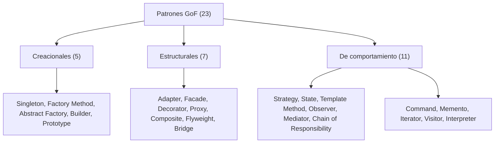
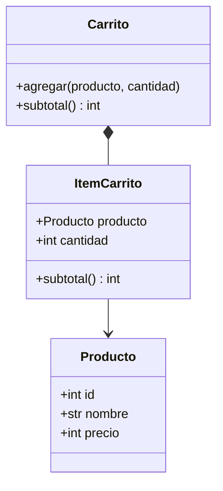

# Introducción y repaso de OOP

Este curso te prepara para responder preguntas de entrevista sobre buenas prácticas, los principios SOLID y los 23 patrones de diseño clásicos. Todo se explica con el mismo ejemplo, una tienda online, y con código en Python, TypeScript, Go y PHP. Antes de empezar conviene tener claro qué es un patrón y repasar los conceptos de orientación a objetos sobre los que se apoyan todos.

## Qué es un patrón de diseño y de dónde viene

Un **patrón de diseño** (solución reutilizable a un problema que aparece una y otra vez al diseñar software; [glosario](../glosario.md#patrón-de-diseño)) es como una receta de cocina: te dice qué ingredientes combinar y en qué orden, pero no te entrega el plato listo. Cada vez que la usas, la adaptas a tu cocina.

Por eso un patrón **no es código que se copia y se pega**. Es una idea con nombre, una estructura de clases y una explicación de cuándo conviene. El nombre importa tanto como la estructura: decir "aquí usamos un Observer" le transmite a otra persona un diseño completo en dos palabras.

Los patrones del curso vienen del libro *Design Patterns: Elements of Reusable Object-Oriented Software* (1994), escrito por Erich Gamma, Richard Helm, Ralph Johnson y John Vlissides. Se los conoce como la **Banda de los Cuatro** (en inglés, *Gang of Four*, de ahí la sigla **GoF**). El libro catalogó 23 patrones y los ordenó en tres familias:

- **Creacionales:** resuelven cómo se crean los objetos sin atar el código a clases concretas.
- **Estructurales:** resuelven cómo se combinan clases y objetos para formar estructuras más grandes.
- **De comportamiento:** resuelven cómo se reparten responsabilidades y cómo se comunican los objetos entre sí.



**Cuándo no sirven.** Un patrón añade clases e indirección. Si el problema que resuelve no existe en tu código, solo estás pagando complejidad a cambio de nada. Aplicar patrones "por si acaso" es un antipatrón tan común como no conocerlos. La regla práctica: primero siente el dolor (código duplicado, cambios que rompen todo), después busca el patrón que lo alivia.

## Cómo usar este curso

**Orden de lectura.** Los módulos están numerados y conviene seguirlos en orden: primero buenas prácticas y los cinco principios SOLID (módulos 01 a 06), luego los patrones creacionales, estructurales y de comportamiento. Los patrones se explican con los principios SOLID, así que ese orden evita saltos.

**Estructura de cada módulo.** Los módulos de patrones repiten el mismo esquema: *El problema* (código que duele), *La idea en pocas palabras* (analogía y solución), *Diagrama*, *Código* en los cuatro lenguajes, *Cuándo usarlo y cuándo no* y *Preguntas de entrevista* con respuestas que puedes decir en voz alta en 2 a 4 frases.

**La tienda online.** Todos los ejemplos usan el mismo dominio: `Producto`, `ItemCarrito`, `Carrito`, `Cliente`, `Pedido`, `MetodoPago`, `ReglaDescuento`, `Notificador` y `PedidoRepository`. Los precios son pesos chilenos como entero, sin decimales (`12990`). Como los nombres no cambian, puedes concentrarte en el patrón y no en entender un dominio nuevo cada vez. Si algún patrón no encaja bien con una tienda, el módulo lo avisa y justifica el cambio.

**Cómo leer los diagramas.** Los diagramas de clases usan **UML** (lenguaje gráfico estándar para dibujar la estructura del software; [glosario](../glosario.md#uml)) escrito en Mermaid. Estos son los símbolos que verás:

| Símbolo | Significa | Ejemplo |
|---|---|---|
| `A <\|-- B` | Herencia o implementación: B es un tipo de A | `MetodoPago <\|-- PagoTarjeta` |
| `A *-- B` | Composición: A contiene a B y B no vive sin A | `Carrito *-- ItemCarrito` |
| `A o-- B` | Agregación: A contiene a B, pero B existe por su cuenta | `Catalogo o-- Producto` |
| `A --> B` | Asociación: A guarda una referencia a B | `ItemCarrito --> Producto` |
| `A ..> B` | Dependencia: A usa a B de forma pasajera | `Carrito ..> ReglaDescuento` |
| `<<interface>>` | Marca un contrato sin implementación | `<<interface>> MetodoPago` |

Este es el primer diagrama del curso, el de las clases que escribirás en seguida:



Un `Carrito` está compuesto por líneas (`ItemCarrito`), y cada línea apunta a un `Producto` del catálogo.

## Repaso de OOP en 4 lenguajes

Los patrones de diseño son combinaciones de unas pocas ideas de la **programación orientada a objetos** (OOP). Repasémoslas una por una.

### Clase y objeto

Una **clase** (molde que define los datos y el comportamiento de un tipo de objeto; [glosario](../glosario.md#clase)) es el plano de una casa. Un **objeto** es una casa construida con ese plano: tiene sus propios valores, pero comparte la estructura. `Producto` es la clase; "zapatillas a 12990" es un objeto.

### Encapsulamiento

El **encapsulamiento** (ocultar el estado interno de un objeto y exponer solo operaciones controladas; [glosario](../glosario.md#encapsulamiento)) funciona como el cajero de un banco: no entras a la bóveda, pides una operación y el cajero verifica que sea válida. En `Carrito`, la lista de líneas es privada; solo se modifica con `agregar`, que puede validar que la cantidad sea positiva. Si mañana la lista pasa a ser una base de datos, quien usa el carrito no se entera.

### Herencia

La **herencia** (una clase reutiliza y extiende a otra, formando una relación "es un"; [glosario](../glosario.md#herencia)) permite que `PagoTarjeta` sea un tipo de `MetodoPago` y reutilice su comportamiento común. Es potente pero rígida: el hijo queda atado al padre y un cambio en el padre puede romper a todos los hijos.

### Composición

La **composición** (un objeto se arma con otros objetos y les delega trabajo, formando una relación "tiene un"; [glosario](../glosario.md#composición)) es como armar un computador con piezas: la placa madre no "es" una tarjeta de video, la "tiene". Un `Carrito` tiene líneas, y una línea tiene un producto. Puedes cambiar una pieza sin tocar las demás.

```python
class Notificador:
    def notificar(self, destinatario: str, mensaje: str) -> None: ...


# Herencia: PedidoConCorreo ES un Notificador y queda atado a él.
class PedidoConCorreo(Notificador):
    def confirmar(self) -> None:
        self.notificar("ana@correo.cl", "Pedido confirmado")


# Composición: Pedido TIENE un notificador y puede cambiarlo.
class Pedido:
    def __init__(self, notificador: Notificador) -> None:
        self._notificador = notificador

    def confirmar(self) -> None:
        self._notificador.notificar("ana@correo.cl", "Pedido confirmado")
```

La regla que repetirás en entrevistas: **prefiere composición sobre herencia**, y usa herencia solo cuando de verdad exista una relación "es un" estable.

### Interfaz y polimorfismo

Una **interfaz** (contrato que lista las operaciones que un tipo promete ofrecer, sin decir cómo; [glosario](../glosario.md#interfaz)) es como el enchufe de una pared: no le importa si conectas una lámpara o un cargador, solo exige que tengan la forma correcta. El **polimorfismo** (que un mismo mensaje produzca comportamientos distintos según el objeto que lo recibe; [glosario](../glosario.md#polimorfismo)) es lo que permite conectar cualquier aparato al mismo enchufe.

```python
from typing import Protocol


class MetodoPago(Protocol):
    def pagar(self, monto: int) -> str: ...


class PagoTarjeta:
    def pagar(self, monto: int) -> str:
        return f"Tarjeta: {monto}"


class PagoTransferencia:
    def pagar(self, monto: int) -> str:
        return f"Transferencia: {monto}"


def cobrar(metodo: MetodoPago, monto: int) -> str:
    return metodo.pagar(monto)  # no sabe qué método recibe


print(cobrar(PagoTarjeta(), 25980))        # => Tarjeta: 25980
print(cobrar(PagoTransferencia(), 25980))  # => Transferencia: 25980
```

`cobrar` funciona con cualquier método de pago, presente o futuro, sin cambiar una línea. Casi todos los patrones del curso se reducen a este truco.

### Comparación entre lenguajes

Los cuatro lenguajes tienen estas ideas, pero las expresan distinto:

| Aspecto | Python | TypeScript | Go | PHP |
|---|---|---|---|---|
| Interfaz | `Protocol` (estructural) o `ABC` (explícita) | `interface` | `interface`, se cumple de forma implícita | `interface`, se declara con `implements` |
| Herencia | Simple y múltiple | Simple (`extends`) | No existe; se usa composición por embedding | Simple (`extends`) |
| Visibilidad | Convención `_x` (no se impone) | `private`, `protected`, `public` | Mayúscula exporta, minúscula es privada al paquete | `private`, `protected`, `public` |
| Clase | `class` + `@dataclass` | `class` | `struct` + métodos | `class` |

### La tienda en 4 lenguajes

Cada bloque define `Producto`, `ItemCarrito` y `Carrito` con `agregar` y `subtotal`, y calcula el subtotal de 2 unidades de un producto de 12990.

#### Python

```python
from dataclasses import dataclass


@dataclass(frozen=True)
class Producto:
    id: int
    nombre: str
    precio: int


@dataclass
class ItemCarrito:
    producto: Producto
    cantidad: int

    def subtotal(self) -> int:
        return self.producto.precio * self.cantidad


class Carrito:
    def __init__(self) -> None:
        self._items: list[ItemCarrito] = []

    def agregar(self, producto: Producto, cantidad: int) -> None:
        self._items.append(ItemCarrito(producto, cantidad))

    def subtotal(self) -> int:
        return sum(item.subtotal() for item in self._items)


carrito = Carrito()
carrito.agregar(Producto(1, "Zapatillas", 12990), 2)
print(f"Subtotal: {carrito.subtotal()}")  # => Subtotal: 25980
```

#### TypeScript

```typescript
interface Producto {
  id: number;
  nombre: string;
  precio: number;
}

class ItemCarrito {
  constructor(readonly producto: Producto, readonly cantidad: number) {}

  subtotal(): number {
    return this.producto.precio * this.cantidad;
  }
}

class Carrito {
  private items: ItemCarrito[] = [];

  agregar(producto: Producto, cantidad: number): void {
    this.items.push(new ItemCarrito(producto, cantidad));
  }

  subtotal(): number {
    return this.items.reduce((suma, item) => suma + item.subtotal(), 0);
  }
}

const carrito = new Carrito();
carrito.agregar({ id: 1, nombre: "Zapatillas", precio: 12990 }, 2);
console.log(`Subtotal: ${carrito.subtotal()}`); // => Subtotal: 25980
```

#### Go

```go
package main

import "fmt"

type Producto struct {
	ID     int
	Nombre string
	Precio int
}

type ItemCarrito struct {
	Producto Producto
	Cantidad int
}

func (i ItemCarrito) Subtotal() int {
	return i.Producto.Precio * i.Cantidad
}

type Carrito struct {
	items []ItemCarrito // minúscula: privado al paquete
}

func (c *Carrito) Agregar(producto Producto, cantidad int) {
	c.items = append(c.items, ItemCarrito{producto, cantidad})
}

func (c *Carrito) Subtotal() int {
	total := 0
	for _, item := range c.items {
		total += item.Subtotal()
	}
	return total
}

func main() {
	carrito := &Carrito{}
	carrito.Agregar(Producto{1, "Zapatillas", 12990}, 2)
	fmt.Printf("Subtotal: %d\n", carrito.Subtotal()) // => Subtotal: 25980
}
```

> **Nota Go:** Go no tiene clases ni herencia. Un `struct` con métodos cumple el papel de la clase, y la reutilización se logra con composición (un struct dentro de otro). Los bloques de Go de un módulo (o de un patrón) forman un solo `main.go` lógico: el primero abre con `package main` y el `import`, y los demás no los repiten.

#### PHP

```php
<?php

final class Producto
{
    public function __construct(
        public readonly int $id,
        public readonly string $nombre,
        public readonly int $precio,
    ) {}
}

final class ItemCarrito
{
    public function __construct(
        public readonly Producto $producto,
        public readonly int $cantidad,
    ) {}

    public function subtotal(): int
    {
        return $this->producto->precio * $this->cantidad;
    }
}
```

```php
<?php

final class Carrito
{
    /** @var ItemCarrito[] */
    private array $items = [];

    public function agregar(Producto $producto, int $cantidad): void
    {
        $this->items[] = new ItemCarrito($producto, $cantidad);
    }

    public function subtotal(): int
    {
        return array_sum(array_map(fn (ItemCarrito $i) => $i->subtotal(), $this->items));
    }
}

$carrito = new Carrito();
$carrito->agregar(new Producto(1, "Zapatillas", 12990), 2);
echo "Subtotal: {$carrito->subtotal()}\n"; // => Subtotal: 25980
```

## Preguntas de entrevista

**P1. ¿Qué es un patrón de diseño y qué no es?**
Es una solución reutilizable y con nombre a un problema de diseño que se repite, descrita como una estructura de clases y una explicación de cuándo aplicarla. No es código para copiar y pegar, ni una librería, ni un objetivo en sí mismo: se adapta a cada caso y solo se usa cuando el problema existe de verdad.

**P2. Herencia vs composición: ¿cuál prefieres y por qué?**
Prefiero composición. La herencia ata al hijo con el padre, y un cambio en el padre puede romper a todos los hijos; además, solo permite una jerarquía fija. Con composición el objeto delega en otros que puedes reemplazar, incluso en tiempo de ejecución. Uso herencia solo cuando hay una relación "es un" estable y real.

**P3. ¿Interfaz o clase abstracta?**
La interfaz define solo un contrato, sin estado ni código, y una clase puede cumplir varias. La clase abstracta puede traer estado y comportamiento compartido, pero solo se hereda una. Uso interfaz por defecto para separar contratos; elijo clase abstracta cuando varias subclases comparten código real que no quiero repetir.

**P4. ¿Qué es el polimorfismo y qué ventaja da?**
Es que el mismo mensaje produzca comportamientos distintos según el objeto que lo recibe. Por ejemplo, `cobrar` llama a `pagar` sin saber si el método es tarjeta o transferencia. La ventaja es que agregas comportamientos nuevos sin modificar el código que los usa, y eso reduce los `if` y facilita las pruebas.
