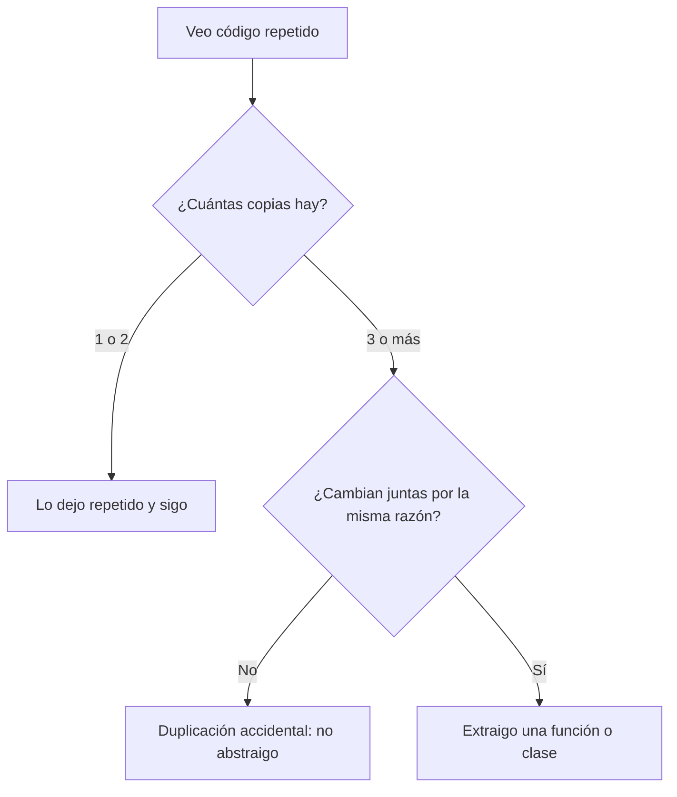

# Buenas prácticas de desarrollo

Antes de los patrones y de SOLID conviene dominar un puñado de hábitos que hacen que el código sea fácil de leer y de cambiar. Casi toda pregunta de entrevista sobre diseño termina apoyándose en ellos. Cada práctica se explica con la misma estructura: qué es, un ejemplo "antes y después" con la tienda y cuándo **no** aplicarla. Si necesitas repasar las ideas de OOP que se usan aquí, están en el [módulo 00](00-introduccion.md).

Dos palabras aparecen en todo el módulo. El **acoplamiento** (qué tanto depende un módulo de otro; [glosario](../glosario.md#acoplamiento)) conviene que sea bajo: si cambias una pieza, las demás no se rompen. La **cohesión** (qué tanto trabajan en lo mismo las partes de un módulo; [glosario](../glosario.md#cohesión)) conviene que sea alta: una clase o función hace una cosa bien definida. Casi todas las prácticas siguientes son formas de bajar el acoplamiento o de subir la cohesión.

## DRY: no repitas conocimiento

**DRY** (*Don't Repeat Yourself*, "no te repitas": cada pieza de conocimiento debe vivir en un solo lugar; [glosario](../glosario.md#dry)) funciona como la receta familiar anotada en un solo cuaderno. Si cada primo copia la receta en su propia libreta y un día cambia la cantidad de sal, nadie sabe cuál versión es la correcta.

**Antes.** El IVA de 19 % está copiado en tres lugares de la tienda. Cuando la tasa cambie, habrá que acordarse de los tres (ejemplo solo en Python; es una idea breve):

```python
def total_carrito(subtotal: int) -> int:
    return subtotal + subtotal * 19 // 100


def total_pedido(subtotal: int, envio: int) -> int:
    return subtotal + subtotal * 19 // 100 + envio


def precio_con_iva(precio: int) -> int:
    return precio + precio * 19 // 100


print(total_carrito(10000))  # => 11900
```

**Después.** El conocimiento "cómo se calcula el IVA" vive en una sola función:

```python
IVA_PORCENTAJE = 19


def con_iva(monto: int) -> int:
    return monto + monto * IVA_PORCENTAJE // 100


def total_carrito(subtotal: int) -> int:
    return con_iva(subtotal)


def total_pedido(subtotal: int, envio: int) -> int:
    return con_iva(subtotal) + envio


print(total_pedido(10000, 3000))  # => 14900
```

**Cuándo no aplicarlo.** DRY trata de duplicar *conocimiento*, no de que dos trozos de texto se parezcan. Hay dos tipos de parecido:

- **Duplicación real:** si la regla cambia, ambos lugares deben cambiar juntos (el IVA). Se unifica.
- **Duplicación accidental:** dos trozos se ven iguales hoy, pero responden a razones distintas y cambiarán por separado (por ejemplo, el despacho de un pedido y el de una devolución, que hoy suman lo mismo). Unirlos crea un acoplamiento falso.

Para decidir existe la **regla de tres** (la primera vez lo escribes, la segunda lo toleras, la tercera lo abstraes; [glosario](../glosario.md#regla-de-tres)): con dos copias aún no sabes qué es común de verdad; con tres, el patrón ya se ve.



## KISS: la solución más simple que funcione

**KISS** (*Keep It Simple, Stupid*, "mantenlo simple": prefiere el diseño más sencillo que resuelva el problema; [glosario](../glosario.md#kiss)) se parece a elegir un destornillador para apretar un tornillo. Una navaja suiza con 30 herramientas también lo aprieta, pero es más difícil de usar y de reparar.

**Antes** (solo Python): una descripción de pedido armada con trucos que obligan a descifrarla.

```python
def etiqueta(items: list[tuple[str, int]]) -> str:
    return ", ".join(map(lambda t: f"{t[0]} x{t[1]}", filter(lambda t: t[1] > 0, items)))


print(etiqueta([("Zapatillas", 2), ("Calcetas", 0)]))  # => Zapatillas x2
```

**Después:** un bucle claro que cualquiera lee de arriba hacia abajo.

```python
def etiqueta(items: list[tuple[str, int]]) -> str:
    partes = []
    for nombre, cantidad in items:
        if cantidad > 0:
            partes.append(f"{nombre} x{cantidad}")
    return ", ".join(partes)


print(etiqueta([("Zapatillas", 2), ("Calcetas", 0)]))  # => Zapatillas x2
```

**Cuándo no aplicarlo.** Simple no significa simplista. Si el problema es complejo (concurrencia, dinero, seguridad), la solución simple es la más pequeña que lo resuelve **bien**, no la que ignora los casos difíciles. Y una versión más corta no siempre es más simple: lo que cuenta es cuánto cuesta entenderla.

## YAGNI: no construyas lo que nadie pidió

**YAGNI** (*You Aren't Gonna Need It*, "no lo vas a necesitar": no implementes funcionalidad hasta que haga falta de verdad; [glosario](../glosario.md#yagni)) es como comprar un taladro industrial para colgar un cuadro. Ocupa espacio, cuesta dinero y probablemente nunca lo uses otra vez.

**Antes** (solo Python): piden un descuento del 10 % para clientes frecuentes y alguien construye un "motor de reglas genérico", por si algún día hay más.

```python
class MotorDeReglas:
    def __init__(self) -> None:
        self.reglas: list = []

    def registrar(self, condicion, accion, prioridad: int = 0) -> None:
        self.reglas.append((prioridad, condicion, accion))

    def ejecutar(self, contexto: dict) -> dict:
        for _, condicion, accion in sorted(self.reglas, key=lambda r: r[0]):
            if condicion(contexto):
                contexto = accion(contexto)
        return contexto
```

**Después:** lo que se pidió, en tres líneas.

```python
def descuento_cliente_frecuente(subtotal: int) -> int:
    return subtotal * 10 // 100


print(descuento_cliente_frecuente(25000))  # => 2500
```

Si mañana aparece una segunda y una tercera regla de descuento, ahí sí hay motivo para abstraer (regla de tres). Más adelante, en el módulo de Strategy, se verá cómo hacerlo con un diseño ligero.

**Cuándo no aplicarlo.** YAGNI no es excusa para ignorar el diseño. Dejar el código limpio y bien separado es barato y no cuenta como "construir de más". Lo que no se debe hacer es agregar capacidades concretas (configuración, plugins, jerarquías) para un futuro que nadie ha confirmado. Tampoco aplica a decisiones muy caras de cambiar más tarde, como el formato de datos de una API pública.

## Nombres que dicen la intención

Un buen nombre es como la etiqueta de un frasco en la cocina: si dice "harina", no hace falta abrirlo para saber qué contiene. Un nombre debe responder qué es, para qué sirve y en qué unidad viene.

**Antes** (solo Python):

```python
def f(d, tmp, data2):
    if d > 30:
        return tmp * data2 // 100
    return 0


print(f(45, 25000, 10))  # => 2500
```

**Después:**

```python
def descuento_por_inactividad(dias_desde_ultima_compra: int, subtotal: int, porcentaje: int) -> int:
    if dias_desde_ultima_compra > 30:
        return subtotal * porcentaje // 100
    return 0


print(descuento_por_inactividad(45, 25000, 10))  # => 2500
```

Reglas prácticas: el nombre de una variable es un sustantivo (`subtotal`), el de una función es un verbo (`calcular_total`), el de un booleano suena a pregunta (`esta_pagado`) y no se abrevia lo que no es universal (`cant` no; `id` sí).

**Cuándo no aplicarlo.** Un nombre más largo no siempre es mejor. En un ámbito de dos líneas, `i` en un bucle o `p` en una lambda corta están bien. El nombre debe ser tan descriptivo como grande es el espacio donde vive.

## Funciones pequeñas y con un solo nivel de abstracción

Una función debe hacer una cosa y todas sus líneas deben estar al mismo nivel de detalle. Piensa en el índice de un libro: lista capítulos, no mezcla un capítulo con una frase suelta del párrafo 3 de otro. Una función larga mezcla "qué hay que hacer" (alto nivel) con "cómo se hace" (bajo nivel), y obliga a leerla entera para entenderla.

**Antes** (solo Python): la función valida, calcula y formatea, todo mezclado.

```python
def procesar(items: list[tuple[int, int]]) -> str:
    total = 0
    for precio, cantidad in items:
        if cantidad <= 0:
            raise ValueError("cantidad inválida")
        total += precio * cantidad
    total = total + total * 19 // 100
    return "Total: " + str(total)


print(procesar([(12500, 2)]))  # => Total: 29750
```

**Después:** la función principal se lee como una lista de pasos, y cada paso vive en su propia función.

```python
def validar(items: list[tuple[int, int]]) -> None:
    for _, cantidad in items:
        if cantidad <= 0:
            raise ValueError("cantidad inválida")


def sumar(items: list[tuple[int, int]]) -> int:
    return sum(precio * cantidad for precio, cantidad in items)


def procesar(items: list[tuple[int, int]]) -> str:
    validar(items)
    total = sumar(items)
    return f"Total: {total + total * 19 // 100}"


print(procesar([(12500, 2)]))  # => Total: 29750
```

**Cuándo no aplicarlo.** Partir una función en veinte funciones de dos líneas, que se llaman entre sí y obligan a saltar por todo el archivo, también daña la lectura. El criterio no es el número de líneas sino si puedes darle a la función un nombre honesto que describa todo lo que hace.

## Composición sobre herencia

Esta práctica se vio en el [módulo 00](00-introduccion.md): una relación "tiene un" es más flexible que una relación "es un". La herencia ata al hijo con el padre, mientras que la composición permite cambiar piezas sin tocar el resto.

**Antes** (solo Python): para enviar pedidos por correo y por SMS se crean subclases, y si luego hay que combinar ambos canales, la jerarquía se multiplica.

```python
class Pedido:
    def confirmar(self) -> str:
        return "confirmado"


class PedidoConCorreo(Pedido):
    def confirmar(self) -> str:
        return super().confirmar() + " + correo"


print(PedidoConCorreo().confirmar())  # => confirmado + correo
```

**Después:** el pedido recibe un notificador y delega.

```python
from typing import Protocol


class Notificador(Protocol):
    def notificar(self, destinatario: str, mensaje: str) -> str: ...


class Correo:
    def notificar(self, destinatario: str, mensaje: str) -> str:
        return f"correo a {destinatario}: {mensaje}"


class Pedido:
    def __init__(self, notificador: Notificador) -> None:
        self._notificador = notificador

    def confirmar(self) -> str:
        return self._notificador.notificar("ana@correo.cl", "confirmado")


print(Pedido(Correo()).confirmar())  # => correo a ana@correo.cl: confirmado
```

**Cuándo no aplicarlo.** Cuando existe una relación "es un" real, estable y sin sorpresas (un `Error` específico que extiende al `Error` base del lenguaje), la herencia es correcta y más corta. Evita sobre todo las jerarquías profundas que se heredan solo para reutilizar código.

## Ley de Demeter: habla solo con tus amigos cercanos

La **ley de Demeter** (un objeto solo debe hablar con sus vecinos inmediatos, no con los vecinos de sus vecinos; [glosario](../glosario.md#ley-de-demeter)) tiene su analogía en la tienda de la esquina: le pides al cajero "una bolsa de pan", no le explicas cómo abrir la bodega, sacar la caja del tercer estante y contar las unidades. Si el cliente conoce la cadena de objetos interna, un cambio en cualquier eslabón rompe todo.

**Antes** (solo Python): quien necesita la región de despacho recorre toda la cadena.

```python
from dataclasses import dataclass


@dataclass
class Region:
    nombre: str


@dataclass
class Comuna:
    region: Region


@dataclass
class Direccion:
    comuna: Comuna


@dataclass
class Cliente:  # simplificado: sin id, nombre ni email
    direccion: Direccion


@dataclass
class Pedido:  # simplificado: sin id, items ni estado
    cliente: Cliente


pedido = Pedido(Cliente(Direccion(Comuna(Region("Valparaíso")))))
print(pedido.cliente.direccion.comuna.region.nombre)  # => Valparaíso
```

**Después:** el pedido expone lo que los demás necesitan y esconde la cadena (las demás clases no cambian, se repiten para que el bloque se ejecute solo):

```python
from dataclasses import dataclass


@dataclass
class Region:
    nombre: str


@dataclass
class Comuna:
    region: Region


@dataclass
class Direccion:
    comuna: Comuna


@dataclass
class Cliente:  # simplificado: sin id, nombre ni email
    direccion: Direccion


@dataclass
class Pedido:  # simplificado: sin id, items ni estado
    cliente: Cliente

    def region_despacho(self) -> str:
        return self.cliente.direccion.comuna.region.nombre


pedido = Pedido(Cliente(Direccion(Comuna(Region("Valparaíso")))))
print(pedido.region_despacho())  # => Valparaíso
```

**Cuándo no aplicarlo.** No hay que escribir un método de reenvío por cada atributo. La ley apunta a cadenas de comportamiento entre objetos de dominio; encadenar sobre estructuras de datos puras (`config.servidor.puerto`, `lista.filter().map()`) no es una violación, porque no hay lógica oculta. Una fachada que crece a cientos de métodos de reenvío es el síntoma opuesto.

## Manejo de errores

Un error se maneja como un incendio en la cocina: se avisa rápido y se apaga donde ocurre, no se esconde la sartén humeante debajo de la mesa. Tres reglas valen en todos los lenguajes:

- **Falla rápido:** valida al entrar (cantidad negativa, id inexistente) y detén la operación con un error claro, en lugar de arrastrar un dato roto por diez funciones.
- **No te tragues errores:** un `except: pass` o un `catch {}` vacío convierte un fallo visible en un fallo silencioso.
- **El mensaje cuenta qué pasó y con qué dato:** `"producto 99 no existe"` ayuda; `"error"` no.

Cómo se *señala* un error cambia según el lenguaje. Python, TypeScript y PHP usan **excepciones**, que interrumpen el flujo y suben por la pila hasta que alguien las captura. Go usa el **error como valor**: la función devuelve el error junto al resultado y quien llama lo revisa de forma explícita.

**Excepciones (Python):**

```python
class ProductoNoExiste(Exception):
    pass


def obtener_producto(catalogo: dict[int, str], id: int) -> str:
    if id not in catalogo:
        raise ProductoNoExiste(f"producto {id} no existe")
    return catalogo[id]


try:
    obtener_producto({1: "Zapatillas"}, 99)
except ProductoNoExiste as error:
    print(error)  # => producto 99 no existe
```

**Error como valor (Go):**

```go
package main

import "fmt"

func ObtenerProducto(catalogo map[int]string, id int) (string, error) {
	nombre, existe := catalogo[id]
	if !existe {
		return "", fmt.Errorf("producto %d no existe", id)
	}
	return nombre, nil
}

func main() {
	if _, err := ObtenerProducto(map[int]string{1: "Zapatillas"}, 99); err != nil {
		fmt.Println(err) // => producto 99 no existe
	}
}
```

> **Nota Go:** en Go no existen las excepciones para el flujo normal; el patrón `if err != nil` es la forma idiomática y hace visible cada punto donde algo puede fallar. TypeScript y PHP funcionan como Python: `throw`/`catch`.

**Cuándo no aplicarlo.** No uses excepciones para el flujo normal ("no se encontró" en una búsqueda es un resultado esperado, no una excepción: devuelve `None`, `null` o un valor vacío). Y capturar `Exception` muy arriba solo para registrar y seguir suele ocultar defectos.

## Code smells

Un **code smell** (señal en el código de que probablemente hay un problema de diseño, aunque el programa funcione; [glosario](../glosario.md#code-smell)) es como el olor a humedad en una casa: no te dice exactamente dónde está la filtración, pero te avisa que conviene mirar. No es un error, es una invitación a revisar.

| Smell | Síntoma | Remedio |
|---|---|---|
| **Long method** (método largo) | Una función de 80 líneas que valida, calcula, guarda y notifica | Extraer funciones con nombre propio, una por paso |
| **Feature envy** (envidia de atributos) | Un método usa más datos de otro objeto que del propio (`pedido.cliente.x`, `pedido.cliente.y`...) | Mover el método al objeto cuyos datos usa |
| **Primitive obsession** (obsesión por primitivos) | Un correo, un RUT o un monto se pasan como `str`/`int` sueltos y se validan en cada lugar | Crear un tipo propio (`Email`, `Monto`) que se valide al construirse |
| **Magic number** (número mágico; valor literal sin nombre que nadie sabe de dónde sale; [glosario](../glosario.md#magic-number)) | `if dias > 30`, `total * 19 // 100` | Una constante con nombre (`DIAS_INACTIVIDAD`, `IVA_PORCENTAJE`) |
| **Shotgun surgery** (cirugía de escopeta) | Un cambio pequeño obliga a editar diez archivos | Reunir en un solo lugar lo que cambia por la misma razón |

## Ejemplo central: `calcular_total` en 4 lenguajes

Se junta todo en una función: calcula el total de un pedido con descuento e IVA de 19 %. Primero, la versión "mala" (solo Python), en la que cuesta ver qué se calcula:

```python
def ct(s, d):
    # s: subtotal, d: descuento
    t = s - d
    if t > 0:
        t = t + t * 19 // 100  # IVA
    else:
        t = 0
    print("Total: " + str(t))
    return t


ct(25000, 5000)  # => Total: 23800
```

Duele por varias razones: nombres crípticos (`ct`, `s`, `d`, `t`), el número mágico `19` escrito dentro del cálculo, una sola función que calcula *y* imprime, y un comentario que compensa un nombre que no dice nada.

La versión limpia usa constantes con nombre, funciones pequeñas con un solo nivel de abstracción y deja la impresión fuera. El IVA se aplica **sobre lo descontado**: 25000 − 5000 = 20000, IVA = 20000 × 19 / 100 = 3800, total = 23800.

### Python

```python
IVA_PORCENTAJE = 19


def aplicar_descuento(subtotal: int, descuento: int) -> int:
    return max(subtotal - descuento, 0)


def aplicar_iva(base: int) -> int:
    return base + base * IVA_PORCENTAJE // 100


def calcular_total(subtotal: int, descuento: int) -> int:
    return aplicar_iva(aplicar_descuento(subtotal, descuento))


print(f"Total: {calcular_total(25000, 5000)}")  # => Total: 23800
```

### TypeScript

```typescript
const IVA_PORCENTAJE = 19;

function aplicarDescuento(subtotal: number, descuento: number): number {
  return Math.max(subtotal - descuento, 0);
}

function aplicarIva(base: number): number {
  return base + Math.floor((base * IVA_PORCENTAJE) / 100);
}

function calcularTotal(subtotal: number, descuento: number): number {
  return aplicarIva(aplicarDescuento(subtotal, descuento));
}

console.log(`Total: ${calcularTotal(25000, 5000)}`); // => Total: 23800
```

### Go

```go
package main

import "fmt"

const ivaPorcentaje = 19

func aplicarDescuento(subtotal, descuento int) int {
	return max(subtotal-descuento, 0)
}

func aplicarIva(base int) int {
	return base + base*ivaPorcentaje/100
}

func CalcularTotal(subtotal, descuento int) int {
	return aplicarIva(aplicarDescuento(subtotal, descuento))
}

func main() {
	fmt.Printf("Total: %d\n", CalcularTotal(25000, 5000)) // => Total: 23800
}
```

> **Nota Go:** `max` es una función incorporada desde Go 1.21, por eso no hay que importar nada para ella. Las funciones con minúscula (`aplicarIva`) son privadas al paquete y la que se expone empieza con mayúscula (`CalcularTotal`).

### PHP

```php
<?php

const IVA_PORCENTAJE = 19;

function aplicarDescuento(int $subtotal, int $descuento): int
{
    return max($subtotal - $descuento, 0);
}

function aplicarIva(int $base): int
{
    return $base + intdiv($base * IVA_PORCENTAJE, 100);
}

function calcularTotal(int $subtotal, int $descuento): int
{
    return aplicarIva(aplicarDescuento($subtotal, $descuento));
}

echo "Total: " . calcularTotal(25000, 5000) . "\n"; // => Total: 23800
```

Las cuatro versiones son idénticas en estructura: una constante con nombre, dos funciones pequeñas de un solo paso y una que las compone. Si el IVA cambia, se edita una línea.

## Preguntas de entrevista

**P1. ¿DRY significa nunca repetir código?**
No. DRY dice que cada pieza de *conocimiento* (una regla de negocio, una fórmula) debe vivir en un solo lugar. Dos trozos de código parecidos que cambian por razones distintas son duplicación accidental, y unirlos crea un acoplamiento falso. Me apoyo en la regla de tres: abstraigo cuando veo la tercera copia y sé que cambian juntas.

**P2. ¿Cuál es la diferencia entre KISS y YAGNI?**
KISS trata de *cómo* resuelves algo: elegir el diseño más simple que funcione. YAGNI trata de *qué* construyes: no implementar nada que nadie haya pedido todavía. Se complementan: con YAGNI haces menos cosas y con KISS haces cada una de la forma más sencilla. Ninguna significa descuidar la calidad del código.

**P3. ¿Qué dice la ley de Demeter y qué problema evita?**
Dice que un objeto solo debe hablar con sus vecinos directos, no con los objetos de sus vecinos: `pedido.region_despacho()` en lugar de `pedido.cliente.direccion.comuna.region`. Evita que quien llama conozca la estructura interna, de modo que si esa estructura cambia, solo se edita un lugar y no veinte. Reduce el acoplamiento.

**P4. Excepciones vs error como valor: ¿cuándo uso cada uno?**
Las excepciones (Python, TypeScript, PHP) mantienen limpio el camino feliz y suben hasta quien sabe qué hacer, pero el flujo de error queda invisible. El error como valor (Go) obliga a revisar cada llamada y deja explícito dónde se puede fallar, a costa de más código repetitivo. Uso cada uno según el lenguaje y reservo ambos para situaciones realmente excepcionales, no para resultados esperados como "no encontrado".

**P5. Nombra tres code smells y cómo los corriges.**
Long method: lo divido en funciones con nombre propio, una por paso. Magic number: lo reemplazo por una constante con nombre, como `IVA_PORCENTAJE`. Feature envy: si un método usa más datos de otro objeto que del propio, lo muevo a ese objeto. Un smell no es un error; es una señal para revisar.

**P6. ¿Cómo decides cuándo una función es demasiado larga?**
No cuento líneas; miro si hace más de una cosa o mezcla niveles de abstracción, por ejemplo validar, calcular y formatear juntos. Una prueba útil: si no puedo darle un nombre que describa todo lo que hace sin usar "y", hay que dividirla. También si necesito comentarios para separar secciones dentro de ella.
