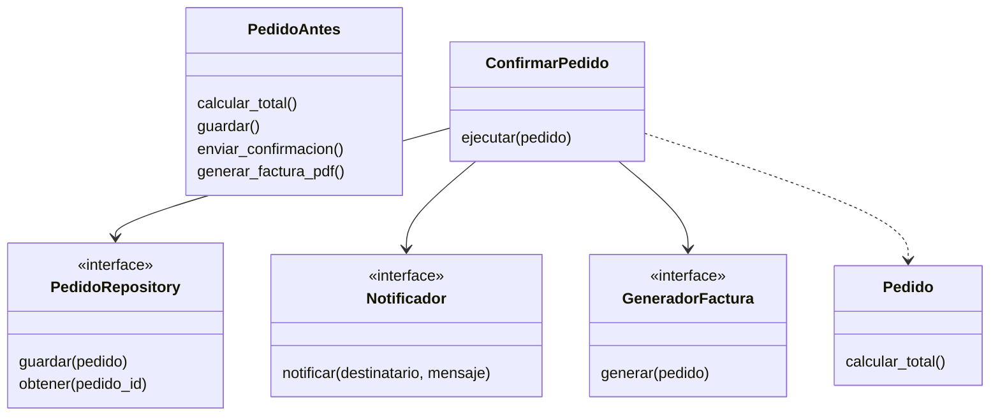

# SRP: Responsabilidad única

El **principio de responsabilidad única** (*Single Responsibility Principle*, SRP: un módulo debe tener una, y solo una, razón para cambiar; [glosario](../glosario.md#srp)) es la "S" de **SOLID** (cinco principios de diseño orientado a objetos que ayudan a escribir código fácil de cambiar; [glosario](../glosario.md#solid)). En lenguaje simple: cada clase responde ante una sola cosa que puede cambiar en el negocio, así que cuando esa cosa cambia, tocas una clase y no cuatro. Si necesitas repasar los hábitos previos (cohesión, nombres, funciones pequeñas), están en el [módulo 01](01-buenas-practicas.md).

## La violación

En la tienda, el equipo empezó con una clase `Pedido` "práctica": como ya tiene los datos, también calcula el total, se guarda en la base de datos, envía el correo de confirmación y arma la factura. Funciona, y por eso nadie la cuestiona hasta que llega el primer cambio.

```python
import sqlite3
import smtplib
from dataclasses import dataclass
from email.message import EmailMessage

IVA_PORCENTAJE = 19


@dataclass
class Pedido:  # simplificado: items como (nombre, precio, cantidad) y solo el email del cliente
    id: int
    email_cliente: str
    items: list[tuple[str, int, int]]
    estado: str = "nuevo"

    def calcular_total(self) -> int:  # cambia cuando varía el IVA o los descuentos
        subtotal = sum(precio * cantidad for _, precio, cantidad in self.items)
        return subtotal + subtotal * IVA_PORCENTAJE // 100

    def guardar(self) -> None:  # cambia cuando cambia la base de datos
        db = sqlite3.connect("tienda.db")
        db.execute("INSERT INTO pedidos (id, total, estado) VALUES (?, ?, ?)",
                   (self.id, self.calcular_total(), self.estado))
        db.commit()

    def enviar_confirmacion(self) -> None:  # cambia cuando cambia el proveedor de correo
        correo = EmailMessage()
        correo["To"] = self.email_cliente
        correo.set_content(f"Pedido {self.id} confirmado")
        with smtplib.SMTP("smtp.tienda.cl") as servidor:
            servidor.send_message(correo)

    def generar_factura_pdf(self) -> bytes:  # cambia cuando cambia el formato de la factura
        lineas = [f"Factura pedido {self.id}"]
        lineas += [f"{nombre} x{cantidad}: {precio * cantidad}" for nombre, precio, cantidad in self.items]
        lineas.append(f"Total: {self.calcular_total()}")
        return "\n".join(lineas).encode()  # en la vida real, una librería de PDF
```

Esta clase duele de verdad. Para probar `calcular_total` hay que importar `sqlite3` y `smtplib`, y para probar el envío de correo hay que construir un pedido completo. Cuando contabilidad pide cambiar el formato de la factura, tocas la misma clase que se edita cuando el IVA varía, y un error de tipeo en la factura puede romper el cálculo del total. Además, dos personas que trabajan en cosas sin relación (una en el correo, otra en la base de datos) editan el mismo archivo y generan conflictos de merge. Esta clase es un **God Object** (una clase que lo sabe y lo hace todo; [glosario](../glosario.md#god-object)).

## La idea en pocas palabras

Imagina un restaurante donde una sola persona cocina, cobra en caja, lava los platos y reparte a domicilio. Si un día cambia el menú, el sistema de pago o la ruta de reparto, todo pasa por esa persona y cualquier cambio la desordena entera. En un restaurante sano cada rol lo cubre alguien distinto, y un cambio en el reparto no afecta a la cocina.

La clave es qué significa "una responsabilidad". No es "la clase hace una sola cosa" (casi todo se puede describir como una sola cosa si el nombre es vago), sino **una razón para cambiar** (el motivo, normalmente ligado a una persona o área del negocio, por el que hay que editar la clase; [glosario](../glosario.md#razón-para-cambiar)). Las cuatro tareas de `Pedido` cambian por razones distintas y con dueños distintos:

| Responsabilidad | Cambia cuando... | Quién lo pide |
|---|---|---|
| Calcular el total | varía el IVA o una regla de descuento | Finanzas |
| Persistir | se cambia de motor o de esquema de base de datos | Equipo de datos |
| Notificar | se cambia de proveedor de correo o se agrega SMS | Marketing / operaciones |
| Generar la factura | cambia el formato legal o de diseño | Contabilidad |

La solución es separar cada razón de cambio en su propia pieza: `Pedido` conserva los datos y el cálculo del total, `PedidoRepository` guarda, `Notificador` avisa, `GeneradorFactura` arma la factura. Una quinta pieza, el servicio `ConfirmarPedido`, solo orquesta el orden de los pasos.

## Diagrama



`PedidoAntes` es la clase de la sección anterior, con cuatro razones para cambiar. A la derecha, `Pedido` queda con una sola y `ConfirmarPedido` depende de tres interfaces.

## Código

Cada lenguaje se divide en bloques cortos: las entidades del dominio, los contratos, las implementaciones (en memoria, para que el ejemplo corra sin base de datos ni servidor de correo; en la tienda real serían SQL y SMTP) y el servicio con su uso. La suma es 23788: subtotal 12990 + 2 × 3500 = 19990, más IVA de 19 % (3798). Se simplifica el dominio respecto a la versión "mala": `Pedido` recibe un `Cliente` completo y `estado` es un texto.

### Python

```python
from dataclasses import dataclass
from typing import Protocol

IVA_PORCENTAJE = 19


@dataclass
class Producto:
    id: int
    nombre: str
    precio: int


@dataclass
class ItemCarrito:
    producto: Producto
    cantidad: int


@dataclass
class Cliente:
    id: int
    nombre: str
    email: str


@dataclass
class Pedido:
    id: int
    cliente: Cliente
    items: list[ItemCarrito]
    estado: str = "nuevo"

    def calcular_total(self) -> int:
        subtotal = sum(i.producto.precio * i.cantidad for i in self.items)
        return subtotal + subtotal * IVA_PORCENTAJE // 100
```

```python
class PedidoRepository(Protocol):
    def guardar(self, pedido: Pedido) -> None: ...
    def obtener(self, pedido_id: int) -> Pedido: ...


class Notificador(Protocol):
    def notificar(self, destinatario: str, mensaje: str) -> None: ...


class GeneradorFactura(Protocol):
    def generar(self, pedido: Pedido) -> str: ...
```

El parámetro se llama `pedido_id` y no `id` para no sombrear la función incorporada `id` de Python.

```python
class RepositorioMemoria:
    def __init__(self) -> None:
        self._pedidos: dict[int, Pedido] = {}

    def guardar(self, pedido: Pedido) -> None:
        self._pedidos[pedido.id] = pedido

    def obtener(self, pedido_id: int) -> Pedido:
        if pedido_id not in self._pedidos:
            raise KeyError(f"pedido {pedido_id} no existe")
        return self._pedidos[pedido_id]


class NotificadorMemoria:
    def __init__(self) -> None:
        self.enviados: list[str] = []

    def notificar(self, destinatario: str, mensaje: str) -> None:
        self.enviados.append(f"{destinatario} | {mensaje}")


class FacturaTexto:
    def generar(self, pedido: Pedido) -> str:
        return f"Factura {pedido.id} por {pedido.calcular_total()}"
```

```python
class ConfirmarPedido:
    def __init__(self, repo: PedidoRepository, notificador: Notificador,
                 facturas: GeneradorFactura) -> None:
        self._repo = repo
        self._notificador = notificador
        self._facturas = facturas

    def ejecutar(self, pedido: Pedido) -> str:
        pedido.estado = "confirmado"
        self._repo.guardar(pedido)
        factura = self._facturas.generar(pedido)
        mensaje = f"Pedido {pedido.id} confirmado. {factura}"
        self._notificador.notificar(pedido.cliente.email, mensaje)
        return f"Pedido {pedido.id} confirmado"


ana = Cliente(1, "Ana", "ana@correo.cl")
items = [ItemCarrito(Producto(10, "Zapatillas", 12990), 1),
         ItemCarrito(Producto(11, "Calcetas", 3500), 2)]
repo, correo = RepositorioMemoria(), NotificadorMemoria()
servicio = ConfirmarPedido(repo, correo, FacturaTexto())
print(servicio.ejecutar(Pedido(101, ana, items)))  # => Pedido 101 confirmado
print(repo.obtener(101).estado)  # => confirmado
print(correo.enviados[0])  # => ana@correo.cl | Pedido 101 confirmado. Factura 101 por 23788
```

### TypeScript

```typescript
const IVA_PORCENTAJE = 19;

interface Producto {
  id: number;
  nombre: string;
  precio: number;
}

interface ItemCarrito {
  producto: Producto;
  cantidad: number;
}

interface Cliente {
  id: number;
  nombre: string;
  email: string;
}

class Pedido {
  constructor(
    readonly id: number,
    readonly cliente: Cliente,
    readonly items: ItemCarrito[],
    public estado: string = "nuevo",
  ) {}

  calcularTotal(): number {
    const subtotal = this.items.reduce((suma, i) => suma + i.producto.precio * i.cantidad, 0);
    return subtotal + Math.floor((subtotal * IVA_PORCENTAJE) / 100);
  }
}
```

```typescript
interface PedidoRepository {
  guardar(pedido: Pedido): void;
  obtener(id: number): Pedido;
}

interface Notificador {
  notificar(destinatario: string, mensaje: string): void;
}

interface GeneradorFactura {
  generar(pedido: Pedido): string;
}
```

```typescript
class RepositorioMemoria implements PedidoRepository {
  private pedidos = new Map<number, Pedido>();

  guardar(pedido: Pedido): void {
    this.pedidos.set(pedido.id, pedido);
  }

  obtener(id: number): Pedido {
    const pedido = this.pedidos.get(id);
    if (pedido === undefined) {
      throw new Error(`pedido ${id} no existe`);
    }
    return pedido;
  }
}

class NotificadorMemoria implements Notificador {
  enviados: string[] = [];

  notificar(destinatario: string, mensaje: string): void {
    this.enviados.push(`${destinatario} | ${mensaje}`);
  }
}

class FacturaTexto implements GeneradorFactura {
  generar(pedido: Pedido): string {
    return `Factura ${pedido.id} por ${pedido.calcularTotal()}`;
  }
}
```

```typescript
class ConfirmarPedido {
  constructor(
    private repo: PedidoRepository,
    private notificador: Notificador,
    private facturas: GeneradorFactura,
  ) {}

  ejecutar(pedido: Pedido): string {
    pedido.estado = "confirmado";
    this.repo.guardar(pedido);
    const factura = this.facturas.generar(pedido);
    const mensaje = `Pedido ${pedido.id} confirmado. ${factura}`;
    this.notificador.notificar(pedido.cliente.email, mensaje);
    return `Pedido ${pedido.id} confirmado`;
  }
}

const ana: Cliente = { id: 1, nombre: "Ana", email: "ana@correo.cl" };
const items: ItemCarrito[] = [
  { producto: { id: 10, nombre: "Zapatillas", precio: 12990 }, cantidad: 1 },
  { producto: { id: 11, nombre: "Calcetas", precio: 3500 }, cantidad: 2 },
];
const repo = new RepositorioMemoria();
const correo = new NotificadorMemoria();
const servicio = new ConfirmarPedido(repo, correo, new FacturaTexto());
console.log(servicio.ejecutar(new Pedido(101, ana, items))); // => Pedido 101 confirmado
console.log(repo.obtener(101).estado); // => confirmado
console.log(correo.enviados[0]); // => ana@correo.cl | Pedido 101 confirmado. Factura 101 por 23788
```

### Go

Los bloques de Go forman un solo archivo `main.go`: el primero abre con `package main` y el `import`; los demás no los repiten.

```go
package main

import "fmt"

const ivaPorcentaje = 19

type Producto struct {
	ID     int
	Nombre string
	Precio int
}

type ItemCarrito struct {
	Producto Producto
	Cantidad int
}

type Cliente struct {
	ID     int
	Nombre string
	Email  string
}

type Pedido struct {
	ID      int
	Cliente Cliente
	Items   []ItemCarrito
	Estado  string
}

func (p *Pedido) CalcularTotal() int {
	subtotal := 0
	for _, item := range p.Items {
		subtotal += item.Producto.Precio * item.Cantidad
	}
	return subtotal + subtotal*ivaPorcentaje/100
}
```

```go
type PedidoRepository interface {
	Guardar(pedido *Pedido) error
	Obtener(id int) (*Pedido, error)
}

type Notificador interface {
	Notificar(destinatario, mensaje string) error
}

type GeneradorFactura interface {
	Generar(pedido *Pedido) string
}
```

```go
type repositorioMemoria struct {
	pedidos map[int]*Pedido
}

func (r *repositorioMemoria) Guardar(pedido *Pedido) error {
	r.pedidos[pedido.ID] = pedido
	return nil
}

func (r *repositorioMemoria) Obtener(id int) (*Pedido, error) {
	pedido, existe := r.pedidos[id]
	if !existe {
		return nil, fmt.Errorf("pedido %d no existe", id)
	}
	return pedido, nil
}

type notificadorMemoria struct {
	enviados []string
}

func (n *notificadorMemoria) Notificar(destinatario, mensaje string) error {
	n.enviados = append(n.enviados, destinatario+" | "+mensaje)
	return nil
}

type facturaTexto struct{}

func (facturaTexto) Generar(pedido *Pedido) string {
	return fmt.Sprintf("Factura %d por %d", pedido.ID, pedido.CalcularTotal())
}
```

```go
type ConfirmarPedido struct {
	repo        PedidoRepository
	notificador Notificador
	facturas    GeneradorFactura
}

func (c ConfirmarPedido) Ejecutar(pedido *Pedido) (string, error) {
	pedido.Estado = "confirmado"
	if err := c.repo.Guardar(pedido); err != nil {
		return "", err
	}
	mensaje := fmt.Sprintf("Pedido %d confirmado. %s", pedido.ID, c.facturas.Generar(pedido))
	if err := c.notificador.Notificar(pedido.Cliente.Email, mensaje); err != nil {
		return "", err
	}
	return fmt.Sprintf("Pedido %d confirmado", pedido.ID), nil
}

func main() {
	ana := Cliente{ID: 1, Nombre: "Ana", Email: "ana@correo.cl"}
	items := []ItemCarrito{
		{Producto{10, "Zapatillas", 12990}, 1},
		{Producto{11, "Calcetas", 3500}, 2},
	}
	repo := &repositorioMemoria{pedidos: map[int]*Pedido{}}
	correo := &notificadorMemoria{}
	servicio := ConfirmarPedido{repo, correo, facturaTexto{}}
	resultado, _ := servicio.Ejecutar(&Pedido{ID: 101, Cliente: ana, Items: items})
	guardado, _ := repo.Obtener(101)
	fmt.Println(resultado) // => Pedido 101 confirmado
	fmt.Println(guardado.Estado) // => confirmado
	fmt.Println(correo.enviados[0]) // => ana@correo.cl | Pedido 101 confirmado. Factura 101 por 23788
}
```

> **Nota Go:** SRP encaja de forma natural en Go. Un paquete pequeño con un propósito claro (`facturacion`, `notificaciones`) y structs con métodos cohesivos son la unidad de diseño habitual, y las interfaces implícitas permiten definir `PedidoRepository` donde se consume, sin que las implementaciones declaren nada. Como en Go los errores son valores, `Guardar` y `Notificar` devuelven `error` y `Ejecutar` lo propaga; en los otros lenguajes el equivalente sería una excepción. En `main` se ignora el error con `_` solo para acortar el ejemplo; en código real se revisa.

### PHP

```php
<?php

const IVA_PORCENTAJE = 19;

class Producto
{
    public function __construct(
        public readonly int $id,
        public readonly string $nombre,
        public readonly int $precio,
    ) {}
}

class ItemCarrito
{
    public function __construct(
        public readonly Producto $producto,
        public readonly int $cantidad,
    ) {}
}

class Cliente
{
    public function __construct(
        public readonly int $id,
        public readonly string $nombre,
        public readonly string $email,
    ) {}
}
```

```php
class Pedido
{
    /** @param ItemCarrito[] $items */
    public function __construct(
        public readonly int $id,
        public readonly Cliente $cliente,
        public readonly array $items,
        public string $estado = 'nuevo',
    ) {}

    public function calcularTotal(): int
    {
        $subtotal = 0;
        foreach ($this->items as $item) {
            $subtotal += $item->producto->precio * $item->cantidad;
        }
        return $subtotal + intdiv($subtotal * IVA_PORCENTAJE, 100);
    }
}
```

```php
<?php

interface PedidoRepository
{
    public function guardar(Pedido $pedido): void;
    public function obtener(int $id): Pedido;
}

interface Notificador
{
    public function notificar(string $destinatario, string $mensaje): void;
}

interface GeneradorFactura
{
    public function generar(Pedido $pedido): string;
}

class RepositorioMemoria implements PedidoRepository
{
    /** @var array<int, Pedido> */
    private array $pedidos = [];

    public function guardar(Pedido $pedido): void
    {
        $this->pedidos[$pedido->id] = $pedido;
    }

    public function obtener(int $id): Pedido
    {
        return $this->pedidos[$id] ?? throw new RuntimeException("pedido $id no existe");
    }
}
```

```php
<?php

class NotificadorMemoria implements Notificador
{
    /** @var string[] */
    public array $enviados = [];

    public function notificar(string $destinatario, string $mensaje): void
    {
        $this->enviados[] = "$destinatario | $mensaje";
    }
}

class FacturaTexto implements GeneradorFactura
{
    public function generar(Pedido $pedido): string
    {
        return "Factura {$pedido->id} por {$pedido->calcularTotal()}";
    }
}

class ConfirmarPedido
{
    public function __construct(
        private PedidoRepository $repo,
        private Notificador $notificador,
        private GeneradorFactura $facturas,
    ) {}

    public function ejecutar(Pedido $pedido): string
    {
        $pedido->estado = 'confirmado';
        $this->repo->guardar($pedido);
        $factura = $this->facturas->generar($pedido);
        $this->notificador->notificar($pedido->cliente->email, "Pedido {$pedido->id} confirmado. $factura");
        return "Pedido {$pedido->id} confirmado";
    }
}
```

```php
<?php

$ana = new Cliente(1, 'Ana', 'ana@correo.cl');
$items = [
    new ItemCarrito(new Producto(10, 'Zapatillas', 12990), 1),
    new ItemCarrito(new Producto(11, 'Calcetas', 3500), 2),
];
$repo = new RepositorioMemoria();
$correo = new NotificadorMemoria();
$servicio = new ConfirmarPedido($repo, $correo, new FacturaTexto());
echo $servicio->ejecutar(new Pedido(101, $ana, $items)) . "\n"; // => Pedido 101 confirmado
echo $repo->obtener(101)->estado . "\n"; // => confirmado
echo $correo->enviados[0] . "\n"; // => ana@correo.cl | Pedido 101 confirmado. Factura 101 por 23788
```

Ahora cada cambio tiene un solo destino. Si Contabilidad pide otra factura, se escribe un nuevo `GeneradorFactura` (o se edita `FacturaTexto`) y `Pedido` ni se entera. Si cambia el IVA, solo se toca `calcular_total`. Y para probar `ConfirmarPedido` basta pasarle los dobles en memoria, sin base de datos ni servidor de correo.

## Cuándo aplicarlo y cuándo no

**Señales de que se viola SRP:**

- La clase se importa desde muchos lugares sin relación entre sí, porque cada uno usa un pedacito distinto.
- Para probar una función hace falta un mock (doble de prueba, objeto falso que reemplaza a una dependencia) de casi todo: base de datos, correo, reloj, sistema de archivos.
- Cada cambio de negocio, aunque sea chico, edita el mismo archivo, y los conflictos de merge en él son constantes.
- El nombre lleva "y" o términos vagos (`PedidoManager`, `Utils`, `Helper`), o la lista de `import` mezcla áreas muy distintas.
- Describir la clase obliga a decir "calcula... y guarda... y envía...".

**El riesgo de pasarse.** Dividir sin criterio produce decenas de clases de un solo método (`CalculadorDeTotal`, `ValidadorDeCantidad`, `FormateadorDeNombre`) que se llaman entre sí y obligan a saltar por todo el proyecto para seguir un flujo simple. Una responsabilidad no es un método: es una *razón de cambio*. Si dos comportamientos siempre cambian juntos y por la misma persona, pertenecen a la misma clase. Divide cuando ya hay (o es muy probable que haya) razones de cambio distintas, no "por si acaso"; es la misma idea de YAGNI del [módulo 01](01-buenas-practicas.md).

Más adelante, los patrones Facade y Mediator ayudarán a coordinar piezas pequeñas como estas sin que quien las usa tenga que conocerlas todas, y el módulo de Strategy mostrará cómo hacer intercambiable una de ellas (por ejemplo, el cálculo de descuentos).

## Ejercicio: detecta la violación

Esta clase de la tienda genera un reporte mensual. ¿Qué principio viola y por qué?

```python
import csv
import io
import smtplib


class ReporteVentas:
    def __init__(self, conexion) -> None:
        self.conexion = conexion

    def ejecutar(self, mes: str, destino: str) -> None:
        filas = self.conexion.execute(
            "SELECT producto, SUM(monto) FROM ventas WHERE mes = ? GROUP BY producto",
            (mes,),
        ).fetchall()
        total = sum(monto for _, monto in filas)
        salida = io.StringIO()
        escritor = csv.writer(salida)
        escritor.writerow(["producto", "monto"])
        escritor.writerows(filas)
        escritor.writerow(["TOTAL", total])
        with smtplib.SMTP("smtp.tienda.cl") as servidor:
            servidor.sendmail("reportes@tienda.cl", destino, salida.getvalue())
```

<details>
<summary>Solución</summary>

Viola SRP: `ReporteVentas` tiene cuatro razones para cambiar. (1) La **consulta** cambia si se modifica el esquema de la base de datos. (2) El **cálculo** del total cambia si Finanzas define otra regla. (3) El **formato** CSV cambia si piden Excel o PDF. (4) El **envío** cambia si se pasa de correo a una carpeta compartida. Cualquiera de esos cambios obliga a editar, y a volver a probar, toda la clase.

Un refactor posible deja una pieza por razón y una clase que las orquesta:

```python
import csv
import io
from typing import Protocol


class FuenteVentas(Protocol):
    def ventas_del_mes(self, mes: str) -> list[tuple[str, int]]: ...


class FormatoReporte(Protocol):
    def formatear(self, filas: list[tuple[str, int]], total: int) -> str: ...


class Notificador(Protocol):
    def notificar(self, destinatario: str, mensaje: str) -> None: ...


class FormatoCsv:
    def formatear(self, filas: list[tuple[str, int]], total: int) -> str:
        salida = io.StringIO()
        escritor = csv.writer(salida)
        escritor.writerow(["producto", "monto"])
        escritor.writerows(filas)
        escritor.writerow(["TOTAL", total])
        return salida.getvalue()


class ReporteVentas:
    def __init__(self, fuente: FuenteVentas, formato: FormatoReporte, notificador: Notificador) -> None:
        self._fuente = fuente
        self._formato = formato
        self._notificador = notificador

    def ejecutar(self, mes: str, destino: str) -> None:
        filas = self._fuente.ventas_del_mes(mes)
        total = sum(monto for _, monto in filas)
        self._notificador.notificar(destino, self._formato.formatear(filas, total))
```

La consulta SQL queda dentro de una implementación de `FuenteVentas` y el envío SMTP dentro de una de `Notificador`. Aquí `ReporteVentas` conserva el cálculo del total porque es una suma trivial que cambia con el reporte; si apareciera una regla de negocio propia (impuestos, descuentos), también merecería su propia pieza.

</details>

## Preguntas de entrevista

**P1. ¿Qué significa "razón para cambiar"?**
Es el motivo de negocio por el que habría que editar una clase, normalmente asociado a un área o persona que lo pide: Finanzas pide otro IVA, Contabilidad otro formato de factura, el equipo de datos otro motor de base de datos. Una clase cumple SRP cuando todos los cambios que la afectan vienen de un mismo origen. Si dos áreas distintas pueden pedir cambios sobre la misma clase, tiene dos responsabilidades.

**P2. ¿SRP es "una clase hace una sola cosa"?**
No, esa es una lectura común pero imprecisa. "Hacer una sola cosa" depende de qué tan vago sea el nombre: casi cualquier clase puede describirse como una cosa. El criterio correcto es que tenga una sola razón para cambiar. Una clase puede tener varios métodos y seguir cumpliendo SRP si todos cambian juntos y por la misma causa.

**P3. ¿Cómo detectas una violación de SRP en código existente?**
Busco señales concretas: la clase se importa desde muchos módulos sin relación, para probarla hay que mockear media aplicación, mezcla niveles (SQL, reglas de negocio y formato de salida) y los commits que la tocan hablan de motivos distintos. También miro su historial: si cambia con cada tarea del equipo, probablemente junta varias razones. El remedio es separar cada razón de cambio en su propia pieza y orquestarlas desde un servicio.

**P4. ¿Cuándo dividir es demasiado?**
Cuando separas cosas que cambian siempre juntas y terminas con muchas clases de un método que se llaman en cadena, y para seguir un flujo simple hay que abrir diez archivos. Una responsabilidad no es un método sino una razón de cambio. Divido cuando ya existen razones de cambio distintas o es muy probable que aparezcan, y no antes, por la misma lógica de YAGNI.
