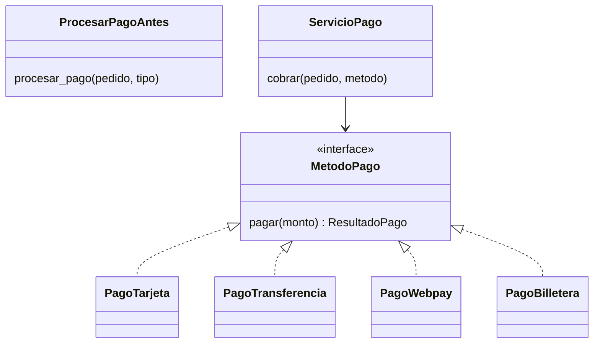

# OCP: Abierto/Cerrado

El **principio abierto/cerrado** (*Open/Closed Principle*, OCP: el código debe estar abierto para extensión pero cerrado para modificación; [glosario](../glosario.md#ocp)) es la "O" de **SOLID**, la sigla de cinco principios de diseño que ya conoces del [módulo 02](02-srp.md). En lenguaje simple: cuando el negocio pide un comportamiento nuevo, lo agregas **escribiendo código nuevo** (una **extensión**: una pieza nueva que se enchufa al sistema sin editar lo que ya existe; [glosario](../glosario.md#extensión)) y no editando código que ya funciona y está probado.

## La violación

La tienda empezó aceptando tres formas de pago: tarjeta, transferencia y Webpay. El equipo escribió una función que recibe el tipo de pago como texto y decide qué hacer con un `if`. Funciona, y se ve inocente, hasta que marketing pide aceptar una billetera digital.

```python
def procesar_pago(pedido: Pedido, tipo: str) -> str:
    monto = pedido.calcular_total()
    if tipo == "tarjeta":
        if monto > LIMITE_TARJETA:
            return "Pago rechazado"
        resultado = pasarela_tarjeta.cobrar(monto)
    elif tipo == "transferencia":
        resultado = banco.registrar_transferencia(monto)
    elif tipo == "webpay":
        resultado = transbank.crear_transaccion(monto)
    else:
        raise ValueError(f"método de pago desconocido: {tipo}")
    if not resultado.ok:
        return "Pago rechazado"
    return f"Pago OK ref={resultado.referencia}"
```

(`pasarela_tarjeta`, `banco` y `transbank` son stand-ins de los clientes reales de cada proveedor, y `Pedido` es el del dominio de la tienda.)

El síntoma aparece al agregar la "billetera digital": hay que **editar** `procesar_pago`, añadir un `elif` entre ramas que ya funcionan, y volver a probar los cuatro caminos porque un error de tipeo en el nuevo puede romper los viejos. Además, el `if tipo == ...` casi nunca vive solo: suele repetirse en otras funciones (`comision_por_tipo`, `nombre_para_mostrar`, `requiere_confirmacion`), y cada método nuevo obliga a recorrerlas todas. Si se olvida una, el error recién aparece en producción.

## La idea en pocas palabras

Piensa en un enchufe múltiple: cuando compras un aparato nuevo no abres la pared ni cambias el cableado, solo lo conectas a una entrada libre. Lo que ya funcionaba sigue igual y lo nuevo se suma. Un buen diseño tiene esas "entradas" donde se conectan las variaciones.

En código, esas entradas se logran con una **abstracción** (un contrato general que oculta los detalles de cada caso concreto, normalmente una interfaz; [glosario](../glosario.md#abstracción)). `ServicioPago` ya no pregunta "¿es tarjeta o Webpay?": solo conoce `MetodoPago` y llama a `pagar(monto)`. Cada método de pago es una clase que implementa esa interfaz, y el **polimorfismo** (el mismo mensaje produce comportamientos distintos según el objeto que lo recibe; [glosario](../glosario.md#polimorfismo)) elige el comportamiento correcto sin ningún `if`.

Así, "abierto para extensión" significa que se puede sumar una billetera digital, y "cerrado para modificación" significa que `ServicioPago` no se toca para lograrlo. El `if` por tipo no desaparece por arte de magia: la decisión de *cuál* usar se mueve a un solo lugar (el punto donde se arma el sistema), en vez de repetirse en cada función.

## Diagrama



`ProcesarPagoAntes` es la función de la sección anterior, que conoce todos los métodos. En el diseño nuevo `ServicioPago` depende solo de la interfaz, y `PagoBilletera` (el cuarto método) se suma sin que ninguna otra clase del diagrama cambie.

## Código

Cada lenguaje se divide en bloques cortos: el dominio, el contrato con sus implementaciones, el servicio con un cuarto método agregado después y, al final, la misma idea aplicada a los descuentos. Las implementaciones simulan un proveedor que siempre aprueba y genera una referencia con un contador (`TJ-001`, `WP-001`...), para que el ejemplo corra sin conectarse a nadie. Se simplifica el dominio: `Pedido` solo tiene `id` e `items` (sin cliente ni estado), y `ResultadoPago` es un valor inmutable con `ok` y `referencia`. El total del pedido es 12990 + 2 × 3500 = 19990; con la regla Cyber de 20 %, el descuento es 3998 y el resultado, 15992. Aquí `ReglaDescuento.aplicar(subtotal)` devuelve el subtotal ya con el descuento aplicado.

### Python

```python
from dataclasses import dataclass


@dataclass
class Producto:
    id: int
    nombre: str
    precio: int


@dataclass
class ItemCarrito:
    producto: Producto
    cantidad: int


@dataclass
class Pedido:
    id: int
    items: list[ItemCarrito]

    def calcular_total(self) -> int:
        return sum(i.producto.precio * i.cantidad for i in self.items)


@dataclass(frozen=True)
class ResultadoPago:
    ok: bool
    referencia: str
```

```python
from itertools import count
from typing import Protocol


class MetodoPago(Protocol):
    def pagar(self, monto: int) -> ResultadoPago: ...


class PagoTarjeta:
    def __init__(self) -> None:
        self._secuencia = count(1)

    def pagar(self, monto: int) -> ResultadoPago:
        return ResultadoPago(True, f"TJ-{next(self._secuencia):03d}")


class PagoTransferencia:
    def __init__(self) -> None:
        self._secuencia = count(1)

    def pagar(self, monto: int) -> ResultadoPago:
        return ResultadoPago(True, f"TR-{next(self._secuencia):03d}")


class PagoWebpay:
    def __init__(self) -> None:
        self._secuencia = count(1)

    def pagar(self, monto: int) -> ResultadoPago:
        return ResultadoPago(True, f"WP-{next(self._secuencia):03d}")
```

```python
from itertools import count


class ServicioPago:
    def cobrar(self, pedido: Pedido, metodo: MetodoPago) -> str:
        resultado = metodo.pagar(pedido.calcular_total())
        if not resultado.ok:
            return "Pago rechazado"
        return f"Pago OK ref={resultado.referencia}"


class PagoBilletera:  # código nuevo: ServicioPago no cambia
    def __init__(self) -> None:
        self._secuencia = count(1)

    def pagar(self, monto: int) -> ResultadoPago:
        return ResultadoPago(True, f"BD-{next(self._secuencia):03d}")


pedido = Pedido(101, [ItemCarrito(Producto(10, "Zapatillas", 12990), 1),
                      ItemCarrito(Producto(11, "Calcetas", 3500), 2)])
servicio = ServicioPago()
print(servicio.cobrar(pedido, PagoTarjeta()))  # => Pago OK ref=TJ-001
print(servicio.cobrar(pedido, PagoWebpay()))  # => Pago OK ref=WP-001
print(servicio.cobrar(pedido, PagoBilletera()))  # => Pago OK ref=BD-001
```

```python
from typing import Protocol


class ReglaDescuento(Protocol):
    def aplicar(self, subtotal: int) -> int: ...


class ReglaDescuentoCyber:
    def __init__(self, porcentaje: int) -> None:
        self._porcentaje = porcentaje

    def aplicar(self, subtotal: int) -> int:
        return subtotal - subtotal * self._porcentaje // 100


regla = ReglaDescuentoCyber(20)
print(regla.aplicar(pedido.calcular_total()))  # => 15992
```

### TypeScript

```typescript
interface Producto {
  id: number;
  nombre: string;
  precio: number;
}

interface ItemCarrito {
  producto: Producto;
  cantidad: number;
}

class Pedido {
  constructor(readonly id: number, readonly items: ItemCarrito[]) {}

  calcularTotal(): number {
    return this.items.reduce((suma, i) => suma + i.producto.precio * i.cantidad, 0);
  }
}

interface ResultadoPago {
  readonly ok: boolean;
  readonly referencia: string;
}
```

```typescript
interface MetodoPago {
  pagar(monto: number): ResultadoPago;
}

class PagoTarjeta implements MetodoPago {
  private contador = 0;

  pagar(monto: number): ResultadoPago {
    this.contador += 1;
    return { ok: true, referencia: `TJ-${String(this.contador).padStart(3, "0")}` };
  }
}

class PagoTransferencia implements MetodoPago {
  private contador = 0;

  pagar(monto: number): ResultadoPago {
    this.contador += 1;
    return { ok: true, referencia: `TR-${String(this.contador).padStart(3, "0")}` };
  }
}

class PagoWebpay implements MetodoPago {
  private contador = 0;

  pagar(monto: number): ResultadoPago {
    this.contador += 1;
    return { ok: true, referencia: `WP-${String(this.contador).padStart(3, "0")}` };
  }
}
```

```typescript
class ServicioPago {
  cobrar(pedido: Pedido, metodo: MetodoPago): string {
    const resultado = metodo.pagar(pedido.calcularTotal());
    if (!resultado.ok) {
      return "Pago rechazado";
    }
    return `Pago OK ref=${resultado.referencia}`;
  }
}

class PagoBilletera implements MetodoPago { // código nuevo: ServicioPago no cambia
  private contador = 0;

  pagar(monto: number): ResultadoPago {
    this.contador += 1;
    return { ok: true, referencia: `BD-${String(this.contador).padStart(3, "0")}` };
  }
}

const pedido = new Pedido(101, [
  { producto: { id: 10, nombre: "Zapatillas", precio: 12990 }, cantidad: 1 },
  { producto: { id: 11, nombre: "Calcetas", precio: 3500 }, cantidad: 2 },
]);
const servicio = new ServicioPago();
console.log(servicio.cobrar(pedido, new PagoTarjeta())); // => Pago OK ref=TJ-001
console.log(servicio.cobrar(pedido, new PagoWebpay())); // => Pago OK ref=WP-001
console.log(servicio.cobrar(pedido, new PagoBilletera())); // => Pago OK ref=BD-001
```

```typescript
interface ReglaDescuento {
  aplicar(subtotal: number): number;
}

class ReglaDescuentoCyber implements ReglaDescuento {
  constructor(private porcentaje: number) {}

  aplicar(subtotal: number): number {
    return subtotal - Math.floor((subtotal * this.porcentaje) / 100);
  }
}

const regla = new ReglaDescuentoCyber(20);
console.log(regla.aplicar(pedido.calcularTotal())); // => 15992
```

### Go

Los bloques de Go forman un solo archivo `main.go`; `package main` e `import` aparecen en el primero y los demás no los repiten.

```go
package main

import (
	"fmt"
)

type Producto struct {
	ID     int
	Nombre string
	Precio int
}

type ItemCarrito struct {
	Producto Producto
	Cantidad int
}

type Pedido struct {
	ID    int
	Items []ItemCarrito
}

func (p Pedido) CalcularTotal() int {
	total := 0
	for _, item := range p.Items {
		total += item.Producto.Precio * item.Cantidad
	}
	return total
}

type ResultadoPago struct {
	Ok         bool
	Referencia string
}
```

```go
type MetodoPago interface {
	Pagar(monto int) ResultadoPago
}

type PagoTarjeta struct{ contador int }

func (p *PagoTarjeta) Pagar(monto int) ResultadoPago {
	p.contador++
	return ResultadoPago{true, fmt.Sprintf("TJ-%03d", p.contador)}
}

type PagoTransferencia struct{ contador int }

func (p *PagoTransferencia) Pagar(monto int) ResultadoPago {
	p.contador++
	return ResultadoPago{true, fmt.Sprintf("TR-%03d", p.contador)}
}

type PagoWebpay struct{ contador int }

func (p *PagoWebpay) Pagar(monto int) ResultadoPago {
	p.contador++
	return ResultadoPago{true, fmt.Sprintf("WP-%03d", p.contador)}
}
```

```go
type ServicioPago struct{}

func (ServicioPago) Cobrar(pedido Pedido, metodo MetodoPago) string {
	resultado := metodo.Pagar(pedido.CalcularTotal())
	if !resultado.Ok {
		return "Pago rechazado"
	}
	return "Pago OK ref=" + resultado.Referencia
}

// Código nuevo: ServicioPago no cambia.
type PagoBilletera struct{ contador int }

func (p *PagoBilletera) Pagar(monto int) ResultadoPago {
	p.contador++
	return ResultadoPago{true, fmt.Sprintf("BD-%03d", p.contador)}
}
```

```go
type ReglaDescuento interface {
	Aplicar(subtotal int) int
}

type ReglaDescuentoCyber struct{ Porcentaje int }

func (r ReglaDescuentoCyber) Aplicar(subtotal int) int {
	return subtotal - subtotal*r.Porcentaje/100
}

func main() {
	pedido := Pedido{ID: 101, Items: []ItemCarrito{
		{Producto{10, "Zapatillas", 12990}, 1},
		{Producto{11, "Calcetas", 3500}, 2},
	}}
	servicio := ServicioPago{}
	fmt.Println(servicio.Cobrar(pedido, &PagoTarjeta{}))   // => Pago OK ref=TJ-001
	fmt.Println(servicio.Cobrar(pedido, &PagoWebpay{}))    // => Pago OK ref=WP-001
	fmt.Println(servicio.Cobrar(pedido, &PagoBilletera{})) // => Pago OK ref=BD-001
	var regla ReglaDescuento = ReglaDescuentoCyber{20}
	fmt.Println(regla.Aplicar(pedido.CalcularTotal())) // => 15992
}
```

> **Nota Go:** en Go OCP casi viene incluido. Las interfaces son implícitas: `PagoBilletera` cumple `MetodoPago` con solo tener el método `Pagar`, sin declarar nada ni tocar el paquete donde se definió la interfaz. Para elegir el método por nombre basta un `map[string]MetodoPago` (`"webpay": &PagoWebpay{}`) que se llena al arrancar el programa, y si cada método es una sola operación sin estado, incluso alcanza una función con nombre, `type FuncPago func(monto int) ResultadoPago`, con un método que la llama: `func (f FuncPago) Pagar(monto int) ResultadoPago { return f(monto) }`. Es lo que hace `http.HandlerFunc`, que tiene su método `ServeHTTP` para adaptar una función a la interfaz `http.Handler`. El mapa es el único lugar que se edita al agregar un método nuevo.

### PHP

```php
<?php

class Producto
{
    public function __construct(
        public readonly int $id,
        public readonly string $nombre,
        public readonly int $precio,
    ) {}
}

class ItemCarrito
{
    public function __construct(
        public readonly Producto $producto,
        public readonly int $cantidad,
    ) {}
}

class Pedido
{
    /** @param ItemCarrito[] $items */
    public function __construct(
        public readonly int $id,
        public readonly array $items,
    ) {}

    public function calcularTotal(): int
    {
        $total = 0;
        foreach ($this->items as $item) {
            $total += $item->producto->precio * $item->cantidad;
        }
        return $total;
    }
}
```

```php
<?php

final class ResultadoPago
{
    public function __construct(
        public readonly bool $ok,
        public readonly string $referencia,
    ) {}
}

interface MetodoPago
{
    public function pagar(int $monto): ResultadoPago;
}

class PagoTarjeta implements MetodoPago
{
    private int $contador = 0;

    public function pagar(int $monto): ResultadoPago
    {
        return new ResultadoPago(true, sprintf('TJ-%03d', ++$this->contador));
    }
}
```

```php
<?php

class PagoTransferencia implements MetodoPago
{
    private int $contador = 0;

    public function pagar(int $monto): ResultadoPago
    {
        return new ResultadoPago(true, sprintf('TR-%03d', ++$this->contador));
    }
}

class PagoWebpay implements MetodoPago
{
    private int $contador = 0;

    public function pagar(int $monto): ResultadoPago
    {
        return new ResultadoPago(true, sprintf('WP-%03d', ++$this->contador));
    }
}
```

```php
<?php

class ServicioPago
{
    public function cobrar(Pedido $pedido, MetodoPago $metodo): string
    {
        $resultado = $metodo->pagar($pedido->calcularTotal());
        if (!$resultado->ok) {
            return 'Pago rechazado';
        }
        return "Pago OK ref={$resultado->referencia}";
    }
}

class PagoBilletera implements MetodoPago // código nuevo: ServicioPago no cambia
{
    private int $contador = 0;

    public function pagar(int $monto): ResultadoPago
    {
        return new ResultadoPago(true, sprintf('BD-%03d', ++$this->contador));
    }
}

$pedido = new Pedido(101, [
    new ItemCarrito(new Producto(10, 'Zapatillas', 12990), 1),
    new ItemCarrito(new Producto(11, 'Calcetas', 3500), 2),
]);
$servicio = new ServicioPago();
echo $servicio->cobrar($pedido, new PagoTarjeta()) . "\n"; // => Pago OK ref=TJ-001
echo $servicio->cobrar($pedido, new PagoWebpay()) . "\n"; // => Pago OK ref=WP-001
echo $servicio->cobrar($pedido, new PagoBilletera()) . "\n"; // => Pago OK ref=BD-001
```

```php
<?php

interface ReglaDescuento
{
    public function aplicar(int $subtotal): int;
}

class ReglaDescuentoCyber implements ReglaDescuento
{
    public function __construct(private int $porcentaje) {}

    public function aplicar(int $subtotal): int
    {
        return $subtotal - intdiv($subtotal * $this->porcentaje, 100);
    }
}

$regla = new ReglaDescuentoCyber(20);
echo $regla->aplicar($pedido->calcularTotal()) . "\n"; // => 15992
```

Mira qué se tocó para agregar `PagoBilletera` y `ReglaDescuentoCyber`: nada existente. Se escribió una clase nueva por cada caso y se pasó a quien la necesita. Los métodos de pago originales y `ServicioPago` quedaron intactos, así que no hace falta volver a probarlos. Lo mismo vale para el descuento: una campaña nueva (por ejemplo, 2x1) sería otra clase que implementa `ReglaDescuento`, y quien calcula el total ni se entera.

## Cuándo aplicarlo y cuándo no

**Señales de que se viola OCP:**

- Una cadena `if/elif` (o un `switch`) sobre un tipo, un texto o un enum que crece cada vez que el negocio agrega un caso.
- El mismo `switch` por tipo aparece copiado en varias funciones, y agregar un caso exige recorrerlas todas.
- Cada "pequeña" funcionalidad nueva se resuelve editando una clase central que nadie quiere tocar por miedo a romper algo.
- Los commits que agregan un caso nuevo modifican líneas de los casos viejos.

**El riesgo de pasarse.** Crear una interfaz y tres clases para un `if` que tiene dos ramas y nunca cambió es sobre-ingeniería. No se puede cerrar un código contra *todos* los cambios posibles: hay que elegir contra cuáles protegerse. La regla práctica es no abstraer "por si acaso" (YAGNI, como en el [módulo 01](01-buenas-practicas.md)): con un único caso, escribe el código directo; con el segundo, empieza a sospechar; con el tercero, aplica la [regla de tres](../glosario.md#regla-de-tres) y extrae la abstracción, porque ya viste en qué dirección varía el sistema. Una abstracción adivinada antes suele salir con la forma equivocada.

OCP es el principio detrás de varios patrones que verás más adelante: Strategy (intercambiar un algoritmo detrás de una interfaz, como el cálculo de envío), Factory Method (delegar la creación del objeto concreto) y Decorator (agregar comportamiento envolviendo un objeto sin editar su clase) son maneras concretas de dejar el código abierto a la extensión.

## Ejercicio: detecta la violación

La tienda calcula el costo de envío según el tipo de despacho. ¿Qué principio viola esta función y por qué?

```python
def costo_envio(pedido: Pedido, despacho: str) -> int:
    if despacho == "estandar":
        if pedido.calcular_total() >= 50000:
            return 0
        return 3990
    elif despacho == "express":
        return 5990
    elif despacho == "retiro":
        return 0
    else:
        raise ValueError(f"despacho desconocido: {despacho}")
```

<details>
<summary>Solución</summary>

Viola OCP: cada tipo de despacho nuevo (por ejemplo, "mismo día" o "punto de retiro") obliga a editar `costo_envio`, a añadir otro `elif` entre ramas que ya funcionan y a volver a probar todas. Además, lo más probable es que el mismo `if despacho == ...` se repita en otras funciones (plazo de entrega, texto para el cliente).

Un refactor deja una clase por despacho detrás de un contrato común:

```python
from dataclasses import dataclass
from typing import Protocol


@dataclass
class Pedido:
    id: int
    total: int  # simplificado: se guarda el total ya calculado

    def calcular_total(self) -> int:
        return self.total


class EstrategiaEnvio(Protocol):
    def costo(self, pedido: Pedido) -> int: ...


class EnvioEstandar:
    def costo(self, pedido: Pedido) -> int:
        return 0 if pedido.calcular_total() >= 50000 else 3990


class EnvioExpress:
    def costo(self, pedido: Pedido) -> int:
        return 5990


class RetiroEnTienda:
    def costo(self, pedido: Pedido) -> int:
        return 0


print(EnvioExpress().costo(Pedido(101, 19990)))  # => 5990
```

Para agregar "mismo día" se escribe otra clase con `costo` y no se toca ninguna de las existentes. Quien arma el pedido elige la clase una sola vez. Este patrón se llama Strategy y se retoma más adelante.

</details>

## Preguntas de entrevista

**P1. ¿Cómo se rompe OCP con un `switch`?**
Un `switch` (o una cadena de `if/elif`) sobre el tipo de algo obliga a editar esa función cada vez que aparece un caso nuevo, y suele estar copiado en varios lugares, así que hay que acordarse de todos. Cada edición arriesga romper los casos que ya funcionaban y obliga a probarlos de nuevo. La salida es reemplazar el `switch` por una interfaz con una implementación por caso y dejar que el polimorfismo elija.

**P2. ¿"Cerrado para modificación" es absoluto?**
No. No existe código cerrado contra todo cambio: si cambia el contrato de la interfaz (por ejemplo, `pagar` necesita un parámetro nuevo), hay que modificar el código existente. El cierre es estratégico: se protege contra los tipos de cambio más probables, como agregar un método de pago, y se acepta modificar para los demás. Además, corregir un bug sí es una modificación legítima; el principio habla de agregar comportamiento.

**P3. ¿Qué patrones sirven para cumplir OCP?**
Strategy permite intercambiar algoritmos detrás de una interfaz (envío, descuentos), Factory Method delega qué clase concreta crear a una subclase o función, y Decorator agrega comportamiento envolviendo un objeto sin editar su clase. También Observer (nuevos suscriptores sin tocar al emisor) y Template Method (variar pasos sin tocar el esqueleto) siguen la misma lógica. Todos comparten la receta: depender de una abstracción y agregar variaciones como código nuevo.

**P4. ¿Cuándo NO aplicarlo?**
Cuando solo hay un caso o dos ramas que probablemente no cambiarán: la abstracción es costo sin beneficio y, al adivinar mal, queda con una forma equivocada que luego hay que desarmar. Por YAGNI conviene esperar al segundo o tercer caso real, y recién ahí extraer la interfaz. Aplica OCP donde ya viste que el sistema cambia, y no en cada `if` del código.
