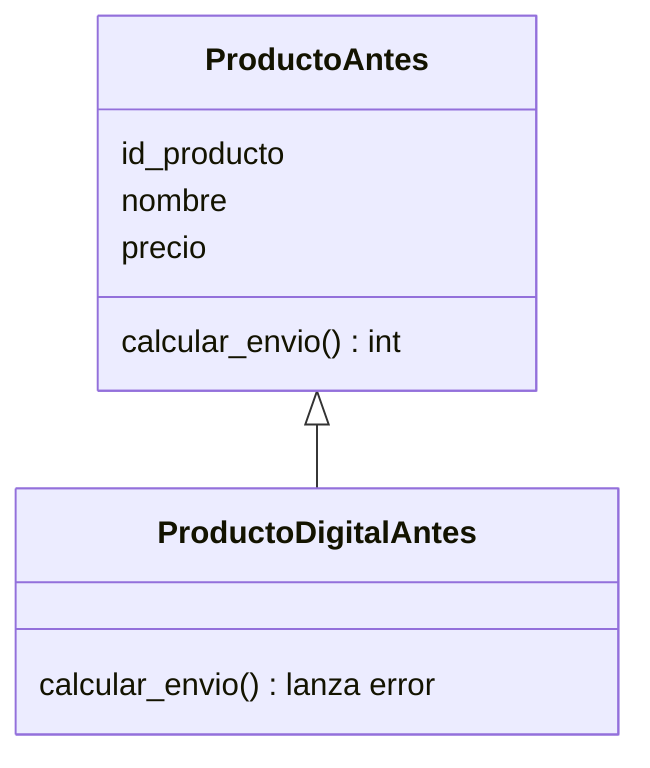
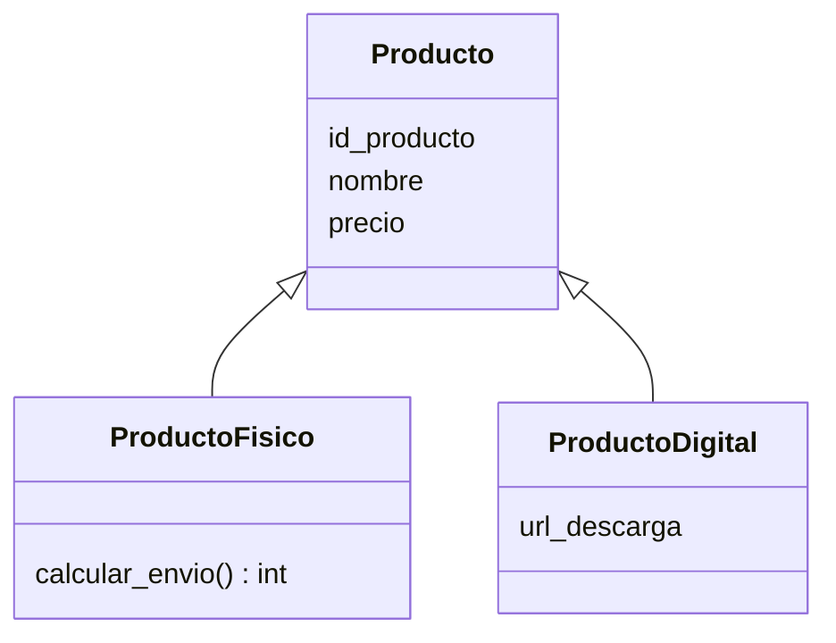

# LSP: Sustitución de Liskov

El **principio de sustitución de Liskov** (*Liskov Substitution Principle*, LSP: donde el código espera un objeto de la clase base, debe poder recibir una subclase sin que nada se rompa ni se comporte de forma inesperada; [glosario](../glosario.md#lsp)) es la "L" de **SOLID**, los cinco principios de diseño que ya conoces desde el [módulo 02](02-srp.md). En lenguaje simple: si una clase dice "soy un `Producto`", tiene que comportarse como tal en **todos** los lugares donde se usa un `Producto`; si no, la **herencia** (una clase que reutiliza y extiende a otra; [glosario](../glosario.md#herencia)) es una mentira que el compilador no detecta.

## La violación

La tienda vende zapatillas (físicas) y, desde este año, también guías y cursos en PDF. Para no duplicar el catálogo, el equipo hizo que `ProductoDigital` herede de `Producto`. Hasta ahí, razonable. El problema es que `Producto` ya tenía un método `calcular_envio()`, y un archivo descargable no se envía a ningún lado.

```python
class Producto:
    def __init__(self, id_producto: int, nombre: str, precio: int) -> None:
        self.id_producto = id_producto
        self.nombre = nombre
        self.precio = precio

    def calcular_envio(self) -> int:
        return 3990


class ProductoDigital(Producto):
    def calcular_envio(self) -> int:
        raise NotImplementedError("un producto digital no se envía")


carrito = [Producto(10, "Zapatillas", 12990),
           ProductoDigital(20, "Guía de running", 4990)]
total_envio = 0
for p in carrito:
    total_envio += p.calcular_envio()  # revienta con la guía digital
```

El código cliente (el `for`) hizo lo correcto: recibió `Producto`s y llamó a un método que `Producto` promete tener. Aun así, falla con `NotImplementedError` en cuanto aparece un producto digital en el carrito. La subclase **no se puede usar donde se esperaba la base**. Para "arreglarlo" sin tocar la jerarquía, alguien escribirá `if isinstance(p, ProductoDigital): continue` en el cliente, y ese `isinstance` se copiará a cada función que calcule envíos, plazos o peso.

Hay un segundo síntoma, más sutil. El contrato de `ReglaDescuento` (la interfaz del [módulo 03](03-ocp.md)) dice que `aplicar(subtotal)` devuelve el subtotal con el descuento ya aplicado, y nadie espera que un descuento deje un total negativo. Marketing agrega un descuento VIP de monto fijo:

```python
class DescuentoVIP:
    def aplicar(self, subtotal: int) -> int:
        return subtotal - 15000  # con un subtotal de 12990 devuelve -2010


total = DescuentoVIP().aplicar(12990)
print(total)  # => -2010: la tienda "le paga" al cliente
```

Aquí no hay ninguna excepción ni error de tipos: el método existe, recibe un `int` y devuelve un `int`. Pero rompe lo que el resto del sistema da por sentado, y el pedido termina con un total negativo.

## La idea en pocas palabras

Piensa en un enchufe: el de la lámpara y el de la plancha encajan en la misma pared, pero si un aparato se enchufa y no recibe corriente, el enchufe "encaja" y aun así no sirve. Sustituir no es solo que las piezas calcen, sino que funcionen igual de bien.

Ese "funcionar igual" se llama **contrato** (el conjunto de promesas, explícitas e implícitas, que una clase hace a quien la usa: qué recibe, qué devuelve y qué cosas siempre se cumplen; [glosario](../glosario.md#contrato)). Un contrato tiene tres partes:

- **Precondiciones** (lo que debe cumplirse *antes* de llamar al método; [glosario](../glosario.md#precondición)). La subclase no puede **endurecerlas**: si la base acepta cualquier subtotal, la subclase no puede empezar a exigir que sea mayor que 10000.
- **Poscondiciones** (lo que el método garantiza *después* de ejecutarse; [glosario](../glosario.md#poscondición)). La subclase no puede **debilitarlas**: si la base garantiza "el resultado nunca es negativo", la subclase tampoco puede devolver un negativo.
- **Invariantes** (lo que siempre es verdad sobre el objeto, antes y después de cada operación; [glosario](../glosario.md#invariante)). La subclase debe mantenerlas: si un `Producto` siempre tiene precio mayor o igual que cero, ninguna subclase puede permitir otra cosa.

Esta idea viene del **diseño por contrato** (declarar esas promesas de forma explícita y exigir que se cumplan). `ProductoDigital` rompe una promesa de `Producto` ("siempre puedes pedirme el envío") y `DescuentoVIP` rompe una de `ReglaDescuento` ("el resultado nunca es negativo").

La solución para los productos es admitir que la jerarquía estaba mal planteada: el envío no es algo que todo producto sepa hacer. Solo lo tienen los productos físicos, así que sube a una subclase `ProductoFisico`, y `Producto` queda con lo que de verdad es común a todos: id, nombre y precio. Para el descuento, basta cumplir la poscondición: nunca devolver menos de cero.

## Diagrama



Antes, `ProductoDigitalAntes` hereda una promesa (`calcular_envio`) que no puede cumplir, y por eso lanza un error.



Después, `Producto` solo promete lo que todos cumplen. El envío vive únicamente en `ProductoFisico`, y ya no existe un método que un producto digital deba fingir tener. El código que calcula despachos pide `ProductoFisico`, no `Producto`.

## Código

Cada lenguaje tiene tres partes: la jerarquía corregida, un uso con carrito y la regla de descuento que respeta su contrato. La jerarquía queda con nombres estables: `Producto` (base), `ProductoFisico` (con `calcular_envio`) y `ProductoDigital` (con `url_descarga`); más adelante el curso la reutiliza tal cual. Se simplifica el dominio: el envío de un producto físico es una tarifa plana de 3990, y el contrato de `ReglaDescuento` se precisa así: `aplicar(subtotal)` devuelve un valor entre 0 y `subtotal`. El carrito del ejemplo suma 12990 + 4990 = 17980, y solo la zapatilla (física) se despacha, por 3990.

Una alternativa válida, cuando el envío podría variar mucho, es no usar herencia y componer: un `ProductoFisico` que *tiene* un objeto `Envio` con la tarifa. Se decide igual que en el [módulo 01](01-buenas-practicas.md): la composición suele ser más flexible que heredar.

### Python

```python
from dataclasses import dataclass


@dataclass
class Producto:
    id_producto: int
    nombre: str
    precio: int


@dataclass
class ProductoFisico(Producto):
    def calcular_envio(self) -> int:
        return 3990


@dataclass
class ProductoDigital(Producto):
    url_descarga: str = ""


def total_productos(productos: list[Producto]) -> int:
    return sum(p.precio for p in productos)


def envio_total(despachables: list[ProductoFisico]) -> int:
    return sum(p.calcular_envio() for p in despachables)
```

```python
zapatillas = ProductoFisico(10, "Zapatillas", 12990)
guia = ProductoDigital(20, "Guía de running", 4990, "https://tienda.cl/guia.pdf")
carrito: list[Producto] = [zapatillas, guia]
print(f"Total: {total_productos(carrito)}")  # => Total: 17980
print(f"Envío total: {envio_total([zapatillas])}")  # => Envío total: 3990
```

```python
class ReglaDescuentoVIP:
    """Contrato: devuelve un valor entre 0 y subtotal."""

    def __init__(self, monto_fijo: int) -> None:
        self._monto_fijo = monto_fijo

    def aplicar(self, subtotal: int) -> int:
        return max(0, subtotal - self._monto_fijo)


regla = ReglaDescuentoVIP(15000)
print(regla.aplicar(12990))  # => 0
print(regla.aplicar(30000))  # => 15000
```

### TypeScript

```typescript
class Producto {
  constructor(
    readonly idProducto: number,
    readonly nombre: string,
    readonly precio: number,
  ) {}
}

class ProductoFisico extends Producto {
  calcularEnvio(): number {
    return 3990;
  }
}

class ProductoDigital extends Producto {
  constructor(idProducto: number, nombre: string, precio: number, readonly urlDescarga: string) {
    super(idProducto, nombre, precio);
  }
}

function totalProductos(productos: Producto[]): number {
  return productos.reduce((suma, p) => suma + p.precio, 0);
}

function envioTotal(despachables: ProductoFisico[]): number {
  return despachables.reduce((suma, p) => suma + p.calcularEnvio(), 0);
}
```

```typescript
const zapatillas = new ProductoFisico(10, "Zapatillas", 12990);
const guia = new ProductoDigital(20, "Guía de running", 4990, "https://tienda.cl/guia.pdf");
const carrito: Producto[] = [zapatillas, guia];
console.log(`Total: ${totalProductos(carrito)}`); // => Total: 17980
console.log(`Envío total: ${envioTotal([zapatillas])}`); // => Envío total: 3990
```

```typescript
interface ReglaDescuento {
  aplicar(subtotal: number): number; // contrato: devuelve entre 0 y subtotal
}

class ReglaDescuentoVIP implements ReglaDescuento {
  constructor(private montoFijo: number) {}

  aplicar(subtotal: number): number {
    return Math.max(0, subtotal - this.montoFijo);
  }
}

const regla = new ReglaDescuentoVIP(15000);
console.log(regla.aplicar(12990)); // => 0
console.log(regla.aplicar(30000)); // => 15000
```

### Go

Los bloques de Go forman un solo archivo `main.go`; `package main` e `import` aparecen en el primero y los demás no los repiten.

```go
package main

import (
	"fmt"
)

type Producto struct {
	ID     int
	Nombre string
	Precio int
}

func (p Producto) PrecioVenta() int { return p.Precio }

type ProductoFisico struct{ Producto }

func (ProductoFisico) CalcularEnvio() int { return 3990 }

type ProductoDigital struct {
	Producto
	URLDescarga string
}

type Vendible interface{ PrecioVenta() int }

type Despachable interface{ CalcularEnvio() int }

func TotalProductos(productos []Vendible) int {
	total := 0
	for _, p := range productos {
		total += p.PrecioVenta()
	}
	return total
}

func EnvioTotal(despachables []Despachable) int {
	total := 0
	for _, d := range despachables {
		total += d.CalcularEnvio()
	}
	return total
}
```

```go
type ReglaDescuento interface {
	Aplicar(subtotal int) int // contrato: devuelve entre 0 y subtotal
}

type ReglaDescuentoVIP struct{ MontoFijo int }

func (r ReglaDescuentoVIP) Aplicar(subtotal int) int {
	return max(0, subtotal-r.MontoFijo)
}

func main() {
	zapatillas := ProductoFisico{Producto{10, "Zapatillas", 12990}}
	guia := ProductoDigital{Producto{20, "Guía de running", 4990}, "https://tienda.cl/guia.pdf"}
	fmt.Println("Total:", TotalProductos([]Vendible{zapatillas, guia}))  // => Total: 17980
	fmt.Println("Envío total:", EnvioTotal([]Despachable{zapatillas})) // => Envío total: 3990
	var regla ReglaDescuento = ReglaDescuentoVIP{15000}
	fmt.Println(regla.Aplicar(12990), regla.Aplicar(30000)) // => 0 15000
}
```

> **Nota Go:** en Go no hay herencia de clases: `ProductoFisico` *embebe* a `Producto` (composición por embedding) y la sustitución se expresa con interfaces pequeñas (`Vendible`, `Despachable`), que además son implícitas: `ProductoDigital` simplemente no tiene `CalcularEnvio`, así que ni siquiera compila si se intenta pasar como `Despachable`. Pero LSP en Go es un tema de **contrato y comportamiento** más que de tipos. El compilador solo verifica que el método exista con la firma correcta; no puede saber si `Aplicar` respeta "devuelve entre 0 y `subtotal`" o si un `CalcularEnvio` hace `panic`. Un tipo que implementa la interfaz pero rompe su contrato compila sin quejas y viola LSP igual. Ese contrato se documenta en el comentario de la interfaz y se verifica con pruebas.

### PHP

```php
<?php

class Producto
{
    public function __construct(
        public readonly int $idProducto,
        public readonly string $nombre,
        public readonly int $precio,
    ) {}
}

class ProductoFisico extends Producto
{
    public function calcularEnvio(): int
    {
        return 3990;
    }
}

class ProductoDigital extends Producto
{
    public function __construct(
        int $idProducto,
        string $nombre,
        int $precio,
        public readonly string $urlDescarga,
    ) {
        parent::__construct($idProducto, $nombre, $precio);
    }
}
```

```php
<?php

/** @param Producto[] $productos */
function totalProductos(array $productos): int
{
    return array_sum(array_map(fn (Producto $p) => $p->precio, $productos));
}

/** @param ProductoFisico[] $despachables */
function envioTotal(array $despachables): int
{
    return array_sum(array_map(fn (ProductoFisico $p) => $p->calcularEnvio(), $despachables));
}

$zapatillas = new ProductoFisico(10, 'Zapatillas', 12990);
$guia = new ProductoDigital(20, 'Guía de running', 4990, 'https://tienda.cl/guia.pdf');
echo 'Total: ' . totalProductos([$zapatillas, $guia]) . "\n"; // => Total: 17980
echo 'Envío total: ' . envioTotal([$zapatillas]) . "\n"; // => Envío total: 3990
```

```php
<?php

interface ReglaDescuento
{
    /** Contrato: devuelve un valor entre 0 y $subtotal. */
    public function aplicar(int $subtotal): int;
}

class ReglaDescuentoVIP implements ReglaDescuento
{
    public function __construct(private int $montoFijo) {}

    public function aplicar(int $subtotal): int
    {
        return max(0, $subtotal - $this->montoFijo);
    }
}

$regla = new ReglaDescuentoVIP(15000);
echo $regla->aplicar(12990) . "\n"; // => 0
echo $regla->aplicar(30000) . "\n"; // => 15000
```

Mira qué cambió respecto de la violación: `ProductoDigital` ya no hereda un método que no puede cumplir, así que no puede entrar en una lista de despachables (TypeScript y Go lo rechazan al compilar, PHP lanza un `TypeError` al ejecutar y en Python lo detectaría un verificador de tipos como mypy). Y `ReglaDescuentoVIP` cumple la poscondición, de modo que el resto del sistema puede confiar en el resultado sin revisar si es negativo.

## Cuándo aplicarlo y cuándo no

**Señales de que se viola LSP:**

- Métodos de la subclase que lanzan `NotImplementedError`, `UnsupportedOperationException` o un `panic`: la subclase se niega a hacer lo que la base promete.
- Métodos heredados que quedan vacíos o devuelven un valor "neutro" falso, solo para que compile.
- Código cliente con `isinstance`, `instanceof` o `switch` sobre el tipo concreto antes de llamar a un método: el cliente ya no confía en la base.
- Una subclase que exige más a quien la llama (valida un rango más estrecho) o garantiza menos (devuelve valores que la base nunca devolvería).
- Documentación del tipo "no uses este método con la clase X".

**El riesgo de pasarse.** No hace falta partir cada jerarquía en mil interfaces ni modelar todas las diferencias posibles entre productos desde el primer día. Si la herencia incomoda o necesitas excepciones para que funcione, es una señal para probar con composición (el [módulo 01](01-buenas-practicas.md) lo explica) en vez de forzar una jerarquía. Y si dos clases solo comparten un par de campos, quizá basta con que sean tipos independientes.

LSP conecta con patrones que verás más adelante: Template Method y Strategy dependen de que cada variante respete el contrato de la base, y en Decorator y Composite el objeto envuelto o el nodo hijo debe poder tratarse igual que el componente original. Un Visitor sobre productos, además, parte de una jerarquía como la de este módulo, donde cada subclase es sustituible por `Producto`.

## Ejercicio: detecta la violación

La tienda tiene cupones de descuento. Un cupón expirado se modeló como subclase, y el carrito aplica el cupón que el cliente tenga guardado. ¿Qué principio viola este código y por qué?

```python
class Cupon:
    def __init__(self, descuento: int) -> None:
        self.descuento = descuento

    def aplicar(self, subtotal: int) -> int:
        return max(0, subtotal - self.descuento)


class CuponExpirado(Cupon):
    def aplicar(self, subtotal: int) -> int:
        raise ValueError("el cupón está expirado")


def total_con_cupon(subtotal: int, cupon: Cupon) -> int:
    return cupon.aplicar(subtotal)
```

<details>
<summary>Solución</summary>

Viola LSP: `total_con_cupon` recibe un `Cupon` y espera siempre un `int`; con un `CuponExpirado` lanza una excepción que el contrato de `Cupon` nunca anunció. La subclase **debilita la poscondición** ("devuelve un total entre 0 y el subtotal"). El cliente quedaría obligado a hacer `isinstance(cupon, CuponExpirado)` antes de cada llamada.

Una opción es que el cupón expirado cumpla el contrato: sin vigencia no hay descuento, y el subtotal vuelve intacto.

```python
class Cupon:
    def __init__(self, descuento: int) -> None:
        self.descuento = descuento

    def aplicar(self, subtotal: int) -> int:
        return max(0, subtotal - self.descuento)


class CuponExpirado(Cupon):
    def __init__(self) -> None:
        super().__init__(0)  # un cupón expirado no descuenta nada


print(Cupon(5000).aplicar(12990))  # => 7990
print(CuponExpirado().aplicar(12990))  # => 12990
```

Si el negocio necesita avisar al cliente que el cupón venció, ese aviso se resuelve antes de aplicarlo (una validación explícita de vigencia) y no con una subclase que rompe el método. Así `Cupon` y `CuponExpirado` vuelven a ser intercambiables.

</details>

## Preguntas de entrevista

**P1. Enuncia LSP con tus palabras.**
Si un código funciona con una clase base, tiene que seguir funcionando igual cuando le pasas cualquiera de sus subclases, sin saber cuál es. La subclase debe respetar lo que la base promete: aceptar lo mismo, garantizar al menos lo mismo y mantener sus invariantes. No basta con que los tipos encajen: tiene que comportarse como la base.

**P2. ¿Cuáles son las señales de una violación de LSP?**
Subclases que lanzan `NotImplementedError` o `UnsupportedOperationException` en un método heredado, métodos que se dejan vacíos o devuelven un valor falso, y clientes que hacen `isinstance` o `switch` por tipo antes de llamar. También que la subclase valide más (endurezca una precondición) o devuelva algo que la base nunca devolvería (debilite una poscondición). Cuando el cliente necesita saber qué subclase tiene, la sustitución ya falló.

**P3. ¿Qué tiene que ver LSP con el diseño por contrato?**
LSP es diseño por contrato aplicado a la herencia. Cada método tiene precondiciones (lo que exige), poscondiciones (lo que garantiza) e invariantes de clase (lo que siempre se cumple). Una subclase sustituible puede relajar las precondiciones y reforzar las poscondiciones, pero nunca lo contrario, y debe conservar los invariantes.

**P4. ¿LSP se cumple solo con que el código compile?**
No. El compilador verifica firmas (nombres y tipos), no comportamiento: `DescuentoVIP` devuelve un `int` y compila, pero deja totales negativos y rompe la poscondición. En lenguajes con interfaces implícitas, como Go, pasa igual: un tipo con el método correcto satisface la interfaz sin garantizar su contrato. Por eso LSP se protege documentando el contrato, con pruebas que ejecuten el mismo caso contra todas las implementaciones y, cuando se puede, con jerarquías más pequeñas.
