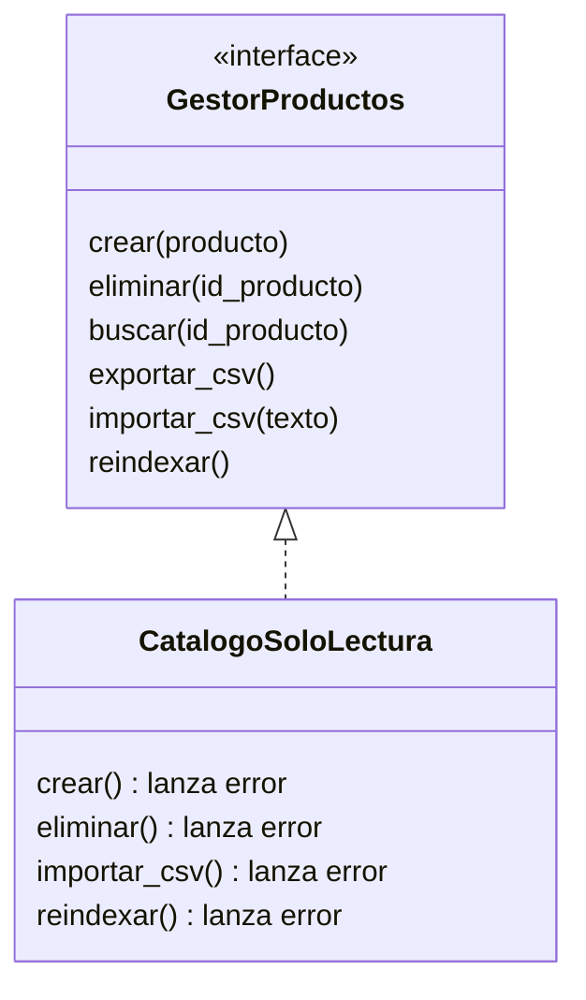
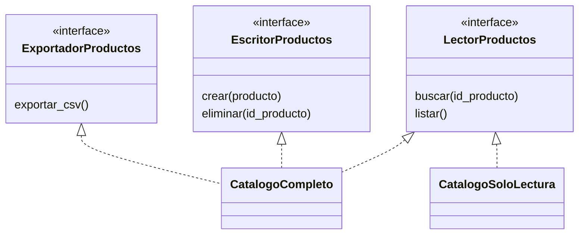

# ISP: Segregación de interfaces

El **principio de segregación de interfaces** (*Interface Segregation Principle*, ISP: ningún cliente debe verse obligado a depender de métodos que no usa; [glosario](../glosario.md#isp)) es la "I" de **SOLID**, los cinco principios de diseño que conoces desde el [módulo 02](02-srp.md). Un **cliente** es simplemente el código que usa una interfaz. En lenguaje simple: es mejor tener varias **interfaces** pequeñas y específicas (una lista de operaciones que un tipo promete ofrecer; [glosario](../glosario.md#interfaz)) que una sola interfaz enorme que lo ofrece todo y que cada implementación debe cumplir completa.

## La violación

El equipo de la tienda define una única interfaz para trabajar con el catálogo, `GestorProductos`, con todo lo que alguien podría querer hacer: crear, eliminar, buscar, exportar a CSV, importar desde CSV y reindexar el buscador. Es una **interfaz gorda** (una interfaz con muchos métodos de motivos distintos, de los que cada cliente usa solo una parte; [glosario](../glosario.md#interfaz-gorda)).

```python
from abc import ABC, abstractmethod
from dataclasses import dataclass


@dataclass
class Producto:
    id_producto: int
    nombre: str
    precio: int


class GestorProductos(ABC):
    @abstractmethod
    def crear(self, producto: Producto) -> None: ...
    @abstractmethod
    def eliminar(self, id_producto: int) -> None: ...
    @abstractmethod
    def buscar(self, id_producto: int) -> Producto | None: ...
    @abstractmethod
    def exportar_csv(self) -> str: ...
    @abstractmethod
    def importar_csv(self, texto: str) -> None: ...
    @abstractmethod
    def reindexar(self) -> None: ...
```

Hasta aquí parece ordenado. El problema aparece cuando la vitrina pública de la web, que solo muestra productos, necesita su propio catálogo de solo lectura. Para ser un `GestorProductos` está obligado a implementar todo:

```python
class CatalogoSoloLectura(GestorProductos):
    def __init__(self, productos: list[Producto]) -> None:
        self._productos = {p.id_producto: p for p in productos}

    def buscar(self, id_producto: int) -> Producto | None:
        return self._productos.get(id_producto)

    def crear(self, producto: Producto) -> None:
        raise NotImplementedError("el catálogo es de solo lectura")

    def eliminar(self, id_producto: int) -> None:
        raise NotImplementedError("el catálogo es de solo lectura")

    def importar_csv(self, texto: str) -> None:
        raise NotImplementedError("el catálogo es de solo lectura")

    def reindexar(self) -> None:
        raise NotImplementedError("el catálogo es de solo lectura")

    def exportar_csv(self) -> str:
        return ""  # método heredado que no tiene sentido aquí
```

Se ven tres síntomas. Cinco de los seis métodos no tienen nada que ver con una vitrina: cuatro lanzan error y uno devuelve un valor falso. Quien reciba un `GestorProductos` no sabe cuáles métodos son seguros de llamar, así que tarde o temprano alguien llama `crear` sobre la vitrina y la aplicación revienta en producción. Y cualquier cambio en la interfaz (digamos, agregar `exportar_json`) obliga a editar **todas** las implementaciones, aunque ninguna lo necesite.

Además, esto es una violación de LSP: `CatalogoSoloLectura` dice ser un `GestorProductos` pero se niega a cumplir parte de su contrato, justo lo que el [módulo 04](04-lsp.md) enseña a evitar.

## La idea en pocas palabras

Piensa en un control remoto con 80 botones cuando solo necesitas tres (encender, volumen y canal): cada botón extra estorba, y si alguien te presta el control del aire acondicionado, no quieres aprender también los botones del televisor. Cada cliente debería recibir un control con los botones que de verdad usa.

Aplicado al código: se parte la interfaz gorda según **quién la usa y para qué**, no según cuántos métodos tiene. En la tienda hay tres tipos de cliente:

- Quien consulta el catálogo (la vitrina, el buscador, el carrito) necesita `LectorProductos`: `buscar` y `listar`.
- Quien modifica el catálogo (el panel de administración) necesita `EscritorProductos`: `crear` y `eliminar`.
- Quien genera reportes necesita `ExportadorProductos`: `exportar_csv`.

Una misma clase puede implementar varias de estas interfaces (el catálogo completo implementa las tres) y otra solo una (la vitrina implementa solo la de lectura). Cada cliente declara en su firma únicamente lo que necesita. Por simplicidad, el ejemplo deja fuera `importar_csv` y `reindexar`; en un sistema real cada uno iría a la interfaz de su cliente (por ejemplo, un `ImportadorProductos` para la carga masiva y un `Indexador` para el buscador).

Algo que ya viste, `PedidoRepository` del [módulo 02](02-srp.md) con solo `guardar` y `obtener`, es una interfaz del tamaño correcto: quien guarda pedidos no tiene por qué saber de exportaciones.

## Diagrama



Antes, una sola interfaz gorda: `CatalogoSoloLectura` la implementa entera y lanza error en cuatro métodos que no puede cumplir.



Después, tres interfaces pequeñas. `CatalogoCompleto` implementa las tres y `CatalogoSoloLectura` solo `LectorProductos`; ya no existe ningún método que deba fingir tener.

## Código

Cada lenguaje tiene tres partes: las tres interfaces pequeñas, el catálogo completo y la vitrina de solo lectura con un uso. `Producto` es aquí un simple contenedor de datos (`id_producto`, `nombre`, `precio`), sin la jerarquía del módulo 04. Para buscar, Python devuelve `Producto | None`, TypeScript `Producto | undefined`, PHP `?Producto` y Go el par `(Producto, bool)`. Los tres productos de la demo (10, 20 y 30) se crean en el catálogo completo, y la vitrina se construye a partir de ellos.

### Python

```python
from dataclasses import dataclass
from typing import Protocol


@dataclass
class Producto:
    id_producto: int
    nombre: str
    precio: int


class LectorProductos(Protocol):
    def buscar(self, id_producto: int) -> Producto | None: ...
    def listar(self) -> list[Producto]: ...


class EscritorProductos(Protocol):
    def crear(self, producto: Producto) -> None: ...
    def eliminar(self, id_producto: int) -> None: ...


class ExportadorProductos(Protocol):
    def exportar_csv(self) -> str: ...
```

```python
class CatalogoCompleto:
    def __init__(self) -> None:
        self._productos: dict[int, Producto] = {}

    def crear(self, producto: Producto) -> None:
        self._productos[producto.id_producto] = producto

    def eliminar(self, id_producto: int) -> None:
        self._productos.pop(id_producto, None)

    def buscar(self, id_producto: int) -> Producto | None:
        return self._productos.get(id_producto)

    def listar(self) -> list[Producto]:
        return list(self._productos.values())

    def exportar_csv(self) -> str:
        filas = [f"{p.id_producto},{p.nombre},{p.precio}" for p in self.listar()]
        return "\n".join(filas)
```

```python
class CatalogoSoloLectura:
    def __init__(self, productos: list[Producto]) -> None:
        self._productos = {p.id_producto: p for p in productos}

    def buscar(self, id_producto: int) -> Producto | None:
        return self._productos.get(id_producto)

    def listar(self) -> list[Producto]:
        return list(self._productos.values())


def mostrar_catalogo(lector: LectorProductos) -> None:
    print(f"{len(lector.listar())} productos listados")


completo = CatalogoCompleto()
completo.crear(Producto(10, "Zapatillas", 12990))
completo.crear(Producto(20, "Polera", 8990))
completo.crear(Producto(30, "Mochila", 24990))
print(completo.exportar_csv().splitlines()[0])  # => 10,Zapatillas,12990
mostrar_catalogo(completo)  # => 3 productos listados
mostrar_catalogo(CatalogoSoloLectura(completo.listar()))  # => 3 productos listados
```

`mostrar_catalogo` pide `LectorProductos`, así que acepta tanto el catálogo completo como la vitrina, y ninguno de los dos necesita fingir métodos de escritura.

### TypeScript

```typescript
interface Producto {
  idProducto: number;
  nombre: string;
  precio: number;
}

interface LectorProductos {
  buscar(idProducto: number): Producto | undefined;
  listar(): Producto[];
}

interface EscritorProductos {
  crear(producto: Producto): void;
  eliminar(idProducto: number): void;
}

interface ExportadorProductos {
  exportarCsv(): string;
}
```

```typescript
class CatalogoCompleto
  implements LectorProductos, EscritorProductos, ExportadorProductos
{
  private productos = new Map<number, Producto>();

  crear(producto: Producto): void {
    this.productos.set(producto.idProducto, producto);
  }

  eliminar(idProducto: number): void {
    this.productos.delete(idProducto);
  }

  buscar(idProducto: number): Producto | undefined {
    return this.productos.get(idProducto);
  }

  listar(): Producto[] {
    return [...this.productos.values()];
  }

  exportarCsv(): string {
    return this.listar()
      .map((p) => `${p.idProducto},${p.nombre},${p.precio}`)
      .join("\n");
  }
}
```

```typescript
class CatalogoSoloLectura implements LectorProductos {
  private productos = new Map<number, Producto>();

  constructor(productos: Producto[]) {
    productos.forEach((p) => this.productos.set(p.idProducto, p));
  }

  buscar(idProducto: number): Producto | undefined {
    return this.productos.get(idProducto);
  }

  listar(): Producto[] {
    return [...this.productos.values()];
  }
}

function mostrarCatalogo(lector: LectorProductos): void {
  console.log(`${lector.listar().length} productos listados`);
}

const completo = new CatalogoCompleto();
completo.crear({ idProducto: 10, nombre: "Zapatillas", precio: 12990 });
completo.crear({ idProducto: 20, nombre: "Polera", precio: 8990 });
completo.crear({ idProducto: 30, nombre: "Mochila", precio: 24990 });
console.log(completo.exportarCsv().split("\n")[0]); // => 10,Zapatillas,12990
mostrarCatalogo(completo); // => 3 productos listados
mostrarCatalogo(new CatalogoSoloLectura(completo.listar())); // => 3 productos listados
```

### Go

Los bloques de Go forman un solo archivo `main.go`; `package main` e `import` aparecen en el primero y los demás no los repiten.

```go
package main

import (
	"fmt"
	"strings"
)

type Producto struct {
	ID     int
	Nombre string
	Precio int
}

type LectorProductos interface {
	Buscar(id int) (Producto, bool)
	Listar() []Producto
}

type EscritorProductos interface {
	Crear(p Producto)
	Eliminar(id int)
}

type ExportadorProductos interface {
	ExportarCSV() string
}
```

```go
type CatalogoCompleto struct{ productos []Producto }

func (c *CatalogoCompleto) Crear(p Producto) {
	c.productos = append(c.productos, p)
}

func (c *CatalogoCompleto) Eliminar(id int) {
	for i, p := range c.productos {
		if p.ID == id {
			c.productos = append(c.productos[:i], c.productos[i+1:]...)
			return
		}
	}
}

func (c *CatalogoCompleto) Buscar(id int) (Producto, bool) {
	for _, p := range c.productos {
		if p.ID == id {
			return p, true
		}
	}
	return Producto{}, false
}

func (c *CatalogoCompleto) Listar() []Producto { return c.productos }
```

```go
func (c *CatalogoCompleto) ExportarCSV() string {
	filas := make([]string, 0, len(c.productos))
	for _, p := range c.productos {
		filas = append(filas, fmt.Sprintf("%d,%s,%d", p.ID, p.Nombre, p.Precio))
	}
	return strings.Join(filas, "\n")
}

type CatalogoSoloLectura struct{ productos []Producto }

func (c CatalogoSoloLectura) Buscar(id int) (Producto, bool) {
	for _, p := range c.productos {
		if p.ID == id {
			return p, true
		}
	}
	return Producto{}, false
}

func (c CatalogoSoloLectura) Listar() []Producto { return c.productos }

func MostrarCatalogo(lector LectorProductos) {
	fmt.Println(len(lector.Listar()), "productos listados")
}
```

```go
func main() {
	completo := &CatalogoCompleto{}
	completo.Crear(Producto{10, "Zapatillas", 12990})
	completo.Crear(Producto{20, "Polera", 8990})
	completo.Crear(Producto{30, "Mochila", 24990})
	fmt.Println(strings.Split(completo.ExportarCSV(), "\n")[0]) // => 10,Zapatillas,12990
	MostrarCatalogo(completo)                                   // => 3 productos listados
	MostrarCatalogo(CatalogoSoloLectura{completo.Listar()})     // => 3 productos listados
}
```

> **Nota Go:** el proverbio de Go lo resume: "mientras más grande la interfaz, más débil la abstracción". La biblioteca estándar es el modelo: `io.Reader` tiene un solo método (`Read`) e `io.Writer` otro (`Write`); cuando hacen falta ambos se **compone** (`io.ReadWriter` embebe las dos). Además, en Go las interfaces son implícitas y se definen **donde se consumen**: `MostrarCatalogo` podría declarar su propia interfaz mínima de un solo método (`Listar`) sin que `CatalogoCompleto` sepa que existe. Por eso en Go ISP casi viene incluido: la interfaz gorda se siente fuera de lugar. Aquí `Producto` y las tres interfaces comparten archivo solo para que el ejemplo se lea de corrido; en un proyecto real cada interfaz viviría junto al paquete que la usa.

### PHP

```php
<?php

class Producto
{
    public function __construct(
        public readonly int $idProducto,
        public readonly string $nombre,
        public readonly int $precio,
    ) {}
}

interface LectorProductos
{
    public function buscar(int $idProducto): ?Producto;

    /** @return Producto[] */
    public function listar(): array;
}

interface EscritorProductos
{
    public function crear(Producto $producto): void;

    public function eliminar(int $idProducto): void;
}

interface ExportadorProductos
{
    public function exportarCsv(): string;
}
```

```php
<?php

class CatalogoCompleto implements LectorProductos, EscritorProductos, ExportadorProductos
{
    /** @var array<int, Producto> */
    private array $productos = [];

    public function crear(Producto $producto): void
    {
        $this->productos[$producto->idProducto] = $producto;
    }

    public function eliminar(int $idProducto): void
    {
        unset($this->productos[$idProducto]);
    }

    public function buscar(int $idProducto): ?Producto
    {
        return $this->productos[$idProducto] ?? null;
    }

    public function listar(): array
    {
        return array_values($this->productos);
    }

    public function exportarCsv(): string
    {
        $filas = array_map(
            fn (Producto $p) => "{$p->idProducto},{$p->nombre},{$p->precio}",
            $this->listar(),
        );
        return implode("\n", $filas);
    }
}
```

```php
<?php

class CatalogoSoloLectura implements LectorProductos
{
    /** @var array<int, Producto> */
    private array $productos = [];

    /** @param Producto[] $productos */
    public function __construct(array $productos)
    {
        foreach ($productos as $p) {
            $this->productos[$p->idProducto] = $p;
        }
    }

    public function buscar(int $idProducto): ?Producto
    {
        return $this->productos[$idProducto] ?? null;
    }

    public function listar(): array
    {
        return array_values($this->productos);
    }
}

function mostrarCatalogo(LectorProductos $lector): void
{
    echo count($lector->listar()) . " productos listados\n";
}

$completo = new CatalogoCompleto();
$completo->crear(new Producto(10, 'Zapatillas', 12990));
$completo->crear(new Producto(20, 'Polera', 8990));
$completo->crear(new Producto(30, 'Mochila', 24990));
echo explode("\n", $completo->exportarCsv())[0] . "\n"; // => 10,Zapatillas,12990
mostrarCatalogo($completo); // => 3 productos listados
mostrarCatalogo(new CatalogoSoloLectura($completo->listar())); // => 3 productos listados
```

Mira qué cambió respecto de la violación: `CatalogoSoloLectura` ya no tiene métodos que lanzan error, y el tipo mismo dice qué se puede hacer. Una función que reciba `LectorProductos` no puede llamar `crear` (el verificador de tipos o el compilador lo impide), así que el error de "escribir en la vitrina" deja de existir en vez de esperar a producción. Si mañana se agrega `exportarJson`, solo cambia `ExportadorProductos` y quienes lo implementan; la vitrina ni se entera.

## Cuándo aplicarlo y cuándo no

**Señales de una interfaz gorda:**

- Implementaciones con métodos que lanzan `NotImplementedError`, `UnsupportedOperationException` o un `panic`, o que quedan vacíos o devuelven un valor falso.
- Clientes que usan solo dos o tres métodos de una interfaz de diez.
- Agregar un método a la interfaz obliga a editar clases y *mocks* (objetos falsos para pruebas) que no tienen relación con el cambio.
- Nombres con sufijos genéricos como `Manager`, `Service` o `Handler` que acumulan operaciones de áreas distintas.
- Pruebas donde para simular un cliente hay que implementar un montón de métodos que ese cliente nunca invoca.

**El riesgo de pasarse.** No hay que fragmentar una interfaz en una por método. Si `buscar` y `listar` siempre cambian y se usan juntos, separarlos en `BuscadorProductos` y `ListadorProductos` solo agrega nombres, archivos y trabajo sin que ningún cliente lo pida. El criterio es la **razón de cambio distinta** o el **cliente distinto**: se separa lo que usan clientes diferentes o lo que cambia por motivos diferentes (leer el catálogo, administrarlo o exportarlo), y se mantiene junto lo que va junto. Una interfaz de un solo método está bien cuando ese método es de verdad lo que el cliente necesita (como `io.Reader`), pero no como regla automática.

ISP conecta con patrones que verás más adelante: Adapter y Facade ofrecen a un cliente una interfaz distinta o más acotada que la del sistema que hay detrás, y Proxy y Decorator son más fáciles de escribir cuando la interfaz que envuelven es pequeña, porque hay pocos métodos que reenviar.

## Ejercicio: detecta la violación

La tienda avisa a los clientes por varios canales. El equipo definió una sola interfaz y un servicio que solo envía correos. ¿Qué principio viola este código y por qué? ¿Cómo lo arreglarías?

```python
from abc import ABC, abstractmethod


class ServicioNotificaciones(ABC):
    @abstractmethod
    def enviar_email(self, destinatario: str, mensaje: str) -> None: ...
    @abstractmethod
    def enviar_sms(self, destinatario: str, mensaje: str) -> None: ...
    @abstractmethod
    def enviar_push(self, destinatario: str, mensaje: str) -> None: ...
    @abstractmethod
    def enviar_whatsapp(self, destinatario: str, mensaje: str) -> None: ...


class ServicioSoloEmail(ServicioNotificaciones):
    def enviar_email(self, destinatario: str, mensaje: str) -> None:
        print(f"Email a {destinatario}: {mensaje}")

    def enviar_sms(self, destinatario: str, mensaje: str) -> None:
        raise NotImplementedError("este servicio no envía SMS")

    def enviar_push(self, destinatario: str, mensaje: str) -> None:
        raise NotImplementedError("este servicio no envía push")

    def enviar_whatsapp(self, destinatario: str, mensaje: str) -> None:
        raise NotImplementedError("este servicio no envía WhatsApp")
```

<details>
<summary>Solución</summary>

Viola ISP: `ServicioSoloEmail` queda obligado a implementar tres canales que no usa y los rellena con errores, y cualquier cliente que reciba un `ServicioNotificaciones` no sabe qué canales funcionan. Además, agregar un canal nuevo (Telegram, por ejemplo) obligaría a editar todas las implementaciones. De rebote, también rompe LSP.

La solución es una interfaz por canal; cada cliente pide solo la que necesita, y una clase puede implementar varias si de verdad soporta varios canales.

```python
from typing import Protocol


class EnviadorEmail(Protocol):
    def enviar_email(self, destinatario: str, mensaje: str) -> None: ...


class EnviadorSMS(Protocol):
    def enviar_sms(self, destinatario: str, mensaje: str) -> None: ...


class ServicioEmail:
    def enviar_email(self, destinatario: str, mensaje: str) -> None:
        print(f"Email a {destinatario}: {mensaje}")


def avisar_confirmacion(canal: EnviadorEmail, email: str) -> None:
    canal.enviar_email(email, "Pedido confirmado")


avisar_confirmacion(ServicioEmail(), "ana@correo.cl")
# => Email a ana@correo.cl: Pedido confirmado
```

`EnviadorPush` y `EnviadorWhatsapp` se definen igual. Observa que el `Notificador` del dominio del curso (un solo método, `notificar`) ya es una interfaz pequeña; el ejercicio muestra qué pasa cuando alguien la reemplaza por una gorda.

</details>

## Preguntas de entrevista

**P1. ¿En qué se diferencia ISP de SRP?**
SRP mira a la **implementación**: una clase debe tener una sola razón para cambiar. ISP mira a la **interfaz desde el punto de vista del cliente**: nadie debe depender de métodos que no usa. Se parecen porque ambos separan, pero se pueden violar por separado: una clase puede tener una sola responsabilidad y aun así exponer una interfaz gorda que obliga a sus clientes a conocer métodos que no necesitan.

**P2. ¿Qué síntoma delata una interfaz gorda?**
Implementaciones que lanzan `NotImplementedError` o devuelven valores falsos en métodos que no les corresponden, clientes que usan una fracción pequeña de la interfaz, y cambios en la interfaz que obligan a tocar clases y mocks sin relación con ese cambio. Un indicador práctico: si para escribir un mock de prueba tienes que implementar diez métodos y el cliente usa dos, la interfaz es demasiado grande.

**P3. ¿Cómo se relaciona ISP con LSP?**
Una interfaz gorda empuja a las implementaciones a negarse a cumplir parte de ella, por ejemplo lanzando `NotImplementedError`, y eso es justo una violación de LSP: la subclase no puede sustituir a la base ([módulo 04](04-lsp.md)). Segregar la interfaz ataca la causa: cada implementación solo promete lo que puede cumplir, y por eso suele resolver también el problema de sustitución.

**P4. ¿Aplica ISP en lenguajes sin interfaces formales, como Python?**
Sí, porque el principio trata de dependencias y no de la palabra `interface`. Python usa **duck typing** (un objeto sirve si tiene los métodos que se le piden, sin importar su clase; [glosario](../glosario.md#duck-typing)): el cliente depende de hecho solo de los métodos que invoca. Aun así, ISP importa: una clase base abstracta gorda sigue obligando a implementar todo, y los tipos poco claros esconden qué usa cada cliente. Con `typing.Protocol` se declara explícitamente el conjunto mínimo de métodos que cada función necesita, y un verificador como mypy lo comprueba.
