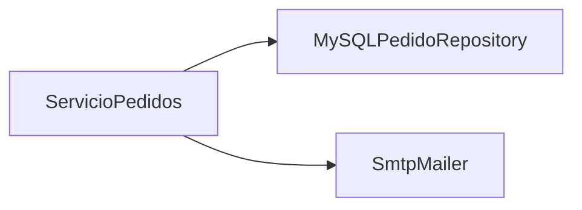
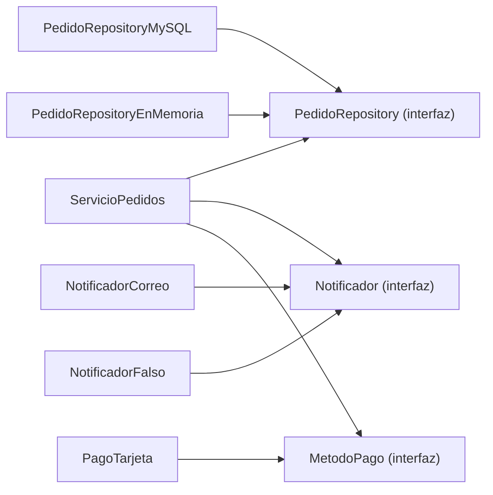

# DIP: Inversión de dependencias

El **principio de inversión de dependencias** (*Dependency Inversion Principle*, DIP: los módulos de alto nivel no deben depender de los de bajo nivel; ambos deben depender de abstracciones; [glosario](../glosario.md#dip)) es la "D" de **SOLID**, los cinco principios de diseño que conoces desde el [módulo 02](02-srp.md). Un módulo de **alto nivel** contiene las reglas del negocio (qué hace la tienda al confirmar un pedido); uno de **bajo nivel** contiene los detalles técnicos (qué base de datos o qué servidor de correo se usa). En lenguaje simple: las reglas del negocio no deben quedar atadas a una tecnología concreta; deben hablar con un contrato, y la tecnología se acomoda a ese contrato.

## La violación

El servicio que confirma pedidos en la tienda crea él mismo las piezas que necesita: el repositorio de MySQL y el cliente de correo SMTP. Se ve cómodo, porque quien lo usa solo escribe `ServicioPedidos()`.

```python
class ServicioPedidos:
    def __init__(self) -> None:
        self.repo = MySQLPedidoRepository("mysql://tienda-prod:3306/tienda")
        self.mailer = SmtpMailer("smtp.tienda.cl", 587)

    def confirmar(self, pedido) -> str:
        pedido.estado = "pagado"
        self.repo.guardar(pedido)
        self.mailer.enviar(pedido.cliente.email, f"Pedido {pedido.id} confirmado")
        return f"Pedido {pedido.id} guardado y notificado"
```

Los síntomas aparecen enseguida. Para probar `confirmar` hace falta una base MySQL levantada y un servidor SMTP alcanzable: la prueba es lenta, frágil y, si se descuida, manda correos de verdad a clientes reales. Si la tienda cambia de proveedor de correo (de SMTP a una API de envíos), hay que **editar el servicio de negocio**, aunque la regla "al pagar, guardar y avisar" no haya cambiado. Y el servicio ni siquiera podría usarse en otro contexto, como una migración que no debe enviar nada. El módulo de alto nivel (la regla) depende del de bajo nivel (el detalle), así que cada cambio en el detalle sube hasta la regla.

## La idea en pocas palabras

Piensa en el enchufe de la pared: es un estándar. Los fabricantes de lámparas, hervidores y cargadores diseñan su cable para encajar en él, y la casa no se reconstruye cada vez que compras un aparato nuevo. Ni la pared depende de la marca de tu lámpara, ni la lámpara de la marca de la pared: ambas dependen del estándar del enchufe.

En el código, `ServicioPedidos` es la casa y el estándar es una **abstracción** (un contrato que oculta los detalles de cada caso concreto, normalmente una interfaz; [glosario](../glosario.md#abstracción)). El servicio declara lo que necesita (`PedidoRepository`, `Notificador`, `MetodoPago`, que ya conoces de los módulos [02](02-srp.md) y [03](03-ocp.md)) y las clases concretas (MySQL, SMTP, tarjeta) se adaptan a ese contrato. La dependencia del código fuente se **invierte**: antes la regla apuntaba al detalle; ahora el detalle apunta a la interfaz que la regla definió.

Conviene separar tres ideas que suelen mezclarse, porque en entrevistas se preguntan por separado:

- **DIP** es el **principio**: una guía de diseño sobre hacia dónde deben apuntar las dependencias. No dice cómo lograrlo.
- La **inyección de dependencias** (una clase recibe de afuera las piezas que necesita en lugar de crearlas; [glosario](../glosario.md#inyección-de-dependencias)) es una **técnica** para cumplir DIP. La forma más común es por constructor, que es la que usa este módulo; también existe por método o por propiedad.
- **IoC** (*Inversion of Control*, inversión de control: el flujo de creación y de llamadas lo maneja un marco o una pieza externa, no tu código; [glosario](../glosario.md#ioc)) es un concepto más amplio, y un **contenedor de IoC** es la **herramienta** que arma y entrega las piezas automáticamente (Spring, el contenedor de Laravel, NestJS). Un contenedor es opcional: se puede inyectar a mano.

Quien arma las piezas concretas y las pasa al servicio es el **composition root** ("raíz de composición": el único lugar, cerca del arranque del programa, que conoce las clases concretas y las conecta; [glosario](../glosario.md#composition-root)). Para las pruebas, en lugar de MySQL y SMTP se pasan **dobles de prueba** (*test doubles*: objetos falsos y simples que reemplazan a una dependencia real; [glosario](../glosario.md#test-double)), y el servicio ni se entera.

## Diagrama



Antes, la flecha va del servicio (alto nivel) a las clases concretas (bajo nivel): cada detalle técnico queda cableado dentro de la regla.



Después, el servicio y las clases concretas apuntan a las interfaces. Las flechas de las clases concretas hacia la interfaz significan "implementa": el detalle se acomoda al contrato, no al revés.

## Código

Cada lenguaje se divide en bloques cortos: el dominio, los contratos, el servicio `ServicioPedidos` con inyección por constructor, las implementaciones (las reales y los dobles de prueba `PedidoRepositoryEnMemoria` y `NotificadorFalso`) y, al final, el composition root con una prueba que usa los dobles. Se simplifica el dominio: no hay IVA, `Pedido.estado` es un texto, y `ResultadoPago` es un valor con `ok` y `referencia`. Las clases "reales" (`NotificadorCorreo`, `PagoTarjeta`) solo imprimen o simulan, para que el ejemplo corra sin conectarse a nadie; en la tienda real habría además un `PedidoRepositoryMySQL`. El total del pedido de la demo es 12990 + 2 × 3500 = 19990. Estos dobles los reutilizarán los módulos de Adapter, Facade y el de cierre del curso.

### Python

```python
from dataclasses import dataclass


@dataclass
class Producto:
    id: int
    nombre: str
    precio: int


@dataclass
class ItemCarrito:
    producto: Producto
    cantidad: int


@dataclass
class Cliente:
    id: int
    nombre: str
    email: str


@dataclass
class Pedido:
    id: int
    cliente: Cliente
    items: list[ItemCarrito]
    estado: str = "nuevo"

    def calcular_total(self) -> int:
        return sum(i.producto.precio * i.cantidad for i in self.items)


@dataclass(frozen=True)
class ResultadoPago:
    ok: bool
    referencia: str
```

```python
from typing import Protocol


class PedidoRepository(Protocol):
    def guardar(self, pedido: Pedido) -> None: ...
    def obtener(self, pedido_id: int) -> Pedido: ...


class Notificador(Protocol):
    def notificar(self, destinatario: str, mensaje: str) -> None: ...


class MetodoPago(Protocol):
    def pagar(self, monto: int) -> ResultadoPago: ...
```

```python
class ServicioPedidos:
    def __init__(self, repo: PedidoRepository, notificador: Notificador,
                 pago: MetodoPago) -> None:
        self._repo = repo
        self._notificador = notificador
        self._pago = pago

    def confirmar(self, pedido: Pedido) -> str:
        resultado = self._pago.pagar(pedido.calcular_total())
        if not resultado.ok:
            return f"Pedido {pedido.id} rechazado"
        pedido.estado = "pagado"
        self._repo.guardar(pedido)
        self._notificador.notificar(pedido.cliente.email,
                                    f"Pedido {pedido.id} confirmado")
        return f"Pedido {pedido.id} guardado y notificado"
```

El constructor recibe las tres dependencias ya hechas y solo conoce sus interfaces. Ya no hay ningún `MySQL` ni `Smtp` dentro del servicio. Ahora las implementaciones: las reales (simuladas) y los dobles de prueba.

```python
class PedidoRepositoryEnMemoria:
    def __init__(self) -> None:
        self._pedidos: dict[int, Pedido] = {}

    def guardar(self, pedido: Pedido) -> None:
        self._pedidos[pedido.id] = pedido

    def obtener(self, pedido_id: int) -> Pedido:
        if pedido_id not in self._pedidos:
            raise KeyError(f"pedido {pedido_id} no existe")
        return self._pedidos[pedido_id]


class NotificadorFalso:
    def __init__(self) -> None:
        self.enviados: list[str] = []

    def notificar(self, destinatario: str, mensaje: str) -> None:
        self.enviados.append(f"{destinatario} | {mensaje}")


class PagoFalso:
    def pagar(self, monto: int) -> ResultadoPago:
        return ResultadoPago(True, "FALSO-001")
```

```python
class NotificadorCorreo:
    def notificar(self, destinatario: str, mensaje: str) -> None:
        print(f"Correo a {destinatario}: {mensaje}")  # en la tienda real, SMTP


class PagoTarjeta:
    def pagar(self, monto: int) -> ResultadoPago:
        return ResultadoPago(True, "TJ-001")  # en la tienda real, el proveedor
```

Falta el composition root y la prueba. El composition root es la única función que nombra clases concretas; la prueba arma el mismo servicio con dobles.

```python
def pedido_demo() -> Pedido:
    ana = Cliente(1, "Ana", "ana@correo.cl")
    items = [ItemCarrito(Producto(10, "Zapatillas", 12990), 1),
             ItemCarrito(Producto(11, "Calcetas", 3500), 2)]
    return Pedido(7, ana, items)


def componer_servicio() -> ServicioPedidos:  # composition root
    return ServicioPedidos(PedidoRepositoryEnMemoria(), NotificadorCorreo(),
                           PagoTarjeta())


def probar_confirmar() -> None:  # sin base de datos ni correo
    repo, aviso = PedidoRepositoryEnMemoria(), NotificadorFalso()
    servicio = ServicioPedidos(repo, aviso, PagoFalso())
    print(servicio.confirmar(pedido_demo()))  # => Pedido 7 guardado y notificado
    print(repo.obtener(7).estado)  # => pagado
    print(aviso.enviados[0])  # => ana@correo.cl | Pedido 7 confirmado


print(componer_servicio().confirmar(pedido_demo()))
# => Correo a ana@correo.cl: Pedido 7 confirmado
# => Pedido 7 guardado y notificado
probar_confirmar()
```

### TypeScript

```typescript
interface Producto {
  id: number;
  nombre: string;
  precio: number;
}

interface ItemCarrito {
  producto: Producto;
  cantidad: number;
}

interface Cliente {
  id: number;
  nombre: string;
  email: string;
}

class Pedido {
  constructor(
    readonly id: number,
    readonly cliente: Cliente,
    readonly items: ItemCarrito[],
    public estado: string = "nuevo",
  ) {}

  calcularTotal(): number {
    return this.items.reduce((suma, i) => suma + i.producto.precio * i.cantidad, 0);
  }
}

interface ResultadoPago {
  ok: boolean;
  referencia: string;
}
```

```typescript
interface PedidoRepository {
  guardar(pedido: Pedido): void;
  obtener(pedidoId: number): Pedido;
}

interface Notificador {
  notificar(destinatario: string, mensaje: string): void;
}

interface MetodoPago {
  pagar(monto: number): ResultadoPago;
}

class ServicioPedidos {
  constructor(
    private repo: PedidoRepository,
    private notificador: Notificador,
    private pago: MetodoPago,
  ) {}

  confirmar(pedido: Pedido): string {
    const resultado = this.pago.pagar(pedido.calcularTotal());
    if (!resultado.ok) {
      return `Pedido ${pedido.id} rechazado`;
    }
    pedido.estado = "pagado";
    this.repo.guardar(pedido);
    this.notificador.notificar(pedido.cliente.email, `Pedido ${pedido.id} confirmado`);
    return `Pedido ${pedido.id} guardado y notificado`;
  }
}
```

```typescript
class PedidoRepositoryEnMemoria implements PedidoRepository {
  private pedidos = new Map<number, Pedido>();

  guardar(pedido: Pedido): void {
    this.pedidos.set(pedido.id, pedido);
  }

  obtener(pedidoId: number): Pedido {
    const pedido = this.pedidos.get(pedidoId);
    if (pedido === undefined) {
      throw new Error(`pedido ${pedidoId} no existe`);
    }
    return pedido;
  }
}

class NotificadorFalso implements Notificador {
  enviados: string[] = [];

  notificar(destinatario: string, mensaje: string): void {
    this.enviados.push(`${destinatario} | ${mensaje}`);
  }
}

class PagoFalso implements MetodoPago {
  pagar(monto: number): ResultadoPago {
    return { ok: true, referencia: "FALSO-001" };
  }
}
```

```typescript
class NotificadorCorreo implements Notificador {
  notificar(destinatario: string, mensaje: string): void {
    console.log(`Correo a ${destinatario}: ${mensaje}`); // en la tienda real, SMTP
  }
}

class PagoTarjeta implements MetodoPago {
  pagar(monto: number): ResultadoPago {
    return { ok: true, referencia: "TJ-001" }; // en la tienda real, el proveedor
  }
}

function pedidoDemo(): Pedido {
  const ana: Cliente = { id: 1, nombre: "Ana", email: "ana@correo.cl" };
  const items: ItemCarrito[] = [
    { producto: { id: 10, nombre: "Zapatillas", precio: 12990 }, cantidad: 1 },
    { producto: { id: 11, nombre: "Calcetas", precio: 3500 }, cantidad: 2 },
  ];
  return new Pedido(7, ana, items);
}
```

```typescript
function componerServicio(): ServicioPedidos { // composition root
  return new ServicioPedidos(new PedidoRepositoryEnMemoria(), new NotificadorCorreo(),
    new PagoTarjeta());
}

function probarConfirmar(): void { // sin base de datos ni correo
  const repo = new PedidoRepositoryEnMemoria();
  const aviso = new NotificadorFalso();
  const servicio = new ServicioPedidos(repo, aviso, new PagoFalso());
  console.log(servicio.confirmar(pedidoDemo())); // => Pedido 7 guardado y notificado
  console.log(repo.obtener(7).estado); // => pagado
  console.log(aviso.enviados[0]); // => ana@correo.cl | Pedido 7 confirmado
}

console.log(componerServicio().confirmar(pedidoDemo()));
// => Correo a ana@correo.cl: Pedido 7 confirmado
// => Pedido 7 guardado y notificado
probarConfirmar();
```

### Go

Los bloques de Go forman un solo archivo `main.go`: el primero abre con `package main` y el `import`; los demás no los repiten.

```go
package main

import "fmt"

type Producto struct {
	ID     int
	Nombre string
	Precio int
}

type ItemCarrito struct {
	Producto Producto
	Cantidad int
}

type Cliente struct {
	ID     int
	Nombre string
	Email  string
}

type Pedido struct {
	ID      int
	Cliente Cliente
	Items   []ItemCarrito
	Estado  string
}

func (p Pedido) CalcularTotal() int {
	total := 0
	for _, item := range p.Items {
		total += item.Producto.Precio * item.Cantidad
	}
	return total
}

type ResultadoPago struct {
	Ok         bool
	Referencia string
}
```

```go
type PedidoRepository interface {
	Guardar(pedido *Pedido) error
	Obtener(id int) (*Pedido, error)
}

type Notificador interface {
	Notificar(destinatario, mensaje string) error
}

type MetodoPago interface {
	Pagar(monto int) ResultadoPago
}

type ServicioPedidos struct {
	repo        PedidoRepository
	notificador Notificador
	pago        MetodoPago
}

func NewServicioPedidos(repo PedidoRepository, notificador Notificador, pago MetodoPago) *ServicioPedidos {
	return &ServicioPedidos{repo: repo, notificador: notificador, pago: pago}
}
```

```go
func (s *ServicioPedidos) Confirmar(pedido *Pedido) (string, error) {
	resultado := s.pago.Pagar(pedido.CalcularTotal())
	if !resultado.Ok {
		return fmt.Sprintf("Pedido %d rechazado", pedido.ID), nil
	}
	pedido.Estado = "pagado"
	if err := s.repo.Guardar(pedido); err != nil {
		return "", err
	}
	mensaje := fmt.Sprintf("Pedido %d confirmado", pedido.ID)
	if err := s.notificador.Notificar(pedido.Cliente.Email, mensaje); err != nil {
		return "", err
	}
	return fmt.Sprintf("Pedido %d guardado y notificado", pedido.ID), nil
}
```

> **Nota Go:** en Go la inyección de dependencias se hace a mano, con una función constructora (`NewServicioPedidos`) que recibe las interfaces; no se usan frameworks ni contenedores, y el `main` es el composition root. Como las interfaces son implícitas, se declaran del lado que las consume y pueden ser muy pequeñas (aquí cada una tiene uno o dos métodos); las implementaciones no declaran que las cumplen. Para las pruebas basta un struct sencillo que tenga los métodos, sin librerías de mocks.

```go
type PedidoRepositoryEnMemoria struct {
	pedidos map[int]*Pedido
}

func NewPedidoRepositoryEnMemoria() *PedidoRepositoryEnMemoria {
	return &PedidoRepositoryEnMemoria{pedidos: map[int]*Pedido{}}
}

func (r *PedidoRepositoryEnMemoria) Guardar(pedido *Pedido) error {
	r.pedidos[pedido.ID] = pedido
	return nil
}

func (r *PedidoRepositoryEnMemoria) Obtener(id int) (*Pedido, error) {
	pedido, existe := r.pedidos[id]
	if !existe {
		return nil, fmt.Errorf("pedido %d no existe", id)
	}
	return pedido, nil
}

type NotificadorFalso struct {
	Enviados []string
}

func (n *NotificadorFalso) Notificar(destinatario, mensaje string) error {
	n.Enviados = append(n.Enviados, destinatario+" | "+mensaje)
	return nil
}

type PagoFalso struct{}

func (PagoFalso) Pagar(monto int) ResultadoPago {
	return ResultadoPago{Ok: true, Referencia: "FALSO-001"}
}
```

```go
type NotificadorCorreo struct{}

func (NotificadorCorreo) Notificar(destinatario, mensaje string) error {
	fmt.Printf("Correo a %s: %s\n", destinatario, mensaje) // en la tienda real, SMTP
	return nil
}

type PagoTarjeta struct{}

func (PagoTarjeta) Pagar(monto int) ResultadoPago {
	return ResultadoPago{Ok: true, Referencia: "TJ-001"} // en la tienda real, el proveedor
}

func pedidoDemo() *Pedido {
	ana := Cliente{ID: 1, Nombre: "Ana", Email: "ana@correo.cl"}
	items := []ItemCarrito{
		{Producto{10, "Zapatillas", 12990}, 1},
		{Producto{11, "Calcetas", 3500}, 2},
	}
	return &Pedido{ID: 7, Cliente: ana, Items: items}
}
```

```go
func componerServicio() *ServicioPedidos { // composition root
	return NewServicioPedidos(NewPedidoRepositoryEnMemoria(), NotificadorCorreo{}, PagoTarjeta{})
}

func probarConfirmar() { // sin base de datos ni correo
	repo := NewPedidoRepositoryEnMemoria()
	aviso := &NotificadorFalso{}
	servicio := NewServicioPedidos(repo, aviso, PagoFalso{})
	resultado, _ := servicio.Confirmar(pedidoDemo())
	guardado, _ := repo.Obtener(7)
	fmt.Println(resultado)          // => Pedido 7 guardado y notificado
	fmt.Println(guardado.Estado)    // => pagado
	fmt.Println(aviso.Enviados[0])  // => ana@correo.cl | Pedido 7 confirmado
}

func main() {
	resultado, _ := componerServicio().Confirmar(pedidoDemo())
	fmt.Println(resultado)
	// => Correo a ana@correo.cl: Pedido 7 confirmado
	// => Pedido 7 guardado y notificado
	probarConfirmar()
}
```

### PHP

```php
<?php

class Producto
{
    public function __construct(
        public readonly int $id,
        public readonly string $nombre,
        public readonly int $precio,
    ) {}
}

class ItemCarrito
{
    public function __construct(
        public readonly Producto $producto,
        public readonly int $cantidad,
    ) {}
}

class Cliente
{
    public function __construct(
        public readonly int $id,
        public readonly string $nombre,
        public readonly string $email,
    ) {}
}
```

```php
<?php

class Pedido
{
    /** @param ItemCarrito[] $items */
    public function __construct(
        public readonly int $id,
        public readonly Cliente $cliente,
        public readonly array $items,
        public string $estado = 'nuevo',
    ) {}

    public function calcularTotal(): int
    {
        $total = 0;
        foreach ($this->items as $item) {
            $total += $item->producto->precio * $item->cantidad;
        }
        return $total;
    }
}

class ResultadoPago
{
    public function __construct(
        public readonly bool $ok,
        public readonly string $referencia,
    ) {}
}
```

```php
<?php

interface PedidoRepository
{
    public function guardar(Pedido $pedido): void;
    public function obtener(int $id): Pedido;
}

interface Notificador
{
    public function notificar(string $destinatario, string $mensaje): void;
}

interface MetodoPago
{
    public function pagar(int $monto): ResultadoPago;
}

class ServicioPedidos
{
    public function __construct(
        private PedidoRepository $repo,
        private Notificador $notificador,
        private MetodoPago $pago,
    ) {}

    public function confirmar(Pedido $pedido): string
    {
        $resultado = $this->pago->pagar($pedido->calcularTotal());
        if (!$resultado->ok) {
            return "Pedido {$pedido->id} rechazado";
        }
        $pedido->estado = 'pagado';
        $this->repo->guardar($pedido);
        $this->notificador->notificar($pedido->cliente->email, "Pedido {$pedido->id} confirmado");
        return "Pedido {$pedido->id} guardado y notificado";
    }
}
```

```php
<?php

class PedidoRepositoryEnMemoria implements PedidoRepository
{
    /** @var array<int, Pedido> */
    private array $pedidos = [];

    public function guardar(Pedido $pedido): void
    {
        $this->pedidos[$pedido->id] = $pedido;
    }

    public function obtener(int $id): Pedido
    {
        return $this->pedidos[$id] ?? throw new RuntimeException("pedido $id no existe");
    }
}

class NotificadorFalso implements Notificador
{
    /** @var string[] */
    public array $enviados = [];

    public function notificar(string $destinatario, string $mensaje): void
    {
        $this->enviados[] = "$destinatario | $mensaje";
    }
}

class PagoFalso implements MetodoPago
{
    public function pagar(int $monto): ResultadoPago
    {
        return new ResultadoPago(true, 'FALSO-001');
    }
}
```

```php
<?php

class NotificadorCorreo implements Notificador
{
    public function notificar(string $destinatario, string $mensaje): void
    {
        echo "Correo a $destinatario: $mensaje\n"; // en la tienda real, SMTP
    }
}

class PagoTarjeta implements MetodoPago
{
    public function pagar(int $monto): ResultadoPago
    {
        return new ResultadoPago(true, 'TJ-001'); // en la tienda real, el proveedor
    }
}

function pedidoDemo(): Pedido
{
    $ana = new Cliente(1, 'Ana', 'ana@correo.cl');
    $items = [
        new ItemCarrito(new Producto(10, 'Zapatillas', 12990), 1),
        new ItemCarrito(new Producto(11, 'Calcetas', 3500), 2),
    ];
    return new Pedido(7, $ana, $items);
}
```

```php
<?php

function componerServicio(): ServicioPedidos // composition root
{
    return new ServicioPedidos(new PedidoRepositoryEnMemoria(), new NotificadorCorreo(), new PagoTarjeta());
}

function probarConfirmar(): void // sin base de datos ni correo
{
    $repo = new PedidoRepositoryEnMemoria();
    $aviso = new NotificadorFalso();
    $servicio = new ServicioPedidos($repo, $aviso, new PagoFalso());
    echo $servicio->confirmar(pedidoDemo()) . "\n"; // => Pedido 7 guardado y notificado
    echo $repo->obtener(7)->estado . "\n"; // => pagado
    echo $aviso->enviados[0] . "\n"; // => ana@correo.cl | Pedido 7 confirmado
}

echo componerServicio()->confirmar(pedidoDemo()) . "\n";
// => Correo a ana@correo.cl: Pedido 7 confirmado
// => Pedido 7 guardado y notificado
probarConfirmar();
```

Fíjate en la prueba: arma el mismo `ServicioPedidos` pero con `PedidoRepositoryEnMemoria` y `NotificadorFalso`, así que corre en milisegundos, no necesita MySQL ni SMTP, y permite comprobar lo que importa (el pedido quedó en estado `pagado` y se "envió" el aviso correcto) revisando los dobles. Cambiar de proveedor de correo ahora es escribir otra clase que cumpla `Notificador` y cambiar una línea del composition root; `ServicioPedidos` no se toca.

## Cuándo aplicarlo y cuándo no

**Señales de que se viola DIP:**

- Una clase de negocio hace `new` (o `Clase()`) de una base de datos, un cliente HTTP, un servicio de correo o un reloj dentro de su constructor o de sus métodos.
- Los imports de una regla de negocio incluyen librerías de infraestructura (drivers de base de datos, SDK de un proveedor).
- Para probar una regla hace falta levantar servicios externos o parchear imports a la fuerza.
- Cambiar de proveedor obliga a editar clases de negocio.

**El riesgo de pasarse.** No todo se inyecta. Los valores simples (un porcentaje de IVA, un nombre), las clases de utilidad puras y estables (una función que formatea una fecha, `Math.max`) y los objetos de datos (`Producto`, `Pedido`) se pueden usar directamente: no cambian de proveedor ni estorban en las pruebas. Tampoco hace falta una interfaz para cada clase: si solo existe una implementación y nada obliga a reemplazarla, la interfaz es ruido (YAGNI, [módulo 01](01-buenas-practicas.md)). Y no construyas un contenedor de IoC antes de necesitarlo: con tres o cuatro dependencias, un composition root escrito a mano es más claro que cualquier framework. El contenedor se justifica cuando el grafo de objetos es grande y armarlo a mano se vuelve repetitivo.

Más adelante, el patrón Adapter reutilizará estas piezas: permite que un proveedor externo cumpla la interfaz que definió tu código. Las fábricas (Factory Method y Abstract Factory) son otra forma de entregar dependencias cuando no se pueden crear de antemano.

## Ejercicio: detecta la violación

Esta clase de la tienda genera un reporte de ventas. ¿Qué principio viola y por qué? ¿Cómo se prueba hoy y cómo debería probarse?

```python
class GeneradorReporte:
    def __init__(self) -> None:
        self.cliente = ClienteHttp("https://api.tienda.cl", timeout=5)

    def generar(self, mes: str) -> str:
        ventas = self.cliente.get(f"/ventas?mes={mes}")
        total = sum(v["monto"] for v in ventas)
        return f"Reporte {mes}: {len(ventas)} ventas, total {total}"
```

<details>
<summary>Solución</summary>

Viola **DIP**: `GeneradorReporte`, que contiene la regla del reporte (contar y sumar ventas), instancia directamente un cliente HTTP concreto, un detalle de bajo nivel. Para probarlo hay que tener la API levantada y con datos conocidos, y si las ventas pasan a venir de una base de datos o de un archivo, hay que editar el generador.

La solución es declarar lo que el generador necesita como una abstracción y recibirla por constructor:

```python
from typing import Protocol


class FuenteVentas(Protocol):
    def ventas_del_mes(self, mes: str) -> list[dict]: ...


class GeneradorReporte:
    def __init__(self, fuente: FuenteVentas) -> None:
        self._fuente = fuente

    def generar(self, mes: str) -> str:
        ventas = self._fuente.ventas_del_mes(mes)
        total = sum(v["monto"] for v in ventas)
        return f"Reporte {mes}: {len(ventas)} ventas, total {total}"


class FuenteVentasFalsa:
    def ventas_del_mes(self, mes: str) -> list[dict]:
        return [{"monto": 12990}, {"monto": 7000}]


print(GeneradorReporte(FuenteVentasFalsa()).generar("2026-09"))
# => Reporte 2026-09: 2 ventas, total 19990
```

Una clase `FuenteVentasHttp` (la que usa `ClienteHttp`) cumple el mismo contrato y se arma en el composition root. La prueba usa `FuenteVentasFalsa`, sin red. Nota que `FuenteVentas` habla el lenguaje del negocio (`ventas_del_mes`), no el del protocolo (`get(url)`): la abstracción la define quien la consume.

</details>

## Preguntas de entrevista

**P1. ¿En qué se diferencian DIP, inyección de dependencias e IoC?**
DIP es el principio: el código de alto nivel debe depender de abstracciones, no de detalles concretos. La inyección de dependencias es una técnica para lograrlo: la clase recibe sus dependencias desde afuera, normalmente por constructor, en lugar de crearlas. IoC es el concepto más amplio de ceder a un marco o contenedor el control del flujo, incluida la creación y conexión de objetos, y un contenedor de IoC es una herramienta que automatiza la inyección; se puede cumplir DIP con inyección manual y sin ningún contenedor.

**P2. ¿Por qué se dice "invertir"?**
En el diseño ingenuo, las dependencias del código fuente siguen el flujo de llamadas: la regla de negocio importa y construye al detalle técnico, así que apunta "hacia abajo". Con DIP la regla define la interfaz que necesita y el detalle la implementa, de modo que la dependencia del código fuente del detalle apunta hacia la regla. El flujo de ejecución sigue yendo de la regla al detalle, pero las flechas de dependencia se invierten, y por eso un cambio en el detalle ya no obliga a tocar la regla.

**P3. ¿Cómo facilita DIP las pruebas?**
Como la clase recibe sus dependencias por la interfaz, en una prueba se le pasan dobles de prueba: un repositorio en memoria en lugar de la base de datos y un notificador falso que guarda los mensajes en una lista en lugar de enviar correos. La prueba es rápida, determinista y no necesita infraestructura, y además puede inspeccionar qué pasó (qué se guardó, qué se envió) y simular fallos como un pago rechazado. Sin DIP, para probar la misma regla haría falta una base y un servidor de correo reales o parchear imports.

**P4. ¿Usar una interfaz es lo mismo que aplicar DIP?**
No, es necesario pero no suficiente. Si la clase sigue haciendo `new` de la implementación concreta en su constructor, aunque declare el campo con tipo de interfaz, sigue atada a ella. Además, la abstracción debe expresar lo que necesita el cliente y no los detalles del proveedor: una interfaz `ClienteMySQL` con `ejecutar_sql(consulta)` está copiada del detalle y no desacopla nada, mientras que `PedidoRepository` con `guardar` y `obtener` pertenece al dominio. DIP se cumple cuando la regla define el contrato, el detalle lo implementa y alguien externo (el composition root) conecta ambos.
