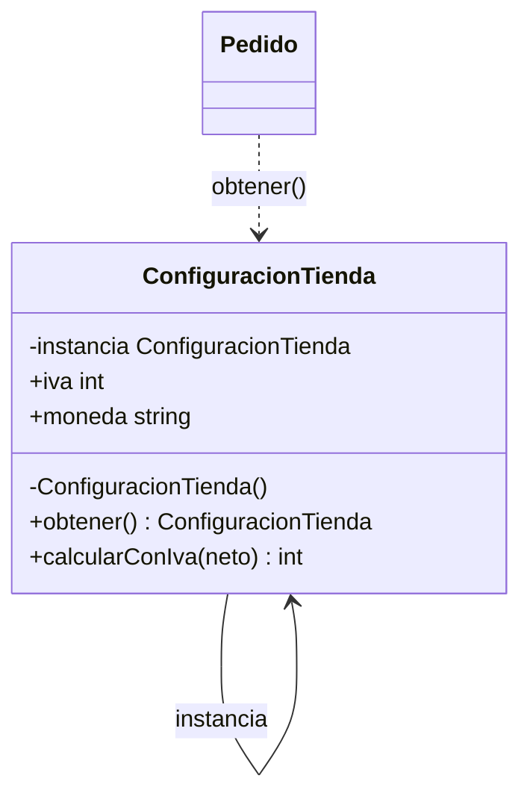

# Creacionales: Singleton

Los **patrones creacionales** (patrones de diseño que resuelven cómo y cuándo se crean los objetos; [glosario](../glosario.md#patrón-de-diseño)) tratan un problema que los módulos de SOLID tocaron de pasada: quién construye cada pieza y cuántas copias existen. Este es el primer patrón GoF del curso, y es un caso especial: es de los más famosos y de los más criticados. Lo estudiamos porque lo preguntan en entrevistas y porque sirve para entender por qué el [módulo 06](06-dip.md) insiste en inyectar dependencias en lugar de ir a buscarlas a un lugar global.

## Singleton

### El problema

La tienda tiene una configuración con el IVA (19 %) y la moneda (CLP). Cada pedido crea su propia `ConfiguracionTienda`, y cada instancia vuelve a leer el archivo del disco. Es lento y, peor, si alguien edita el archivo entre dos pedidos, dos objetos "iguales" responden distinto.

```python
import json


class ConfiguracionTienda:
    def __init__(self) -> None:
        with open("config.json") as archivo:  # lectura de disco en cada instancia
            datos = json.load(archivo)
        self.iva = datos["iva"]
        self.moneda = datos["moneda"]


class Pedido:
    def __init__(self, neto: int) -> None:
        self.neto = neto
        self.config = ConfiguracionTienda()  # una instancia nueva por pedido

    def total(self) -> int:
        return self.neto + self.neto * self.config.iva // 100


pedido_a = Pedido(10000)    # config.json dice iva = 19
# ...alguien cambia config.json a iva = 21...
pedido_b = Pedido(10000)    # esta instancia lee iva = 21
print(pedido_a.total(), pedido_b.total())  # => 11900 12100
```

El mismo carrito da dos totales distintos según el momento en que se creó el pedido. Además, hay miles de lecturas de disco repetidas y nadie sabe cuál es "la" configuración vigente.

### La idea en pocas palabras

Piensa en la alcaldía de un pueblo: hay una sola, todos saben dónde está y cualquiera que necesite un trámite va al mismo lugar. Nadie abre una alcaldía propia para cada vecino.

El **Singleton** garantiza que una clase tenga **una única instancia** y ofrece un **punto de acceso global** a ella. Para lograrlo, la clase esconde su constructor (nadie puede crear instancias desde afuera), guarda la instancia en un atributo estático y expone un método que la crea la primera vez y la devuelve en las siguientes. Una cosa es "hay una sola instancia" y otra "es accesible desde cualquier parte"; el patrón entrega las dos, y la segunda es la fuente de casi todas sus críticas.

- **Singleton** → `ConfiguracionTienda`: guarda su única instancia en un atributo estático privado (`instancia`) y la entrega con `obtener()`.
- **Clientes** → `Pedido` y cualquier otra clase que llame a `ConfiguracionTienda.obtener()`.

### Diagrama



El constructor es privado (`-`), el atributo `instancia` es estático y privado, y `obtener()` (también estático) es el único camino para llegar al objeto. Cualquier cliente llama a `obtener()` y siempre recibe la misma instancia.

### Código

El dominio se reduce a lo necesario: `ConfiguracionTienda` guarda el IVA (19) y la moneda ("CLP"), y `calcularConIva` suma el IVA a un monto neto en pesos: 10000 + 10000 × 19 / 100 = 11900. En lugar de leer un archivo, los valores se fijan al crear la instancia, para que el ejemplo corra solo. Todas las versiones demuestran lo mismo: dos llamadas a `obtener()` devuelven el mismo objeto.

#### Python

En Python hay dos formas habituales. La más simple es usar **el módulo como singleton**: Python ejecuta un módulo una sola vez y lo guarda en caché, así que `configuracion = ConfiguracionTienda()` al final de `configuracion.py` y `from configuracion import configuracion` en el resto del código ya da una única instancia, sin más patrón. La segunda es un método de clase `obtener()`, que es la que se muestra para que coincida con los otros lenguajes. Python no tiene constructores privados de verdad; por convención el constructor no se llama desde afuera. El candado y la doble comprobación hacen la creación **thread-safe** (segura cuando varios hilos la ejecutan a la vez; [glosario](../glosario.md#thread-safe)).

```python
import threading


class ConfiguracionTienda:
    _instancia: "ConfiguracionTienda | None" = None
    _candado = threading.Lock()

    def __init__(self) -> None:  # por convención, no se llama desde afuera
        self.iva = 19
        self.moneda = "CLP"

    @classmethod
    def obtener(cls) -> "ConfiguracionTienda":
        if cls._instancia is None:
            with cls._candado:
                if cls._instancia is None:  # segunda comprobación, ya con el candado
                    cls._instancia = cls()
        return cls._instancia

    def calcular_con_iva(self, neto: int) -> int:
        return neto + neto * self.iva // 100


a = ConfiguracionTienda.obtener()
b = ConfiguracionTienda.obtener()
print(a is b)  # => True
print(a.calcular_con_iva(10000))  # => 11900
print(b.moneda)  # => CLP
```

#### TypeScript

TypeScript sí permite un constructor `private`, y el compilador rechaza `new ConfiguracionTienda()` desde afuera. JavaScript ejecuta el código en un solo hilo (las tareas se turnan, no corren en paralelo), así que no hace falta un candado. La alternativa más simple, igual que en Python, es exportar una constante desde un módulo.

```typescript
class ConfiguracionTienda {
  private static instancia: ConfiguracionTienda | null = null;

  readonly iva = 19;
  readonly moneda = "CLP";

  private constructor() {}

  static obtener(): ConfiguracionTienda {
    if (ConfiguracionTienda.instancia === null) {
      ConfiguracionTienda.instancia = new ConfiguracionTienda();
    }
    return ConfiguracionTienda.instancia;
  }

  calcularConIva(neto: number): number {
    return neto + Math.floor((neto * this.iva) / 100);
  }
}

const a = ConfiguracionTienda.obtener();
const b = ConfiguracionTienda.obtener();
console.log(a === b); // => true
console.log(a.calcularConIva(10000)); // => 11900
console.log(b.moneda); // => CLP
```

#### Go

```go
package main

import (
	"fmt"
	"sync"
)

type ConfiguracionTienda struct {
	Iva    int
	Moneda string
}

var (
	instancia *ConfiguracionTienda
	una       sync.Once
)

func Obtener() *ConfiguracionTienda {
	una.Do(func() {
		instancia = &ConfiguracionTienda{Iva: 19, Moneda: "CLP"}
	})
	return instancia
}

func (c *ConfiguracionTienda) CalcularConIva(neto int) int {
	return neto + neto*c.Iva/100
}

func main() {
	a := Obtener()
	b := Obtener()
	fmt.Println(a == b)                  // => true
	fmt.Println(a.CalcularConIva(10000)) // => 11900
	fmt.Println(b.Moneda)                // => CLP
}
```

> **Nota Go:** `sync.Once` ejecuta la función que recibe **exactamente una vez**, aunque cientos de goroutines llamen a `Obtener()` al mismo tiempo; las que llegan después esperan a que termine y ven el resultado ya escrito. Es la forma idiomática de inicializar de forma perezosa y segura, sin escribir el candado a mano. Go tampoco tiene constructores privados: se limita el acceso a nivel de paquete dejando `instancia` en minúscula (no exportada) y exponiendo solo `Obtener()`. Ojo: como el tipo y sus campos están exportados, otro paquete puede crear otra instancia (`&ConfiguracionTienda{Iva: 19}`); para impedirlo, el tipo se deja no exportado (`configuracionTienda`) y solo se expone `Obtener()` (o una interfaz). Y como un paquete ya se inicializa una sola vez, a menudo basta una variable de paquete creada al arrancar.

#### PHP

En PHP el patrón clásico usa `private __construct` y un método `static getInstance()`. También se bloquea `__clone` para que nadie haga una segunda copia, y `__wakeup` lanza una excepción para que `unserialize` tampoco pueda crear otra. Cada petición HTTP corre con su propia memoria, así que la "única instancia" lo es solo dentro de esa petición, no entre peticiones.

```php
<?php

class ConfiguracionTienda
{
    private static ?ConfiguracionTienda $instancia = null;

    public readonly int $iva;
    public readonly string $moneda;

    private function __construct()
    {
        $this->iva = 19;
        $this->moneda = 'CLP';
    }

    private function __clone() {}

    public function __wakeup(): void
    {
        throw new \LogicException("No se puede deserializar un Singleton");
    }

    public static function getInstance(): ConfiguracionTienda
    {
        return self::$instancia ??= new ConfiguracionTienda();
    }

    public function calcularConIva(int $neto): int
    {
        return $neto + intdiv($neto * $this->iva, 100);
    }
}

$a = ConfiguracionTienda::getInstance();
$b = ConfiguracionTienda::getInstance();
echo ($a === $b ? 'true' : 'false') . "\n"; // => true
echo $a->calcularConIva(10000) . "\n"; // => 11900
echo $b->moneda . "\n"; // => CLP
```

### Cuándo usarlo y cuándo no

**Casi nunca es la mejor opción.** Singleton es **estado global** (datos que cualquier parte del programa puede leer o cambiar desde cualquier lugar; [glosario](../glosario.md#estado-global)) con una presentación más ordenada. Sus problemas son reales:

- **Esconde dependencias.** `Pedido.total()` usa la configuración, pero su firma no lo dice: hay que leer el cuerpo para enterarse. Es lo contrario de lo que enseña el [módulo 06](06-dip.md) (DIP): una clase debe declarar lo que necesita y recibirlo de afuera.
- **Dificulta las pruebas.** No se puede pasar una configuración falsa; el estado queda entre una prueba y otra, y el orden de las pruebas empieza a importar.
- **Viola SRP.** La clase tiene dos razones para cambiar: su lógica (calcular con IVA) y el control de su propia creación (cuántas instancias hay, cuándo se crean). Es el mismo problema de responsabilidades mezcladas que se vio en el [módulo 02](02-srp.md).
- **Complica la concurrencia.** Si la instancia es mutable, varios hilos la modifican a la vez; si se inicializa de forma perezosa sin cuidado, se pueden crear dos instancias.

**La alternativa habitual: una instancia única, pero inyectada.** Se crea **una sola** `ConfiguracionTienda` en el composition root (el punto de arranque que arma los objetos) y se pasa por constructor a quienes la necesitan: `Pedido(neto, config)`. La unicidad la garantiza quien arma el programa, no la clase, y las pruebas pueden pasar otra configuración. Es lo que hacen los contenedores de dependencias cuando registran un servicio con ciclo de vida "singleton": una sola instancia, sin acceso global.

**Cuándo puede justificarse:** cuando la unicidad es una restricción real del recurso (una única conexión a un dispositivo, un registro de logs del proceso), la instancia es de solo lectura o está bien protegida, e inyectarla sería de verdad incómodo (por ejemplo, en código heredado que no se puede modificar). Incluso entonces conviene ocultarla detrás de una interfaz para conservar la posibilidad de reemplazarla en las pruebas.

## Preguntas de entrevista

**P1. ¿Cómo haces thread-safe un Singleton?**
Hay que evitar que dos hilos creen la instancia a la vez. Las opciones son crearla al cargar la clase o el módulo (inicialización temprana, segura porque el cargador del lenguaje lo hace una sola vez), proteger la creación con un candado y doble comprobación (Python), o usar una primitiva del lenguaje como `sync.Once` en Go. Además, si el objeto es mutable, la instancia única no basta: hay que sincronizar también el acceso a su estado, o mejor hacerlo inmutable.

**P2. ¿Por qué muchos lo consideran un antipatrón?**
Porque es estado global disfrazado. Las clases que lo usan esconden esa dependencia (no aparece en su constructor ni en su firma), quedan acopladas a una clase concreta, y las pruebas se contaminan entre sí porque el estado persiste. Además mezcla dos responsabilidades en una clase, su lógica y el control de su propia creación, lo que viola SRP. El problema no es tener una instancia, sino imponerla desde la clase con acceso global.

**P3. ¿Qué alternativas hay al Singleton?**
La principal es crear una sola instancia en el composition root e inyectarla por constructor: se mantiene la unicidad sin el acceso global, y la dependencia es explícita y reemplazable (DIP). Otras son el módulo como singleton en Python y TypeScript (una constante exportada) o un contenedor de dependencias que registre el servicio con vida única. En los tres casos se conserva la ventaja (un único objeto) y se evita la desventaja (estado global).

**P4. ¿En qué se diferencia un Singleton de una variable global?**
Las dos son accesibles desde cualquier parte, pero el Singleton agrega dos garantías: solo puede existir una instancia (el constructor es privado) y la clase controla cuándo se crea (a menudo de forma perezosa, al pedirla por primera vez, en lugar de existir desde el arranque). A cambio hereda los mismos defectos del estado global: dependencias ocultas y pruebas difíciles. Es una variable global más ordenada, pero no elimina el acoplamiento.
