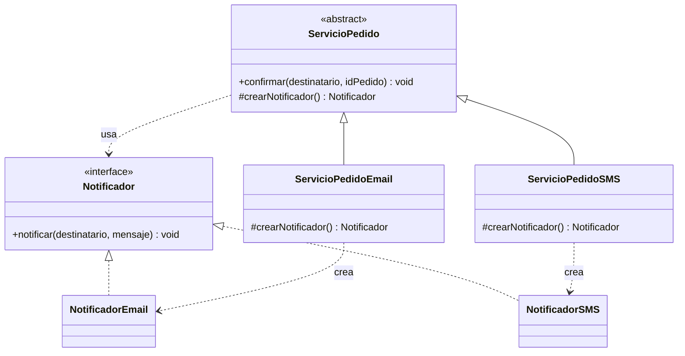

# Creacionales: Factory Method

El [módulo 07](07-singleton.md) trató cuántas instancias de una clase pueden existir. Este módulo trata la otra mitad del problema creacional: **qué clase concreta se instancia** y quién lo decide. Cuando cada parte del código escribe `new` de una clase concreta, el programa queda pegado a esas clases, justo el defecto que el [módulo 03](03-ocp.md) (OCP) y el [módulo 06](06-dip.md) (DIP) enseñaron a evitar. Factory Method es la primera respuesta del catálogo GoF.

## Factory Method

### El problema

Al confirmar un pedido, la tienda avisa al cliente por email, SMS o notificación push según su preferencia. Como no hay un lugar único que decida, cada función que notifica repite la misma cadena de `if` y construye las clases concretas ella misma.

```python
def confirmar_pedido(canal: str, destinatario: str, id_pedido: int) -> None:
    if canal == "email":
        notificador = NotificadorEmail()
    elif canal == "sms":
        notificador = NotificadorSMS()
    else:
        raise ValueError(f"canal desconocido: {canal}")
    notificador.notificar(destinatario, f"Pedido {id_pedido} confirmado")


def avisar_despacho(canal: str, destinatario: str, id_pedido: int) -> None:
    if canal == "email":
        notificador = NotificadorEmail()
    elif canal == "sms":
        notificador = NotificadorSMS()
    else:
        raise ValueError(f"canal desconocido: {canal}")
    notificador.notificar(destinatario, f"Pedido {id_pedido} despachado")

# ...y lo mismo en reembolsos, recordatorios de carrito y promociones.
```

La cadena aparece en cinco lugares. Para agregar `NotificadorPush` hay que encontrar y editar los cinco; si se olvida uno, ese flujo lanza "canal desconocido" en producción. Además, cada función depende de clases concretas, aunque solo necesita "algo que sepa notificar".

### La idea en pocas palabras

Piensa en pedir "un café" en una cadena de cafeterías: tú no decides cómo se prepara; cada sucursal sabe hacerlo a su manera (una usa máquina de cápsulas, otra espresso). Tú recibes el café y lo tomas igual.

**Factory Method** define, en una clase base, un método que **crea** el objeto (el **método creador**; [glosario](../glosario.md#método-creador)) sin decir de qué clase concreta es, y deja que cada subclase decida cuál devuelve. El resto de la clase base usa el objeto a través de su interfaz, sin saber qué hay detrás. Así, la decisión de "qué clase" vive en un solo lugar y el código que usa el objeto no cambia cuando aparece un tipo nuevo.

- **Producto** → `Notificador`: la interfaz de lo que se crea.
- **Productos concretos** → `NotificadorEmail`, `NotificadorSMS`, `NotificadorPush`.
- **Creador** → `ServicioPedido`: declara `crearNotificador()` y tiene lógica (`confirmar`) que usa lo que ese método devuelve.
- **Creadores concretos** → `ServicioPedidoEmail`, `ServicioPedidoSMS`: sobrescriben `crearNotificador()` y devuelven el producto que corresponde.

### Diagrama



`confirmar()` solo conoce `Notificador`. Las únicas flechas hacia las clases concretas salen de los creadores concretos, y cada uno apunta a una sola. `NotificadorPush` se omite para no saturar el diagrama; se agrega igual que los otros dos productos.

### Código

El producto es la interfaz `Notificador` del dominio, con `notificar(destinatario, mensaje)`. Para que el ejemplo corra solo, las tres implementaciones imprimen una línea con el canal y el destinatario en lugar de conectarse a un proveedor real (el `mensaje` no se imprime). Cada lenguaje tiene bloques para los productos, el Factory Method clásico con `ServicioPedido` y sus subclases, y la función de creación `crearNotificador(canal)`, la variante simple que se usa cuando el canal llega como dato (por ejemplo, desde la preferencia del cliente). En Go solo existe esa función, como explica la nota.

#### Python

```python
from typing import Protocol


class Notificador(Protocol):
    def notificar(self, destinatario: str, mensaje: str) -> None: ...


class NotificadorEmail:
    def notificar(self, destinatario: str, mensaje: str) -> None:
        print(f"Email enviado a {destinatario}")


class NotificadorSMS:
    def notificar(self, destinatario: str, mensaje: str) -> None:
        print(f"SMS enviado a {destinatario}")


class NotificadorPush:
    def notificar(self, destinatario: str, mensaje: str) -> None:
        print(f"Push enviado a {destinatario}")
```

El creador abstracto implementa `confirmar` una sola vez; cada subclase solo decide el producto.

```python
from abc import ABC, abstractmethod


class ServicioPedido(ABC):
    @abstractmethod
    def crear_notificador(self) -> Notificador: ...  # el método creador

    def confirmar(self, destinatario: str, id_pedido: int) -> None:
        notificador = self.crear_notificador()
        notificador.notificar(destinatario, f"Pedido {id_pedido} confirmado")


class ServicioPedidoEmail(ServicioPedido):
    def crear_notificador(self) -> Notificador:
        return NotificadorEmail()


class ServicioPedidoSMS(ServicioPedido):
    def crear_notificador(self) -> Notificador:
        return NotificadorSMS()


ServicioPedidoEmail().confirmar("ana@tienda.cl", 101)
# => Email enviado a ana@tienda.cl
ServicioPedidoSMS().confirmar("+56912345678", 101)
# => SMS enviado a +56912345678
```

Cuando el canal llega como texto, basta una función con una tabla de clases: agregar un canal es agregar una entrada, sin tocar los `if` de nadie.

```python
_CANALES: dict[str, type[Notificador]] = {
    "email": NotificadorEmail,
    "sms": NotificadorSMS,
    "push": NotificadorPush,
}


def crear_notificador(canal: str) -> Notificador:
    if canal not in _CANALES:
        raise ValueError(f"canal desconocido: {canal}")
    return _CANALES[canal]()


crear_notificador("push").notificar("dispositivo-42", "Hola")
# => Push enviado a dispositivo-42
try:
    crear_notificador("fax")
except ValueError as error:
    print(error)  # => canal desconocido: fax
```

#### TypeScript

```typescript
interface Notificador {
  notificar(destinatario: string, mensaje: string): void;
}

class NotificadorEmail implements Notificador {
  notificar(destinatario: string, mensaje: string): void {
    console.log(`Email enviado a ${destinatario}`);
  }
}

class NotificadorSMS implements Notificador {
  notificar(destinatario: string, mensaje: string): void {
    console.log(`SMS enviado a ${destinatario}`);
  }
}

class NotificadorPush implements Notificador {
  notificar(destinatario: string, mensaje: string): void {
    console.log(`Push enviado a ${destinatario}`);
  }
}
```

```typescript
abstract class ServicioPedido {
  protected abstract crearNotificador(): Notificador; // el método creador

  confirmar(destinatario: string, idPedido: number): void {
    const notificador = this.crearNotificador();
    notificador.notificar(destinatario, `Pedido ${idPedido} confirmado`);
  }
}

class ServicioPedidoEmail extends ServicioPedido {
  protected crearNotificador(): Notificador {
    return new NotificadorEmail();
  }
}

class ServicioPedidoSMS extends ServicioPedido {
  protected crearNotificador(): Notificador {
    return new NotificadorSMS();
  }
}

new ServicioPedidoEmail().confirmar("ana@tienda.cl", 101);
// => Email enviado a ana@tienda.cl
new ServicioPedidoSMS().confirmar("+56912345678", 101);
// => SMS enviado a +56912345678
```

```typescript
const canales: Record<string, () => Notificador> = {
  email: () => new NotificadorEmail(),
  sms: () => new NotificadorSMS(),
  push: () => new NotificadorPush(),
};

function crearNotificador(canal: string): Notificador {
  const crear = canales[canal];
  if (crear === undefined) {
    throw new Error(`canal desconocido: ${canal}`);
  }
  return crear();
}

crearNotificador("push").notificar("dispositivo-42", "Hola");
// => Push enviado a dispositivo-42
try {
  crearNotificador("fax");
} catch (error) {
  console.log((error as Error).message); // => canal desconocido: fax
}
```

#### Go

Los bloques de Go forman un solo `main.go`: el primero abre con `package main` y el `import` que usa todo el conjunto.

```go
package main

import "fmt"

type Notificador interface {
	Notificar(destinatario, mensaje string) error
}

type NotificadorEmail struct{}

func (NotificadorEmail) Notificar(destinatario, mensaje string) error {
	fmt.Println("Email enviado a " + destinatario)
	return nil
}

type NotificadorSMS struct{}

func (NotificadorSMS) Notificar(destinatario, mensaje string) error {
	fmt.Println("SMS enviado a " + destinatario)
	return nil
}

type NotificadorPush struct{}

func (NotificadorPush) Notificar(destinatario, mensaje string) error {
	fmt.Println("Push enviado a " + destinatario)
	return nil
}
```

```go
var canales = map[string]func() Notificador{
	"email": func() Notificador { return NotificadorEmail{} },
	"sms":   func() Notificador { return NotificadorSMS{} },
	"push":  func() Notificador { return NotificadorPush{} },
}

func NuevoNotificador(canal string) (Notificador, error) {
	crear, ok := canales[canal]
	if !ok {
		return nil, fmt.Errorf("canal desconocido: %s", canal)
	}
	return crear(), nil
}

func Confirmar(canal, destinatario string, idPedido int) error {
	notificador, err := NuevoNotificador(canal)
	if err != nil {
		return err
	}
	return notificador.Notificar(destinatario, fmt.Sprintf("Pedido %d confirmado", idPedido))
}
```

```go
func main() {
	avisar := func(canal, destinatario string) {
		if err := Confirmar(canal, destinatario, 101); err != nil {
			fmt.Println(err)
		}
	}
	avisar("email", "ana@tienda.cl")  // => Email enviado a ana@tienda.cl
	avisar("sms", "+56912345678")     // => SMS enviado a +56912345678
	avisar("push", "dispositivo-42")  // => Push enviado a dispositivo-42
	avisar("fax", "ana@tienda.cl")    // => canal desconocido: fax
}
```

> **Nota Go:** Go no tiene herencia de clases, así que no hay un creador abstracto con subclases que sobrescriban un método. El patrón se reduce a lo esencial: una **función constructora que devuelve una interfaz** (`NuevoNotificador`). Quien la llama recibe un `Notificador` y no sabe qué tipo concreto hay detrás, que es el objetivo del patrón. Cuando se necesita variar la creación entre servicios, se inyecta la función misma (`func() Notificador`) en lugar de escribir una jerarquía. Por convención, las funciones constructoras se llaman `NuevoX` (o `NewX`) y devuelven `error` si la creación puede fallar.

#### PHP

```php
<?php

interface Notificador
{
    public function notificar(string $destinatario, string $mensaje): void;
}

class NotificadorEmail implements Notificador
{
    public function notificar(string $destinatario, string $mensaje): void
    {
        echo "Email enviado a $destinatario\n";
    }
}

class NotificadorSMS implements Notificador
{
    public function notificar(string $destinatario, string $mensaje): void
    {
        echo "SMS enviado a $destinatario\n";
    }
}

class NotificadorPush implements Notificador
{
    public function notificar(string $destinatario, string $mensaje): void
    {
        echo "Push enviado a $destinatario\n";
    }
}
```

```php
<?php

abstract class ServicioPedido
{
    abstract protected function crearNotificador(): Notificador; // el método creador

    public function confirmar(string $destinatario, int $idPedido): void
    {
        $notificador = $this->crearNotificador();
        $notificador->notificar($destinatario, "Pedido $idPedido confirmado");
    }
}

class ServicioPedidoEmail extends ServicioPedido
{
    protected function crearNotificador(): Notificador
    {
        return new NotificadorEmail();
    }
}

class ServicioPedidoSMS extends ServicioPedido
{
    protected function crearNotificador(): Notificador
    {
        return new NotificadorSMS();
    }
}

(new ServicioPedidoEmail())->confirmar('ana@tienda.cl', 101);
// => Email enviado a ana@tienda.cl
(new ServicioPedidoSMS())->confirmar('+56912345678', 101);
// => SMS enviado a +56912345678
```

```php
<?php

function crearNotificador(string $canal): Notificador
{
    return match ($canal) {
        'email' => new NotificadorEmail(),
        'sms' => new NotificadorSMS(),
        'push' => new NotificadorPush(),
        default => throw new InvalidArgumentException("canal desconocido: $canal"),
    };
}

crearNotificador('push')->notificar('dispositivo-42', 'Hola');
// => Push enviado a dispositivo-42
try {
    crearNotificador('fax');
} catch (InvalidArgumentException $error) {
    echo $error->getMessage() . "\n"; // => canal desconocido: fax
}
```

### Cuándo usarlo y cuándo no

**Úsalo cuando** el tipo concreto que se necesita depende del contexto (el canal elegido por el cliente, el país, la configuración) y varias partes del código necesitan crearlo. Concentra la decisión en un solo lugar y trae dos beneficios ligados a SOLID:

- **OCP** ([módulo 03](03-ocp.md)): agregar `NotificadorPush` no obliga a editar cada `if canal == ...` del código; se agrega la clase y una entrada (o un creador concreto), y el código que notifica queda intacto.
- **DIP** ([módulo 06](06-dip.md)): el código que usa el producto depende de la interfaz `Notificador`, no de `NotificadorEmail`. Los nombres de las clases concretas quedan encerrados en la fábrica.

**No lo uses cuando** solo hay un tipo concreto y nada indica que vaya a haber otro: un `new NotificadorEmail()` directo es más claro (YAGNI: no construyas flexibilidad que nadie pidió). Tampoco cuando el objeto es un dato simple sin variantes. Y ten en cuenta el costo de la versión clásica: una jerarquía paralela de creadores (`ServicioPedidoEmail`, `ServicioPedidoSMS`) que solo existe para decidir una clase. Si la decisión depende de un dato (el texto `"sms"`), la función con una tabla es casi siempre más simple que las subclases.

## Comparación

Los tres nombres se confunden con frecuencia en entrevistas.

| | Qué es | Cómo elige el producto | Ejemplo en la tienda |
|---|---|---|---|
| **Simple Factory** | Una función o clase con un método que construye según un parámetro. No es un patrón GoF. | Un `if`, `match` o tabla sobre el parámetro | `crearNotificador("sms")` |
| **Factory Method** | Patrón GoF: un método creador en una clase base que las subclases sobrescriben. | Cada subclase fija el producto | `ServicioPedidoSMS.crearNotificador()` |
| **Abstract Factory** | Patrón GoF: una interfaz para crear **familias** de productos relacionados. | Cada fábrica concreta crea toda una familia coherente | Se estudia más adelante, en el módulo de Abstract Factory |

La diferencia práctica: Simple Factory y Factory Method crean **un** tipo de producto; Abstract Factory crea **varios productos que deben ser compatibles entre sí**. Factory Method se extiende con subclases, Simple Factory editando la tabla.

## Preguntas de entrevista

**P1. ¿En qué se diferencian Factory Method, Simple Factory y Abstract Factory?**
Simple Factory es una función o clase que construye objetos según un parámetro; no es un patrón GoF. Factory Method es un método de una clase base que las subclases sobrescriben para decidir qué producto crear. Abstract Factory es una interfaz que crea familias de productos relacionados que deben usarse juntos, no uno solo.

**P2. ¿Qué problema resuelve Factory Method?**
Evita que el código cliente cree clases concretas con `new` y repita cadenas de `if` por tipo. La decisión de qué clase instanciar queda en un solo lugar, y quien usa el objeto trabaja contra una interfaz. Así, un tipo nuevo no obliga a modificar todos los puntos donde se usa.

**P3. ¿Cómo se relaciona con OCP?**
Sin el patrón, cada tipo nuevo exige editar las cadenas de `if` repartidas por el código, es decir, modificar código existente. Con él, se extiende agregando una clase de producto y su creador (o una entrada en la tabla de la fábrica), y el código que usa el producto no se toca. También apoya DIP, porque el cliente depende de la interfaz y no de la clase concreta.

**P4. ¿Cómo se ve Factory Method en Go?**
Go no tiene herencia, así que no hay creador abstracto con subclases. El patrón se reduce a una función constructora que devuelve una interfaz, como `NuevoNotificador(canal string) (Notificador, error)`. Para variar la creación se inyecta la función como valor (`func() Notificador`).

**P5. ¿Por qué no usar `new` directamente?**
Porque acopla el código a una clase concreta: cambiarla, reemplazarla por un doble en las pruebas o agregar una variante obliga a editar cada lugar donde aparece. Con una fábrica, ese conocimiento está en un solo punto. Aun así, si hay un único tipo y no se espera otro, `new` directo es más simple y correcto.
