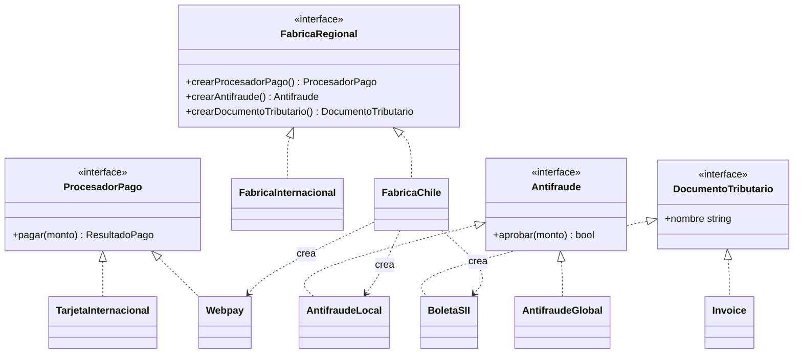

# Creacionales: Abstract Factory

El [módulo 08](08-factory-method.md) mostró cómo decidir **qué clase** se crea cuando el producto es uno solo. Este módulo sube un nivel: qué pasa cuando hay que crear **varios objetos que solo funcionan bien si vienen juntos**. Es el mismo problema de acoplamiento que atacan [OCP](03-ocp.md) y [DIP](06-dip.md), pero ahora con piezas que deben ser compatibles entre sí.

## Abstract Factory

### El problema

La tienda opera en Chile y en el extranjero. En Chile cobra con Webpay, revisa el fraude con un servicio local y emite boleta electrónica del SII; fuera de Chile cobra con tarjeta internacional, usa un antifraude global y emite una invoice. Hoy cada flujo decide cada pieza por separado con un `if region`, y nada impide mezclar piezas de familias distintas.

```python
def cobrar(region: str, monto: int) -> str:
    pago = Webpay() if region == "chile" else TarjetaInternacional()
    antifraude = AntifraudeLocal() if region == "chile" else AntifraudeGlobal()
    documento = BoletaSII() if region == "chile" else Invoice()
    if not antifraude.aprobar(monto):
        return "rechazado por antifraude"
    pago.pagar(monto)
    return f"{pago.nombre} + {documento.nombre}"


def reembolsar(region: str, monto: int) -> str:
    pago = Webpay() if region == "chile" else TarjetaInternacional()
    documento = Invoice()  # se olvidó el if: Webpay con invoice
    pago.pagar(monto)
    return f"{pago.nombre} + {documento.nombre}"
```

(Las clases `Webpay`, `BoletaSII`, etc. se definen en la sección de código.) Cada función repite tres `if region` y construye seis clases concretas. En `reembolsar` ya se coló el error: un cliente chileno recibe una **invoice** en lugar de boleta, y el SII la rechaza. Nada en el código lo detecta, porque cada pieza es válida por sí sola; lo que está mal es la **combinación**. Y si mañana se agrega Brasil, hay que editar cada función de la tienda.

### La idea en pocas palabras

Piensa en comprar un kit de muebles de la misma línea: la mesa, las sillas y el estante vienen diseñados para combinar. No puedes recibir la mesa de una línea con las sillas de otra por accidente, porque las pides en un solo paquete.

**Abstract Factory** es una interfaz con un método de creación por cada producto de una **familia de productos** (conjunto de objetos pensados para usarse juntos; [glosario](../glosario.md#familia-de-productos)). Cada fábrica concreta implementa todos esos métodos y devuelve siempre las piezas de **su** familia. El código cliente recibe una fábrica y construye todo a través de ella: no nombra ninguna clase concreta y, por construcción, no puede mezclar familias.

- **Fábrica abstracta** → `FabricaRegional`: declara `crearProcesadorPago()`, `crearAntifraude()` y `crearDocumentoTributario()`.
- **Fábricas concretas** → `FabricaChile` (Webpay, antifraude local, boleta SII) y `FabricaInternacional` (tarjeta, antifraude global, invoice).
- **Productos abstractos** → `ProcesadorPago` (el `MetodoPago` del dominio), `Antifraude` y `DocumentoTributario`.
- **Productos concretos** → `Webpay`, `TarjetaInternacional`, `AntifraudeLocal`, `AntifraudeGlobal`, `BoletaSII`, `Invoice`.
- **Cliente** → `cliente(fabrica, monto)` (en Go `usarFabrica`, porque `Cliente` ya es un tipo del dominio): usa solo las interfaces.

### Diagrama



Hay 3 productos abstractos y 2 familias, así que `FabricaInternacional` crea `TarjetaInternacional`, `AntifraudeGlobal` e `Invoice` con las mismas flechas "crea"; se omiten para no saturar el diagrama. El cliente solo depende de `FabricaRegional` y de las tres interfaces de producto.

### Código

Se simplifica el dominio: cada producto tiene un `nombre` para poder mostrar qué familia salió, y `DocumentoTributario` no emite nada real (solo se identifica). `ProcesadorPago` es el `MetodoPago` de los módulos anteriores con `nombre` agregado: `pagar(monto)` devuelve `ResultadoPago(ok, referencia)`. Los proveedores son simulados: el pago siempre se aprueba, y el antifraude local rechaza montos sobre 1.000.000 y el global, sobre 5.000.000.

#### Python

```python
from dataclasses import dataclass
from typing import Protocol


@dataclass(frozen=True)
class ResultadoPago:
    ok: bool
    referencia: str


class ProcesadorPago(Protocol):
    nombre: str

    def pagar(self, monto: int) -> ResultadoPago: ...


class Antifraude(Protocol):
    def aprobar(self, monto: int) -> bool: ...


class DocumentoTributario(Protocol):
    nombre: str
```

```python
class Webpay:
    nombre = "Webpay"

    def pagar(self, monto: int) -> ResultadoPago:
        return ResultadoPago(True, "WP-001")


class TarjetaInternacional:
    nombre = "Tarjeta"

    def pagar(self, monto: int) -> ResultadoPago:
        return ResultadoPago(True, "TJ-001")


class AntifraudeLocal:
    def aprobar(self, monto: int) -> bool:
        return monto <= 1_000_000


class AntifraudeGlobal:
    def aprobar(self, monto: int) -> bool:
        return monto <= 5_000_000


class BoletaSII:
    nombre = "Boleta SII"


class Invoice:
    nombre = "Invoice"
```

La fábrica abstracta y las dos concretas son la única parte que nombra clases concretas; el cliente no.

```python
from abc import ABC, abstractmethod


class FabricaRegional(ABC):
    @abstractmethod
    def crear_procesador_pago(self) -> ProcesadorPago: ...

    @abstractmethod
    def crear_antifraude(self) -> Antifraude: ...

    @abstractmethod
    def crear_documento_tributario(self) -> DocumentoTributario: ...


class FabricaChile(FabricaRegional):
    def crear_procesador_pago(self) -> ProcesadorPago:
        return Webpay()

    def crear_antifraude(self) -> Antifraude:
        return AntifraudeLocal()

    def crear_documento_tributario(self) -> DocumentoTributario:
        return BoletaSII()
```

```python
class FabricaInternacional(FabricaRegional):
    def crear_procesador_pago(self) -> ProcesadorPago:
        return TarjetaInternacional()

    def crear_antifraude(self) -> Antifraude:
        return AntifraudeGlobal()

    def crear_documento_tributario(self) -> DocumentoTributario:
        return Invoice()


def cliente(fabrica: FabricaRegional, monto: int) -> str:
    pago = fabrica.crear_procesador_pago()
    antifraude = fabrica.crear_antifraude()
    documento = fabrica.crear_documento_tributario()
    if not antifraude.aprobar(monto) or not pago.pagar(monto).ok:
        return "rechazado"
    return f"{pago.nombre} + {documento.nombre}"


print("Chile:", cliente(FabricaChile(), 19990))
# => Chile: Webpay + Boleta SII
print("Internacional:", cliente(FabricaInternacional(), 19990))
# => Internacional: Tarjeta + Invoice
print("Chile:", cliente(FabricaChile(), 2_000_000))
# => Chile: rechazado
```

#### TypeScript

```typescript
interface ResultadoPago {
  ok: boolean;
  referencia: string;
}

interface ProcesadorPago {
  nombre: string;
  pagar(monto: number): ResultadoPago;
}

interface Antifraude {
  aprobar(monto: number): boolean;
}

interface DocumentoTributario {
  nombre: string;
}

interface FabricaRegional {
  crearProcesadorPago(): ProcesadorPago;
  crearAntifraude(): Antifraude;
  crearDocumentoTributario(): DocumentoTributario;
}
```

```typescript
class Webpay implements ProcesadorPago {
  nombre = "Webpay";
  pagar(monto: number): ResultadoPago {
    return { ok: true, referencia: "WP-001" };
  }
}

class TarjetaInternacional implements ProcesadorPago {
  nombre = "Tarjeta";
  pagar(monto: number): ResultadoPago {
    return { ok: true, referencia: "TJ-001" };
  }
}

class AntifraudeLocal implements Antifraude {
  aprobar(monto: number): boolean {
    return monto <= 1_000_000;
  }
}

class AntifraudeGlobal implements Antifraude {
  aprobar(monto: number): boolean {
    return monto <= 5_000_000;
  }
}

class BoletaSII implements DocumentoTributario {
  nombre = "Boleta SII";
}

class Invoice implements DocumentoTributario {
  nombre = "Invoice";
}
```

```typescript
class FabricaChile implements FabricaRegional {
  crearProcesadorPago(): ProcesadorPago {
    return new Webpay();
  }
  crearAntifraude(): Antifraude {
    return new AntifraudeLocal();
  }
  crearDocumentoTributario(): DocumentoTributario {
    return new BoletaSII();
  }
}

class FabricaInternacional implements FabricaRegional {
  crearProcesadorPago(): ProcesadorPago {
    return new TarjetaInternacional();
  }
  crearAntifraude(): Antifraude {
    return new AntifraudeGlobal();
  }
  crearDocumentoTributario(): DocumentoTributario {
    return new Invoice();
  }
}
```

```typescript
function cliente(fabrica: FabricaRegional, monto: number): string {
  const pago = fabrica.crearProcesadorPago();
  const antifraude = fabrica.crearAntifraude();
  const documento = fabrica.crearDocumentoTributario();
  if (!antifraude.aprobar(monto) || !pago.pagar(monto).ok) {
    return "rechazado";
  }
  return `${pago.nombre} + ${documento.nombre}`;
}

console.log("Chile:", cliente(new FabricaChile(), 19990));
// => Chile: Webpay + Boleta SII
console.log("Internacional:", cliente(new FabricaInternacional(), 19990));
// => Internacional: Tarjeta + Invoice
console.log("Chile:", cliente(new FabricaChile(), 2_000_000));
// => Chile: rechazado
```

#### Go

Los bloques de Go forman un solo `main.go`: el primero abre con `package main` y el `import` que usa todo el conjunto.

```go
package main

import "fmt"

type ResultadoPago struct {
	Ok         bool
	Referencia string
}

type ProcesadorPago interface {
	Nombre() string
	Pagar(monto int) ResultadoPago
}

type Antifraude interface {
	Aprobar(monto int) bool
}

type DocumentoTributario interface {
	Nombre() string
}

type FabricaRegional interface {
	CrearProcesadorPago() ProcesadorPago
	CrearAntifraude() Antifraude
	CrearDocumentoTributario() DocumentoTributario
}
```

```go
type Webpay struct{}

func (Webpay) Nombre() string { return "Webpay" }
func (Webpay) Pagar(monto int) ResultadoPago {
	return ResultadoPago{Ok: true, Referencia: "WP-001"}
}

type TarjetaInternacional struct{}

func (TarjetaInternacional) Nombre() string { return "Tarjeta" }
func (TarjetaInternacional) Pagar(monto int) ResultadoPago {
	return ResultadoPago{Ok: true, Referencia: "TJ-001"}
}

type AntifraudeLocal struct{}

func (AntifraudeLocal) Aprobar(monto int) bool { return monto <= 1_000_000 }

type AntifraudeGlobal struct{}

func (AntifraudeGlobal) Aprobar(monto int) bool { return monto <= 5_000_000 }

type BoletaSII struct{}

func (BoletaSII) Nombre() string { return "Boleta SII" }

type Invoice struct{}

func (Invoice) Nombre() string { return "Invoice" }
```

```go
type FabricaChile struct{}

func (FabricaChile) CrearProcesadorPago() ProcesadorPago        { return Webpay{} }
func (FabricaChile) CrearAntifraude() Antifraude                { return AntifraudeLocal{} }
func (FabricaChile) CrearDocumentoTributario() DocumentoTributario { return BoletaSII{} }

type FabricaInternacional struct{}

func (FabricaInternacional) CrearProcesadorPago() ProcesadorPago {
	return TarjetaInternacional{}
}
func (FabricaInternacional) CrearAntifraude() Antifraude { return AntifraudeGlobal{} }
func (FabricaInternacional) CrearDocumentoTributario() DocumentoTributario {
	return Invoice{}
}
```

```go
func usarFabrica(fabrica FabricaRegional, monto int) string {
	pago := fabrica.CrearProcesadorPago()
	antifraude := fabrica.CrearAntifraude()
	documento := fabrica.CrearDocumentoTributario()
	if !antifraude.Aprobar(monto) || !pago.Pagar(monto).Ok {
		return "rechazado"
	}
	return pago.Nombre() + " + " + documento.Nombre()
}

func main() {
	fmt.Println("Chile:", usarFabrica(FabricaChile{}, 19990))
	// => Chile: Webpay + Boleta SII
	fmt.Println("Internacional:", usarFabrica(FabricaInternacional{}, 19990))
	// => Internacional: Tarjeta + Invoice
	fmt.Println("Chile:", usarFabrica(FabricaChile{}, 2_000_000))
	// => Chile: rechazado
}
```

> **Nota Go:** no hace falta una clase abstracta ni herencia: la fábrica abstracta es una **interfaz con varios métodos de creación** y cada familia es un `struct` vacío (`FabricaChile`, `FabricaInternacional`) que la satisface de forma implícita. Como los métodos no guardan estado, se pasan por valor (`FabricaChile{}`). Si una familia necesita configuración (credenciales, país), el `struct` tiene campos y se construye con una función `NuevaFabricaChile(...)`.

#### PHP

```php
<?php

final class ResultadoPago
{
    public function __construct(
        public readonly bool $ok,
        public readonly string $referencia,
    ) {
    }
}

interface ProcesadorPago
{
    public function nombre(): string;
    public function pagar(int $monto): ResultadoPago;
}

interface Antifraude
{
    public function aprobar(int $monto): bool;
}

interface DocumentoTributario
{
    public function nombre(): string;
}

interface FabricaRegional
{
    public function crearProcesadorPago(): ProcesadorPago;
    public function crearAntifraude(): Antifraude;
    public function crearDocumentoTributario(): DocumentoTributario;
}
```

```php
<?php

class Webpay implements ProcesadorPago
{
    public function nombre(): string { return 'Webpay'; }
    public function pagar(int $monto): ResultadoPago { return new ResultadoPago(true, 'WP-001'); }
}

class TarjetaInternacional implements ProcesadorPago
{
    public function nombre(): string { return 'Tarjeta'; }
    public function pagar(int $monto): ResultadoPago { return new ResultadoPago(true, 'TJ-001'); }
}

class AntifraudeLocal implements Antifraude
{
    public function aprobar(int $monto): bool { return $monto <= 1_000_000; }
}

class AntifraudeGlobal implements Antifraude
{
    public function aprobar(int $monto): bool { return $monto <= 5_000_000; }
}

class BoletaSII implements DocumentoTributario
{
    public function nombre(): string { return 'Boleta SII'; }
}

class Invoice implements DocumentoTributario
{
    public function nombre(): string { return 'Invoice'; }
}
```

```php
<?php

class FabricaChile implements FabricaRegional
{
    public function crearProcesadorPago(): ProcesadorPago { return new Webpay(); }
    public function crearAntifraude(): Antifraude { return new AntifraudeLocal(); }
    public function crearDocumentoTributario(): DocumentoTributario { return new BoletaSII(); }
}

class FabricaInternacional implements FabricaRegional
{
    public function crearProcesadorPago(): ProcesadorPago { return new TarjetaInternacional(); }
    public function crearAntifraude(): Antifraude { return new AntifraudeGlobal(); }
    public function crearDocumentoTributario(): DocumentoTributario { return new Invoice(); }
}
```

```php
<?php

function cliente(FabricaRegional $fabrica, int $monto): string
{
    $pago = $fabrica->crearProcesadorPago();
    $antifraude = $fabrica->crearAntifraude();
    $documento = $fabrica->crearDocumentoTributario();
    if (!$antifraude->aprobar($monto) || !$pago->pagar($monto)->ok) {
        return 'rechazado';
    }
    return $pago->nombre() . ' + ' . $documento->nombre();
}

echo 'Chile: ' . cliente(new FabricaChile(), 19990) . "\n";
// => Chile: Webpay + Boleta SII
echo 'Internacional: ' . cliente(new FabricaInternacional(), 19990) . "\n";
// => Internacional: Tarjeta + Invoice
echo 'Chile: ' . cliente(new FabricaChile(), 2_000_000) . "\n";
// => Chile: rechazado
```

### Cuándo usarlo y cuándo no

**Úsalo cuando** el sistema debe trabajar con **varias familias** de objetos que tienen que usarse juntas (pago + antifraude + documento por región, widgets de una interfaz por plataforma, drivers de base de datos) y quieres garantizar que no se mezclen. Beneficios ligados a SOLID:

- **DIP** ([módulo 06](06-dip.md)): el cliente depende de `FabricaRegional` y de las interfaces de producto, nunca de `Webpay` ni de `Invoice`. Las clases concretas quedan encerradas en las fábricas, que se eligen en un solo punto (la configuración o la raíz de composición).
- **OCP** ([módulo 03](03-ocp.md)), en el eje de las familias: agregar Brasil es crear `FabricaBrasil` y sus productos, sin editar el cliente ni las otras fábricas.

**El costo**, también en términos de OCP, está en el otro eje: agregar un **producto nuevo** a la familia (por ejemplo `crearCalculadorImpuestos()`) obliga a modificar la interfaz `FabricaRegional` y **todas** las fábricas concretas. El patrón hace fácil agregar familias y caro agregar tipos de producto; si lo segundo ocurre seguido, ese diseño te va a doler.

**No lo uses cuando** solo hay una familia, o cuando los productos son independientes y se pueden combinar libremente: bastan una fábrica por producto (Factory Method) o inyectar cada pieza por separado. Tampoco lo uses por anticipado (YAGNI): con dos familias y dos productos, un `if region` bien ubicado puede ser más claro que cuatro interfaces y tres clases.

## Comparación

| | Factory Method | Abstract Factory |
|---|---|---|
| **Crea** | **Un** producto | Una **familia** de productos relacionados |
| **Mecanismo** | Un método creador que las subclases sobrescriben | Un objeto fábrica con varios métodos de creación |
| **Compatibilidad entre piezas** | No aplica: hay un solo producto | La garantiza: cada fábrica entrega piezas que combinan |
| **Agregar un producto nuevo** | Un creador concreto nuevo | Cambiar la interfaz y todas las fábricas |
| **Ejemplo en la tienda** | `ServicioPedidoSMS.crearNotificador()` | `FabricaChile` (Webpay + antifraude local + boleta SII) |

Es común que cada método de una Abstract Factory se implemente, por dentro, como un Factory Method o una función constructora: son patrones que se componen.

## Preguntas de entrevista

**P1. ¿En qué se diferencia Abstract Factory de Factory Method?**
Factory Method crea un solo tipo de producto mediante un método que las subclases sobrescriben. Abstract Factory es un objeto con varios métodos de creación que produce una familia completa de productos que deben usarse juntos. La diferencia clave es que la segunda garantiza la compatibilidad entre las piezas.

**P2. ¿Cuándo elegir uno u otro?**
Si necesitas variar un solo objeto según el contexto (el canal de notificación), usa Factory Method o una función creadora. Si necesitas variar varios objetos a la vez y deben ser coherentes entre sí (pago, antifraude y documento de una región), usa Abstract Factory. Si hay una sola familia, ninguno de los dos hace falta.

**P3. ¿Qué principio se resiente al agregar un producto nuevo a la familia?**
OCP. Agregar `crearCalculadorImpuestos()` obliga a modificar la interfaz de la fábrica y todas sus implementaciones, así que el diseño no está cerrado a ese tipo de extensión. En cambio, agregar una familia nueva no toca código existente. Por eso conviene usarlo cuando las familias cambian más que los tipos de producto.

**P4. ¿Qué ventaja da frente al `if region` repartido por el código?**
Concentra en un solo punto la decisión de qué familia se usa, y el cliente trabaja contra interfaces (DIP). Además impide por construcción combinaciones inválidas, como Webpay con invoice, que con `if` sueltos dependen de que nadie se equivoque. Agregar una región es escribir una fábrica nueva.

**P5. ¿Un ejemplo real?**
Un toolkit de interfaz gráfica multiplataforma: una fábrica por sistema operativo que crea botones, menús y ventanas con el mismo aspecto. Otro: las bibliotecas de acceso a bases de datos, donde cada driver (PostgreSQL, MySQL) entrega su propia conexión, comando y lector de resultados, que solo funcionan entre sí.

**P6. ¿Cómo se ve en Go?**
Una interfaz con varios métodos de creación y un `struct` por familia que la satisface de forma implícita, sin herencia. Quien la usa recibe la interfaz y no sabe qué familia hay detrás.
