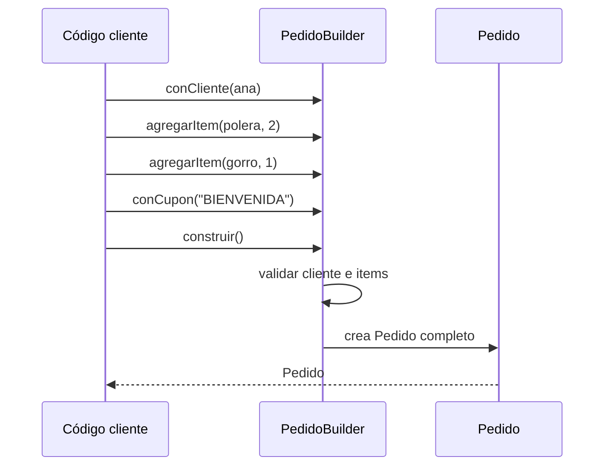

# Creacionales: Builder

Los módulos [08](08-factory-method.md) y [09](09-abstract-factory.md) resolvieron **qué clase** se crea. Este módulo trata otro problema creacional: cuando una sola clase se crea con **muchas opciones**, algunas obligatorias y otras no, y el propio acto de crearla se vuelve difícil de leer y de hacer bien. Builder separa el "cómo se arma" del objeto armado, una aplicación directa de [SRP](02-srp.md).

## Builder

### El problema

Un `Pedido` de la tienda lleva cliente e items (obligatorios), y además cupón, tipo de despacho, nota para el repartidor y opciones de regalo. Todo eso entra por el constructor.

```python
class Pedido:
    def __init__(self, cliente, items, cupon=None, despacho="estandar",
                 nota="", regalo=False, mensaje_regalo=""):
        self.cliente = cliente
        self.items = items
        self.cupon = cupon
        self.despacho = despacho
        self.nota = nota
        self.regalo = regalo
        self.mensaje_regalo = mensaje_regalo


ana = "Ana"
items = ["Polera", "Gorro"]
p1 = Pedido(ana, items, None, "express", "", True, "Feliz cumple")
p2 = Pedido(ana, items, "BIENVENIDA", "Dejar en conserjería")
p3 = Pedido(ana, [])
```

Esto es un **constructor telescópico** (un constructor con una larga fila de parámetros opcionales que crece con cada opción nueva; [glosario](../glosario.md#constructor-telescópico)). Los problemas se ven en las tres últimas líneas:

- `p1` exige contar posiciones: ¿el `""` es la nota o el despacho? Ya cuesta leerlo.
- `p2` tiene un error silencioso: la nota "Dejar en conserjería" quedó en `despacho`, porque el tercer argumento posicional era el cupón y el cuarto el despacho. Python no se queja: ambos son `str`.
- `p3` es un pedido **sin items**. Nada lo impide, y el error aparecerá lejos de aquí, cuando alguien calcule el total.

La alternativa habitual, crear el `Pedido` vacío y asignar atributos uno a uno, es peor: deja objetos **a medio armar** circulando por el programa.

### La idea en pocas palabras

Piensa en pedir un sándwich en un local: el cajero te pregunta paso a paso el pan, la proteína y las salsas, y solo cuando terminas de elegir arma el sándwich completo. Nadie te entrega medio sándwich.

**Builder** es un objeto auxiliar que reúne los datos de a uno por paso y entrega el objeto final solo cuando se llama a `construir()`, que además **valida** que todo esté completo. Los pasos tienen nombre (`conCupon("BIENVENIDA")`), así que no importa el orden ni hay que contar posiciones. Cuando cada paso devuelve el propio builder se obtiene una **interfaz fluida** (llamadas encadenadas que se leen casi como una frase; [glosario](../glosario.md#interfaz-fluida)).

- **Builder** → `PedidoBuilder`: guarda el estado en construcción y ofrece `conCliente`, `agregarItem`, `conCupon`, `conDespacho`, `conNota` y `construir()`.
- **Producto** → `Pedido`: el objeto final, que nace completo y válido.
- **Director** (opcional) → una función o clase que conoce recetas de armado ("pedido de regalo exprés") y las ejecuta sobre un builder. Solo vale la pena si esas recetas se repiten.

### Diagrama



Cada paso devuelve el mismo builder (por eso se pueden encadenar). Solo `construir()` produce un `Pedido`, y lo hace después de validar.

### Código

Se simplifica el dominio fijo: `Pedido` no lleva `id` ni `estado` y no calcula `total()` (eso queda fuera para centrar el módulo en la construcción). En su lugar tiene `cupon`, `despacho`, `nota` y un método `resumen()` que describe el pedido. Se omiten las opciones de regalo del ejemplo anterior: agregarlas sería un `conRegalo(...)` más, sin tocar nada existente. El despacho vale `"estandar"` si nadie lo cambia.

La validación de `construir()` es doble: no hay pedido sin cliente ni sin items.

#### Python

`Pedido` es una `dataclass` con `frozen=True`: asignar un atributo después de crearlo lanza `FrozenInstanceError`. Los items se guardan como `tuple`, que tampoco se puede modificar.

```python
from dataclasses import dataclass


@dataclass(frozen=True)
class Producto:
    id: int
    nombre: str
    precio: int


@dataclass(frozen=True)
class Cliente:
    id: int
    nombre: str
    email: str


@dataclass(frozen=True)
class ItemCarrito:
    producto: Producto
    cantidad: int


@dataclass(frozen=True)
class Pedido:
    cliente: Cliente
    items: tuple[ItemCarrito, ...]
    cupon: str | None = None
    despacho: str = "estandar"
    nota: str = ""

    def resumen(self) -> str:
        cupon = f"cupón {self.cupon}" if self.cupon else "sin cupón"
        return f"Pedido con {len(self.items)} items, {cupon}"
```

```python
class PedidoBuilder:
    def __init__(self) -> None:
        self._cliente: Cliente | None = None
        self._items: list[ItemCarrito] = []
        self._cupon: str | None = None
        self._despacho = "estandar"
        self._nota = ""

    def con_cliente(self, cliente: Cliente) -> "PedidoBuilder":
        self._cliente = cliente
        return self

    def agregar_item(self, producto: Producto, cantidad: int) -> "PedidoBuilder":
        self._items.append(ItemCarrito(producto, cantidad))
        return self

    def con_cupon(self, cupon: str) -> "PedidoBuilder":
        self._cupon = cupon
        return self

    def con_despacho(self, despacho: str) -> "PedidoBuilder":
        self._despacho = despacho
        return self

    def con_nota(self, nota: str) -> "PedidoBuilder":
        self._nota = nota
        return self

    def construir(self) -> Pedido:
        if self._cliente is None:
            raise ValueError("un pedido necesita cliente")
        if not self._items:
            raise ValueError("un pedido necesita al menos un item")
        return Pedido(self._cliente, tuple(self._items),
                      self._cupon, self._despacho, self._nota)
```

```python
ana = Cliente(1, "Ana", "ana@mail.cl")
polera = Producto(1, "Polera", 12990)
gorro = Producto(2, "Gorro", 5990)
pedido = (PedidoBuilder().con_cliente(ana).agregar_item(polera, 2)
          .agregar_item(gorro, 1).con_cupon("BIENVENIDA").construir())
print(pedido.resumen())
# => Pedido con 2 items, cupón BIENVENIDA
try:
    PedidoBuilder().con_cliente(ana).construir()
except ValueError as error:
    print("Error:", error)
# => Error: un pedido necesita al menos un item
```

`construir()` entrega una tupla **copia** de los items del builder: si después se llama `agregar_item` sobre el mismo builder, el `Pedido` ya creado no cambia.

#### TypeScript

Las propiedades de `Pedido` son `readonly` y la lista de items se copia y se congela con `Object.freeze`, así que tampoco se puede modificar en tiempo de ejecución. (`readonly` por sí solo lo comprueba solo el compilador.)

```typescript
interface Producto {
  id: number;
  nombre: string;
  precio: number;
}

interface Cliente {
  id: number;
  nombre: string;
  email: string;
}

interface ItemCarrito {
  producto: Producto;
  cantidad: number;
}

class Pedido {
  constructor(
    readonly cliente: Cliente,
    readonly items: readonly ItemCarrito[],
    readonly cupon: string | null,
    readonly despacho: string,
    readonly nota: string,
  ) {}

  resumen(): string {
    const cupon = this.cupon ? `cupón ${this.cupon}` : "sin cupón";
    return `Pedido con ${this.items.length} items, ${cupon}`;
  }
}
```

```typescript
class PedidoBuilder {
  private cliente: Cliente | null = null;
  private items: ItemCarrito[] = [];
  private cupon: string | null = null;
  private despacho = "estandar";
  private nota = "";

  conCliente(cliente: Cliente): this {
    this.cliente = cliente;
    return this;
  }
  agregarItem(producto: Producto, cantidad: number): this {
    this.items.push({ producto, cantidad });
    return this;
  }
  conCupon(cupon: string): this {
    this.cupon = cupon;
    return this;
  }
  conDespacho(despacho: string): this {
    this.despacho = despacho;
    return this;
  }
  conNota(nota: string): this {
    this.nota = nota;
    return this;
  }

  construir(): Pedido {
    if (this.cliente === null) throw new Error("un pedido necesita cliente");
    if (this.items.length === 0) throw new Error("un pedido necesita al menos un item");
    const items = Object.freeze([...this.items]);
    return new Pedido(this.cliente, items, this.cupon, this.despacho, this.nota);
  }
}
```

```typescript
const ana: Cliente = { id: 1, nombre: "Ana", email: "ana@mail.cl" };
const polera: Producto = { id: 1, nombre: "Polera", precio: 12990 };
const gorro: Producto = { id: 2, nombre: "Gorro", precio: 5990 };
const pedido = new PedidoBuilder().conCliente(ana).agregarItem(polera, 2)
  .agregarItem(gorro, 1).conCupon("BIENVENIDA").construir();
console.log(pedido.resumen());
// => Pedido con 2 items, cupón BIENVENIDA
try {
  new PedidoBuilder().conCliente(ana).construir();
} catch (error) {
  console.log("Error:", (error as Error).message);
}
// => Error: un pedido necesita al menos un item
```

#### Go

Los bloques de Go forman un solo `main.go`: el primero abre con `package main` y el `import` que usa todo el conjunto. Aquí **no hay `PedidoBuilder`**: el idioma de Go son las *functional options* (funciones que modifican el objeto en construcción y se pasan como argumentos variables; [glosario](../glosario.md#functional-options)). Cada opción (`ConCupon`, `ConNota`...) cumple el rol de un paso del builder, y `NuevoPedido` hace de `construir()`.

```go
package main

import (
	"errors"
	"fmt"
)

type Producto struct {
	ID     int
	Nombre string
	Precio int
}

type Cliente struct {
	ID     int
	Nombre string
	Email  string
}

type ItemCarrito struct {
	Producto Producto
	Cantidad int
}

type Pedido struct {
	cliente  Cliente
	items    []ItemCarrito
	cupon    string
	despacho string
	nota     string
}

func (p Pedido) Resumen() string {
	cupon := "sin cupón"
	if p.cupon != "" {
		cupon = "cupón " + p.cupon
	}
	return fmt.Sprintf("Pedido con %d items, %s", len(p.items), cupon)
}
```

```go
type OpcionPedido func(*Pedido)

func ConItem(producto Producto, cantidad int) OpcionPedido {
	return func(p *Pedido) {
		p.items = append(p.items, ItemCarrito{producto, cantidad})
	}
}

func ConCupon(cupon string) OpcionPedido {
	return func(p *Pedido) { p.cupon = cupon }
}

func ConDespacho(despacho string) OpcionPedido {
	return func(p *Pedido) { p.despacho = despacho }
}

func ConNota(nota string) OpcionPedido {
	return func(p *Pedido) { p.nota = nota }
}

func NuevoPedido(cliente Cliente, opciones ...OpcionPedido) (Pedido, error) {
	p := Pedido{cliente: cliente, despacho: "estandar"}
	for _, aplicar := range opciones {
		aplicar(&p)
	}
	if len(p.items) == 0 {
		return Pedido{}, errors.New("un pedido necesita al menos un item")
	}
	return p, nil
}
```

```go
func main() {
	ana := Cliente{1, "Ana", "ana@mail.cl"}
	polera := Producto{1, "Polera", 12990}
	gorro := Producto{2, "Gorro", 5990}
	pedido, err := NuevoPedido(ana, ConItem(polera, 2), ConItem(gorro, 1),
		ConCupon("BIENVENIDA"), ConNota("Dejar en conserjería"))
	if err != nil {
		fmt.Println("Error:", err)
		return
	}
	fmt.Println(pedido.Resumen())
	// => Pedido con 2 items, cupón BIENVENIDA
	_, err = NuevoPedido(ana, ConCupon("BIENVENIDA"))
	fmt.Println("Error:", err)
	// => Error: un pedido necesita al menos un item
}
```

> **Nota Go:** en Go las *functional options* reemplazan al Builder clásico. El cliente es un argumento obligatorio de `NuevoPedido` (no se puede olvidar, así que no hace falta validarlo) y las opciones, todas opcionales, se pasan por nombre y en cualquier orden. La validación vive en `NuevoPedido`, que devuelve `(Pedido, error)`: los errores son valores, no excepciones. Devolver `Pedido` por valor entrega una copia, y como los campos no están exportados, desde otro paquete el pedido solo se podría leer mediante métodos (en este `main.go` de un solo paquete esa protección no se ve). Agregar una opción nueva es escribir una función más.

#### PHP

`Pedido` usa propiedades `readonly` (PHP 8.1+): no se pueden reasignar después del constructor. Los arrays en PHP se copian por valor, así que `construir()` entrega al `Pedido` su propia copia de la lista de items.

```php
<?php

final class Producto
{
    public function __construct(
        public readonly int $id,
        public readonly string $nombre,
        public readonly int $precio,
    ) {
    }
}

final class Cliente
{
    public function __construct(
        public readonly int $id,
        public readonly string $nombre,
        public readonly string $email,
    ) {
    }
}

final class ItemCarrito
{
    public function __construct(
        public readonly Producto $producto,
        public readonly int $cantidad,
    ) {
    }
}
```

```php
<?php

final class Pedido
{
    /** @param ItemCarrito[] $items */
    public function __construct(
        public readonly Cliente $cliente,
        public readonly array $items,
        public readonly ?string $cupon,
        public readonly string $despacho,
        public readonly string $nota,
    ) {
    }

    public function resumen(): string
    {
        $cupon = $this->cupon !== null ? "cupón {$this->cupon}" : 'sin cupón';
        return 'Pedido con ' . count($this->items) . " items, $cupon";
    }
}
```

```php
<?php

final class PedidoBuilder
{
    private ?Cliente $cliente = null;
    /** @var ItemCarrito[] */
    private array $items = [];
    private ?string $cupon = null;
    private string $despacho = 'estandar';
    private string $nota = '';

    public function conCliente(Cliente $cliente): self
    {
        $this->cliente = $cliente;
        return $this;
    }

    public function agregarItem(Producto $producto, int $cantidad): self
    {
        $this->items[] = new ItemCarrito($producto, $cantidad);
        return $this;
    }

    public function conCupon(string $cupon): self { $this->cupon = $cupon; return $this; }

    public function conDespacho(string $despacho): self { $this->despacho = $despacho; return $this; }

    public function conNota(string $nota): self { $this->nota = $nota; return $this; }

    public function construir(): Pedido
    {
        if ($this->cliente === null) {
            throw new InvalidArgumentException('un pedido necesita cliente');
        }
        if ($this->items === []) {
            throw new InvalidArgumentException('un pedido necesita al menos un item');
        }
        return new Pedido($this->cliente, $this->items, $this->cupon, $this->despacho, $this->nota);
    }
}
```

```php
<?php

$ana = new Cliente(1, 'Ana', 'ana@mail.cl');
$polera = new Producto(1, 'Polera', 12990);
$gorro = new Producto(2, 'Gorro', 5990);
$pedido = (new PedidoBuilder())->conCliente($ana)->agregarItem($polera, 2)
    ->agregarItem($gorro, 1)->conCupon('BIENVENIDA')->construir();
echo $pedido->resumen() . "\n";
// => Pedido con 2 items, cupón BIENVENIDA
try {
    (new PedidoBuilder())->conCliente($ana)->construir();
} catch (InvalidArgumentException $error) {
    echo 'Error: ' . $error->getMessage() . "\n";
}
// => Error: un pedido necesita al menos un item
```

### Cuándo usarlo y cuándo no

**Úsalo cuando** un objeto tiene muchas opciones (varias opcionales, o varias del mismo tipo que se confunden por posición) o reglas de validez que deben cumplirse antes de que exista, como "no hay pedido sin items". Beneficios ligados a SOLID:

- **SRP** ([módulo 02](02-srp.md)): `Pedido` solo representa un pedido; la razón de cambio "cómo se arma y se valida" vive en `PedidoBuilder`. Cuando aparezca una opción nueva (`conRegalo`), cambia el builder, no el consumidor.
- **Invariantes** ([glosario](../glosario.md#invariante)): como el `Pedido` solo se obtiene por `construir()`, ningún código recibe un pedido a medio armar o inválido.

**No lo uses cuando** el objeto tiene dos o tres parámetros: un constructor normal, con argumentos con nombre si el lenguaje los tiene, es más simple (KISS, [módulo 01](01-buenas-practicas.md)). Si todos los datos son obligatorios y no hay validación cruzada, un builder solo agrega una clase de relleno. Y en Go no armes un builder encadenado: usa functional options, o simplemente un `struct` literal cuando los campos son pocos.

## Comparación

| | Factory Method / Abstract Factory | Builder |
|---|---|---|
| **Resuelve** | **Qué clase** concreta se crea | **Cómo se arma** un objeto complejo |
| **Entrega** | El producto en una sola llamada | El producto al final de varios pasos (`construir()`) |
| **Foco** | Variar el tipo creado | Manejar muchas opciones y validar |
| **Ejemplo en la tienda** | `FabricaChile` entrega Webpay + boleta | `PedidoBuilder` arma un `Pedido` con cupón y nota |

Se combinan: una fábrica puede devolver el builder correcto, o el builder puede usar una fábrica para crear sus piezas.

## Preguntas de entrevista

**P1. ¿En qué se diferencia Builder de Factory?**
Una fábrica decide **qué clase** instanciar y devuelve el objeto en una sola llamada. Builder se ocupa de **cómo se arma** un objeto complejo: acumula datos en varios pasos y entrega el resultado al final, validado. Las fábricas varían el tipo; Builder maneja la complejidad de la construcción.

**P2. ¿Qué es el constructor telescópico y por qué es un problema?**
Es un constructor (o una cadena de constructores sobrecargados) con una fila de parámetros opcionales que crece con cada opción nueva. Los llamados se vuelven ilegibles, es fácil pasar un valor en la posición equivocada sin que el compilador lo note si los tipos coinciden, y no hay dónde validar el conjunto. Builder lo reemplaza con pasos con nombre.

**P3. ¿Cómo se garantiza que el objeto final sea válido e inmutable?**
La validez se garantiza haciendo que `construir()` sea la vía normal de crear el objeto y que ahí se revisen las reglas (cliente presente, al menos un item); para que sea la única, el constructor se deja privado o no exportado donde el lenguaje lo permite. La inmutabilidad se logra con un objeto sin setters (propiedades `readonly`, `frozen=True`, campos sin exportar) y copiando las colecciones que recibe, para que el builder no pueda alterarlas después.

**P4. ¿Cómo se hace en Go?**
Con *functional options*: la función constructora recibe los datos obligatorios como argumentos y las opciones como funciones variádicas (`NuevoPedido(cliente, ConCupon("X"), ConNota("..."))`). Aplica cada opción sobre el objeto, valida y devuelve `(Pedido, error)`. No hace falta un tipo builder, y agregar una opción es escribir una función.

**P5. ¿Para qué sirve el Director?**
Es un objeto o función que conoce recetas de construcción ("pedido de regalo exprés") y las ejecuta sobre un builder, de modo que no se repitan en cada llamador. Es opcional: si nadie repite una secuencia de pasos, no se necesita.
