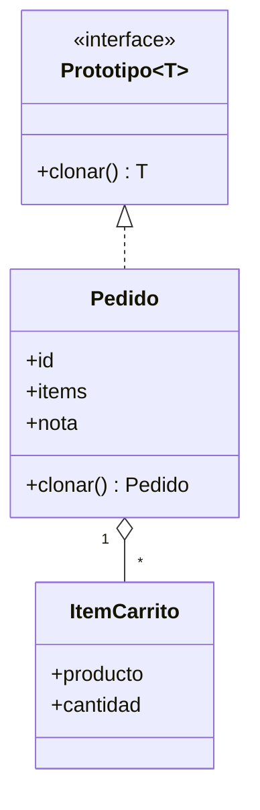

# Creacionales: Prototype

El [módulo 10](10-builder.md) mostró cómo armar un objeto complejo paso a paso. Este módulo trata el caso contrario: ya existe un objeto bien armado y se necesita **otro igual**, o casi igual. En vez de volver a construirlo desde cero, se **copia**. Parece trivial, pero copiar bien es donde se esconde el error.

## Prototype

### El problema

En la tienda, un cliente pulsa "repetir pedido": se arma un pedido nuevo a partir de uno anterior, y luego se le agrega un producto. La primera versión copia campo a campo.

```python
class Pedido:
    def __init__(self, id_pedido, items, nota=""):
        self.id = id_pedido
        self.items = items
        self.nota = nota


def repetir_pedido(original, nuevo_id):
    return Pedido(nuevo_id, original.items)


original = Pedido(1, ["Polera", "Gorro"], "Dejar en conserjería")
repetido = repetir_pedido(original, 2)
repetido.items.append("Calcetines")
print(f"original: {len(original.items)} items, nota repetida: '{repetido.nota}'")
# => original: 3 items, nota repetida: ''
```

Hay dos fallas a la vez. Primero, `repetir_pedido` **olvidó la nota**: cada campo nuevo de `Pedido` obliga a recordar este código. Segundo, y peor: `repetido.items` y `original.items` son **la misma lista**. Agregar "Calcetines" al pedido nuevo corrompió el pedido histórico, que ahora dice tener 3 items.

El atajo obvio es `copy.copy`, que copia todos los campos sin recordarlos uno a uno. Pero no resuelve la segunda falla:

```python
import copy

original = Pedido(1, ["Polera", "Gorro"], "Dejar en conserjería")
superficial = copy.copy(original)
superficial.items.append("Calcetines")
print(f"original: {len(original.items)} items, clon: {len(superficial.items)} items")
# => original: 3 items, clon: 3 items
```

Esto es una **copia superficial** (copia el objeto, pero sus campos siguen apuntando a los mismos objetos internos; [glosario](../glosario.md#copia-superficial)). La nota ya viaja, pero la lista sigue compartida.

### La idea en pocas palabras

Piensa en fotocopiar un formulario ya lleno: no vuelves a escribir cada casilla, y lo que anotes en la fotocopia no altera el original. Pero si el formulario tuviera una hoja pegada con grapa a un anexo compartido, la fotocopia seguiría apuntando a ese mismo anexo.

**Prototype** es un patrón creacional (de los que resuelven cómo se crean los objetos) donde el propio objeto sabe copiarse mediante un método `clonar()`, y los objetos nuevos nacen copiando un **prototipo** ya configurado ([glosario](../glosario.md#prototype)). Quien necesita la copia no conoce los campos ni la clase concreta: solo llama a `clonar()`.

La parte delicada es qué tan hondo se copia:

- **Copia superficial**: duplica el objeto, pero listas, diccionarios y otros objetos internos quedan **compartidos** con el original.
- **Copia profunda**: duplica también todo lo que el objeto contiene, recursivamente, de modo que el clon es independiente ([glosario](../glosario.md#copia-profunda)).

Para que `clonar()` sea seguro, casi siempre debe ser **profunda**.

- **Prototype** (interfaz) → `Prototipo`: declara `clonar()`.
- **Prototipo concreto** → `Pedido`: implementa `clonar()` con copia profunda.
- **Cliente** → el código de "repetir pedido": clona y edita la copia.

Una diferencia deliberada con el módulo anterior: el `Pedido` del Builder era **inmutable**, así que copiarlo superficialmente habría sido inofensivo (nadie podía modificar la lista compartida). Aquí el `Pedido` es **mutable**: tiene `id`, `items` y `nota` que se pueden cambiar después de crearlo, y por eso el bug de la lista compartida se manifiesta. Además se simplifica el dominio fijo: no lleva `cliente` ni `estado`, ni calcula `total()`, para centrar el módulo en la copia. Este `Pedido.clonar()` se reutilizará más adelante, en el módulo de Memento, para guardar "fotos" del estado de un pedido.

### Diagrama



`clonar()` no copia la lista de items: copia **cada** `ItemCarrito`, y así el clon queda con su propia colección.

### Código

El uso es el mismo en los cuatro lenguajes: se clona un pedido de 2 items, se le asigna otro `id`, se le agrega un tercer item al clon y se comprueba que el original no cambió.

#### Python

`copy.deepcopy` recorre el objeto completo y copia todo lo que encuentra. Además recuerda lo ya copiado, así que soporta referencias circulares sin entrar en un bucle infinito.

```python
from dataclasses import dataclass
from typing import Protocol, Self


@dataclass(frozen=True)
class Producto:
    id: int
    nombre: str
    precio: int


@dataclass
class ItemCarrito:
    producto: Producto
    cantidad: int


class Prototipo(Protocol):
    def clonar(self) -> Self: ...
```

```python
import copy
from dataclasses import dataclass, field


@dataclass
class Pedido:
    id: int
    items: list[ItemCarrito] = field(default_factory=list)
    nota: str = ""

    def clonar(self) -> "Pedido":
        return copy.deepcopy(self)
```

```python
polera = Producto(1, "Polera", 12990)
gorro = Producto(2, "Gorro", 5990)
original = Pedido(1, [ItemCarrito(polera, 2), ItemCarrito(gorro, 1)], "Dejar en conserjería")
clon = original.clonar()
clon.id = 2
clon.items.append(ItemCarrito(Producto(3, "Calcetines", 2990), 1))
print(f"original: {len(original.items)} items, clon: {len(clon.items)} items")
# => original: 2 items, clon: 3 items
```

`Producto` es `frozen`, así que `deepcopy` igual lo duplica pero nadie podría modificarlo; la independencia importante es la de la lista y la de cada `ItemCarrito`.

#### TypeScript

`structuredClone` (global en Node 17+ y navegadores) hace una copia profunda y también tolera referencias circulares. Su límite: copia **datos**, no comportamiento. Si se le pasa una instancia de clase devuelve un objeto plano sin métodos. Por eso `clonar()` clona los datos y reconstruye un `Pedido` con ellos.

```typescript
interface Producto {
  id: number;
  nombre: string;
  precio: number;
}

interface ItemCarrito {
  producto: Producto;
  cantidad: number;
}

interface Prototipo<T> {
  clonar(): T;
}

class Pedido implements Prototipo<Pedido> {
  constructor(
    public id: number,
    public items: ItemCarrito[],
    public nota: string,
  ) {}

  clonar(): Pedido {
    const datos = structuredClone({ id: this.id, items: this.items, nota: this.nota });
    return new Pedido(datos.id, datos.items, datos.nota);
  }
}
```

```typescript
const polera: Producto = { id: 1, nombre: "Polera", precio: 12990 };
const gorro: Producto = { id: 2, nombre: "Gorro", precio: 5990 };
const original = new Pedido(
  1,
  [{ producto: polera, cantidad: 2 }, { producto: gorro, cantidad: 1 }],
  "Dejar en conserjería",
);
const clon = original.clonar();
clon.id = 2;
clon.items.push({ producto: { id: 3, nombre: "Calcetines", precio: 2990 }, cantidad: 1 });
console.log(`original: ${original.items.length} items, clon: ${clon.items.length} items`);
// => original: 2 items, clon: 3 items
```

#### Go

Los bloques de Go forman un solo `main.go`: el primero abre con `package main` y el `import` que usa todo el conjunto. Go no tiene un `clone` automático; `clonar` se escribe a mano. Como el receptor de `Clonar` es **por valor**, `p` ya es una copia superficial del pedido; solo falta darle su propia slice. `ItemCarrito` y `Producto` contienen solo valores, así que copiar los elementos de la slice basta para que sea una copia profunda.

```go
package main

import "fmt"

type Producto struct {
	ID     int
	Nombre string
	Precio int
}

type ItemCarrito struct {
	Producto Producto
	Cantidad int
}

type Prototipo[T any] interface {
	Clonar() T
}

type Pedido struct {
	ID    int
	Items []ItemCarrito
	Nota  string
}

func (p Pedido) Clonar() Pedido {
	p.Items = append([]ItemCarrito(nil), p.Items...)
	return p
}

var _ Prototipo[Pedido] = Pedido{}
```

```go
func main() {
	polera := Producto{1, "Polera", 12990}
	gorro := Producto{2, "Gorro", 5990}
	original := Pedido{1, []ItemCarrito{{polera, 2}, {gorro, 1}}, "Dejar en conserjería"}
	clon := original.Clonar()
	clon.ID = 2
	clon.Items = append(clon.Items, ItemCarrito{Producto{3, "Calcetines", 2990}, 1})
	fmt.Printf("original: %d items, clon: %d items\n", len(original.Items), len(clon.Items))
	// => original: 2 items, clon: 3 items
}
```

> **Nota Go:** no existe un `clone` genérico: asignar un struct (`copia := original`) copia **solo el nivel superficial**. Los campos simples (números, strings, structs con solo valores) se duplican, pero las slices y los maps se copian como "referencias", así que ambos structs comparten el mismo arreglo subyacente. Con `copia := original`, una línea como `copia.Items[0].Cantidad = 9` también cambia el original. Para independizar una slice se usa `append([]ItemCarrito(nil), p.Items...)` o `slices.Clone(p.Items)` (paquete `slices`, Go 1.21+). Si `ItemCarrito` tuviera a su vez slices o maps, habría que copiarlos también, elemento por elemento.

#### PHP

En PHP, `clone` hace una copia superficial de un objeto, y lo que haya que copiar más hondo se escribe en el método mágico `__clone()`, que se ejecuta sobre la copia recién creada. Un array se copia por valor, pero si contiene objetos, la copia del array sigue apuntando a **los mismos objetos**: por eso `__clone` debe clonar cada `ItemCarrito`.

```php
<?php

final class Producto
{
    public function __construct(
        public readonly int $id,
        public readonly string $nombre,
        public readonly int $precio,
    ) {
    }
}

final class ItemCarrito
{
    public function __construct(
        public Producto $producto,
        public int $cantidad,
    ) {
    }
}

interface Prototipo
{
    public function clonar(): static;
}
```

```php
<?php

final class Pedido implements Prototipo
{
    /** @param ItemCarrito[] $items */
    public function __construct(
        public int $id,
        public array $items,
        public string $nota = '',
    ) {
    }

    public function __clone(): void
    {
        $this->items = array_map(fn (ItemCarrito $item) => clone $item, $this->items);
    }

    public function clonar(): static
    {
        return clone $this;
    }
}
```

```php
<?php

$polera = new Producto(1, 'Polera', 12990);
$gorro = new Producto(2, 'Gorro', 5990);
$original = new Pedido(1, [new ItemCarrito($polera, 2), new ItemCarrito($gorro, 1)], 'Dejar en conserjería');
$clon = $original->clonar();
$clon->id = 2;
$clon->items[] = new ItemCarrito(new Producto(3, 'Calcetines', 2990), 1);
echo 'original: ' . count($original->items) . ' items, clon: ' . count($clon->items) . " items\n";
// => original: 2 items, clon: 3 items
```

`Producto` es `readonly`: al no poder cambiar, los pedidos pueden compartirlo sin riesgo, y no hace falta clonarlo.

### Cuándo usarlo y cuándo no

**Úsalo cuando** crear un objeto desde cero es caro o laborioso (configuración compleja, muchos pasos, datos que vienen de una consulta) y es más fácil partir de uno existente y ajustarlo: "repetir pedido", plantillas de documentos, o guardar una copia del estado actual para poder volver a él. También ayuda a respetar **OCP** ([módulo 03](03-ocp.md)): el código que necesita una copia llama a `clonar()` sobre cualquier prototipo, sin un `if` por tipo concreto (`if es_pedido... elif es_cotizacion...`), así que un tipo nuevo se agrega implementando `clonar()` sin tocar a quien copia.

**Cuidado con:**

- **Copia superficial por error**: es el bug de este módulo. Decide explícitamente qué se comparte y qué se duplica.
- **Referencias circulares** (un objeto que, directa o indirectamente, se contiene a sí mismo): una copia manual recursiva se queda en un bucle infinito. `deepcopy` y `structuredClone` las manejan; en Go y PHP hay que resolverlo a mano.
- **Recursos externos** (conexiones, archivos abiertos): no se pueden copiar de forma significativa; el clon debe volver a abrirlos o dejarlos fuera.

**No lo uses cuando** el objeto es simple y un constructor con dos o tres argumentos basta, o cuando el objeto es inmutable: si nadie puede modificarlo, compartir la misma instancia es más simple y seguro que clonarla.

## Comparación

| | Builder ([módulo 10](10-builder.md)) | Prototype |
|---|---|---|
| **Parte de** | Nada: acumula pasos y construye | Un objeto ya existente |
| **Resuelve** | Muchas opciones y validación al crear | Duplicar un objeto sin conocer sus campos |
| **Riesgo típico** | Olvidar un paso obligatorio | Copia superficial con estado compartido |
| **Ejemplo en la tienda** | `PedidoBuilder` arma un pedido nuevo | `Pedido.clonar()` repite un pedido anterior |

## Preguntas de entrevista

**P1. ¿Cuál es la diferencia entre copia superficial y copia profunda?**
La superficial duplica el objeto, pero sus campos de referencia (listas, diccionarios, otros objetos) siguen apuntando a los mismos objetos que el original. La profunda duplica también todo lo que el objeto contiene, recursivamente, así que el clon es totalmente independiente. Con la superficial, modificar la lista del clon modifica la del original.

**P2. ¿Cuándo usarías Prototype en vez de un constructor?**
Cuando construir el objeto es costoso o requiere mucha configuración, y es más barato partir de uno ya configurado y ajustarlo (repetir un pedido, una plantilla). También cuando el código que copia solo conoce una interfaz y no la clase concreta, de modo que un tipo nuevo no obliga a modificarlo (OCP). Si el objeto es simple o inmutable, un constructor o compartir la instancia es mejor.

**P3. ¿Cómo evitas el bug de la lista compartida al clonar?**
Haciendo que `clonar()` realice una copia profunda: `copy.deepcopy` en Python, `structuredClone` en TypeScript, un `__clone` que clone cada objeto interno en PHP, o copiar la slice a mano en Go. Además conviene un test que clone, modifique el clon y compruebe que el original no cambió. Una alternativa es usar objetos inmutables, donde compartir no es un riesgo.

**P4. ¿Cómo se hace en Go?**
Go no tiene `clone` automático: asignar un struct copia solo el nivel superficial, y las slices y maps quedan compartidos. Se escribe un método `Clonar()` que copia explícitamente cada slice con `append([]ItemCarrito(nil), p.Items...)` o `slices.Clone`, y los maps con un bucle. Con un receptor por valor, el struct ya llega copiado y solo hay que reemplazar los campos que contienen referencias.
