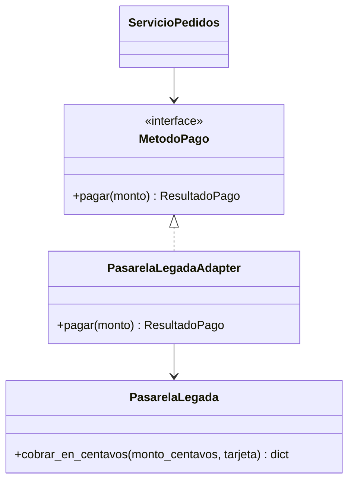
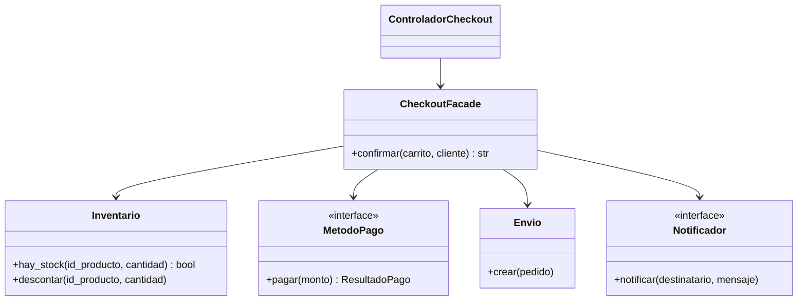

# Estructurales: Adapter y Facade

Hasta el [módulo 11](11-prototype.md) vimos patrones **creacionales**, que resuelven cómo se crean los objetos. Desde aquí empiezan los **estructurales**: patrones que resuelven cómo se **conectan** objetos y clases ya existentes. Este módulo reúne los dos más cotidianos. **Adapter** hace que una pieza con la interfaz equivocada encaje donde se esperaba otra; **Facade** esconde un conjunto de piezas detrás de una interfaz simple. Ambos reutilizan los contratos del [módulo 03](03-ocp.md) (`MetodoPago`) y las piezas del [módulo 06](06-dip.md) (`ServicioPedidos`, `NotificadorFalso`, `PagoFalso`).

## Adapter

### El problema

La tienda contrata una pasarela de pago de un tercero. Su SDK (la librería que entrega el proveedor, que no puedes modificar) expone `cobrar_en_centavos(monto, tarjeta)` y responde con un diccionario. La primera integración llama al SDK directamente desde el servicio de pedidos.

```python
class ServicioPedidos:
    def __init__(self, pasarela: PasarelaLegada) -> None:
        self.pasarela = pasarela

    def confirmar(self, pedido) -> str:
        total = pedido.calcular_total()
        respuesta = self.pasarela.cobrar_en_centavos(total * 100, "tok_visa_4242")
        if respuesta["codigo"] != 0:
            return f"Pedido {pedido.id} rechazado"
        pedido.estado = "pagado"
        return f"Pedido {pedido.id} pagado, ref {respuesta['ref']}"
```

El servicio de negocio ahora sabe que el proveedor cobra en **centavos**, que el éxito es `codigo == 0` y que la referencia viaja en la clave `"ref"`. Es justo lo que el [módulo 06](06-dip.md) enseñó a evitar: el servicio depende de un detalle externo, `PagoFalso` ya no sirve para probarlo y cambiar de proveedor obliga a editar la regla de negocio. La tienda quiere seguir hablando `MetodoPago.pagar(monto) -> ResultadoPago`; el SDK no se puede tocar.

### La idea en pocas palabras

Piensa en el adaptador de enchufe de viaje: tu cargador tiene clavijas europeas y la pared del hotel es de otro estándar. No cambias el cargador ni la pared; pones una pieza en medio que traduce una forma a la otra.

**Adapter** es un patrón estructural que convierte la interfaz de una clase existente en la interfaz que el cliente espera ([glosario](../glosario.md#adapter)). Es un **wrapper** (un objeto que envuelve a otro y le presenta una cara distinta; [glosario](../glosario.md#wrapper)) cuyo único trabajo es **traducir**: convierte los datos que entran (pesos a centavos) y los que salen (diccionario a `ResultadoPago`). El adapter **tiene** al objeto adaptado dentro (composición) y delega en él.

- **Cliente** → `ServicioPedidos`: solo conoce `MetodoPago`.
- **Interfaz esperada (Target)** → `MetodoPago`: `pagar(monto) -> ResultadoPago`.
- **Adapter** → `PasarelaLegadaAdapter`: implementa `MetodoPago` y traduce.
- **Adaptado (Adaptee)** → `PasarelaLegada`: el SDK de terceros, intacto.

### Diagrama



### Código

En los cuatro lenguajes el adapter guarda el SDK y el token de tarjeta, multiplica el monto por 100 y traduce la respuesta. El uso comprueba las dos cosas que hace: el resultado llega como `ResultadoPago` y el SDK recibió **centavos** (19990 pesos son 1999000 centavos). Se simplifica el SDK: devuelve siempre éxito con la referencia `LEG-77` y anota cada monto recibido en `cobros`, para poder verificarlo.

#### Python

```python
from dataclasses import dataclass
from typing import Protocol


@dataclass(frozen=True)
class ResultadoPago:
    ok: bool
    referencia: str


class MetodoPago(Protocol):
    def pagar(self, monto: int) -> ResultadoPago: ...


class PasarelaLegada:  # SDK de terceros: no se puede modificar
    def __init__(self) -> None:
        self.cobros: list[int] = []

    def cobrar_en_centavos(self, monto_centavos: int, tarjeta: str) -> dict:
        self.cobros.append(monto_centavos)
        return {"codigo": 0, "ref": "LEG-77"}
```

```python
class PasarelaLegadaAdapter:
    def __init__(self, pasarela: PasarelaLegada, tarjeta: str) -> None:
        self._pasarela = pasarela
        self._tarjeta = tarjeta

    def pagar(self, monto: int) -> ResultadoPago:
        respuesta = self._pasarela.cobrar_en_centavos(monto * 100, self._tarjeta)
        return ResultadoPago(respuesta["codigo"] == 0, respuesta["ref"])


def cobrar(pago: MetodoPago, monto: int) -> str:
    r = pago.pagar(monto)
    return f"Pago {'OK' if r.ok else 'rechazado'} ref={r.referencia}"


legada = PasarelaLegada()
pago: MetodoPago = PasarelaLegadaAdapter(legada, "tok_visa_4242")
print(cobrar(pago, 19990))  # => Pago OK ref=LEG-77
print(legada.cobros)  # => [1999000]
```

#### TypeScript

```typescript
interface ResultadoPago {
  ok: boolean;
  referencia: string;
}

interface MetodoPago {
  pagar(monto: number): ResultadoPago;
}

interface RespuestaLegada {
  codigo: number;
  ref: string;
}

class PasarelaLegada { // SDK de terceros: no se puede modificar
  cobros: number[] = [];

  cobrarEnCentavos(montoCentavos: number, tarjeta: string): RespuestaLegada {
    this.cobros.push(montoCentavos);
    return { codigo: 0, ref: "LEG-77" };
  }
}
```

```typescript
class PasarelaLegadaAdapter implements MetodoPago {
  constructor(private pasarela: PasarelaLegada, private tarjeta: string) {}

  pagar(monto: number): ResultadoPago {
    const respuesta = this.pasarela.cobrarEnCentavos(monto * 100, this.tarjeta);
    return { ok: respuesta.codigo === 0, referencia: respuesta.ref };
  }
}

function cobrar(pago: MetodoPago, monto: number): string {
  const r = pago.pagar(monto);
  return `Pago ${r.ok ? "OK" : "rechazado"} ref=${r.referencia}`;
}

const legada = new PasarelaLegada();
const pago: MetodoPago = new PasarelaLegadaAdapter(legada, "tok_visa_4242");
console.log(cobrar(pago, 19990)); // => Pago OK ref=LEG-77
console.log(legada.cobros); // => [ 1999000 ]
```

#### Go

Los bloques Go de este módulo forman un solo `main.go`: el de Adapter define `demoAdapter`, el de Facade define `demoFacade`, y `main` llama a las dos al final.

```go
package main

import "fmt"

type ResultadoPago struct {
	Ok         bool
	Referencia string
}

type MetodoPago interface {
	Pagar(monto int) ResultadoPago
}

type RespuestaLegada struct {
	Codigo int
	Ref    string
}

type PasarelaLegada struct { // SDK de terceros: no se puede modificar
	Cobros []int
}

func (p *PasarelaLegada) CobrarEnCentavos(montoCentavos int, tarjeta string) RespuestaLegada {
	p.Cobros = append(p.Cobros, montoCentavos)
	return RespuestaLegada{Codigo: 0, Ref: "LEG-77"}
}
```

```go
type PasarelaLegadaAdapter struct {
	pasarela *PasarelaLegada
	tarjeta  string
}

func (a PasarelaLegadaAdapter) Pagar(monto int) ResultadoPago {
	r := a.pasarela.CobrarEnCentavos(monto*100, a.tarjeta)
	return ResultadoPago{Ok: r.Codigo == 0, Referencia: r.Ref}
}

func cobrar(pago MetodoPago, monto int) string {
	r := pago.Pagar(monto)
	estado := "rechazado"
	if r.Ok {
		estado = "OK"
	}
	return fmt.Sprintf("Pago %s ref=%s", estado, r.Referencia)
}

func demoAdapter() {
	legada := &PasarelaLegada{}
	var pago MetodoPago = PasarelaLegadaAdapter{legada, "tok_visa_4242"}
	fmt.Println(cobrar(pago, 19990)) // => Pago OK ref=LEG-77
	fmt.Println(legada.Cobros)       // => [1999000]
}
```

> **Nota Go:** `PasarelaLegadaAdapter` no declara que implementa `MetodoPago`: le basta tener el método `Pagar` (interfaces implícitas), así que el adapter es un simple struct. Aquí el SDK va en un campo con nombre porque el adapter no debe exponer `CobrarEnCentavos` a quien lo use. Si el adaptado tuviera muchos métodos que ya coinciden con la interfaz, se podría **embeber** (`*PasarelaLegada` sin nombre de campo) y escribir solo los que cambian; el costo es que los métodos del SDK quedan también visibles en el adapter.

#### PHP

```php
<?php
class ResultadoPago
{
    public function __construct(
        public readonly bool $ok,
        public readonly string $referencia,
    ) {}
}

interface MetodoPago
{
    public function pagar(int $monto): ResultadoPago;
}

class PasarelaLegada // SDK de terceros: no se puede modificar
{
    /** @var int[] */
    public array $cobros = [];

    /** @return array{codigo: int, ref: string} */
    public function cobrarEnCentavos(int $montoCentavos, string $tarjeta): array
    {
        $this->cobros[] = $montoCentavos;
        return ['codigo' => 0, 'ref' => 'LEG-77'];
    }
}
```

```php
<?php
class PasarelaLegadaAdapter implements MetodoPago
{
    public function __construct(private PasarelaLegada $pasarela, private string $tarjeta) {}

    public function pagar(int $monto): ResultadoPago
    {
        $respuesta = $this->pasarela->cobrarEnCentavos($monto * 100, $this->tarjeta);
        return new ResultadoPago($respuesta['codigo'] === 0, $respuesta['ref']);
    }
}

function cobrar(MetodoPago $pago, int $monto): string
{
    $r = $pago->pagar($monto);
    return 'Pago ' . ($r->ok ? 'OK' : 'rechazado') . " ref={$r->referencia}";
}

$legada = new PasarelaLegada();
$pago = new PasarelaLegadaAdapter($legada, 'tok_visa_4242');
echo cobrar($pago, 19990) . "\n"; // => Pago OK ref=LEG-77
echo json_encode($legada->cobros) . "\n"; // => [1999000]
```

Con el adapter puesto, `ServicioPedidos` recibe un `MetodoPago` como en el [módulo 06](06-dip.md) y no se entera de que detrás hay un SDK de centavos. Para las pruebas sigue valiendo `PagoFalso`. Si mañana el proveedor cambia, se reescribe **una** clase pequeña y el negocio no se toca.

### Cuándo usarlo y cuándo no

**Úsalo** cuando necesitas integrar una clase o librería que no controlas (un SDK, código legado, una API externa) y su interfaz no coincide con la que tu código espera. Refuerza **OCP** (el sistema acepta un proveedor nuevo agregando un adapter, sin modificar el servicio) y **DIP** (el negocio depende de la abstracción `MetodoPago` y el detalle externo se acomoda a ella).

**No lo uses** si la clase es tuya y puedes cambiarla: modifica la interfaz y ahorra una capa. Tampoco para "adaptar" cosas que ya coinciden, ni como parche permanente para ocultar una mala interfaz propia. Y cuida que el adapter **traduzca** y nada más: si empieza a decidir reglas de negocio (reintentos, descuentos), esa lógica pertenece a otra clase.

## Facade

### El problema

Confirmar un checkout exige coordinar cuatro piezas, en el orden correcto: revisar el stock del inventario, cobrar, crear el envío y avisar al cliente. Esa secuencia vive en el controlador web.

```python
def confirmar_checkout(carrito, cliente, inventario, pago, envio, notificador):
    for item in carrito.items:
        if not inventario.hay_stock(item.producto.id, item.cantidad):
            return f"Sin stock de {item.producto.nombre}"
    resultado = pago.pagar(carrito.subtotal())
    if not resultado.ok:
        return "Pago rechazado"
    for item in carrito.items:
        inventario.descontar(item.producto.id, item.cantidad)
    pedido = Pedido(next_id(), cliente, carrito.items, "pagado")
    envio.crear(pedido)
    notificador.notificar(cliente.email, f"Pedido {pedido.id} confirmado")
    return f"Pedido {pedido.id} confirmado"
```

Funciona, pero el controlador conoce cuatro subsistemas y el orden exacto entre ellos. Cuando llega la app móvil y el panel de administración, alguien copia el bloque y se equivoca: cobra antes de revisar el stock, o se olvida de avisar. Cada controlador nuevo repite el protocolo, y cualquier cambio (un quinto paso, otro orden) obliga a editar todos.

### La idea en pocas palabras

Piensa en el mostrador de un hotel: pides "quiero hacer el check-in" y la recepción se encarga de verificar la reserva, cobrar el depósito, asignar la habitación y avisar al botones. Tú no hablas con cada área; ellas siguen existiendo y trabajando por su cuenta.

**Facade** (fachada) es un patrón estructural que ofrece una interfaz simple y unificada para un **subsistema** (un conjunto de clases que colaboran en una tarea y tienen interfaces propias; [glosario](../glosario.md#subsistema)) complejo ([glosario](../glosario.md#facade)). La fachada no añade funcionalidad nueva: **coordina** llamadas que ya existen, en el orden correcto, y expone una operación de alto nivel.

Una aclaración importante: la fachada **no es una capa que prohíbe**. El subsistema sigue siendo accesible; quien necesite algo fino (consultar el stock directamente, crear un envío especial) puede usar `Inventario` o `Envio` sin pasar por ella. La fachada solo ofrece el camino fácil para el caso común.

- **Facade** → `CheckoutFacade`: expone `confirmar(carrito, cliente)`.
- **Subsistemas** → `Inventario`, `MetodoPago`, `Envio` y `Notificador`.
- **Cliente** → el controlador de checkout (web, móvil o admin).

Se simplifica el flujo: no hay repositorio (podría ser un quinto subsistema, o el propio `ServicioPedidos` del [módulo 06](06-dip.md)); la fachada numera los pedidos con un contador que recibe al construirse; y el pedido se crea ya en estado `pagado`, porque solo se llega a ese punto después de cobrar.

### Diagrama



### Código

Se reutilizan las piezas del [módulo 06](06-dip.md) y se añaden `Carrito` (con `agregar` y `subtotal`), `Inventario` y `Envio`. El uso confirma un carrito de 12990 + 2 × 3500 = 19990 y comprueba que cada subsistema fue llamado, incluso accediendo a ellos directamente: la fachada no los oculta.

#### Python

Se asumen `Producto`, `ItemCarrito`, `Cliente`, `Pedido`, `MetodoPago`, `Notificador`, `PagoFalso` y `NotificadorFalso` tal como en el módulo 06.

```python
from dataclasses import dataclass, field


@dataclass
class Carrito:
    items: list[ItemCarrito] = field(default_factory=list)

    def agregar(self, producto: Producto, cantidad: int) -> None:
        self.items.append(ItemCarrito(producto, cantidad))

    def subtotal(self) -> int:
        return sum(i.producto.precio * i.cantidad for i in self.items)


class Inventario:
    def __init__(self, stock: dict[int, int]) -> None:
        self._stock = stock

    def hay_stock(self, id_producto: int, cantidad: int) -> bool:
        return self._stock.get(id_producto, 0) >= cantidad

    def descontar(self, id_producto: int, cantidad: int) -> None:
        self._stock[id_producto] -= cantidad

    def stock_de(self, id_producto: int) -> int:
        return self._stock.get(id_producto, 0)


class Envio:
    def __init__(self) -> None:
        self.despachados: list[int] = []

    def crear(self, pedido: Pedido) -> None:
        self.despachados.append(pedido.id)
```

```python
class CheckoutFacade:
    def __init__(self, inventario: Inventario, pago: MetodoPago, envio: Envio,
                 notificador: Notificador, siguiente_id: int) -> None:
        self._inventario = inventario
        self._pago = pago
        self._envio = envio
        self._notificador = notificador
        self._siguiente_id = siguiente_id

    def confirmar(self, carrito: Carrito, cliente: Cliente) -> str:
        for item in carrito.items:
            if not self._inventario.hay_stock(item.producto.id, item.cantidad):
                return f"Sin stock de {item.producto.nombre}"
        if not self._pago.pagar(carrito.subtotal()).ok:
            return "Pago rechazado"
        for item in carrito.items:
            self._inventario.descontar(item.producto.id, item.cantidad)
        pedido = Pedido(self._siguiente_id, cliente, carrito.items, "pagado")
        self._siguiente_id += 1
        self._envio.crear(pedido)
        self._notificador.notificar(cliente.email, f"Pedido {pedido.id} confirmado")
        return f"Pedido {pedido.id} confirmado"
```

```python
ana = Cliente(1, "Ana", "ana@correo.cl")
carrito = Carrito()
carrito.agregar(Producto(10, "Zapatillas", 12990), 1)
carrito.agregar(Producto(11, "Calcetas", 3500), 2)
inventario, envio, aviso = Inventario({10: 5, 11: 10}), Envio(), NotificadorFalso()
checkout = CheckoutFacade(inventario, PagoFalso(), envio, aviso, 55)
print(checkout.confirmar(carrito, ana))  # => Pedido 55 confirmado
print(aviso.enviados[0])  # => ana@correo.cl | Pedido 55 confirmado
print(inventario.stock_de(10), envio.despachados)  # => 4 [55]
```

#### TypeScript

Se asumen `Producto`, `ItemCarrito`, `Cliente`, `Pedido`, `MetodoPago`, `Notificador`, `PagoFalso` y `NotificadorFalso` del módulo 06.

```typescript
class Carrito {
  readonly items: ItemCarrito[] = [];

  agregar(producto: Producto, cantidad: number): void {
    this.items.push({ producto, cantidad });
  }

  subtotal(): number {
    return this.items.reduce((suma, i) => suma + i.producto.precio * i.cantidad, 0);
  }
}

class Inventario {
  constructor(private stock: Map<number, number>) {}

  hayStock(idProducto: number, cantidad: number): boolean {
    return this.stockDe(idProducto) >= cantidad;
  }

  descontar(idProducto: number, cantidad: number): void {
    this.stock.set(idProducto, this.stockDe(idProducto) - cantidad);
  }

  stockDe(idProducto: number): number {
    return this.stock.get(idProducto) ?? 0;
  }
}

class Envio {
  despachados: number[] = [];

  crear(pedido: Pedido): void {
    this.despachados.push(pedido.id);
  }
}
```

```typescript
class CheckoutFacade {
  constructor(
    private inventario: Inventario,
    private pago: MetodoPago,
    private envio: Envio,
    private notificador: Notificador,
    private siguienteId: number,
  ) {}

  confirmar(carrito: Carrito, cliente: Cliente): string {
    for (const item of carrito.items) {
      if (!this.inventario.hayStock(item.producto.id, item.cantidad)) {
        return `Sin stock de ${item.producto.nombre}`;
      }
    }
    if (!this.pago.pagar(carrito.subtotal()).ok) {
      return "Pago rechazado";
    }
    for (const item of carrito.items) {
      this.inventario.descontar(item.producto.id, item.cantidad);
    }
    const pedido = new Pedido(this.siguienteId++, cliente, carrito.items, "pagado");
    this.envio.crear(pedido);
    this.notificador.notificar(cliente.email, `Pedido ${pedido.id} confirmado`);
    return `Pedido ${pedido.id} confirmado`;
  }
}
```

```typescript
const ana: Cliente = { id: 1, nombre: "Ana", email: "ana@correo.cl" };
const carrito = new Carrito();
carrito.agregar({ id: 10, nombre: "Zapatillas", precio: 12990 }, 1);
carrito.agregar({ id: 11, nombre: "Calcetas", precio: 3500 }, 2);
const inventario = new Inventario(new Map([[10, 5], [11, 10]]));
const envio = new Envio();
const aviso = new NotificadorFalso();
const checkout = new CheckoutFacade(inventario, new PagoFalso(), envio, aviso, 55);
console.log(checkout.confirmar(carrito, ana)); // => Pedido 55 confirmado
console.log(aviso.enviados[0]); // => ana@correo.cl | Pedido 55 confirmado
console.log(inventario.stockDe(10), envio.despachados); // => 4 [ 55 ]
```

#### Go

Continúa el mismo `main.go`. Primero el dominio que se reutiliza del módulo 06 y el `Carrito` nuevo.

```go
type Producto struct {
	ID     int
	Nombre string
	Precio int
}

type ItemCarrito struct {
	Producto Producto
	Cantidad int
}

type Cliente struct {
	ID     int
	Nombre string
	Email  string
}

type Pedido struct {
	ID      int
	Cliente Cliente
	Items   []ItemCarrito
	Estado  string
}

type Carrito struct {
	Items []ItemCarrito
}

func (c *Carrito) Agregar(producto Producto, cantidad int) {
	c.Items = append(c.Items, ItemCarrito{producto, cantidad})
}

func (c *Carrito) Subtotal() int {
	total := 0
	for _, item := range c.Items {
		total += item.Producto.Precio * item.Cantidad
	}
	return total
}
```

```go
type Notificador interface {
	Notificar(destinatario, mensaje string) error
}

type NotificadorFalso struct {
	Enviados []string
}

func (n *NotificadorFalso) Notificar(destinatario, mensaje string) error {
	n.Enviados = append(n.Enviados, destinatario+" | "+mensaje)
	return nil
}

type PagoFalso struct{}

func (PagoFalso) Pagar(monto int) ResultadoPago {
	return ResultadoPago{Ok: true, Referencia: "FALSO-001"}
}

```

```go
type Inventario struct {
	stock map[int]int
}

func NewInventario(stock map[int]int) *Inventario {
	return &Inventario{stock: stock}
}

func (i *Inventario) HayStock(idProducto, cantidad int) bool {
	return i.stock[idProducto] >= cantidad
}

func (i *Inventario) Descontar(idProducto, cantidad int) {
	i.stock[idProducto] -= cantidad
}

func (i *Inventario) StockDe(idProducto int) int {
	return i.stock[idProducto]
}

type Envio struct {
	Despachados []int
}

func (e *Envio) Crear(pedido Pedido) {
	e.Despachados = append(e.Despachados, pedido.ID)
}
```

```go
type CheckoutFacade struct {
	inventario  *Inventario
	pago        MetodoPago
	envio       *Envio
	notificador Notificador
	siguienteID int
}

func NewCheckoutFacade(inv *Inventario, pago MetodoPago, envio *Envio,
	notificador Notificador, primerID int) *CheckoutFacade {
	return &CheckoutFacade{inv, pago, envio, notificador, primerID}
}

func (c *CheckoutFacade) Confirmar(carrito *Carrito, cliente Cliente) (string, error) {
	for _, item := range carrito.Items {
		if !c.inventario.HayStock(item.Producto.ID, item.Cantidad) {
			return "Sin stock de " + item.Producto.Nombre, nil
		}
	}
	if !c.pago.Pagar(carrito.Subtotal()).Ok {
		return "Pago rechazado", nil
	}
	for _, item := range carrito.Items {
		c.inventario.Descontar(item.Producto.ID, item.Cantidad)
	}
	pedido := Pedido{c.siguienteID, cliente, carrito.Items, "pagado"}
	c.siguienteID++
	c.envio.Crear(pedido)
	mensaje := fmt.Sprintf("Pedido %d confirmado", pedido.ID)
	if err := c.notificador.Notificar(cliente.Email, mensaje); err != nil {
		return "", err
	}
	return mensaje, nil
}
```

```go
func demoFacade() {
	ana := Cliente{ID: 1, Nombre: "Ana", Email: "ana@correo.cl"}
	carrito := &Carrito{}
	carrito.Agregar(Producto{10, "Zapatillas", 12990}, 1)
	carrito.Agregar(Producto{11, "Calcetas", 3500}, 2)
	inventario := NewInventario(map[int]int{10: 5, 11: 10})
	envio, aviso := &Envio{}, &NotificadorFalso{}
	checkout := NewCheckoutFacade(inventario, PagoFalso{}, envio, aviso, 55)
	resultado, _ := checkout.Confirmar(carrito, ana)
	fmt.Println(resultado)                                 // => Pedido 55 confirmado
	fmt.Println(aviso.Enviados[0])                         // => ana@correo.cl | Pedido 55 confirmado
	fmt.Println(inventario.StockDe(10), envio.Despachados) // => 4 [55]
}

func main() {
	demoAdapter()
	demoFacade()
}
```

> **Nota Go:** una fachada en Go es un struct con campos para los subsistemas y un método de alto nivel; no hay nada especial del lenguaje. Los subsistemas que son interfaces (`MetodoPago`, `Notificador`) se aceptan como tales y los concretos (`*Inventario`, `*Envio`) como punteros. Como no hay excepciones, los errores de un paso se devuelven como valor (`error`) y la fachada decide si los propaga, como hace `Confirmar` con el aviso.

#### PHP

Se asumen `Producto`, `ItemCarrito`, `Cliente`, `Pedido`, `MetodoPago`, `Notificador`, `PagoFalso` y `NotificadorFalso` del módulo 06.

```php
<?php
class Carrito
{
    /** @var ItemCarrito[] */
    public array $items = [];

    public function agregar(Producto $producto, int $cantidad): void
    {
        $this->items[] = new ItemCarrito($producto, $cantidad);
    }

    public function subtotal(): int
    {
        $total = 0;
        foreach ($this->items as $item) {
            $total += $item->producto->precio * $item->cantidad;
        }
        return $total;
    }
}

```

```php
<?php
class Inventario
{
    /** @param array<int, int> $stock */
    public function __construct(private array $stock) {}

    public function hayStock(int $idProducto, int $cantidad): bool
    {
        return $this->stockDe($idProducto) >= $cantidad;
    }

    public function descontar(int $idProducto, int $cantidad): void
    {
        $this->stock[$idProducto] = $this->stockDe($idProducto) - $cantidad;
    }

    public function stockDe(int $idProducto): int
    {
        return $this->stock[$idProducto] ?? 0;
    }
}

class Envio
{
    /** @var int[] */
    public array $despachados = [];

    public function crear(Pedido $pedido): void
    {
        $this->despachados[] = $pedido->id;
    }
}
```

```php
<?php
class CheckoutFacade
{
    public function __construct(
        private Inventario $inventario,
        private MetodoPago $pago,
        private Envio $envio,
        private Notificador $notificador,
        private int $siguienteId,
    ) {}

    public function confirmar(Carrito $carrito, Cliente $cliente): string
    {
        foreach ($carrito->items as $item) {
            if (!$this->inventario->hayStock($item->producto->id, $item->cantidad)) {
                return "Sin stock de {$item->producto->nombre}";
            }
        }
        if (!$this->pago->pagar($carrito->subtotal())->ok) {
            return 'Pago rechazado';
        }
        foreach ($carrito->items as $item) {
            $this->inventario->descontar($item->producto->id, $item->cantidad);
        }
        $pedido = new Pedido($this->siguienteId++, $cliente, $carrito->items, 'pagado');
        $this->envio->crear($pedido);
        $this->notificador->notificar($cliente->email, "Pedido {$pedido->id} confirmado");
        return "Pedido {$pedido->id} confirmado";
    }
}
```

```php
<?php
$ana = new Cliente(1, 'Ana', 'ana@correo.cl');
$carrito = new Carrito();
$carrito->agregar(new Producto(10, 'Zapatillas', 12990), 1);
$carrito->agregar(new Producto(11, 'Calcetas', 3500), 2);
$inventario = new Inventario([10 => 5, 11 => 10]);
$envio = new Envio();
$aviso = new NotificadorFalso();
$checkout = new CheckoutFacade($inventario, new PagoFalso(), $envio, $aviso, 55);
echo $checkout->confirmar($carrito, $ana) . "\n"; // => Pedido 55 confirmado
echo $aviso->enviados[0] . "\n"; // => ana@correo.cl | Pedido 55 confirmado
echo $inventario->stockDe(10) . ' ' . json_encode($envio->despachados) . "\n"; // => 4 [55]
```

Los tres controladores (web, móvil, admin) ahora llaman a `confirmar(carrito, cliente)` y el orden de los pasos vive en un solo lugar. Observa también que la fachada recibe sus subsistemas por constructor, igual que en el [módulo 06](06-dip.md): se prueba con `PagoFalso` y `NotificadorFalso` sin tocar nada real.

### Cuándo usarlo y cuándo no

**Úsalo** cuando un flujo común obliga a coordinar varias clases en un orden fijo y muchos clientes repiten esa secuencia, o cuando quieres dar una entrada simple a un módulo complejo (una librería con decenas de clases, un subsistema legado). Refuerza **SRP** (el controlador se ocupa de HTTP y la fachada de orquestar el checkout, cada uno con su razón para cambiar) e **ISP** (el cliente ve una superficie mínima, una sola operación, en lugar de depender de las cuatro interfaces completas).

**No lo uses** si el subsistema ya es simple (una fachada de una sola llamada solo agrega una capa), ni para esconder un diseño interno malo en vez de arreglarlo. Evita además que la fachada se convierta en un **God Object** (clase que sabe y hace demasiado; [glosario](../glosario.md#god-object)): debe coordinar, no acumular reglas de negocio ni estado propio. Y no la trates como una frontera obligatoria: si prohíbes el acceso directo a los subsistemas, ya no es una fachada sino una capa de arquitectura, que es otro tema.

## Comparación

Los tres patrones **envuelven** a otros objetos, y por eso se confunden. Lo que cambia es la **intención**. Proxy se verá más adelante, en el módulo de Decorator y Proxy; aquí va como adelanto.

| | Adapter | Facade | Proxy |
|---|---|---|---|
| Intención | Hacer compatible una interfaz existente con la que el cliente espera | Simplificar el uso de un subsistema complejo | Controlar el acceso a un objeto (carga diferida, permisos, caché) |
| Interfaz | La **cambia**: traduce una a otra | Define una **nueva**, más pequeña | **Misma** interfaz que el objeto real |
| Objetos que envuelve | Normalmente uno | Varios (todo un subsistema) | Uno |
| Ejemplo de la tienda | `PasarelaLegadaAdapter` | `CheckoutFacade` | Un proxy que cachea consultas al catálogo |

## Preguntas de entrevista

**P1. ¿Cuál es la diferencia entre Adapter y Facade?**
Adapter se centra en la **compatibilidad**: traduce la interfaz de un objeto a la que el cliente ya esperaba, normalmente envolviendo uno solo. Facade se centra en la **simplicidad**: crea una interfaz nueva y más pequeña sobre varios objetos de un subsistema. En el adapter la interfaz de destino ya existe; en la fachada la diseñas tú.

**P2. ¿En qué se diferencia Adapter de Decorator?**
Ambos envuelven un objeto, pero con fines distintos. El adapter **cambia** la interfaz para que encaje, porque el objeto adaptado no era compatible. El decorator **mantiene** la interfaz y añade comportamiento (logs, reintentos), de modo que se pueden apilar; Decorator se verá en el siguiente módulo.

**P3. ¿Qué es un Adapter de objeto y qué uno de clase?**
El de **objeto** usa composición: el adapter contiene una instancia del adaptado y delega; es la forma de este módulo y funciona en todos los lenguajes. El de **clase** usa herencia múltiple: el adapter hereda a la vez de la interfaz esperada y de la clase adaptada, lo que solo es posible en lenguajes como C++ o Python y lo acopla a una clase concreta. Por eso, y por preferir composición sobre herencia, casi siempre se usa el de objeto.

**P4. ¿Facade viola la Ley de Demeter o la refuerza?**
La refuerza. La [Ley de Demeter](../glosario.md#ley-de-demeter) (hablar solo con los vecinos inmediatos) dice que el cliente no debería conocer ni recorrer los objetos internos de un subsistema. La fachada es ese único vecino: el cliente le habla a ella y ella conoce a los demás. Eso sí, la fachada conoce a todos los subsistemas, así que debe limitarse a coordinar.

**P5. Da un ejemplo real de cada uno.**
Adapter: envolver el SDK de un proveedor de pagos o de correo detrás de la interfaz propia del sistema (`MetodoPago`, `Notificador`), para cambiar de proveedor sin tocar el negocio. Facade: un `CheckoutFacade` que orquesta stock, pago, envío y aviso; o la API de alto nivel de una librería como `requests` de Python, que oculta sockets, HTTP y TLS. En ambos casos el resto del código depende de algo estable y simple.
