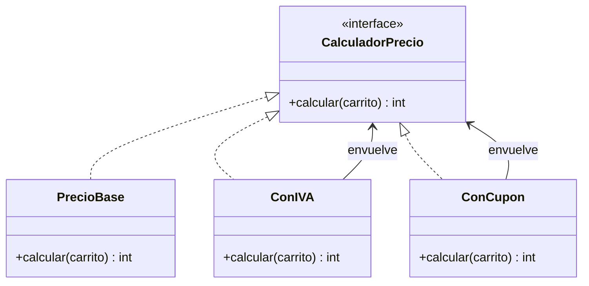
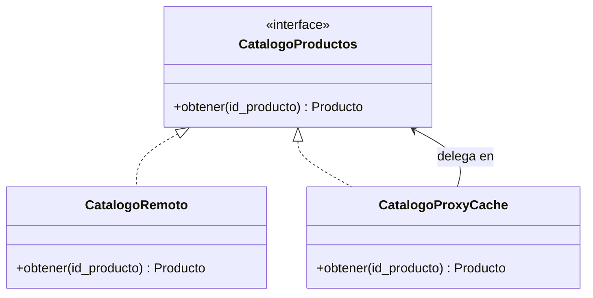
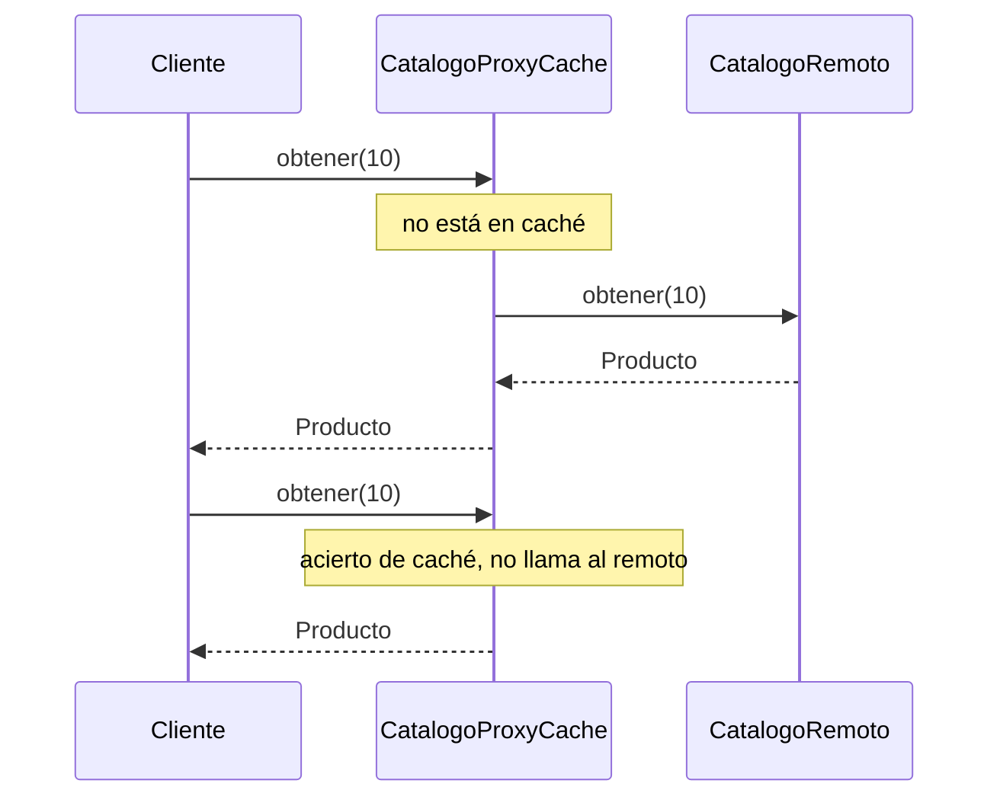

# Estructurales: Decorator y Proxy

En el [módulo 12](12-adapter-facade.md) vimos patrones estructurales que envuelven objetos para **traducirlos** (Adapter) o **simplificarlos** (Facade). Este módulo reúne otros dos wrappers (objetos que envuelven a otro y le presentan una cara; [glosario](../glosario.md#wrapper)) que, a diferencia del Adapter, conservan **la misma interfaz** que el objeto envuelto. **Decorator** le agrega comportamiento; **Proxy** controla el acceso. Por tener la misma interfaz se parecen mucho, y la sección de comparación del final los separa también del Adapter. Ambos son una aplicación directa del [OCP](03-ocp.md): extender sin editar.

## Decorator

### El problema

La tienda calcula el precio final de un carrito. Al principio solo suma. Después llegan los requisitos: aplicar IVA, aplicar un cupón y, más tarde, despacho gratis sobre cierto monto. Cada combinación se resuelve con una subclase nueva.

```python
class PrecioBase:
    def calcular(self, carrito) -> int:
        return carrito.subtotal()


class PrecioConIVA(PrecioBase):
    def calcular(self, carrito) -> int:
        neto = super().calcular(carrito)
        return neto + neto * 19 // 100


class PrecioConCupon(PrecioBase):
    def calcular(self, carrito) -> int:
        return max(0, super().calcular(carrito) - 5000)


class PrecioConIVAYCupon(PrecioBase):
    def calcular(self, carrito) -> int:
        neto = max(0, carrito.subtotal() - 5000)  # lógica copiada de las dos anteriores
        return neto + neto * 19 // 100


class PrecioConIVAYCuponYDespachoGratis(PrecioBase):
    ...  # y faltan PrecioConDespachoGratis, PrecioConIVAYDespachoGratis, ...
```

Con tres opciones independientes hay 2³ = 8 combinaciones, y cada opción nueva **duplica** la cantidad de clases. Además la lógica del cupón o del IVA se copia en varias, de modo que un cambio en el IVA obliga a editar todas las que lo incluyen. Y el orden (¿cupón antes o después del IVA?) queda fijado en el nombre de cada clase. La herencia combina en **tiempo de compilación**; aquí necesitamos combinar en **tiempo de ejecución**.

### La idea en pocas palabras

Piensa en vestirte por capas: polera, chaleco, abrigo. Cada prenda se pone sobre la anterior, y no necesitas una prenda distinta para cada combinación; si hace calor, sacas una capa.

**Decorator** es un patrón estructural que **envuelve** un objeto para agregarle comportamiento en tiempo de ejecución, manteniendo la misma interfaz ([glosario](../glosario.md#decorator)). El decorador **tiene** un objeto de la misma interfaz, le delega el trabajo y, antes o después de delegar, añade lo suyo. Como el resultado sigue siendo un `CalculadorPrecio`, se pueden apilar tantos decoradores como se quiera y en el orden que se quiera.

- **Componente** → `CalculadorPrecio`: `calcular(carrito) -> int`.
- **Componente concreto** → `PrecioBase`: devuelve el subtotal.
- **Decoradores** → `ConIVA` y `ConCupon`: cada uno envuelve a otro `CalculadorPrecio`.
- **Cliente** → quien arma la pila: `ConIVA(ConCupon(PrecioBase()))`.

Se simplifica el dominio: el cupón es un descuento fijo en pesos (5000) y el IVA es el 19 % con división entera.

### Diagrama



### Código

En los cuatro lenguajes se arma el carrito de 15000 + 2 × 5000 = 25000. Con `ConIVA(ConCupon(PrecioBase))` el cupón se aplica primero (25000 − 5000 = 20000) y el IVA después (20000 + 3800 = 23800). El uso también invierte el orden para mostrar que importa: IVA primero da 25000 + 4750 = 29750 y, menos el cupón, 24750. Si un decorador no delegara en el interno, los resultados cambiarían.

#### Python

```python
from dataclasses import dataclass, field
from typing import Protocol


@dataclass(frozen=True)
class Producto:
    id: int
    nombre: str
    precio: int


@dataclass(frozen=True)
class ItemCarrito:
    producto: Producto
    cantidad: int


@dataclass
class Carrito:
    items: list[ItemCarrito] = field(default_factory=list)

    def agregar(self, producto: Producto, cantidad: int) -> None:
        self.items.append(ItemCarrito(producto, cantidad))

    def subtotal(self) -> int:
        return sum(i.producto.precio * i.cantidad for i in self.items)


class CalculadorPrecio(Protocol):
    def calcular(self, carrito: Carrito) -> int: ...


class PrecioBase:
    def calcular(self, carrito: Carrito) -> int:
        return carrito.subtotal()
```

```python
class ConIVA:
    def __init__(self, interno: CalculadorPrecio, tasa: int = 19) -> None:
        self._interno = interno
        self._tasa = tasa

    def calcular(self, carrito: Carrito) -> int:
        neto = self._interno.calcular(carrito)
        return neto + neto * self._tasa // 100


class ConCupon:
    def __init__(self, interno: CalculadorPrecio, descuento: int) -> None:
        self._interno = interno
        self._descuento = descuento

    def calcular(self, carrito: Carrito) -> int:
        return max(0, self._interno.calcular(carrito) - self._descuento)


carrito = Carrito()
carrito.agregar(Producto(20, "Mochila", 15000), 1)
carrito.agregar(Producto(21, "Gorro", 5000), 2)
precio: CalculadorPrecio = ConIVA(ConCupon(PrecioBase(), 5000))
print(precio.calcular(carrito))  # => 23800
print(ConCupon(ConIVA(PrecioBase()), 5000).calcular(carrito))  # => 24750
print(PrecioBase().calcular(carrito))  # => 25000
```

#### TypeScript

```typescript
interface Producto {
  id: number;
  nombre: string;
  precio: number;
}

interface ItemCarrito {
  producto: Producto;
  cantidad: number;
}

class Carrito {
  readonly items: ItemCarrito[] = [];

  agregar(producto: Producto, cantidad: number): void {
    this.items.push({ producto, cantidad });
  }

  subtotal(): number {
    return this.items.reduce((suma, i) => suma + i.producto.precio * i.cantidad, 0);
  }
}

interface CalculadorPrecio {
  calcular(carrito: Carrito): number;
}

class PrecioBase implements CalculadorPrecio {
  calcular(carrito: Carrito): number {
    return carrito.subtotal();
  }
}
```

```typescript
class ConIVA implements CalculadorPrecio {
  constructor(private interno: CalculadorPrecio, private tasa: number = 19) {}

  calcular(carrito: Carrito): number {
    const neto = this.interno.calcular(carrito);
    return neto + Math.floor((neto * this.tasa) / 100);
  }
}

class ConCupon implements CalculadorPrecio {
  constructor(private interno: CalculadorPrecio, private descuento: number) {}

  calcular(carrito: Carrito): number {
    return Math.max(0, this.interno.calcular(carrito) - this.descuento);
  }
}

const carrito = new Carrito();
carrito.agregar({ id: 20, nombre: "Mochila", precio: 15000 }, 1);
carrito.agregar({ id: 21, nombre: "Gorro", precio: 5000 }, 2);
const precio: CalculadorPrecio = new ConIVA(new ConCupon(new PrecioBase(), 5000));
console.log(precio.calcular(carrito)); // => 23800
console.log(new ConCupon(new ConIVA(new PrecioBase()), 5000).calcular(carrito)); // => 24750
console.log(new PrecioBase().calcular(carrito)); // => 25000
```

#### Go

Los bloques Go de este módulo forman un solo `main.go`: el de Decorator define `demoDecorator` y `demoDecoradorFunciones`, el de Proxy define `demoProxy`, y `main` llama a las tres al final.

```go
package main

import "fmt"

type Producto struct {
	ID     int
	Nombre string
	Precio int
}

type ItemCarrito struct {
	Producto Producto
	Cantidad int
}

type Carrito struct {
	Items []ItemCarrito
}

func (c *Carrito) Agregar(producto Producto, cantidad int) {
	c.Items = append(c.Items, ItemCarrito{producto, cantidad})
}

func (c *Carrito) Subtotal() int {
	total := 0
	for _, item := range c.Items {
		total += item.Producto.Precio * item.Cantidad
	}
	return total
}

type CalculadorPrecio interface {
	Calcular(carrito *Carrito) int
}

type PrecioBase struct{}

func (PrecioBase) Calcular(carrito *Carrito) int {
	return carrito.Subtotal()
}
```

```go
type ConIVA struct {
	interno CalculadorPrecio
	tasa    int
}

func (d ConIVA) Calcular(carrito *Carrito) int {
	neto := d.interno.Calcular(carrito)
	return neto + neto*d.tasa/100
}

type ConCupon struct {
	interno   CalculadorPrecio
	descuento int
}

func (d ConCupon) Calcular(carrito *Carrito) int {
	return max(0, d.interno.Calcular(carrito)-d.descuento)
}

func carritoDemo() *Carrito {
	carrito := &Carrito{}
	carrito.Agregar(Producto{20, "Mochila", 15000}, 1)
	carrito.Agregar(Producto{21, "Gorro", 5000}, 2)
	return carrito
}

func demoDecorator() {
	carrito := carritoDemo()
	var precio CalculadorPrecio = ConIVA{ConCupon{PrecioBase{}, 5000}, 19}
	fmt.Println(precio.Calcular(carrito))                                   // => 23800
	fmt.Println(ConCupon{ConIVA{PrecioBase{}, 19}, 5000}.Calcular(carrito)) // => 24750
	fmt.Println(PrecioBase{}.Calcular(carrito))                             // => 25000
}
```

> **Nota Go:** en Go el decorador suele ser una **función que envuelve a otra función**, y esa es la forma de los *middleware* de HTTP (`func(http.Handler) http.Handler`; [glosario](../glosario.md#middleware)). Una función es un valor, así que no hace falta declarar un struct por decorador: basta un tipo función y funciones que reciben una y devuelven otra del mismo tipo. El struct de arriba es la forma clásica; la funcional, más corta, es la habitual cuando la interfaz tiene un solo método.

```go
type Calculo func(carrito *Carrito) int

func ConIVAFn(interno Calculo, tasa int) Calculo {
	return func(carrito *Carrito) int {
		neto := interno(carrito)
		return neto + neto*tasa/100
	}
}

func ConCuponFn(interno Calculo, descuento int) Calculo {
	return func(carrito *Carrito) int {
		return max(0, interno(carrito)-descuento)
	}
}

func demoDecoradorFunciones() {
	base := func(carrito *Carrito) int { return carrito.Subtotal() }
	precio := ConIVAFn(ConCuponFn(base, 5000), 19)
	fmt.Println(precio(carritoDemo())) // => 23800
}
```

#### PHP

```php
<?php
class Producto
{
    public function __construct(
        public readonly int $id,
        public readonly string $nombre,
        public readonly int $precio,
    ) {}
}

class ItemCarrito
{
    public function __construct(
        public readonly Producto $producto,
        public readonly int $cantidad,
    ) {}
}

class Carrito
{
    /** @var ItemCarrito[] */
    public array $items = [];

    public function agregar(Producto $producto, int $cantidad): void
    {
        $this->items[] = new ItemCarrito($producto, $cantidad);
    }

    public function subtotal(): int
    {
        $total = 0;
        foreach ($this->items as $item) {
            $total += $item->producto->precio * $item->cantidad;
        }
        return $total;
    }
}
```

```php
<?php
interface CalculadorPrecio
{
    public function calcular(Carrito $carrito): int;
}

class PrecioBase implements CalculadorPrecio
{
    public function calcular(Carrito $carrito): int
    {
        return $carrito->subtotal();
    }
}

class ConIVA implements CalculadorPrecio
{
    public function __construct(private CalculadorPrecio $interno, private int $tasa = 19) {}

    public function calcular(Carrito $carrito): int
    {
        $neto = $this->interno->calcular($carrito);
        return $neto + intdiv($neto * $this->tasa, 100);
    }
}

class ConCupon implements CalculadorPrecio
{
    public function __construct(private CalculadorPrecio $interno, private int $descuento) {}

    public function calcular(Carrito $carrito): int
    {
        return max(0, $this->interno->calcular($carrito) - $this->descuento);
    }
}
```

```php
<?php
$carrito = new Carrito();
$carrito->agregar(new Producto(20, 'Mochila', 15000), 1);
$carrito->agregar(new Producto(21, 'Gorro', 5000), 2);
$precio = new ConIVA(new ConCupon(new PrecioBase(), 5000));
echo $precio->calcular($carrito) . "\n"; // => 23800
echo (new ConCupon(new ConIVA(new PrecioBase()), 5000))->calcular($carrito) . "\n"; // => 24750
echo (new PrecioBase())->calcular($carrito) . "\n"; // => 25000
```

Para agregar el despacho gratis basta **una** clase nueva (`ConDespachoGratis`) que cumpla `CalculadorPrecio`; ninguna de las existentes se toca, y cada combinación se arma en el punto de uso en lugar de vivir en una subclase.

### Cuándo usarlo y cuándo no

**Úsalo** cuando quieres agregar responsabilidades a un objeto de forma opcional y combinable, sin modificar su clase ni explotar la jerarquía con subclases. Refuerza **OCP** (una capacidad nueva es una clase nueva, sin editar `PrecioBase` ni los otros decoradores) y **SRP** (el IVA, el cupón y el despacho cada uno en su clase, con una sola razón para cambiar, en vez de un `calcular` gigante lleno de condiciones).

**No lo uses** si solo existe una combinación fija: un único cálculo directo es más simple que tres capas. Cuidado también con el **orden** (cambia el resultado, como se vio con 23800 frente a 24750) y con apilar tantas capas que depurar obligue a recorrer diez objetos. Y como el decorador no es el objeto original, no uses `isinstance` ni comparaciones de identidad para saber qué hay debajo: programa contra la interfaz.

## Proxy

### El problema

El catálogo de productos vive en un servicio remoto lento: cada consulta es una llamada de red. Las páginas de la tienda piden una y otra vez los mismos productos (la mochila destacada del home aparece en el listado, en el carrito y en las recomendaciones). El código que consulta llama directamente al servicio.

```python
class CatalogoRemoto:
    def __init__(self, productos: dict) -> None:
        self._productos = productos
        self.consultas = 0

    def obtener(self, id_producto: int):
        self.consultas += 1  # una llamada de red lenta cada vez
        return self._productos[id_producto]


def precio_de(catalogo: CatalogoRemoto, id_producto: int) -> int:
    return catalogo.obtener(id_producto).precio  # depende de la clase remota


# tres lecturas de la misma mochila: tres viajes por la red
```

Cada lectura paga el viaje completo aunque el producto no haya cambiado. La solución obvia, guardar un diccionario de resultados, tiene un mal sitio donde vivir: si va en `precio_de`, hay que repetirla en cada lugar que consulta; si va en `CatalogoRemoto`, mezcla dos responsabilidades (hablar con la red y recordar resultados) y obliga a editar una clase que quizá ni siquiera controlas. Además `precio_de` quedó atado a la clase remota concreta.

### La idea en pocas palabras

Piensa en el recepcionista de una oficina que filtra llamadas: contesta él, responde lo que ya sabe y solo pasa la llamada al jefe cuando hace falta. Quien llama usa el mismo teléfono de siempre.

**Proxy** es un patrón estructural que ofrece un **sustituto** con la misma interfaz que el objeto real y **controla el acceso** a él ([glosario](../glosario.md#proxy)): puede guardar resultados en una caché (una copia de lo ya obtenido para no repetir la consulta), crear el objeto solo cuando se usa (*lazy loading*, carga diferida; [glosario](../glosario.md#lazy-loading)), verificar permisos o registrar cada llamada. El cliente no se entera de que habla con un intermediario.

- **Interfaz del sujeto** → `CatalogoProductos`: `obtener(id_producto) -> Producto`.
- **Sujeto real** → `CatalogoRemoto`: hace la consulta lenta.
- **Proxy** → `CatalogoProxyCache`: implementa la misma interfaz, recuerda lo ya consultado y solo llama al real cuando no lo tiene.
- **Cliente** → cualquier código que reciba un `CatalogoProductos`, como `precio_de`.

Se simplifica: la caché no expira ni se invalida (si el producto cambia en el servicio, el proxy seguirá devolviendo la copia vieja; un proxy de caché real necesita una política de vencimiento) y se asume que el id pedido existe.

### Diagrama



El flujo muestra qué pasa en la primera lectura (fallo de caché) y en la segunda (acierto):



### Código

En los cuatro lenguajes el proxy y el real implementan la misma interfaz, y el cliente (`precio_de`) solo conoce la interfaz. El uso pide el mismo producto tres veces y comprueba los contadores: el remoto recibió **una** consulta y el proxy atendió **tres** lecturas. Sin la caché el remoto contaría 3, así que el resultado cambia si el proxy no cachea.

#### Python

Se asume `Producto` tal como en la sección de Decorator.

```python
from typing import Protocol


class CatalogoProductos(Protocol):
    def obtener(self, id_producto: int) -> Producto: ...


class CatalogoRemoto:
    def __init__(self, productos: dict[int, Producto]) -> None:
        self._productos = productos
        self.consultas = 0

    def obtener(self, id_producto: int) -> Producto:
        self.consultas += 1  # simula una llamada de red lenta
        return self._productos[id_producto]


class CatalogoProxyCache:
    def __init__(self, real: CatalogoProductos) -> None:
        self._real = real
        self._cache: dict[int, Producto] = {}
        self.lecturas = 0

    def obtener(self, id_producto: int) -> Producto:
        self.lecturas += 1
        if id_producto not in self._cache:
            self._cache[id_producto] = self._real.obtener(id_producto)
        return self._cache[id_producto]
```

```python
def precio_de(catalogo: CatalogoProductos, id_producto: int) -> int:
    return catalogo.obtener(id_producto).precio


remoto = CatalogoRemoto({10: Producto(10, "Mochila", 15000)})
proxy = CatalogoProxyCache(remoto)
print(precio_de(proxy, 10))  # => 15000
print(precio_de(proxy, 10) + precio_de(proxy, 10))  # => 30000
print(f"{remoto.consultas} consulta remota, {proxy.lecturas} lecturas")  # => 1 consulta remota, 3 lecturas
```

#### TypeScript

Se asume `Producto` tal como en la sección de Decorator.

```typescript
interface CatalogoProductos {
  obtener(idProducto: number): Producto;
}

class CatalogoRemoto implements CatalogoProductos {
  consultas = 0;

  constructor(private productos: Map<number, Producto>) {}

  obtener(idProducto: number): Producto {
    this.consultas++; // simula una llamada de red lenta
    return this.productos.get(idProducto)!;
  }
}

class CatalogoProxyCache implements CatalogoProductos {
  lecturas = 0;
  private cache = new Map<number, Producto>();

  constructor(private real: CatalogoProductos) {}

  obtener(idProducto: number): Producto {
    this.lecturas++;
    if (!this.cache.has(idProducto)) {
      this.cache.set(idProducto, this.real.obtener(idProducto));
    }
    return this.cache.get(idProducto)!;
  }
}
```

```typescript
function precioDe(catalogo: CatalogoProductos, idProducto: number): number {
  return catalogo.obtener(idProducto).precio;
}

const remoto = new CatalogoRemoto(new Map([[10, { id: 10, nombre: "Mochila", precio: 15000 }]]));
const proxy = new CatalogoProxyCache(remoto);
console.log(precioDe(proxy, 10)); // => 15000
console.log(precioDe(proxy, 10) + precioDe(proxy, 10)); // => 30000
console.log(`${remoto.consultas} consulta remota, ${proxy.lecturas} lecturas`); // => 1 consulta remota, 3 lecturas
```

#### Go

Continúa el mismo `main.go`, con el `Producto` del bloque de Decorator.

```go
type CatalogoProductos interface {
	Obtener(idProducto int) Producto
}

type CatalogoRemoto struct {
	productos map[int]Producto
	Consultas int
}

func (c *CatalogoRemoto) Obtener(idProducto int) Producto {
	c.Consultas++ // simula una llamada de red lenta
	return c.productos[idProducto]
}

type CatalogoProxyCache struct {
	real     CatalogoProductos
	cache    map[int]Producto
	Lecturas int
}

func NewCatalogoProxyCache(real CatalogoProductos) *CatalogoProxyCache {
	return &CatalogoProxyCache{real: real, cache: map[int]Producto{}}
}

func (p *CatalogoProxyCache) Obtener(idProducto int) Producto {
	p.Lecturas++
	if _, ok := p.cache[idProducto]; !ok {
		p.cache[idProducto] = p.real.Obtener(idProducto)
	}
	return p.cache[idProducto]
}
```

```go
func precioDe(catalogo CatalogoProductos, idProducto int) int {
	return catalogo.Obtener(idProducto).Precio
}

func demoProxy() {
	remoto := &CatalogoRemoto{productos: map[int]Producto{10: {10, "Mochila", 15000}}}
	proxy := NewCatalogoProxyCache(remoto)
	fmt.Println(precioDe(proxy, 10))                       // => 15000
	fmt.Println(precioDe(proxy, 10) + precioDe(proxy, 10)) // => 30000
	fmt.Printf("%d consulta remota, %d lecturas\n", remoto.Consultas, proxy.Lecturas)
	// => 1 consulta remota, 3 lecturas
}

func main() {
	demoDecorator()
	demoDecoradorFunciones()
	demoProxy()
}
```

> **Nota Go:** el proxy es un struct que guarda la interfaz `CatalogoProductos` y la implementa de forma implícita, sin declarar nada. Como el proxy muta su mapa y sus contadores, sus métodos usan receptor puntero (`*CatalogoProxyCache`) y los dos tipos se pasan como punteros. Si varias goroutines lo compartieran, el mapa necesitaría un `sync.Mutex`: aquí se omite para no distraer.

#### PHP

Se asume `Producto` tal como en la sección de Decorator.

```php
<?php
interface CatalogoProductos
{
    public function obtener(int $idProducto): Producto;
}

class CatalogoRemoto implements CatalogoProductos
{
    public int $consultas = 0;

    /** @param array<int, Producto> $productos */
    public function __construct(private array $productos) {}

    public function obtener(int $idProducto): Producto
    {
        $this->consultas++; // simula una llamada de red lenta
        return $this->productos[$idProducto];
    }
}

class CatalogoProxyCache implements CatalogoProductos
{
    public int $lecturas = 0;
    /** @var array<int, Producto> */
    private array $cache = [];

    public function __construct(private CatalogoProductos $real) {}

    public function obtener(int $idProducto): Producto
    {
        $this->lecturas++;
        if (!isset($this->cache[$idProducto])) {
            $this->cache[$idProducto] = $this->real->obtener($idProducto);
        }
        return $this->cache[$idProducto];
    }
}
```

```php
<?php
function precioDe(CatalogoProductos $catalogo, int $idProducto): int
{
    return $catalogo->obtener($idProducto)->precio;
}

$remoto = new CatalogoRemoto([10 => new Producto(10, 'Mochila', 15000)]);
$proxy = new CatalogoProxyCache($remoto);
echo precioDe($proxy, 10) . "\n"; // => 15000
echo (precioDe($proxy, 10) + precioDe($proxy, 10)) . "\n"; // => 30000
echo "{$remoto->consultas} consulta remota, {$proxy->lecturas} lecturas\n"; // => 1 consulta remota, 3 lecturas
```

`precio_de` no cambió una sola línea: recibe un `CatalogoProductos` y le da igual si es el remoto o el proxy. En las pruebas se le puede pasar un catálogo falso, como el `PagoFalso` del [módulo 06](06-dip.md).

### Cuándo usarlo y cuándo no

**Úsalo** cuando necesitas controlar el acceso a un objeto sin que sus clientes lo noten: cachear resultados caros, cargar algo pesado solo si se usa, exigir permisos o registrar llamadas. Refuerza **OCP** (el control de acceso se añade como una clase nueva, sin editar `CatalogoRemoto` ni a los clientes) y **DIP** (el cliente depende de la interfaz `CatalogoProductos`, no del objeto real; por eso se puede intercalar el proxy sin que se entere).

**No lo uses** si no hay un acceso que controlar: un proxy que solo reenvía cada llamada agrega una capa sin beneficio. En el caso de la caché, ten claro cuándo se vuelve obsoleta: sin política de vencimiento o invalidación el proxy sirve datos viejos, y esa es la fuente de errores más común. Y no lo uses para agregar comportamiento de negocio opcional y apilable (IVA, cupones): para eso está Decorator.

## Comparación

Decorator, Proxy y Adapter (del [módulo 12](12-adapter-facade.md)) envuelven a un objeto y delegan en él; lo que los separa es si **conservan** la interfaz y **para qué** envuelven.

| | Decorator | Proxy | Adapter |
|---|---|---|---|
| ¿Misma interfaz que el envuelto? | Sí | Sí | **No**: traduce una interfaz a otra |
| Intención | Agregar comportamiento | Controlar el acceso al objeto | Hacer compatible una interfaz |
| ¿Quién arma la combinación? | El cliente, apilando decoradores | Normalmente el proxy conoce o crea al real | El cliente o el punto de configuración |
| ¿Se apilan varios? | Es lo habitual | Poco habitual | No |
| Ejemplo de la tienda | `ConIVA(ConCupon(PrecioBase))` | `CatalogoProxyCache` | `PasarelaLegadaAdapter` |

Decorator y Proxy tienen la misma estructura en el diagrama de clases; se distinguen por la intención.

## Preguntas de entrevista

**P1. ¿Cuál es la diferencia entre Decorator y Proxy, si ambos tienen la misma interfaz?**
La intención. Decorator **agrega** comportamiento al objeto y está pensado para apilarse: el cliente compone las capas que quiere. Proxy **controla el acceso** al objeto (caché, permisos, carga diferida) y suele ser él quien conoce o crea al sujeto real, de modo que el cliente ni siquiera sabe que existe. La estructura es casi idéntica; la pregunta correcta es "¿qué quiero lograr?".

**P2. ¿Por qué Decorator es mejor que la herencia para combinar comportamientos?**
La herencia fija las combinaciones al compilar y obliga a una subclase por combinación: con tres opciones hay ocho clases y cada una nueva las duplica. Con Decorator cada comportamiento es una clase y la combinación se arma en tiempo de ejecución, en el orden que se necesite. El costo es que hay más objetos pequeños y el orden de las capas importa (IVA antes o después del cupón da 24750 o 23800).

**P3. ¿Qué tipos de proxy existen?**
El **virtual** crea un objeto caro solo cuando se usa por primera vez (*lazy loading*). El de **protección** comprueba permisos antes de delegar. El **remoto** representa localmente a un objeto que vive en otro proceso o máquina y oculta la comunicación (como un cliente de un servicio). El de **caché** guarda resultados para no repetir trabajo, como `CatalogoProxyCache`. Todos comparten la misma interfaz que el objeto real.

**P4. ¿En qué se parece Decorator a un middleware?**
Un middleware es un decorador de una función de manejo de peticiones: recibe el siguiente manejador, hace algo antes y después (autenticar, registrar, medir tiempo) y delega. Se apilan en un orden, igual que `ConIVA(ConCupon(...))`, y el orden cambia el resultado. En Go es literalmente `func(http.Handler) http.Handler`, una función que envuelve a otra. Cada middleware envuelve al siguiente como un Decorator; la pila completa, donde cualquiera puede cortar, es una Chain of Responsibility.

**P5. ¿Por qué el decorador o el proxy deben tener la misma interfaz que el objeto envuelto?**
Para que el cliente no note la diferencia: puede recibir el objeto real, un proxy o una pila de decoradores sin cambiar una línea (DIP), y además los decoradores se pueden apilar porque cada uno acepta cualquier otro como interno. Es sustituibilidad pura: el envoltorio debe respetar el contrato del original ([LSP](04-lsp.md)). Si la interfaz cambiara, sería un Adapter.
