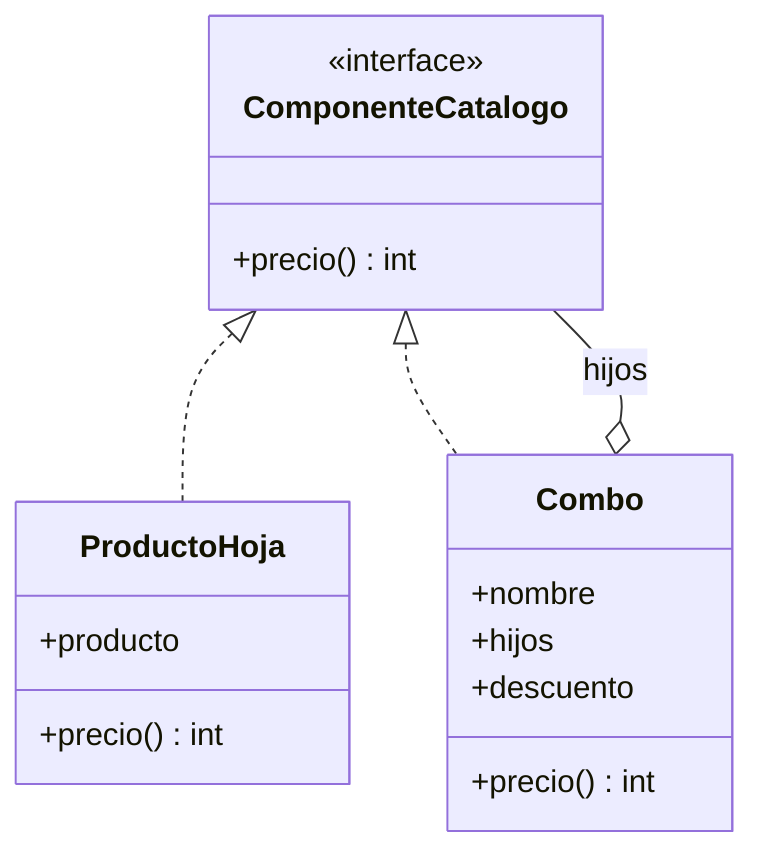
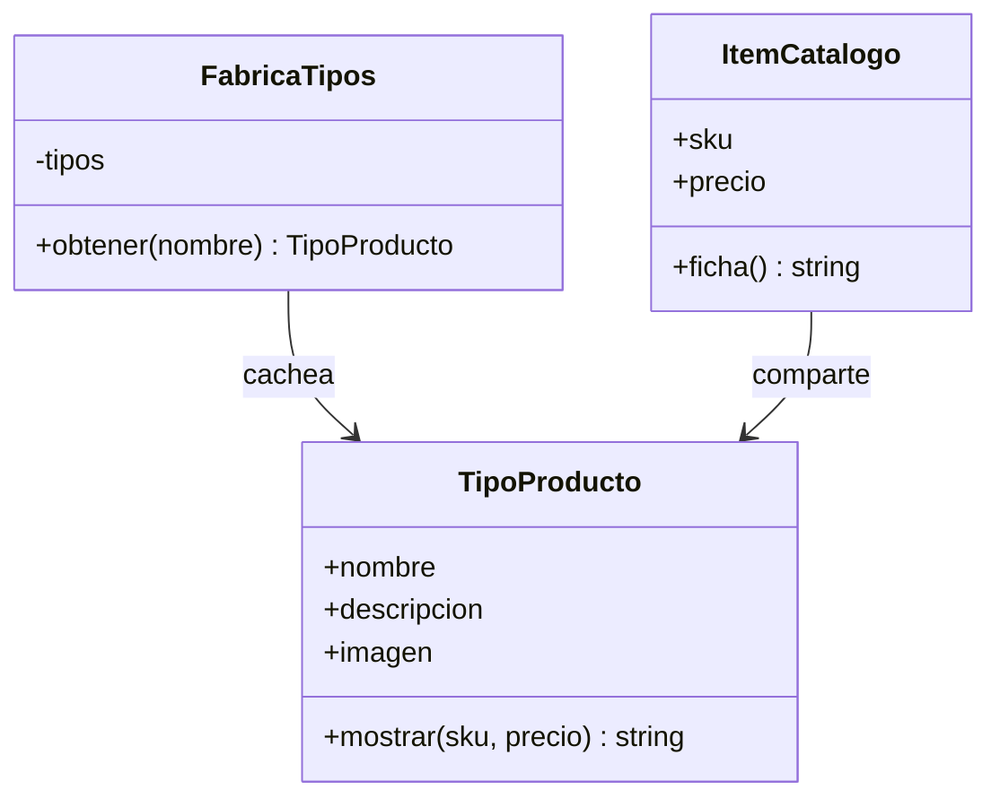

# Estructurales: Composite y Flyweight

En el [módulo 13](13-decorator-proxy.md) vimos wrappers que conservan la interfaz del objeto envuelto. Este módulo reúne dos patrones estructurales que tratan con **muchos objetos a la vez**. **Composite** organiza objetos en un árbol (estructura donde cada elemento puede tener hijos; [glosario](../glosario.md#árbol)) para tratar igual a uno solo y a un grupo. **Flyweight** (peso mosca) comparte la parte repetida de miles de objetos para ahorrar memoria. Composite refuerza el [OCP](03-ocp.md) y el [LSP](04-lsp.md); Flyweight se apoya en el [SRP](02-srp.md). El primer patrón produce los nombres `ComponenteCatalogo`, `ProductoHoja` y `Combo`, que se reutilizarán más adelante, en el módulo de Visitor.

## Composite

### El problema

La tienda vende productos sueltos y también **combos**: "Combo Fiesta" trae una pizza, una bebida y un "Combo Postres", que a su vez trae un helado y un brownie. Un combo puede contener otros combos. El código del carrito distingue los dos casos en cada operación.

```python
def precio_item(item: dict) -> int:
    if item["tipo"] == "combo":
        total = 0
        for hijo in item["hijos"]:
            if hijo["tipo"] == "combo":
                total += sum(n["precio"] for n in hijo["hijos"])  # ignora su descuento y un tercer nivel
            else:
                total += hijo["precio"]
        return max(0, total - item["descuento"])
    return item["precio"]


def cantidad_unidades(item: dict) -> int:
    if item["tipo"] == "combo":
        return sum(cantidad_unidades(hijo) for hijo in item["hijos"])
    return 1


def etiqueta(item: dict) -> str:
    if item["tipo"] == "combo":
        return item["nombre"] + " (" + ", ".join(etiqueta(h) for h in item["hijos"]) + ")"
    return item["nombre"]
```

Cada operación repite el `if tipo == "combo"` y su propio recorrido. `precio_item` ya está mal: cuenta solo dos niveles, ignora el descuento del combo interno y lanza `KeyError` si hay un combo dentro del combo interno. Las otras dos recursan bien, pero cada operación nueva (peso, stock, impuestos) obliga a escribir otra copia del recorrido, y es fácil que una quede distinta de las demás.

### La idea en pocas palabras

Piensa en las carpetas y los archivos de tu computador: puedes copiar, mover o pedir el tamaño de un archivo o de una carpeta con el mismo gesto, y la carpeta se encarga de preguntar a su contenido, que puede incluir más carpetas.

**Composite** es un patrón estructural que compone objetos en un **árbol** y permite tratar de la misma forma a un objeto individual y a un grupo de ellos, mediante una interfaz común ([glosario](../glosario.md#composite)). Quien llama no pregunta "¿eres combo o producto?": llama a `precio()` y cada nodo responde a su manera. El compuesto responde sumando lo que responden sus hijos, y esa suma es **recursiva** (la operación se llama a sí misma sobre cada parte más pequeña de la estructura).

- **Componente** → `ComponenteCatalogo`: `precio() -> int`.
- **Hoja** → `ProductoHoja`: envuelve un `Producto` y devuelve su precio.
- **Compuesto** → `Combo`: guarda una lista de `hijos` (hojas u otros combos) y un `descuento` fijo en pesos.
- **Cliente** → `total_carrito`: recibe componentes sin saber de cuál tipo es cada uno.

Se simplifica el dominio: el descuento del combo es un monto fijo en pesos, y `Combo` recibe sus hijos al construirse (no hay `agregar` en la interfaz, por la razón que se explica en "Cuándo usarlo").

### Diagrama



### Código

En los cuatro lenguajes se arma el árbol: Combo Postres = helado 3500 + brownie 2500 − 600 = 5400. Combo Fiesta = pizza 9990 + bebida 2990 + Combo Postres 5400 − 2400 = 15980. El carrito suma una pizza suelta y el Combo Fiesta: 9990 + 15980 = 25970. Si `Combo.precio` no fuera recursivo (o ignorara el descuento interno), los números cambiarían.

#### Python

```python
from dataclasses import dataclass
from typing import Protocol


@dataclass(frozen=True)
class Producto:
    id: int
    nombre: str
    precio: int


class ComponenteCatalogo(Protocol):
    def precio(self) -> int: ...


class ProductoHoja:
    def __init__(self, producto: Producto) -> None:
        self.producto = producto

    def precio(self) -> int:
        return self.producto.precio


class Combo:
    def __init__(self, nombre: str, hijos: list[ComponenteCatalogo], descuento: int = 0) -> None:
        self.nombre = nombre
        self.hijos = hijos
        self.descuento = descuento

    def precio(self) -> int:
        suma = sum(hijo.precio() for hijo in self.hijos)
        return max(0, suma - self.descuento)
```

```python
def total_carrito(items: list[ComponenteCatalogo]) -> int:
    return sum(item.precio() for item in items)


pizza = ProductoHoja(Producto(1, "Pizza familiar", 9990))
bebida = ProductoHoja(Producto(2, "Bebida 1.5 L", 2990))
helado = ProductoHoja(Producto(5, "Helado", 3500))
brownie = ProductoHoja(Producto(6, "Brownie", 2500))
postres = Combo("Combo Postres", [helado, brownie], descuento=600)
fiesta = Combo("Combo Fiesta", [pizza, bebida, postres], descuento=2400)
print(f"{postres.nombre}: {postres.precio()}")  # => Combo Postres: 5400
print(f"{fiesta.nombre}: {fiesta.precio()}")  # => Combo Fiesta: 15980
print(total_carrito([pizza, fiesta]))  # => 25970
```

#### TypeScript

```typescript
interface Producto {
  id: number;
  nombre: string;
  precio: number;
}

interface ComponenteCatalogo {
  precio(): number;
}

class ProductoHoja implements ComponenteCatalogo {
  constructor(readonly producto: Producto) {}

  precio(): number {
    return this.producto.precio;
  }
}

class Combo implements ComponenteCatalogo {
  constructor(
    readonly nombre: string,
    readonly hijos: ComponenteCatalogo[],
    readonly descuento: number = 0,
  ) {}

  precio(): number {
    const suma = this.hijos.reduce((total, hijo) => total + hijo.precio(), 0);
    return Math.max(0, suma - this.descuento);
  }
}
```

```typescript
function totalCarrito(items: ComponenteCatalogo[]): number {
  return items.reduce((total, item) => total + item.precio(), 0);
}

const pizza = new ProductoHoja({ id: 1, nombre: "Pizza familiar", precio: 9990 });
const bebida = new ProductoHoja({ id: 2, nombre: "Bebida 1.5 L", precio: 2990 });
const helado = new ProductoHoja({ id: 5, nombre: "Helado", precio: 3500 });
const brownie = new ProductoHoja({ id: 6, nombre: "Brownie", precio: 2500 });
const postres = new Combo("Combo Postres", [helado, brownie], 600);
const fiesta = new Combo("Combo Fiesta", [pizza, bebida, postres], 2400);
console.log(`${postres.nombre}: ${postres.precio()}`); // => Combo Postres: 5400
console.log(`${fiesta.nombre}: ${fiesta.precio()}`); // => Combo Fiesta: 15980
console.log(totalCarrito([pizza, fiesta])); // => 25970
```

#### Go

Los bloques Go de este módulo forman un solo `main.go`: el de Composite define `demoComposite`, el de Flyweight define `demoFlyweight`, y `main` llama a las dos al final. Por eso el primer bloque ya importa `sync`, que se usa recién en Flyweight.

```go
package main

import (
	"fmt"
	"sync"
)

type Producto struct {
	ID     int
	Nombre string
	Precio int
}

type ComponenteCatalogo interface {
	Precio() int
}

type ProductoHoja struct {
	Producto Producto
}

func (h ProductoHoja) Precio() int {
	return h.Producto.Precio
}

type Combo struct {
	Nombre    string
	Hijos     []ComponenteCatalogo
	Descuento int
}

func (c Combo) Precio() int {
	suma := 0
	for _, hijo := range c.Hijos {
		suma += hijo.Precio()
	}
	return max(0, suma-c.Descuento)
}
```

> **Nota Go:** no hay clase base ni `implements`: `ProductoHoja` y `Combo` cumplen `ComponenteCatalogo` por tener el método `Precio() int` (interfaces implícitas). Un `[]ComponenteCatalogo` admite hojas y combos mezclados sin más ceremonia, y el árbol es simplemente un slice de interfaces dentro de un struct.

```go
func totalCarrito(items []ComponenteCatalogo) int {
	total := 0
	for _, item := range items {
		total += item.Precio()
	}
	return total
}

func demoComposite() {
	pizza := ProductoHoja{Producto{1, "Pizza familiar", 9990}}
	bebida := ProductoHoja{Producto{2, "Bebida 1.5 L", 2990}}
	helado := ProductoHoja{Producto{5, "Helado", 3500}}
	brownie := ProductoHoja{Producto{6, "Brownie", 2500}}
	postres := Combo{"Combo Postres", []ComponenteCatalogo{helado, brownie}, 600}
	fiesta := Combo{"Combo Fiesta", []ComponenteCatalogo{pizza, bebida, postres}, 2400}
	fmt.Printf("%s: %d\n", postres.Nombre, postres.Precio()) // => Combo Postres: 5400
	fmt.Printf("%s: %d\n", fiesta.Nombre, fiesta.Precio())   // => Combo Fiesta: 15980
	fmt.Println(totalCarrito([]ComponenteCatalogo{pizza, fiesta})) // => 25970
}
```

#### PHP

```php
<?php
class Producto
{
    public function __construct(
        public readonly int $id,
        public readonly string $nombre,
        public readonly int $precio,
    ) {}
}

interface ComponenteCatalogo
{
    public function precio(): int;
}

class ProductoHoja implements ComponenteCatalogo
{
    public function __construct(public readonly Producto $producto) {}

    public function precio(): int
    {
        return $this->producto->precio;
    }
}

class Combo implements ComponenteCatalogo
{
    /** @param ComponenteCatalogo[] $hijos */
    public function __construct(
        public readonly string $nombre,
        public readonly array $hijos,
        public readonly int $descuento = 0,
    ) {}

    public function precio(): int
    {
        $suma = array_sum(array_map(fn (ComponenteCatalogo $hijo) => $hijo->precio(), $this->hijos));
        return max(0, $suma - $this->descuento);
    }
}
```

```php
<?php
function totalCarrito(array $items): int
{
    return array_sum(array_map(fn (ComponenteCatalogo $item) => $item->precio(), $items));
}

$pizza = new ProductoHoja(new Producto(1, 'Pizza familiar', 9990));
$bebida = new ProductoHoja(new Producto(2, 'Bebida 1.5 L', 2990));
$helado = new ProductoHoja(new Producto(5, 'Helado', 3500));
$brownie = new ProductoHoja(new Producto(6, 'Brownie', 2500));
$postres = new Combo('Combo Postres', [$helado, $brownie], 600);
$fiesta = new Combo('Combo Fiesta', [$pizza, $bebida, $postres], 2400);
echo "{$postres->nombre}: {$postres->precio()}\n"; // => Combo Postres: 5400
echo "{$fiesta->nombre}: {$fiesta->precio()}\n"; // => Combo Fiesta: 15980
echo totalCarrito([$pizza, $fiesta]), "\n"; // => 25970
```

### Cuándo usarlo y cuándo no

**Úsalo** cuando el dominio es una jerarquía parte-todo (combos con combos, categorías con subcategorías, menús con submenús) y quieres que el código cliente no distinga entre una hoja y un grupo. Refuerza **OCP**: un nuevo tipo de combo, por ejemplo uno por temporada, es una clase nueva que implementa `ComponenteCatalogo`, sin tocar el carrito. Refuerza **LSP**: `ProductoHoja` y `Combo` son intercambiables, y quien recibe un `ComponenteCatalogo` puede usar cualquiera sin conocer cuál es. Para que eso se cumpla, la interfaz común no incluye `agregar(hijo)`: una hoja no puede tener hijos, y obligarla a implementar un `agregar` que lanza error rompería la sustituibilidad.

**No lo uses** si la estructura no es un árbol real (una lista plana de productos no necesita compuestos) ni si las hojas y los grupos se comportan de forma muy distinta, porque la interfaz común terminaría llena de métodos que a unos no les sirven. Cuidado con los **ciclos**: un combo que se contiene a sí mismo (directa o indirectamente) provoca recursión infinita, y el patrón no lo evita.

## Flyweight

### El problema

Un videojuego dibuja un mapa con miles de árboles, y todos usan la misma textura: si cada árbol guardara su propia copia de la imagen la memoria se acabaría, y basta una textura compartida con la posición propia de cada árbol. La tienda tiene el mismo problema con su catálogo: 200 000 `ItemCatalogo` donde cada uno repite la descripción larga y la imagen de su **tipo de producto**, que son idénticas para todas las camisetas.

```python
def leer_descripcion(nombre_tipo: str) -> str:
    return f"Descripción larga de {nombre_tipo}. " * 50


def leer_imagen(nombre_tipo: str) -> bytes:
    return bytes(50_000)  # unos 50 KB por llamada


class ItemCatalogo:
    def __init__(self, sku: int, precio: int, nombre_tipo: str) -> None:
        self.sku = sku
        self.precio = precio
        self.nombre_tipo = nombre_tipo
        self.descripcion = leer_descripcion(nombre_tipo)  # copia propia
        self.imagen = leer_imagen(nombre_tipo)  # copia propia


catalogo = [ItemCatalogo(i, 9990, "Camiseta") for i in range(200_000)]
# 200 000 x 50 KB = unos 10 GB para describir solo 3 tipos de producto
```

El dato que varía por ítem (SKU y precio) pesa unos bytes; lo que se repite (descripción e imagen) pesa miles de veces más, y es **idéntico** entre ítems del mismo tipo. La memoria se dispara por duplicar lo que nunca cambia.

### La idea en pocas palabras

Piensa en los moldes de una imprenta: no se fabrica un molde de la letra "A" por cada "A" del libro; se usa el mismo molde y solo cambia la posición donde se estampa.

**Flyweight** es un patrón estructural que ahorra memoria **compartiendo** la parte común de muchos objetos y guardando aparte lo que varía ([glosario](../glosario.md#flyweight)). Se separa el estado en dos:

- **Estado intrínseco** (lo que es igual para todos y no cambia; [glosario](../glosario.md#estado-intrínseco)): nombre, descripción e imagen del tipo de producto. Vive en el flyweight, es **inmutable** (no se puede modificar después de crearlo) y se comparte.
- **Estado extrínseco** (lo que depende de cada uso; [glosario](../glosario.md#estado-extrínseco)): el SKU y el precio de cada ítem. Lo guarda el contexto, o se pasa como argumento a las operaciones del flyweight.

Participantes:

- **Flyweight** → `TipoProducto`: guarda `nombre`, `descripcion`, `imagen` y expone `mostrar(sku, precio)`, que recibe lo extrínseco.
- **Fábrica** → `FabricaTipos`: `obtener(nombre)` crea el tipo la primera vez y devuelve **la misma instancia** después.
- **Contexto** → `ItemCatalogo`: guarda `sku`, `precio` y una referencia al `TipoProducto` compartido.

El Flyweight es una optimización de memoria: se aplica cuando se mide el problema, no como punto de partida.

### Diagrama



### Código

En los cuatro lenguajes se crean 1000 ítems que reparten tres tipos (Camiseta, Taza, Mochila) y se verifica el **ahorro real**: la cantidad de objetos `TipoProducto` distintos en memoria se mide por **identidad** (`is`, `Set` de objetos, comparar punteros, `spl_object_id`), no por igualdad de valores. Esto es importante: si la fábrica creara un tipo nuevo cada vez, dos tipos con los mismos datos serían "iguales" por valor y la prueba pasaría sin compartir nada; por identidad, el resultado sería 1000 en vez de 3.

#### Python

```python
from dataclasses import dataclass


@dataclass(frozen=True)
class TipoProducto:
    nombre: str
    descripcion: str
    imagen: bytes

    def mostrar(self, sku: int, precio: int) -> str:
        return f"{self.nombre} #{sku}: ${precio}"


class FabricaTipos:
    def __init__(self) -> None:
        self._tipos: dict[str, TipoProducto] = {}

    def obtener(self, nombre: str) -> TipoProducto:
        if nombre not in self._tipos:
            self._tipos[nombre] = TipoProducto(nombre, f"Descripción larga de {nombre}", bytes(50_000))
        return self._tipos[nombre]


@dataclass(frozen=True)
class ItemCatalogo:
    sku: int
    precio: int
    tipo: TipoProducto

    def ficha(self) -> str:
        return self.tipo.mostrar(self.sku, self.precio)
```

```python
fabrica = FabricaTipos()
nombres = ["Camiseta", "Taza", "Mochila"]
items = [ItemCatalogo(i, 9990 + i % 3 * 1000, fabrica.obtener(nombres[i % 3])) for i in range(1000)]
print(items[1].ficha())  # => Taza #1: $10990
print(items[0].tipo is items[3].tipo)  # => True
distintos = len({id(item.tipo) for item in items})
print(f"{len(items)} items, {distintos} tipos compartidos")  # => 1000 items, 3 tipos compartidos
```

#### TypeScript

```typescript
class TipoProducto {
  constructor(
    readonly nombre: string,
    readonly descripcion: string,
    readonly imagen: Uint8Array,
  ) {}

  mostrar(sku: number, precio: number): string {
    return `${this.nombre} #${sku}: $${precio}`;
  }
}

class FabricaTipos {
  private tipos = new Map<string, TipoProducto>();

  obtener(nombre: string): TipoProducto {
    let tipo = this.tipos.get(nombre);
    if (tipo === undefined) {
      tipo = new TipoProducto(nombre, `Descripción larga de ${nombre}`, new Uint8Array(50_000));
      this.tipos.set(nombre, tipo);
    }
    return tipo;
  }
}

class ItemCatalogo {
  constructor(readonly sku: number, readonly precio: number, readonly tipo: TipoProducto) {}

  ficha(): string {
    return this.tipo.mostrar(this.sku, this.precio);
  }
}
```

```typescript
const fabrica = new FabricaTipos();
const nombres = ["Camiseta", "Taza", "Mochila"];
const items: ItemCatalogo[] = [];
for (let i = 0; i < 1000; i++) {
  items.push(new ItemCatalogo(i, 9990 + (i % 3) * 1000, fabrica.obtener(nombres[i % 3])));
}
console.log(items[1].ficha()); // => Taza #1: $10990
console.log(items[0].tipo === items[3].tipo); // => true
const distintos = new Set(items.map((item) => item.tipo)).size; // un Set compara objetos por identidad
console.log(`${items.length} items, ${distintos} tipos compartidos`); // => 1000 items, 3 tipos compartidos
```

#### Go

```go
type TipoProducto struct {
	nombre      string
	descripcion string
	imagen      []byte
}

func (t *TipoProducto) Mostrar(sku, precio int) string {
	return fmt.Sprintf("%s #%d: $%d", t.nombre, sku, precio)
}

type FabricaTipos struct {
	mu    sync.Mutex
	tipos map[string]*TipoProducto
}

func NewFabricaTipos() *FabricaTipos {
	return &FabricaTipos{tipos: map[string]*TipoProducto{}}
}

func (f *FabricaTipos) Obtener(nombre string) *TipoProducto {
	f.mu.Lock()
	defer f.mu.Unlock()
	if tipo, ok := f.tipos[nombre]; ok {
		return tipo
	}
	tipo := &TipoProducto{nombre, "Descripción larga de " + nombre, make([]byte, 50_000)}
	f.tipos[nombre] = tipo
	return tipo
}
```

> **Nota Go:** la fábrica es un `map[string]*TipoProducto` protegido por un `sync.Mutex`, porque en Go es normal pedir tipos desde varias goroutines a la vez y un mapa no es seguro para escrituras concurrentes (dos goroutines podrían crear dos tipos distintos para el mismo nombre). El `defer f.mu.Unlock()` libera el candado en todas las salidas. Compartir es barato: el ítem guarda un `*TipoProducto` de 8 bytes, y comparar dos punteros con `==` es comparar identidad. Los campos del tipo son no exportados y sin setters para que sea inmutable fuera del paquete.

```go
type ItemCatalogo struct {
	SKU    int
	Precio int
	Tipo   *TipoProducto
}

func (i ItemCatalogo) Ficha() string {
	return i.Tipo.Mostrar(i.SKU, i.Precio)
}

func demoFlyweight() {
	fabrica := NewFabricaTipos()
	nombres := []string{"Camiseta", "Taza", "Mochila"}
	items := make([]ItemCatalogo, 0, 1000)
	distintos := map[*TipoProducto]struct{}{}
	for i := 0; i < 1000; i++ {
		tipo := fabrica.Obtener(nombres[i%3])
		items = append(items, ItemCatalogo{i, 9990 + i%3*1000, tipo})
		distintos[tipo] = struct{}{}
	}
	fmt.Println(items[1].Ficha())                                  // => Taza #1: $10990
	fmt.Println(items[0].Tipo == items[3].Tipo)                    // => true
	fmt.Printf("%d items, %d tipos compartidos\n", len(items), len(distintos)) // => 1000 items, 3 tipos compartidos
}

func main() {
	demoComposite()
	demoFlyweight()
}
```

#### PHP

```php
<?php
final class TipoProducto
{
    public function __construct(
        public readonly string $nombre,
        public readonly string $descripcion,
        public readonly string $imagen,
    ) {}

    public function mostrar(int $sku, int $precio): string
    {
        return sprintf('%s #%d: $%d', $this->nombre, $sku, $precio);
    }
}

final class FabricaTipos
{
    /** @var array<string, TipoProducto> */
    private array $tipos = [];

    public function obtener(string $nombre): TipoProducto
    {
        return $this->tipos[$nombre] ??= new TipoProducto(
            $nombre,
            "Descripción larga de {$nombre}",
            str_repeat("\0", 50000),
        );
    }
}
```

```php
<?php
final class ItemCatalogo
{
    public function __construct(
        public readonly int $sku,
        public readonly int $precio,
        public readonly TipoProducto $tipo,
    ) {}

    public function ficha(): string
    {
        return $this->tipo->mostrar($this->sku, $this->precio);
    }
}

$fabrica = new FabricaTipos();
$nombres = ['Camiseta', 'Taza', 'Mochila'];
$items = [];
for ($i = 0; $i < 1000; $i++) {
    $items[] = new ItemCatalogo($i, 9990 + $i % 3 * 1000, $fabrica->obtener($nombres[$i % 3]));
}
echo $items[1]->ficha(), "\n"; // => Taza #1: $10990
echo $items[0]->tipo === $items[3]->tipo ? 'true' : 'false', "\n"; // => true
$distintos = count(array_unique(array_map(fn (ItemCatalogo $i) => spl_object_id($i->tipo), $items)));
echo count($items) . " items, $distintos tipos compartidos\n"; // => 1000 items, 3 tipos compartidos
```

### Cuándo usarlo y cuándo no

**Úsalo** cuando hay una cantidad enorme de objetos, la mayor parte de su estado se repite entre ellos y esa parte repetida es inmutable (el catálogo de 200 000 ítems con 3 tipos de producto, los árboles del mapa, los glifos de un editor de texto). Refuerza **SRP**: separa dos responsabilidades que estaban mezcladas, "describir el tipo de producto" (compartido, estable) y "representar este ítem concreto" (SKU y precio), de modo que cada clase cambia por una sola razón.

**No lo uses** de entrada: es una **optimización de memoria** y la regla de [YAGNI](../glosario.md#yagni) aplica con fuerza. Con unos cientos de objetos, o con poco estado repetido, el ahorro no compensa la complejidad de la fábrica y de separar los dos tipos de estado. Mide primero. Y nunca compartas estado **mutable**: si un ítem modificara la descripción del `TipoProducto`, el cambio se vería en todos los demás ítems de ese tipo.

## Comparación

**Composite vs Decorator.** Los dos son recursivos: un nodo contiene otros nodos que cumplen su misma interfaz, y por eso se parecen en el código. Se diferencian en la intención y en cuántos objetos contienen. Decorator (del [módulo 13](13-decorator-proxy.md)) envuelve **uno solo** para agregar comportamiento; Composite agrupa **muchos** y combina sus resultados.

| | Composite | Decorator |
|---|---|---|
| Hijos por nodo | Muchos (una lista) | Uno (el envuelto) |
| Intención | Tratar igual a un objeto y a un grupo | Agregar comportamiento a un objeto |
| Qué hace con lo que contiene | Lo agrega (suma los precios de los hijos) | Lo transforma (IVA sobre el precio interno) |
| Ejemplo de la tienda | `Combo` | `ConIVA(ConCupon(PrecioBase))` |

**Flyweight vs Singleton vs Prototype.** Los tres tienen que ver con cuántas instancias hay y quién las comparte.

| | Flyweight | Singleton ([módulo 07](07-singleton.md)) | Prototype ([módulo 11](11-prototype.md)) |
|---|---|---|---|
| Cuántas instancias | Una por cada valor distinto (3 tipos de producto) | Una sola para toda la aplicación | Una por cada copia que se pide |
| ¿Se comparte? | Sí, entre miles de objetos | Sí, con acceso global | No: cada copia es independiente |
| Estado | Inmutable | Suele ser mutable (y global) | Mutable, propio de cada copia |
| Objetivo | Ahorrar memoria | Garantizar una única instancia | Crear objetos copiando uno existente |

Una regla práctica: si el objeto es único por diseño, Singleton; si hay pocos valores distintos y muchos usuarios, Flyweight; si cada usuario necesita poder modificar su propia copia, Prototype.

## Preguntas de entrevista

**P1. ¿Para qué sirve el patrón Composite?**
Para tratar de la misma forma a un objeto individual y a un grupo de objetos cuando el dominio forma un árbol. Hoja y compuesto implementan la misma interfaz (`ComponenteCatalogo.precio()`), y el compuesto delega en sus hijos de forma recursiva. El cliente deja de escribir `if es_combo` y recorridos repetidos, y los combos pueden anidarse a cualquier profundidad.

**P2. ¿En qué se diferencia Composite de Decorator, si ambos son recursivos?**
Decorator envuelve un único objeto para agregarle comportamiento, y el resultado sigue siendo "ese objeto, con algo más". Composite contiene muchos hijos y combina sus resultados (suma, recorrido, conteo): modela una estructura parte-todo, no una extensión. En el código la estructura se parece; la pista es si el nodo tiene una lista de hijos o un solo interno.

**P3. ¿Qué es el estado intrínseco y qué es el extrínseco en Flyweight?**
El intrínseco es lo que no depende del contexto y es igual para muchos objetos (descripción e imagen del tipo de producto); es inmutable y vive en el flyweight compartido. El extrínseco depende de cada uso (SKU y precio de un ítem): lo guarda el contexto o se pasa como argumento (`mostrar(sku, precio)`). La técnica consiste en mover al flyweight lo primero y dejar fuera lo segundo.

**P4. ¿Cuándo NO conviene usar Flyweight?**
Cuando hay pocos objetos, cuando casi todo su estado es distinto entre ellos o cuando el estado que se querría compartir es mutable. En esos casos el ahorro de memoria es mínimo y el costo es complejidad extra (fábrica, separación de estados, sincronización en lenguajes concurrentes como Go). Es una optimización: se aplica después de medir (YAGNI), no al diseñar.

**P5. ¿Cuál es la diferencia entre Flyweight y una caché?**
Una caché guarda **resultados** costosos de calcular u obtener para no repetir el trabajo, y suele expirar o sacar entradas cuando se llena. Flyweight comparte **objetos inmutables** que muchos otros objetos referencian a la vez, con el fin de ahorrar memoria, y esos objetos viven mientras alguien los use. La fábrica de un Flyweight es de hecho una caché por clave, pero la intención (memoria frente a tiempo) y la inmutabilidad lo distinguen.
