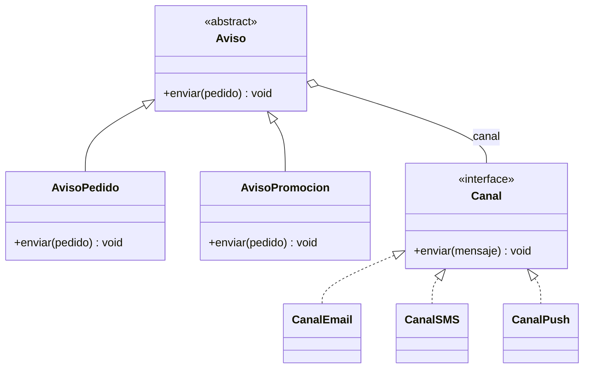

# Estructurales: Bridge

En el [módulo 12](12-adapter-facade.md) vimos Adapter, que arregla una incompatibilidad que ya existe, y en el [módulo 13](13-decorator-proxy.md) wrappers que conservan la interfaz del objeto envuelto. **Bridge** resuelve un problema distinto: una clase que crece en **dos direcciones a la vez** y obliga a escribir una subclase por cada combinación. Aquí se retoma el tema de los canales del [módulo 08](08-factory-method.md) (email, SMS, push), pero ya no para decidir qué clase crear, sino para evitar que cada tipo de aviso se multiplique por cada canal. El patrón refuerza el [OCP](03-ocp.md) y produce los nombres `Aviso`, `AvisoPedido`, `AvisoPromocion`, `Canal`, `CanalEmail`, `CanalSMS` y `CanalPush`, que se reutilizarán más adelante.

## Bridge

### El problema

La tienda envía dos tipos de aviso (sobre un pedido y de promoción) y puede entregarlos por email, SMS o push. Cada combinación se escribió como una clase propia, copiando el texto del aviso y el formato del canal.

```python
class AvisoPedidoEmail:
    def enviar(self, pedido) -> None:
        print(f"[Email] Tu pedido {pedido.id} está en camino")


class AvisoPedidoSMS:
    def enviar(self, pedido) -> None:
        print(f"[SMS] Tu pedido {pedido.id} está en camino")


class AvisoPedidoPush:
    def enviar(self, pedido) -> None:
        print(f"[Push] Tu pedido {pedido.id} está en camino")


class AvisoPromocionEmail:
    def enviar(self, pedido) -> None:
        print(f"[Email] {pedido.cliente.nombre}, 15% de descuento")

# ...y AvisoPromocionSMS y AvisoPromocionPush: 2 x 3 = 6 clases.
```

Son 2 tipos de aviso por 3 canales, es decir, 6 clases hoy. Si se agrega WhatsApp son 8; si además aparece un aviso de carrito abandonado son 12. Esto es la **explosión de subclases** (el número de clases crece como el producto de dos variaciones independientes en vez de su suma; [glosario](../glosario.md#explosión-de-subclases)). Peor aún, el texto de "tu pedido está en camino" está repetido en tres clases: si cambia la redacción, hay que editar tres lugares.

### La idea en pocas palabras

Piensa en un control remoto y un televisor: el control (botones de volumen, canal, encendido) se puede usar con televisores de marcas distintas, y cada televisor puede manejarse con controles distintos. Ninguno de los dos necesita una versión especial por cada pareja; el control solo sabe hablarle a "algo que se deja controlar".

**Bridge** separa una **abstracción** (la parte de alto nivel: qué se quiere comunicar; [glosario](../glosario.md#abstracción)) de su **implementor** (la parte de bajo nivel que hace el trabajo: cómo se entrega; [glosario](../glosario.md#implementor)) en dos jerarquías independientes. La abstracción guarda una referencia a un implementor y le delega el trabajo. Esa referencia es el "puente": cualquier abstracción se conecta con cualquier implementor, y cada lado crece sin tocar al otro.

Ojo con el nombre: en Bridge, "abstracción" **no** significa interfaz ni clase abstracta, sino la clase de alto nivel (`Aviso`) que contiene al implementor y le delega. El contrato, es decir la interfaz, es el `Canal`. En los ejemplos `Aviso` se declara abstracta solo por comodidad; podría ser una clase concreta y seguiría siendo la abstracción del patrón.

- **Abstracción** → `Aviso`: contiene un `Canal` y define `enviar(pedido)`.
- **Abstracciones refinadas** → `AvisoPedido`, `AvisoPromocion`: cada una arma su propio mensaje.
- **Implementor** → `Canal`: la interfaz de entrega, con `enviar(mensaje)`.
- **Implementores concretos** → `CanalEmail`, `CanalSMS`, `CanalPush`.

### Diagrama



Hay dos jerarquías y una sola flecha entre ellas, la composición `Aviso o-- Canal`. Esa flecha es el puente. Los avisos nunca mencionan una clase de canal concreta, y los canales nunca saben qué aviso los usa.

### Código

El `Canal` recibe el mensaje ya armado y solo se ocupa de entregarlo con su formato. Es la misma idea que `Notificador` del módulo 08, pero reducida a "cómo se entrega". Para mantener el ejemplo corto, `Pedido` se reduce a `id` y `cliente` (sin `items` ni `estado`), y cada canal imprime una línea con su etiqueta.

#### Python

```python
from dataclasses import dataclass
from typing import Protocol


@dataclass
class Cliente:
    id: int
    nombre: str
    email: str


@dataclass
class Pedido:
    id: int
    cliente: Cliente


class Canal(Protocol):
    def enviar(self, mensaje: str) -> None: ...


class CanalEmail:
    def enviar(self, mensaje: str) -> None:
        print(f"[Email] {mensaje}")


class CanalSMS:
    def enviar(self, mensaje: str) -> None:
        print(f"[SMS] {mensaje}")


class CanalPush:
    def enviar(self, mensaje: str) -> None:
        print(f"[Push] {mensaje}")
```

La abstracción recibe el canal en el constructor y cada aviso solo arma su mensaje.

```python
from abc import ABC, abstractmethod


class Aviso(ABC):
    def __init__(self, canal: Canal) -> None:
        self._canal = canal  # el puente

    @abstractmethod
    def enviar(self, pedido: Pedido) -> None: ...


class AvisoPedido(Aviso):
    def enviar(self, pedido: Pedido) -> None:
        self._canal.enviar(f"Tu pedido {pedido.id} está en camino")


class AvisoPromocion(Aviso):
    def __init__(self, canal: Canal, descuento: int) -> None:
        super().__init__(canal)
        self._descuento = descuento

    def enviar(self, pedido: Pedido) -> None:
        nombre = pedido.cliente.nombre
        self._canal.enviar(f"{nombre}, {self._descuento}% de descuento en tu próxima compra")


pedido = Pedido(12, Cliente(1, "Ana", "ana@tienda.cl"))
AvisoPedido(CanalSMS()).enviar(pedido)
# => [SMS] Tu pedido 12 está en camino
AvisoPedido(CanalEmail()).enviar(pedido)
# => [Email] Tu pedido 12 está en camino
AvisoPromocion(CanalPush(), 15).enviar(pedido)
# => [Push] Ana, 15% de descuento en tu próxima compra
```

Añadir un canal es escribir una sola clase; ningún aviso cambia, y los dos avisos funcionan con él de inmediato.

```python
class CanalWhatsApp:
    def enviar(self, mensaje: str) -> None:
        print(f"[WhatsApp] {mensaje}")


AvisoPedido(CanalWhatsApp()).enviar(pedido)
# => [WhatsApp] Tu pedido 12 está en camino
AvisoPromocion(CanalWhatsApp(), 10).enviar(pedido)
# => [WhatsApp] Ana, 10% de descuento en tu próxima compra
```

#### TypeScript

```typescript
interface Cliente {
  id: number;
  nombre: string;
  email: string;
}

interface Pedido {
  id: number;
  cliente: Cliente;
}

interface Canal {
  enviar(mensaje: string): void;
}

class CanalEmail implements Canal {
  enviar(mensaje: string): void {
    console.log(`[Email] ${mensaje}`);
  }
}

class CanalSMS implements Canal {
  enviar(mensaje: string): void {
    console.log(`[SMS] ${mensaje}`);
  }
}

class CanalPush implements Canal {
  enviar(mensaje: string): void {
    console.log(`[Push] ${mensaje}`);
  }
}
```

```typescript
abstract class Aviso {
  constructor(protected readonly canal: Canal) {} // el puente

  abstract enviar(pedido: Pedido): void;
}

class AvisoPedido extends Aviso {
  enviar(pedido: Pedido): void {
    this.canal.enviar(`Tu pedido ${pedido.id} está en camino`);
  }
}

class AvisoPromocion extends Aviso {
  constructor(canal: Canal, private readonly descuento: number) {
    super(canal);
  }

  enviar(pedido: Pedido): void {
    const nombre = pedido.cliente.nombre;
    this.canal.enviar(`${nombre}, ${this.descuento}% de descuento en tu próxima compra`);
  }
}

const pedido: Pedido = { id: 12, cliente: { id: 1, nombre: "Ana", email: "ana@tienda.cl" } };
new AvisoPedido(new CanalSMS()).enviar(pedido);
// => [SMS] Tu pedido 12 está en camino
new AvisoPedido(new CanalEmail()).enviar(pedido);
// => [Email] Tu pedido 12 está en camino
new AvisoPromocion(new CanalPush(), 15).enviar(pedido);
// => [Push] Ana, 15% de descuento en tu próxima compra
```

```typescript
class CanalWhatsApp implements Canal {
  enviar(mensaje: string): void {
    console.log(`[WhatsApp] ${mensaje}`);
  }
}

new AvisoPedido(new CanalWhatsApp()).enviar(pedido);
// => [WhatsApp] Tu pedido 12 está en camino
new AvisoPromocion(new CanalWhatsApp(), 10).enviar(pedido);
// => [WhatsApp] Ana, 10% de descuento en tu próxima compra
```

#### Go

Los bloques de Go forman un solo `main.go`: el primero abre con `package main` y el `import` que usa todo el conjunto.

```go
package main

import "fmt"

type Cliente struct {
	ID     int
	Nombre string
	Email  string
}

type Pedido struct {
	ID      int
	Cliente Cliente
}

type Canal interface {
	Enviar(mensaje string)
}

type CanalEmail struct{}

func (CanalEmail) Enviar(mensaje string) { fmt.Println("[Email] " + mensaje) }

type CanalSMS struct{}

func (CanalSMS) Enviar(mensaje string) { fmt.Println("[SMS] " + mensaje) }

type CanalPush struct{}

func (CanalPush) Enviar(mensaje string) { fmt.Println("[Push] " + mensaje) }
```

```go
type Aviso interface {
	Enviar(pedido Pedido)
}

type AvisoPedido struct {
	Canal Canal // el puente
}

func (a AvisoPedido) Enviar(pedido Pedido) {
	a.Canal.Enviar(fmt.Sprintf("Tu pedido %d está en camino", pedido.ID))
}

type AvisoPromocion struct {
	Canal     Canal // el puente
	Descuento int
}

func (a AvisoPromocion) Enviar(pedido Pedido) {
	a.Canal.Enviar(fmt.Sprintf("%s, %d%% de descuento en tu próxima compra",
		pedido.Cliente.Nombre, a.Descuento))
}
```

```go
type CanalWhatsApp struct{}

func (CanalWhatsApp) Enviar(mensaje string) { fmt.Println("[WhatsApp] " + mensaje) }

func main() {
	pedido := Pedido{ID: 12, Cliente: Cliente{ID: 1, Nombre: "Ana", Email: "ana@tienda.cl"}}
	var aviso Aviso = AvisoPedido{Canal: CanalSMS{}}
	aviso.Enviar(pedido) // => [SMS] Tu pedido 12 está en camino
	aviso = AvisoPedido{Canal: CanalEmail{}}
	aviso.Enviar(pedido) // => [Email] Tu pedido 12 está en camino
	aviso = AvisoPromocion{Canal: CanalPush{}, Descuento: 15}
	aviso.Enviar(pedido) // => [Push] Ana, 15% de descuento en tu próxima compra
	aviso = AvisoPromocion{Canal: CanalWhatsApp{}, Descuento: 10}
	aviso.Enviar(pedido) // => [WhatsApp] Ana, 10% de descuento en tu próxima compra
}
```

> **Nota Go:** En Go el patrón sale casi solo: hay dos interfaces (`Aviso` y `Canal`) y los avisos guardan un `Canal` como campo, es decir, composición por campo. Como no existe la herencia de clases, la "explosión de subclases" ni siquiera tienta: nadie escribe `AvisoPedidoSMS` como subtipo de nada. Aun así, el problema de fondo existe si se copian structs por cada combinación, y componer por campo es la forma idiomática de evitarlo. Los structs no necesitan una base `Aviso` común; la interfaz basta.

#### PHP

```php
<?php

class Cliente
{
    public function __construct(
        public readonly int $id,
        public readonly string $nombre,
        public readonly string $email,
    ) {
    }
}

class Pedido
{
    public function __construct(
        public readonly int $id,
        public readonly Cliente $cliente,
    ) {
    }
}

interface Canal
{
    public function enviar(string $mensaje): void;
}
```

```php
<?php

class CanalEmail implements Canal
{
    public function enviar(string $mensaje): void
    {
        echo "[Email] $mensaje\n";
    }
}

class CanalSMS implements Canal
{
    public function enviar(string $mensaje): void
    {
        echo "[SMS] $mensaje\n";
    }
}

class CanalPush implements Canal
{
    public function enviar(string $mensaje): void
    {
        echo "[Push] $mensaje\n";
    }
}
```

```php
<?php

abstract class Aviso
{
    public function __construct(protected readonly Canal $canal) // el puente
    {
    }

    abstract public function enviar(Pedido $pedido): void;
}

class AvisoPedido extends Aviso
{
    public function enviar(Pedido $pedido): void
    {
        $this->canal->enviar("Tu pedido {$pedido->id} está en camino");
    }
}

class AvisoPromocion extends Aviso
{
    public function __construct(Canal $canal, private readonly int $descuento)
    {
        parent::__construct($canal);
    }

    public function enviar(Pedido $pedido): void
    {
        $nombre = $pedido->cliente->nombre;
        $this->canal->enviar("$nombre, {$this->descuento}% de descuento en tu próxima compra");
    }
}

$pedido = new Pedido(12, new Cliente(1, 'Ana', 'ana@tienda.cl'));
(new AvisoPedido(new CanalSMS()))->enviar($pedido);
// => [SMS] Tu pedido 12 está en camino
(new AvisoPedido(new CanalEmail()))->enviar($pedido);
// => [Email] Tu pedido 12 está en camino
(new AvisoPromocion(new CanalPush(), 15))->enviar($pedido);
// => [Push] Ana, 15% de descuento en tu próxima compra
```

```php
<?php

class CanalWhatsApp implements Canal
{
    public function enviar(string $mensaje): void
    {
        echo "[WhatsApp] $mensaje\n";
    }
}

(new AvisoPedido(new CanalWhatsApp()))->enviar($pedido);
// => [WhatsApp] Tu pedido 12 está en camino
(new AvisoPromocion(new CanalWhatsApp(), 10))->enviar($pedido);
// => [WhatsApp] Ana, 10% de descuento en tu próxima compra
```

### Cuándo usarlo y cuándo no

**Úsalo cuando** una clase varía en dos dimensiones independientes (qué se comunica y cómo se entrega, qué se dibuja y con qué motor, qué reporte y en qué formato) y cada dimensión seguirá creciendo. Aporta dos beneficios ligados a principios de diseño:

- **OCP** ([módulo 03](03-ocp.md)): un canal nuevo es una clase nueva y un aviso nuevo es otra; ninguno obliga a editar a los existentes. Con herencia, cada adición multiplica las clases.
- **Composición sobre herencia**: en vez de fijar el canal al construir la subclase (`AvisoPedidoSMS`), el aviso lo recibe como objeto y puede cambiarlo sin tocar su jerarquía. La relación "tiene un canal" reemplaza a "es un aviso por SMS".

**No lo uses cuando** solo varía una dimensión: si hay un único tipo de aviso y varios canales, basta una interfaz `Canal` (o Strategy); si hay dos canales y nada indica que crezcan, un `if` o una subclase es más simple. Tampoco como diseño especulativo: Bridge cuesta una jerarquía extra y una indirección, y solo se paga cuando las dos dimensiones de verdad evolucionan por separado.

## Comparación

Los tres comparten la misma forma de código (un objeto que delega en otro a través de una interfaz), pero la intención es distinta.

| | Para qué se usa | Cuándo se decide | Ejemplo en la tienda |
|---|---|---|---|
| **Bridge** | Separar dos jerarquías que evolucionan por separado | De antemano, al diseñar | `AvisoPedido(CanalSMS())`: avisos y canales crecen cada uno por su lado |
| **Adapter** | Hacer compatible una interfaz que ya existe | Después, cuando algo ya escrito no cuadra | Un adaptador que traduce un SDK de pagos a `MetodoPago` |
| **Strategy** | Que el cliente elija entre algoritmos intercambiables | En tiempo de ejecución | Elegir una `ReglaDescuento` según el cupón; se estudia más adelante, en el módulo de Strategy |

La diferencia práctica: Adapter arregla lo que ya está construido; Bridge se planifica antes, para que dos jerarquías no se multipliquen. Strategy tiene una sola dimensión (el algoritmo que elige el cliente), mientras que en Bridge la abstracción también es una jerarquía propia que se extiende con subclases.

## Preguntas de entrevista

**P1. ¿En qué se diferencia Bridge de Adapter?**
Ambos usan composición, pero con intención opuesta. Adapter se aplica después, para hacer compatible una clase existente con la interfaz que el cliente espera. Bridge se planifica de antemano para separar una abstracción de su implementación y que las dos evolucionen por separado.

**P2. ¿En qué se diferencia Bridge de Strategy?**
El código se parece, porque en ambos un objeto delega en otro mediante una interfaz. En Strategy el cliente elige un algoritmo intercambiable y no hay una jerarquía de abstracciones del lado que delega. En Bridge hay dos jerarquías que crecen: la de la abstracción (`Aviso`, con `AvisoPedido` y `AvisoPromocion`) y la del implementor (`Canal`, con `CanalEmail` y `CanalSMS`).

**P3. ¿Qué es la explosión de subclases?**
Es cuando una clase varía en dos dimensiones y se resuelve con herencia: hay una subclase por cada combinación. Con 2 tipos de aviso y 3 canales son 6 clases; con 3 tipos y 4 canales, 12. Con Bridge el número es la suma (3 + 4 = 7), no el producto.

**P4. ¿Cómo se nota que necesitas Bridge?**
Cuando los nombres de las clases combinan dos ideas (`AvisoPedidoSMS`, `ReportePDFVentas`) y cada característica nueva obliga a crear varias clases a la vez. Otra señal es el texto o la lógica repetida en varias subclases que solo se diferencian en el "cómo". Entonces conviene separar las dos dimensiones y componerlas.

**P5. ¿Cómo se ve Bridge en Go?**
Son dos interfaces y una composición por campo: `AvisoPedido` guarda un `Canal` y le delega. Como Go no tiene herencia, no hay jerarquía de subclases que explote; el patrón es simplemente la forma natural de armar el programa.
