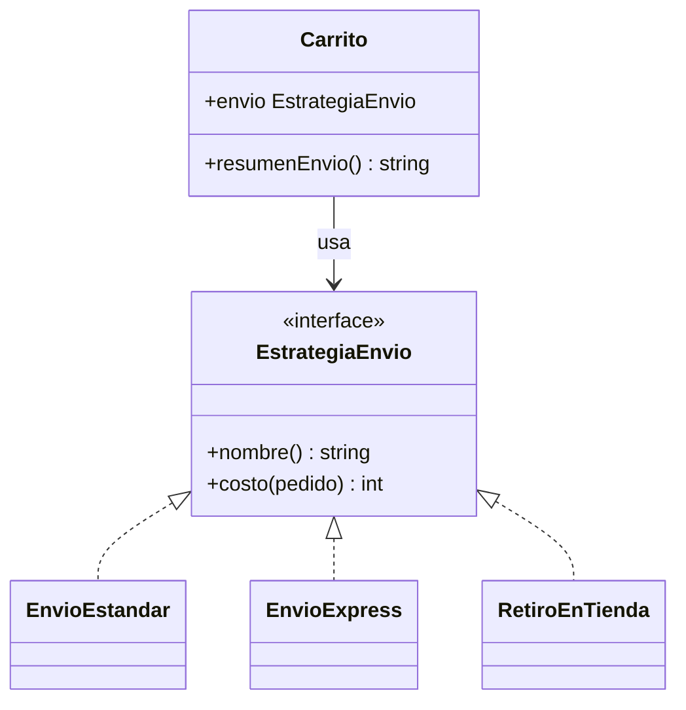
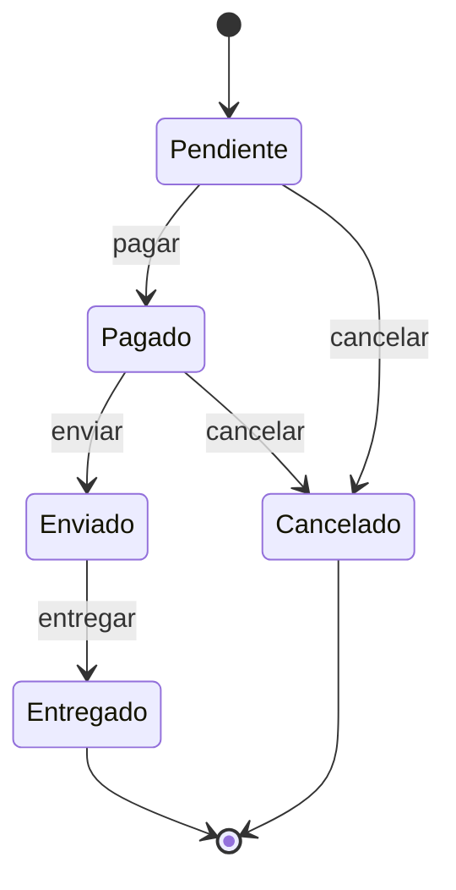
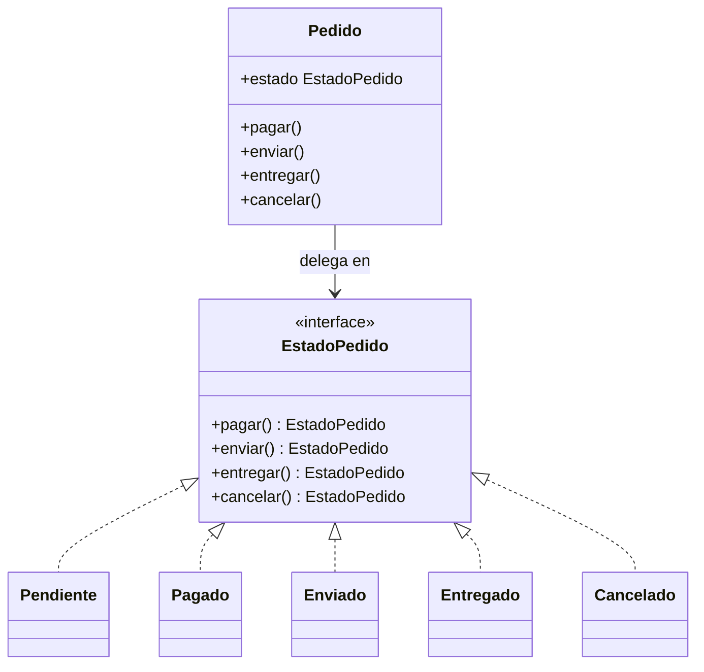
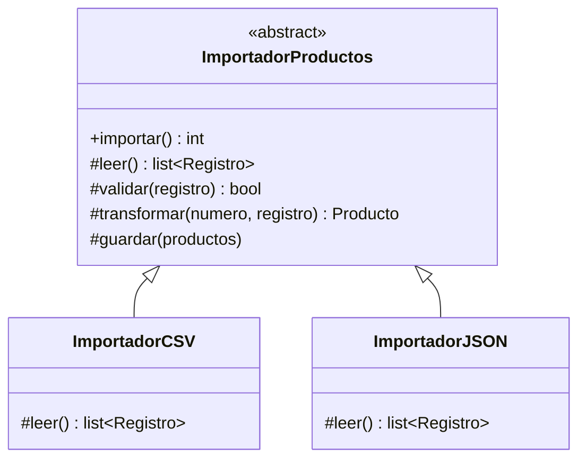

# De comportamiento: Strategy, State y Template Method

Hasta aquí vimos patrones que crean objetos y que los conectan entre sí. Este módulo abre los patrones de **comportamiento**, los que reparten *quién hace qué* y *cuándo*. Los tres de este módulo giran sobre la misma pregunta: cómo hacer que una parte del comportamiento varíe sin llenar el código de `if`. **Strategy** intercambia un algoritmo desde fuera, **State** deja que el propio objeto cambie su comportamiento según su situación y **Template Method** fija el esqueleto de un algoritmo y deja que las subclases rellenen los pasos. Strategy retoma el ejercicio de envío del [módulo 03](03-ocp.md) (`EstrategiaEnvio`, `EnvioEstandar`, `EnvioExpress`, `RetiroEnTienda`), y por usar objetos que delegan se parece al Decorator del [módulo 13](13-decorator-proxy.md) y al Bridge del [módulo 15](15-bridge.md); la comparación del final los separa. Los tres refuerzan el [OCP](03-ocp.md). Producen los nombres `EstrategiaEnvio`, `EstadoPedido` (con `Pendiente`, `Pagado`, `Enviado`, `Entregado`, `Cancelado`) e `ImportadorProductos`.

En Go, cada patrón de este módulo forma su propio `main.go` lógico: los bloques Go de una sección se leen de corrido y no repiten `package` ni `import`.

## Strategy

### El problema

La tienda calcula el costo de envío según el tipo de despacho. Es el `if` por tipo que vimos en el ejercicio del [módulo 03](03-ocp.md), pero ahora vive dentro del carrito y se repite en cada decisión que depende del despacho.

```python
class Carrito:
    def __init__(self, pedido, despacho: str) -> None:
        self.pedido = pedido
        self.despacho = despacho

    def costo_envio(self) -> int:
        if self.despacho == "estandar":
            return 0 if self.pedido.calcular_total() >= 50000 else 3990
        elif self.despacho == "express":
            return 5990
        elif self.despacho == "retiro":
            return 0
        raise ValueError(f"despacho desconocido: {self.despacho}")

    def plazo_dias(self) -> int:  # el mismo if, copiado
        if self.despacho == "estandar":
            return 5
        elif self.despacho == "express":
            return 1
        return 0
```

Agregar "mismo día" obliga a editar `costo_envio` y `plazo_dias`, y a acordarse de cualquier otro lugar que pregunte por el despacho. El tipo es un string: un error de tipeo (`"expres"`) solo se descubre en producción. Además el algoritmo no se puede cambiar en tiempo de ejecución sin reconstruir el carrito, y probar el cálculo de un despacho exige armar el carrito completo.

### La idea en pocas palabras

Piensa en el GPS: el destino es el mismo, pero eliges la ruta (la más corta, la más rápida, la que evita peajes) y puedes cambiarla a mitad de camino. El GPS no se reescribe por cada ruta; solo cambia el algoritmo que usa.

**Strategy** es un patrón de comportamiento que encapsula una familia de algoritmos intercambiables detrás de una misma interfaz y deja elegir cuál usar en tiempo de ejecución ([glosario](../glosario.md#strategy)). El objeto que los usa (el contexto) no sabe cuál tiene; solo llama a la interfaz y el polimorfismo (que cada clase responda a su manera a la misma llamada; [glosario](../glosario.md#polimorfismo)) hace el resto. Es el refactor natural de un `if` por tipo.

- **Estrategia** → `EstrategiaEnvio`: `costo(pedido) -> int` (y un `nombre` para mostrar).
- **Estrategias concretas** → `EnvioEstandar`, `EnvioExpress`, `RetiroEnTienda`.
- **Contexto** → `Carrito`: guarda la estrategia en `envio` y delega en ella.
- **Cliente** → quien elige la estrategia: `carrito.envio = EnvioExpress()`.

Se simplifica el dominio: `Pedido` guarda su total ya calculado (como en el [módulo 03](03-ocp.md)) y el `Carrito` de esta sección envuelve el pedido que se va a despachar.

### Diagrama



### Código

En los cuatro lenguajes el mismo carrito de 19990 pesos cambia de estrategia en tiempo de ejecución y el resultado cambia con ella: estándar cobra 3990 (bajo 50000), retiro 0 y express 5990. Si el carrito siguiera atado a una sola estrategia, las tres líneas darían lo mismo.

#### Python

```python
from dataclasses import dataclass
from typing import Protocol


@dataclass
class Pedido:
    id: int
    total: int  # simplificado: se guarda el total ya calculado

    def calcular_total(self) -> int:
        return self.total


class EstrategiaEnvio(Protocol):
    nombre: str

    def costo(self, pedido: Pedido) -> int: ...


class EnvioEstandar:
    nombre = "Envío estándar"

    def costo(self, pedido: Pedido) -> int:
        return 0 if pedido.calcular_total() >= 50000 else 3990


class EnvioExpress:
    nombre = "Envío express"

    def costo(self, pedido: Pedido) -> int:
        return 5990


class RetiroEnTienda:
    nombre = "Retiro en tienda"

    def costo(self, pedido: Pedido) -> int:
        return 0
```

```python
@dataclass
class Carrito:
    pedido: Pedido
    envio: EstrategiaEnvio

    def resumen_envio(self) -> str:
        return f"{self.envio.nombre}: {self.envio.costo(self.pedido)}"


carrito = Carrito(Pedido(101, 19990), EnvioEstandar())
print(carrito.resumen_envio())  # => Envío estándar: 3990
carrito.envio = RetiroEnTienda()
print(carrito.resumen_envio())  # => Retiro en tienda: 0
carrito.envio = EnvioExpress()
print(carrito.resumen_envio())  # => Envío express: 5990
```

#### TypeScript

```typescript
class Pedido {
  constructor(readonly id: number, readonly total: number) {}

  calcularTotal(): number {
    return this.total; // simplificado: se guarda el total ya calculado
  }
}

interface EstrategiaEnvio {
  readonly nombre: string;
  costo(pedido: Pedido): number;
}

class EnvioEstandar implements EstrategiaEnvio {
  readonly nombre = "Envío estándar";

  costo(pedido: Pedido): number {
    return pedido.calcularTotal() >= 50000 ? 0 : 3990;
  }
}

class EnvioExpress implements EstrategiaEnvio {
  readonly nombre = "Envío express";

  costo(pedido: Pedido): number {
    return 5990;
  }
}

class RetiroEnTienda implements EstrategiaEnvio {
  readonly nombre = "Retiro en tienda";

  costo(pedido: Pedido): number {
    return 0;
  }
}
```

```typescript
class Carrito {
  constructor(public pedido: Pedido, public envio: EstrategiaEnvio) {}

  resumenEnvio(): string {
    return `${this.envio.nombre}: ${this.envio.costo(this.pedido)}`;
  }
}

const carrito = new Carrito(new Pedido(101, 19990), new EnvioEstandar());
console.log(carrito.resumenEnvio()); // => Envío estándar: 3990
carrito.envio = new RetiroEnTienda();
console.log(carrito.resumenEnvio()); // => Retiro en tienda: 0
carrito.envio = new EnvioExpress();
console.log(carrito.resumenEnvio()); // => Envío express: 5990
```

#### Go

```go
package main

import "fmt"

type Pedido struct {
	ID    int
	Total int // simplificado: se guarda el total ya calculado
}

func (p Pedido) CalcularTotal() int { return p.Total }

type EstrategiaEnvio interface {
	Nombre() string
	Costo(pedido Pedido) int
}

type EnvioEstandar struct{}

func (EnvioEstandar) Nombre() string { return "Envío estándar" }
func (EnvioEstandar) Costo(p Pedido) int {
	if p.CalcularTotal() >= 50000 {
		return 0
	}
	return 3990
}

type EnvioExpress struct{}

func (EnvioExpress) Nombre() string     { return "Envío express" }
func (EnvioExpress) Costo(p Pedido) int { return 5990 }

type RetiroEnTienda struct{}

func (RetiroEnTienda) Nombre() string     { return "Retiro en tienda" }
func (RetiroEnTienda) Costo(p Pedido) int { return 0 }
```

```go
type Carrito struct {
	Pedido Pedido
	Envio  EstrategiaEnvio
}

func (c Carrito) ResumenEnvio() string {
	return fmt.Sprintf("%s: %d", c.Envio.Nombre(), c.Envio.Costo(c.Pedido))
}

func demoStrategy() {
	carrito := Carrito{Pedido{101, 19990}, EnvioEstandar{}}
	fmt.Println(carrito.ResumenEnvio()) // => Envío estándar: 3990
	carrito.Envio = RetiroEnTienda{}
	fmt.Println(carrito.ResumenEnvio()) // => Retiro en tienda: 0
	carrito.Envio = EnvioExpress{}
	fmt.Println(carrito.ResumenEnvio()) // => Envío express: 5990
}
```

> **Nota Go:** cuando la interfaz tiene un solo método, la estrategia suele ser simplemente **una función**: `type CostoEnvio func(Pedido) int`. Una función es un valor, así que no hace falta un struct por estrategia ni el `Nombre()`; sirve cualquier función con esa firma, incluida una función anónima. Es la forma de `sort.Slice` y de `http.HandlerFunc`. La interfaz de arriba se justifica cuando la estrategia necesita más de un método o guarda estado.

```go
type CostoEnvio func(Pedido) int

func envioExpress(Pedido) int { return 5990 }

func demoStrategyFuncion() {
	var envio CostoEnvio = envioExpress
	fmt.Println("Envío express:", envio(Pedido{101, 19990})) // => Envío express: 5990
	envio = func(p Pedido) int { return 0 }                  // una estrategia en línea
	fmt.Println("Retiro en tienda:", envio(Pedido{101, 19990})) // => Retiro en tienda: 0
}

func main() {
	demoStrategy()
	demoStrategyFuncion()
}
```

#### PHP

```php
<?php
class Pedido
{
    public function __construct(public readonly int $id, public readonly int $total) {}

    public function calcularTotal(): int
    {
        return $this->total; // simplificado: se guarda el total ya calculado
    }
}

interface EstrategiaEnvio
{
    public function nombre(): string;
    public function costo(Pedido $pedido): int;
}

class EnvioEstandar implements EstrategiaEnvio
{
    public function nombre(): string { return 'Envío estándar'; }

    public function costo(Pedido $pedido): int
    {
        return $pedido->calcularTotal() >= 50000 ? 0 : 3990;
    }
}

class EnvioExpress implements EstrategiaEnvio
{
    public function nombre(): string { return 'Envío express'; }
    public function costo(Pedido $pedido): int { return 5990; }
}

class RetiroEnTienda implements EstrategiaEnvio
{
    public function nombre(): string { return 'Retiro en tienda'; }
    public function costo(Pedido $pedido): int { return 0; }
}
```

```php
<?php
class Carrito
{
    public function __construct(public Pedido $pedido, public EstrategiaEnvio $envio) {}

    public function resumenEnvio(): string
    {
        return $this->envio->nombre() . ': ' . $this->envio->costo($this->pedido);
    }
}

$carrito = new Carrito(new Pedido(101, 19990), new EnvioEstandar());
echo $carrito->resumenEnvio() . "\n"; // => Envío estándar: 3990
$carrito->envio = new RetiroEnTienda();
echo $carrito->resumenEnvio() . "\n"; // => Retiro en tienda: 0
$carrito->envio = new EnvioExpress();
echo $carrito->resumenEnvio() . "\n"; // => Envío express: 5990
```

Para agregar "mismo día" se escribe **una** clase nueva con `costo` y `nombre`; `Carrito` y las otras tres no se tocan. La decisión de cuál usar se toma en un solo lugar, donde se arma el carrito.

### Cuándo usarlo y cuándo no

**Úsalo** cuando tienes varias maneras de hacer lo mismo (calcular un envío, un descuento, ordenar, validar) y quieres elegir o cambiar entre ellas en tiempo de ejecución, o probar cada una por separado. Es **OCP** aplicado: una variante nueva es una clase nueva, sin editar el contexto ni las demás, y el `if` por tipo desaparece de todos los lugares donde se repetía.

**No lo uses** si solo hay una variante o dos que casi no cambian: un `if` simple es más claro que una interfaz y tres clases. Tampoco cuando las variantes difieren en la **forma** de la llamada y no en el algoritmo, porque terminarías forzando parámetros que una estrategia ignora. Y recuerda que el cliente debe conocer las estrategias para elegir una; si esa elección también se repite, centralízala en una fábrica (como el Factory Method del [módulo 08](08-factory-method.md)).

## State

### El problema

Un `Pedido` pasa por etapas: pendiente de pago, pagado, enviado, entregado, y puede cancelarse antes de salir. El estado es un string y cada operación valida a mano si la transición es legal.

```python
class Pedido:
    def __init__(self, id_pedido: int) -> None:
        self.id = id_pedido
        self.estado = "pendiente"

    def pagar(self) -> None:
        if self.estado == "pendiente":
            self.estado = "pagado"
        else:
            raise ValueError(f"no se puede pagar un pedido {self.estado}")

    def enviar(self) -> None:
        if self.estado == "pagado":
            self.estado = "enviado"
        else:
            raise ValueError(f"no se puede enviar un pedido {self.estado}")

    def cancelar(self) -> None:
        if self.estado in ("pendiente", "pagado"):
            self.estado = "cancelado"
        else:
            raise ValueError(f"no se puede cancelar un pedido {self.estado}")
```

Las reglas de transición están desperdigadas en cada método. Agregar el estado "devuelto" obliga a revisar `pagar`, `enviar`, `cancelar` y `entregar` (que falta) para decidir qué hacen en ese estado, y es fácil olvidar uno. Un `"pagdo"` mal escrito no falla al compilar, y nadie puede ver de un vistazo el mapa completo de transiciones.

### La idea en pocas palabras

Piensa en un semáforo: ante el mismo estímulo (pasa el tiempo) se comporta distinto según el color en que esté, y cada color sabe cuál sigue. Nadie ejecuta un `if color == "rojo"` desde fuera.

**State** es un patrón de comportamiento que permite a un objeto cambiar su comportamiento cuando cambia su estado interno, delegando en un objeto por cada estado ([glosario](../glosario.md#state)). Es la forma orientada a objetos de una **máquina de estados** (un modelo de estados posibles y las transiciones permitidas entre ellos; [glosario](../glosario.md#máquina-de-estados)). Cada estado implementa las operaciones y devuelve **el siguiente estado**; las transiciones que no existen lanzan un error. El contexto solo guarda el estado actual y le delega.

- **Estado** → `EstadoPedido`: `pagar()`, `enviar()`, `entregar()`, `cancelar()`, cada una devuelve el nuevo estado. Por defecto, cada operación falla.
- **Estados concretos** → `Pendiente`, `Pagado`, `Enviado`, `Entregado`, `Cancelado`: cada uno sobrescribe solo las transiciones que permite.
- **Contexto** → `Pedido`: guarda `estado` (y un `historial` de los nombres recorridos) y delega.

### Diagrama



La estructura de clases es esta:



### Código

El uso paga y envía un pedido y luego intenta cancelarlo estando enviado, que no es una transición legal. Si las transiciones no se validaran, `cancelar()` tendría éxito y el resultado diría `ok` en lugar de `error`. El error es una excepción (Python, TypeScript, PHP) o un valor `error` (Go).

#### Python

```python
class TransicionInvalida(Exception):
    pass


class EstadoPedido:
    nombre = ""

    def pagar(self) -> "EstadoPedido":
        return self._invalida("pagar")

    def enviar(self) -> "EstadoPedido":
        return self._invalida("enviar")

    def entregar(self) -> "EstadoPedido":
        return self._invalida("entregar")

    def cancelar(self) -> "EstadoPedido":
        return self._invalida("cancelar")

    def _invalida(self, accion: str):
        raise TransicionInvalida(f"no se puede {accion} un pedido {self.nombre}")


class Pendiente(EstadoPedido):
    nombre = "Pendiente"

    def pagar(self) -> EstadoPedido:
        return Pagado()

    def cancelar(self) -> EstadoPedido:
        return Cancelado()
```

```python
class Pagado(EstadoPedido):
    nombre = "Pagado"

    def enviar(self) -> EstadoPedido:
        return Enviado()

    def cancelar(self) -> EstadoPedido:
        return Cancelado()


class Enviado(EstadoPedido):
    nombre = "Enviado"

    def entregar(self) -> EstadoPedido:
        return Entregado()


class Entregado(EstadoPedido):
    nombre = "Entregado"


class Cancelado(EstadoPedido):
    nombre = "Cancelado"
```

```python
class Pedido:
    def __init__(self, id_pedido: int) -> None:
        self.id = id_pedido
        self.estado: EstadoPedido = Pendiente()
        self.historial = [self.estado.nombre]

    def _cambiar(self, siguiente: EstadoPedido) -> None:
        self.estado = siguiente
        self.historial.append(siguiente.nombre)

    def pagar(self) -> None:
        self._cambiar(self.estado.pagar())

    def enviar(self) -> None:
        self._cambiar(self.estado.enviar())

    def entregar(self) -> None:
        self._cambiar(self.estado.entregar())

    def cancelar(self) -> None:
        self._cambiar(self.estado.cancelar())


pedido = Pedido(1)
pedido.pagar()
pedido.enviar()
try:
    pedido.cancelar()
    resultado = "ok"
except TransicionInvalida:
    resultado = "error"
print(f"{' -> '.join(pedido.historial)}; cancelar() en Enviado: {resultado}")
# => Pendiente -> Pagado -> Enviado; cancelar() en Enviado: error
```

#### TypeScript

```typescript
class TransicionInvalida extends Error {}

abstract class EstadoPedido {
  abstract readonly nombre: string;

  pagar(): EstadoPedido {
    return this.invalida("pagar");
  }
  enviar(): EstadoPedido {
    return this.invalida("enviar");
  }
  entregar(): EstadoPedido {
    return this.invalida("entregar");
  }
  cancelar(): EstadoPedido {
    return this.invalida("cancelar");
  }

  private invalida(accion: string): never {
    throw new TransicionInvalida(`no se puede ${accion} un pedido ${this.nombre}`);
  }
}

class Pendiente extends EstadoPedido {
  readonly nombre = "Pendiente";
  pagar(): EstadoPedido {
    return new Pagado();
  }
  cancelar(): EstadoPedido {
    return new Cancelado();
  }
}
```

```typescript
class Pagado extends EstadoPedido {
  readonly nombre = "Pagado";
  enviar(): EstadoPedido {
    return new Enviado();
  }
  cancelar(): EstadoPedido {
    return new Cancelado();
  }
}

class Enviado extends EstadoPedido {
  readonly nombre = "Enviado";
  entregar(): EstadoPedido {
    return new Entregado();
  }
}

class Entregado extends EstadoPedido {
  readonly nombre = "Entregado";
}

class Cancelado extends EstadoPedido {
  readonly nombre = "Cancelado";
}
```

```typescript
class Pedido {
  estado: EstadoPedido = new Pendiente();
  historial: string[] = [this.estado.nombre];

  constructor(readonly id: number) {}

  private cambiar(siguiente: EstadoPedido): void {
    this.estado = siguiente;
    this.historial.push(siguiente.nombre);
  }

  pagar(): void { this.cambiar(this.estado.pagar()); }
  enviar(): void { this.cambiar(this.estado.enviar()); }
  entregar(): void { this.cambiar(this.estado.entregar()); }
  cancelar(): void { this.cambiar(this.estado.cancelar()); }
}

const pedido = new Pedido(1);
pedido.pagar();
pedido.enviar();
let resultado = "ok";
try {
  pedido.cancelar();
} catch (e) {
  if (e instanceof TransicionInvalida) resultado = "error";
  else throw e;
}
console.log(`${pedido.historial.join(" -> ")}; cancelar() en Enviado: ${resultado}`);
// => Pendiente -> Pagado -> Enviado; cancelar() en Enviado: error
```

#### Go

```go
package main

import (
	"errors"
	"fmt"
	"strings"
)

type EstadoPedido interface {
	Nombre() string
	Pagar() (EstadoPedido, error)
	Enviar() (EstadoPedido, error)
	Entregar() (EstadoPedido, error)
	Cancelar() (EstadoPedido, error)
}

var ErrTransicionInvalida = errors.New("transición inválida")

// base da el comportamiento por defecto: toda transición falla.
type base struct{ nombre string }

func (b base) Nombre() string { return b.nombre }
func (b base) invalida(accion string) (EstadoPedido, error) {
	return nil, fmt.Errorf("%w: %s en %s", ErrTransicionInvalida, accion, b.nombre)
}
func (b base) Pagar() (EstadoPedido, error)    { return b.invalida("pagar") }
func (b base) Enviar() (EstadoPedido, error)   { return b.invalida("enviar") }
func (b base) Entregar() (EstadoPedido, error) { return b.invalida("entregar") }
func (b base) Cancelar() (EstadoPedido, error) { return b.invalida("cancelar") }
```

```go
type Pendiente struct{ base }
type Pagado struct{ base }
type Enviado struct{ base }
type Entregado struct{ base }
type Cancelado struct{ base }

func (Pendiente) Pagar() (EstadoPedido, error) {
	return Pagado{base{"Pagado"}}, nil
}
func (Pendiente) Cancelar() (EstadoPedido, error) {
	return Cancelado{base{"Cancelado"}}, nil
}
func (Pagado) Enviar() (EstadoPedido, error) {
	return Enviado{base{"Enviado"}}, nil
}
func (Pagado) Cancelar() (EstadoPedido, error) {
	return Cancelado{base{"Cancelado"}}, nil
}
func (Enviado) Entregar() (EstadoPedido, error) {
	return Entregado{base{"Entregado"}}, nil
}
```

```go
type Pedido struct {
	ID        int
	Estado    EstadoPedido
	Historial []string
}

func NuevoPedido(id int) *Pedido {
	estado := Pendiente{base{"Pendiente"}}
	return &Pedido{ID: id, Estado: estado, Historial: []string{estado.Nombre()}}
}

func (p *Pedido) aplicar(paso func() (EstadoPedido, error)) error {
	siguiente, err := paso()
	if err != nil {
		return err
	}
	p.Estado = siguiente
	p.Historial = append(p.Historial, siguiente.Nombre())
	return nil
}

func (p *Pedido) Pagar() error    { return p.aplicar(p.Estado.Pagar) }
func (p *Pedido) Enviar() error   { return p.aplicar(p.Estado.Enviar) }
func (p *Pedido) Entregar() error { return p.aplicar(p.Estado.Entregar) }
func (p *Pedido) Cancelar() error { return p.aplicar(p.Estado.Cancelar) }
```

```go
func main() {
	pedido := NuevoPedido(1)
	_ = pedido.Pagar() // transiciones válidas: no hay error que revisar
	_ = pedido.Enviar()
	resultado := "ok"
	if err := pedido.Cancelar(); errors.Is(err, ErrTransicionInvalida) {
		resultado = "error"
	}
	fmt.Printf("%s; cancelar() en Enviado: %s\n", strings.Join(pedido.Historial, " -> "), resultado)
	// => Pendiente -> Pagado -> Enviado; cancelar() en Enviado: error
}
```

> **Nota Go:** Go no tiene excepciones, así que la transición inválida es un **valor** `error` (`ErrTransicionInvalida`, que se detecta con `errors.Is`). Los estados no heredan: el struct `base` se **incrusta** (*embedding*) para dar el comportamiento por defecto, y cada estado define solo los métodos que permite, con lo que esos reemplazan a los promovidos de `base`.

#### PHP

```php
<?php
class TransicionInvalida extends RuntimeException {}

abstract class EstadoPedido
{
    abstract public function nombre(): string;

    public function pagar(): EstadoPedido { return $this->invalida('pagar'); }
    public function enviar(): EstadoPedido { return $this->invalida('enviar'); }
    public function entregar(): EstadoPedido { return $this->invalida('entregar'); }
    public function cancelar(): EstadoPedido { return $this->invalida('cancelar'); }

    private function invalida(string $accion): never
    {
        throw new TransicionInvalida("no se puede $accion un pedido {$this->nombre()}");
    }
}

class Pendiente extends EstadoPedido
{
    public function nombre(): string { return 'Pendiente'; }
    public function pagar(): EstadoPedido { return new Pagado(); }
    public function cancelar(): EstadoPedido { return new Cancelado(); }
}

class Pagado extends EstadoPedido
{
    public function nombre(): string { return 'Pagado'; }
    public function enviar(): EstadoPedido { return new Enviado(); }
    public function cancelar(): EstadoPedido { return new Cancelado(); }
}
```

```php
<?php
class Enviado extends EstadoPedido
{
    public function nombre(): string { return 'Enviado'; }
    public function entregar(): EstadoPedido { return new Entregado(); }
}

class Entregado extends EstadoPedido
{
    public function nombre(): string { return 'Entregado'; }
}

class Cancelado extends EstadoPedido
{
    public function nombre(): string { return 'Cancelado'; }
}
```

```php
<?php
class Pedido
{
    public EstadoPedido $estado;
    /** @var string[] */
    public array $historial;

    public function __construct(public readonly int $id)
    {
        $this->estado = new Pendiente();
        $this->historial = [$this->estado->nombre()];
    }

    private function cambiar(EstadoPedido $siguiente): void
    {
        $this->estado = $siguiente;
        $this->historial[] = $siguiente->nombre();
    }

    public function pagar(): void { $this->cambiar($this->estado->pagar()); }
    public function enviar(): void { $this->cambiar($this->estado->enviar()); }
    public function entregar(): void { $this->cambiar($this->estado->entregar()); }
    public function cancelar(): void { $this->cambiar($this->estado->cancelar()); }
}

$pedido = new Pedido(1);
$pedido->pagar();
$pedido->enviar();
try {
    $pedido->cancelar();
    $resultado = 'ok';
} catch (TransicionInvalida) {
    $resultado = 'error';
}
echo implode(' -> ', $pedido->historial) . "; cancelar() en Enviado: $resultado\n";
// => Pendiente -> Pagado -> Enviado; cancelar() en Enviado: error
```

El mapa de transiciones ahora se lee en las clases: `Pendiente` solo sabe pagarse o cancelarse. Agregar `Devuelto` es una clase nueva y un método en `Entregado`; los demás estados no cambian.

### Cuándo usarlo y cuándo no

**Úsalo** cuando el comportamiento de un objeto depende de su estado, hay varias operaciones que cambian según él y las reglas de transición crecen. Cada estado en su clase es **SRP** (una razón para cambiar: las reglas de esa etapa) y agregar un estado nuevo sin editar los existentes es **OCP**; además el mapa de transiciones deja de estar repartido en `if`.

**No lo uses** si hay dos o tres estados y una sola operación que cambia: un `enum` con un `switch` en un único lugar es más corto y se entiende de un vistazo. Tampoco cuando las transiciones son triviales o las decide una tabla de datos (un diccionario `{(estado, evento): siguiente}` sirve y es más fácil de leer). Un State con cinco clases para un `if activo` es sobre-ingeniería.

## Template Method

### El problema

La tienda carga su catálogo desde archivos de proveedores, algunos en CSV y otros en JSON. Cada importador se escribió por separado y repite el mismo flujo: leer, validar, transformar y guardar. Lo único que cambia de verdad es cómo se leen los datos.

```python
class ImportadorCSV:
    def importar(self, contenido: str, repositorio: list) -> int:
        filas = [linea.split(",") for linea in contenido.splitlines()]
        validas = [f for f in filas if int(f[1]) > 0]  # validación
        productos = [(i, f[0], int(f[1])) for i, f in enumerate(validas, 1)]
        repositorio.extend(productos)  # guardado
        return len(productos)


class ImportadorJSON:
    def importar(self, contenido: str, repositorio: list) -> int:
        import json
        registros = json.loads(contenido)
        validos = [r for r in registros if r["precio"] > 0]  # la misma validación
        productos = [(i, r["nombre"], r["precio"]) for i, r in enumerate(validos, 1)]
        repositorio.extend(productos)  # el mismo guardado
        return len(productos)
```

La regla "se descartan los productos sin precio" y el guardado están copiados. Cuando el negocio cambie la validación (por ejemplo, exigir nombre), hay que acordarse de editar los dos importadores, y un tercer formato (XML) copiaría el flujo por tercera vez, con la posibilidad de olvidar un paso o ejecutarlos en otro orden.

### La idea en pocas palabras

Piensa en una receta: los pasos están fijos (mezclar, hornear, enfriar) y tú decides los detalles de cada uno (qué sabor, cuánto azúcar). La receta manda el orden; tú rellenas.

**Template Method** es un patrón de comportamiento en el que una clase base define el **esqueleto** de un algoritmo en un método (el método plantilla) y deja que las subclases rellenen pasos concretos sin cambiar el orden ([glosario](../glosario.md#template-method)). Los pasos que cambian son abstractos (obligatorios); los que tienen un valor razonable por defecto y las subclases *pueden* sobrescribir se llaman **hooks** ([glosario](../glosario.md#hook)). Es **herencia** (una clase que reutiliza y extiende a otra; [glosario](../glosario.md#herencia)) puesta al servicio de una idea: el flujo vive en un solo lugar.

- **Clase abstracta** → `ImportadorProductos`: `importar()` es el método plantilla; `leer()` es abstracto; `validar()` es un hook con una regla por defecto; `transformar()` y `guardar()` están implementados.
- **Clases concretas** → `ImportadorCSV` e `ImportadorJSON`: solo implementan `leer()`.
- **Cliente** → quien llama `importar()` sin saber qué formato hay detrás.

Se simplifica el flujo: el paso "abrir" se omite porque el contenido llega ya como texto, y el guardado es una lista en memoria.

### Diagrama



### Código

En los cuatro lenguajes `importar()` ejecuta leer, validar, transformar y guardar en ese orden, siempre. El CSV trae 120 filas válidas. El JSON trae tres registros y uno tiene precio 0: el hook `validar` de la base lo descarta, y por eso importa 2 y no 3. Ninguna de las dos subclases (ni el importador de Go) contiene esa regla.

#### Python

```python
import json
from abc import ABC, abstractmethod
from dataclasses import dataclass


@dataclass(frozen=True)
class Producto:
    id: int
    nombre: str
    precio: int


class ImportadorProductos(ABC):
    formato = ""

    def __init__(self, contenido: str) -> None:
        self._contenido = contenido
        self.guardados: list[Producto] = []

    def importar(self) -> int:  # método plantilla: el orden no cambia
        registros = self.leer()
        validos = [r for r in registros if self.validar(r)]
        productos = [self.transformar(n, r) for n, r in enumerate(validos, start=1)]
        self.guardar(productos)
        return len(productos)

    @abstractmethod
    def leer(self) -> list[dict]: ...

    def validar(self, registro: dict) -> bool:  # hook con valor por defecto
        return registro["precio"] > 0

    def transformar(self, numero: int, registro: dict) -> Producto:
        return Producto(numero, registro["nombre"], registro["precio"])

    def guardar(self, productos: list[Producto]) -> None:
        self.guardados.extend(productos)
```

```python
class ImportadorCSV(ImportadorProductos):
    formato = "CSV"

    def leer(self) -> list[dict]:
        filas = [linea.split(",") for linea in self._contenido.splitlines()]
        return [{"nombre": f[0], "precio": int(f[1])} for f in filas]


class ImportadorJSON(ImportadorProductos):
    formato = "JSON"

    def leer(self) -> list[dict]:
        return json.loads(self._contenido)


csv = ImportadorCSV("\n".join(f"Producto {i},{1000 + i}" for i in range(1, 121)))
print(f"{csv.importar()} productos importados desde {csv.formato}")
# => 120 productos importados desde CSV
datos = '[{"nombre":"Mochila","precio":15000},{"nombre":"Gorro","precio":5000},{"nombre":"Roto","precio":0}]'
js = ImportadorJSON(datos)
print(f"{js.importar()} productos importados desde {js.formato}")
# => 2 productos importados desde JSON
```

#### TypeScript

```typescript
interface Registro {
  nombre: string;
  precio: number;
}

interface Producto {
  id: number;
  nombre: string;
  precio: number;
}

abstract class ImportadorProductos {
  abstract readonly formato: string;
  readonly guardados: Producto[] = [];

  constructor(protected contenido: string) {}

  importar(): number { // método plantilla: el orden no cambia
    const registros = this.leer();
    const validos = registros.filter((r) => this.validar(r));
    const productos = validos.map((r, i) => this.transformar(i + 1, r));
    this.guardar(productos);
    return productos.length;
  }

  protected abstract leer(): Registro[];

  protected validar(registro: Registro): boolean { // hook con valor por defecto
    return registro.precio > 0;
  }

  protected transformar(numero: number, registro: Registro): Producto {
    return { id: numero, nombre: registro.nombre, precio: registro.precio };
  }

  protected guardar(productos: Producto[]): void {
    this.guardados.push(...productos);
  }
}
```

```typescript
class ImportadorCSV extends ImportadorProductos {
  readonly formato = "CSV";

  protected leer(): Registro[] {
    return this.contenido.split("\n").map((linea) => {
      const [nombre, precio] = linea.split(",");
      return { nombre, precio: Number(precio) };
    });
  }
}

class ImportadorJSON extends ImportadorProductos {
  readonly formato = "JSON";

  protected leer(): Registro[] {
    return JSON.parse(this.contenido) as Registro[];
  }
}

const lineas = Array.from({ length: 120 }, (_, i) => `Producto ${i + 1},${1001 + i}`);
const csv = new ImportadorCSV(lineas.join("\n"));
console.log(`${csv.importar()} productos importados desde ${csv.formato}`);
// => 120 productos importados desde CSV
const datos = '[{"nombre":"Mochila","precio":15000},{"nombre":"Gorro","precio":5000},{"nombre":"Roto","precio":0}]';
const js = new ImportadorJSON(datos);
console.log(`${js.importar()} productos importados desde ${js.formato}`);
// => 2 productos importados desde JSON
```

#### Go

```go
package main

import (
	"encoding/json"
	"fmt"
	"strconv"
	"strings"
)

type Producto struct {
	ID     int
	Nombre string
	Precio int
}

type Registro struct {
	Nombre string `json:"nombre"`
	Precio int    `json:"precio"`
}

// Lector es el paso variable: lo único que cambia entre formatos.
type Lector interface {
	Leer() []Registro
	Formato() string
}
```

```go
type ImportadorProductos struct {
	Lector    Lector
	Validar   func(Registro) bool // hook opcional; nil usa la regla por defecto
	Guardados []Producto
}

func (i *ImportadorProductos) Importar() int { // método plantilla
	validar := i.Validar
	if validar == nil {
		validar = func(r Registro) bool { return r.Precio > 0 }
	}
	importados := 0
	for _, r := range i.Lector.Leer() {
		if !validar(r) {
			continue
		}
		importados++
		i.Guardados = append(i.Guardados, Producto{importados, r.Nombre, r.Precio})
	}
	return importados
}
```

> **Nota Go:** Go no tiene herencia, y el *embedding* no sirve para esto: si un struct incrusta al "importador base", el método de la base llama a **sus** propios métodos, nunca a los del struct externo, así que no hay dispatch virtual hacia el paso variable. La solución idiomática invierte el diseño: el esqueleto es un struct (`ImportadorProductos`) con un método `Importar()` que recibe el paso variable **por composición**, ya sea una interfaz (`Lector`) o una función (el hook `Validar`). `ImportadorCSV` e `ImportadorJSON` implementan `Lector`. Es Template Method sin jerarquía; en la práctica se acerca a Strategy, y es la forma habitual en Go.

```go
type ImportadorCSV struct{ Contenido string }

func (ImportadorCSV) Formato() string { return "CSV" }
func (c ImportadorCSV) Leer() []Registro {
	var registros []Registro
	for _, linea := range strings.Split(c.Contenido, "\n") {
		campos := strings.Split(linea, ",")
		if len(campos) < 2 {
			continue
		}
		precio, err := strconv.Atoi(campos[1])
		if err != nil {
			continue
		}
		registros = append(registros, Registro{campos[0], precio})
	}
	return registros
}

type ImportadorJSON struct{ Contenido string }

func (ImportadorJSON) Formato() string { return "JSON" }
func (j ImportadorJSON) Leer() []Registro {
	var registros []Registro
	if err := json.Unmarshal([]byte(j.Contenido), &registros); err != nil {
		return nil
	}
	return registros
}
```

```go
func main() {
	lineas := make([]string, 120)
	for i := range lineas {
		lineas[i] = fmt.Sprintf("Producto %d,%d", i+1, 1001+i)
	}
	csv := &ImportadorProductos{Lector: ImportadorCSV{strings.Join(lineas, "\n")}}
	fmt.Printf("%d productos importados desde %s\n", csv.Importar(), csv.Lector.Formato())
	// => 120 productos importados desde CSV
	datos := `[{"nombre":"Mochila","precio":15000},{"nombre":"Gorro","precio":5000},{"nombre":"Roto","precio":0}]`
	js := &ImportadorProductos{Lector: ImportadorJSON{datos}}
	fmt.Printf("%d productos importados desde %s\n", js.Importar(), js.Lector.Formato())
	// => 2 productos importados desde JSON
}
```

#### PHP

```php
<?php
class Producto
{
    public function __construct(
        public readonly int $id,
        public readonly string $nombre,
        public readonly int $precio,
    ) {}
}
```

```php
<?php
abstract class ImportadorProductos
{
    /** @var Producto[] */
    public array $guardados = [];

    public function __construct(protected string $contenido) {}

    abstract public function formato(): string;

    public function importar(): int // método plantilla: el orden no cambia
    {
        $registros = $this->leer();
        $validos = array_values(array_filter($registros, fn($r) => $this->validar($r)));
        $productos = [];
        foreach ($validos as $i => $r) {
            $productos[] = $this->transformar($i + 1, $r);
        }
        $this->guardar($productos);
        return count($productos);
    }

    /** @return array<int, array{nombre: string, precio: int}> */
    abstract protected function leer(): array;

    protected function validar(array $registro): bool // hook con valor por defecto
    {
        return $registro['precio'] > 0;
    }

    protected function transformar(int $numero, array $registro): Producto
    {
        return new Producto($numero, $registro['nombre'], $registro['precio']);
    }

    protected function guardar(array $productos): void
    {
        array_push($this->guardados, ...$productos);
    }
}
```

```php
<?php
class ImportadorCSV extends ImportadorProductos
{
    public function formato(): string { return 'CSV'; }

    protected function leer(): array
    {
        return array_map(function (string $linea): array {
            [$nombre, $precio] = explode(',', $linea);
            return ['nombre' => $nombre, 'precio' => (int) $precio];
        }, explode("\n", $this->contenido));
    }
}

class ImportadorJSON extends ImportadorProductos
{
    public function formato(): string { return 'JSON'; }

    protected function leer(): array
    {
        return json_decode($this->contenido, true);
    }
}

$lineas = array_map(fn($i) => "Producto $i," . (1000 + $i), range(1, 120));
$csv = new ImportadorCSV(implode("\n", $lineas));
echo $csv->importar() . " productos importados desde {$csv->formato()}\n";
// => 120 productos importados desde CSV
$datos = '[{"nombre":"Mochila","precio":15000},{"nombre":"Gorro","precio":5000},{"nombre":"Roto","precio":0}]';
$js = new ImportadorJSON($datos);
echo $js->importar() . " productos importados desde {$js->formato()}\n";
// => 2 productos importados desde JSON
```

Un formato nuevo (XML) es una clase con **un** método, `leer()`. El orden de los pasos y la regla de validación viven una sola vez, en la base.

### Cuándo usarlo y cuándo no

**Úsalo** cuando varios procesos comparten el mismo flujo y solo cambian algunos pasos, y quieres garantizar que el orden y los pasos obligatorios no se salten. Se apoya en el **principio de Hollywood** (*no nos llames, te llamamos*; [glosario](../glosario.md#principio-de-hollywood)): el código de alto nivel (la plantilla) llama a los pasos, y las subclases no controlan el flujo. Se relaciona con **DIP**: el esqueleto depende de un paso abstracto (`leer()`), no de CSV ni de JSON.

**No lo uses** si lo que varía es todo el algoritmo y no unos pasos (usa Strategy), si necesitas cambiar el comportamiento en tiempo de ejecución (la subclase se fija al crear el objeto) o si la jerarquía se vuelve profunda: las subclases quedan acopladas a los detalles internos de la base, y un cambio en ella puede romperlas (el problema de la *clase base frágil*). Si los pasos son pocos y el lenguaje tiene funciones de primera clase, pasar los pasos como funciones suele ser más simple.

## Comparación

Los tres patrones separan lo que varía de lo que no, pero con mecanismos distintos y por motivos distintos.

| | Strategy | State | Template Method |
|---|---|---|---|
| ¿Qué varía? | Un algoritmo completo | El comportamiento según el estado del objeto | Algunos pasos de un algoritmo |
| ¿Quién decide el cambio? | El **cliente**, desde fuera | El **propio objeto** (cada estado devuelve el siguiente) | El programador, al elegir la subclase |
| Mecanismo | Composición | Composición | Herencia |
| ¿Cambia en ejecución? | Sí | Sí, es su razón de ser | No: la subclase se fija al crear el objeto |
| ¿Las variantes se conocen entre sí? | No | Sí: cada estado nombra a sus sucesores | No, pero dependen de la base |
| Ejemplo de la tienda | `EnvioExpress` | `Pagado` → `Enviado` | `ImportadorCSV` |

**Strategy vs State.** Tienen la misma estructura (un contexto que delega en un objeto con interfaz común) y se distinguen por quién cambia el objeto delegado. En Strategy lo cambia el cliente y las estrategias no se conocen: son alternativas del mismo trabajo. En State lo cambia el propio objeto como parte de su vida, y cada estado sabe cuál es el siguiente. **Strategy vs Template Method.** Ambos varían un algoritmo: Strategy sustituye **todo** el algoritmo por composición y se puede cambiar en ejecución; Template Method fija el esqueleto y varía solo unos pasos por herencia. La estructura de Strategy es también la del Bridge del [módulo 15](15-bridge.md) y se parece a la del Decorator del [módulo 13](13-decorator-proxy.md); la diferencia es la intención: Strategy elige entre algoritmos, Decorator agrega comportamiento apilable y Bridge separa dos jerarquías.

## Preguntas de entrevista

**P1. ¿Cuál es la diferencia entre Strategy y State, si ambos delegan en un objeto con la misma interfaz?**
Quién cambia el objeto y por qué. En Strategy el cliente elige el algoritmo desde fuera y las estrategias no se conocen entre sí; son alternativas intercambiables para el mismo trabajo (`EnvioExpress` o `RetiroEnTienda`). En State el propio contexto cambia de estado como consecuencia de sus operaciones, y cada estado conoce a sus sucesores (`Pagado` devuelve `Enviado`). La estructura es casi idéntica; la intención no.

**P2. ¿En qué se diferencia Strategy de Template Method?**
Ambos permiten variar un algoritmo, pero Strategy lo hace por composición y Template Method por herencia. Con Strategy se reemplaza el algoritmo completo y se puede cambiar en tiempo de ejecución; con Template Method el esqueleto queda fijo en la clase base y las subclases solo rellenan algunos pasos, y la elección se hace al crear el objeto. Si solo cambia un paso dentro de un flujo común, usa Template Method; si cambia todo el método, Strategy.

**P3. ¿Cuándo usarías State en vez de un enum con un switch?**
El enum con `switch` basta cuando hay pocos estados y una sola operación que depende de ellos. State compensa cuando varias operaciones (`pagar`, `enviar`, `cancelar`) cambian según el estado: el `switch` se copiaría en cada una y un estado nuevo obligaría a editarlas todas. Con State cada estado concentra sus reglas en una clase, las transiciones inválidas fallan por defecto y agregar un estado es agregar una clase (OCP).

**P4. ¿Template Method contradice "composición sobre herencia"?**
Usa herencia, así que sí está en tensión con esa guía, pero es un uso razonable cuando el esqueleto es estable, la jerarquía es poco profunda y las subclases solo rellenan pasos. Sus costos son que la subclase queda acoplada a la base (clase base frágil) y que el comportamiento no se puede cambiar en ejecución. Si esos costos pesan, se pasa el paso variable como un objeto o una función (un Strategy): es lo que se hace en Go, que no tiene herencia.

**P5. ¿Cómo se ve Strategy en Go?**
Si la interfaz tiene un solo método, la estrategia es simplemente una función: `type CostoEnvio func(Pedido) int`, y cualquier función con esa firma (incluida una anónima) sirve. Así funcionan `sort.Slice` con su función de comparación y `http.HandlerFunc`. Se usa una interfaz cuando la estrategia necesita varios métodos (como `Nombre()` y `Costo()`) o guarda estado.

**P6. ¿Qué es el principio de Hollywood?**
Es la regla "no nos llames, te llamamos": el código de alto nivel controla el flujo y llama al de bajo nivel, y no al revés. En Template Method, la clase base llama a `leer()` y a los demás pasos; la subclase no decide cuándo se ejecutan. Es una forma de inversión de control, la misma que usan los frameworks (`setUp`, hooks de ciclo de vida). Se relaciona con DIP (la base depende de un paso abstracto), pero no es lo mismo: IoC trata de quién controla el flujo; DIP, de hacia dónde apuntan las dependencias.
