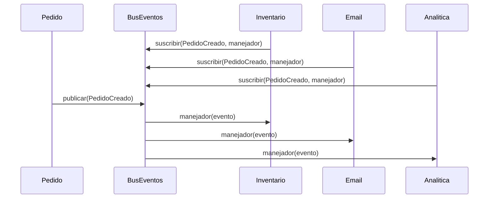
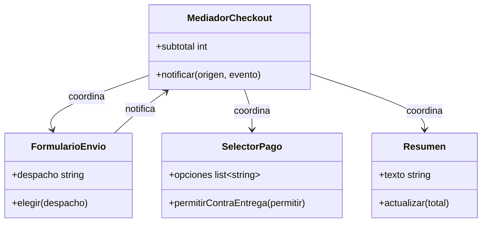
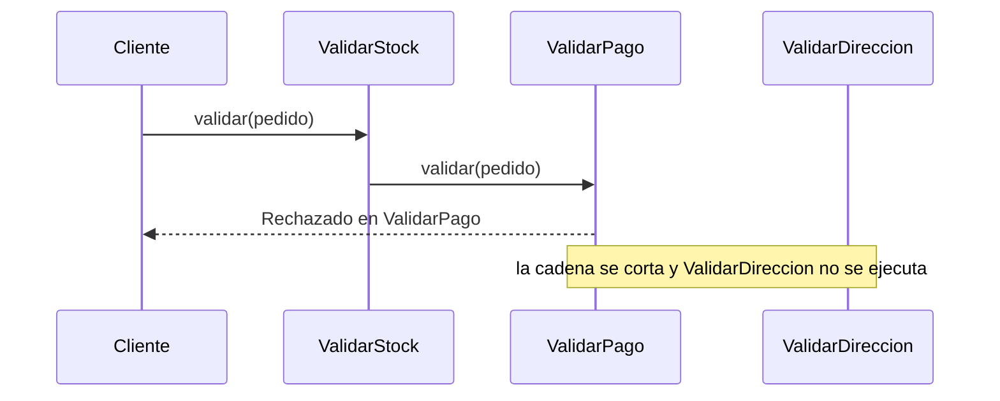

# De comportamiento: Observer, Mediator y Chain of Responsibility

Los tres patrones de este módulo resuelven la misma pregunta desde ángulos distintos: cómo hacer que varios objetos **se comuniquen sin quedar atados unos a otros**. **Observer** avisa a muchos interesados cuando algo ocurre sin conocerlos, **Mediator** reemplaza una red de objetos que se hablan entre sí por un coordinador central y **Chain of Responsibility** pasa una solicitud por una fila de manejadores hasta que alguno la resuelve o la rechaza. Los tres refuerzan el [OCP](03-ocp.md) y el [SRP](02-srp.md). Retoman nombres de módulos anteriores: el `Pedido` de los módulos anteriores, el `Notificador` del [módulo 08](08-factory-method.md) y la idea de objetos que envuelven y delegan del [módulo 13](13-decorator-proxy.md), que la comparación del final usa para separar Chain de Decorator. Producen `Evento` (con `PedidoCreado`), `BusEventos` (con `suscribir(tipo, manejador)` y `publicar(evento)`), `MediadorCheckout` y la cadena `ValidadorPedido` (`ValidarStock` → `ValidarPago` → `ValidarDireccion`); más adelante, en el caso de cierre del módulo 20 (antipatrones y caso de cierre), se reutilizará `BusEventos`.

En Go, cada patrón de este módulo forma su propio `main.go` lógico: los bloques Go de una sección se leen de corrido y no repiten `package` ni `import`.

## Observer

### El problema

Cuando un cliente confirma su pedido, la tienda debe descontar el inventario, enviar un email y registrar la venta en analítica. `Pedido.confirmar()` hace las tres cosas llamando a mano a cada servicio.

```python
class Pedido:
    def __init__(self, id_pedido, total, inventario, correo, analitica) -> None:
        self.id = id_pedido
        self.total = total
        self.inventario = inventario
        self.correo = correo
        self.analitica = analitica

    def confirmar(self) -> None:
        self.inventario.descontar(self.id)
        self.correo.enviar(self.id, "Tu pedido fue confirmado")
        self.analitica.registrar_venta(self.id, self.total)
        # mañana: puntos de fidelidad, aviso a bodega, webhook al ERP...
```

Cada interesado nuevo obliga a editar `Pedido`, a pasarle una dependencia más por el constructor y a volver a probar una clase que no tiene nada que ver con puntos de fidelidad. Si el email falla, ni siquiera se alcanza a registrar la venta. Y `Pedido` conoce a todos: es la clase más acoplada de la tienda.

### La idea en pocas palabras

Piensa en suscribirte a un canal de noticias: el canal publica y tú recibes el aviso, sin que el canal sepa quién eres ni cuántos suscriptores tiene. Darte de baja no lo obliga a cambiar nada.

**Observer** es un patrón de comportamiento en el que un objeto (el sujeto o publicador) mantiene una lista de interesados y los notifica cuando ocurre algo, sin conocer qué hacen con el aviso ([glosario](../glosario.md#observer)). Lo que se avisa es un **evento** (un objeto inmutable que describe algo que ya ocurrió; [glosario](../glosario.md#evento)) y cada interesado se registra con un **callback** (una función que se entrega a otro código para que la llame cuando corresponda; [glosario](../glosario.md#callback)).

- **Evento** → `Evento` y su caso concreto `PedidoCreado(id_pedido, total)`.
- **Publicador** → `Pedido`: llama a `bus.publicar(PedidoCreado(...))`; no conoce a nadie más.
- **Canal** → `BusEventos`: guarda los manejadores por tipo de evento (`suscribir`, `desuscribir`) y los llama en orden en `publicar`.
- **Suscriptores** → tres manejadores: `inventario`, `email` y `analitica`.

`BusEventos` es un Observer con un intermediario: el publicador solo conoce al bus. En el Observer del libro clásico el sujeto guarda su propia lista; aquí la lista vive en el bus para que cualquier clase pueda publicar sin repetirla. El bus de esta sección es síncrono y vive dentro de un solo proceso.

### Diagrama



### Código

En los cuatro lenguajes el pedido se confirma tres veces y la lista de avisados cambia con los suscriptores. La primera vez se enteran los tres originales. Luego se **suscribe** `puntos` sin tocar `Pedido` ni `BusEventos`, y después se **da de baja** `email`. Si el bus no admitiera suscriptores nuevos ni bajas, las tres líneas darían el mismo resultado.

#### Python

```python
from collections import defaultdict
from dataclasses import dataclass
from typing import Callable


class Evento:
    pass


@dataclass(frozen=True)
class PedidoCreado(Evento):
    id_pedido: int
    total: int


Manejador = Callable[[Evento], None]


class BusEventos:
    def __init__(self) -> None:
        self._manejadores: dict[type, list[Manejador]] = defaultdict(list)

    def suscribir(self, tipo: type, manejador: Manejador) -> None:
        self._manejadores[tipo].append(manejador)

    def desuscribir(self, tipo: type, manejador: Manejador) -> None:
        self._manejadores[tipo].remove(manejador)

    def publicar(self, evento: Evento) -> None:
        for manejador in list(self._manejadores[type(evento)]):
            manejador(evento)


class Pedido:
    def __init__(self, id_pedido: int, total: int, bus: BusEventos) -> None:
        self.id, self.total, self.bus = id_pedido, total, bus

    def confirmar(self) -> None:
        self.bus.publicar(PedidoCreado(self.id, self.total))
```

```python
registro: list[str] = []
bus = BusEventos()


def inventario(e: Evento) -> None: registro.append("inventario")
def email(e: Evento) -> None: registro.append("email")
def analitica(e: Evento) -> None: registro.append("analítica")
def puntos(e: Evento) -> None: registro.append("puntos")


def confirmar_y_listar(pedido: Pedido) -> str:
    registro.clear()
    pedido.confirmar()
    return ", ".join(registro) + " notificados"


for manejador in (inventario, email, analitica):
    bus.suscribir(PedidoCreado, manejador)
pedido = Pedido(101, 24990, bus)
print(confirmar_y_listar(pedido))  # => inventario, email, analítica notificados
bus.suscribir(PedidoCreado, puntos)  # un suscriptor nuevo: Pedido no cambia
print(confirmar_y_listar(pedido))  # => inventario, email, analítica, puntos notificados
bus.desuscribir(PedidoCreado, email)
print(confirmar_y_listar(pedido))  # => inventario, analítica, puntos notificados
```

#### TypeScript

```typescript
interface Evento {
  readonly tipo: string;
}

class PedidoCreado implements Evento {
  readonly tipo = "PedidoCreado";
  constructor(readonly idPedido: number, readonly total: number) {}
}

type Manejador = (evento: Evento) => void;

class BusEventos {
  private manejadores = new Map<string, Manejador[]>();

  suscribir(tipo: string, manejador: Manejador): void {
    this.manejadores.set(tipo, [...(this.manejadores.get(tipo) ?? []), manejador]);
  }

  desuscribir(tipo: string, manejador: Manejador): void {
    const restantes = (this.manejadores.get(tipo) ?? []).filter((m) => m !== manejador);
    this.manejadores.set(tipo, restantes);
  }

  publicar(evento: Evento): void {
    for (const manejador of this.manejadores.get(evento.tipo) ?? []) manejador(evento);
  }
}

class Pedido {
  constructor(readonly id: number, readonly total: number, private bus: BusEventos) {}

  confirmar(): void {
    this.bus.publicar(new PedidoCreado(this.id, this.total));
  }
}
```

```typescript
const registro: string[] = [];
const bus = new BusEventos();

const inventario: Manejador = () => { registro.push("inventario"); };
const email: Manejador = () => { registro.push("email"); };
const analitica: Manejador = () => { registro.push("analítica"); };
const puntos: Manejador = () => { registro.push("puntos"); };

function confirmarYListar(pedido: Pedido): string {
  registro.length = 0;
  pedido.confirmar();
  return `${registro.join(", ")} notificados`;
}

for (const manejador of [inventario, email, analitica]) bus.suscribir("PedidoCreado", manejador);
const pedido = new Pedido(101, 24990, bus);
console.log(confirmarYListar(pedido)); // => inventario, email, analítica notificados
bus.suscribir("PedidoCreado", puntos); // un suscriptor nuevo: Pedido no cambia
console.log(confirmarYListar(pedido)); // => inventario, email, analítica, puntos notificados
bus.desuscribir("PedidoCreado", email);
console.log(confirmarYListar(pedido)); // => inventario, analítica, puntos notificados
```

#### Go

```go
package main

import (
	"fmt"
	"strings"
)

type Evento interface{ Tipo() string }

type PedidoCreado struct{ IDPedido, Total int }

func (PedidoCreado) Tipo() string { return "PedidoCreado" }

type Manejador func(Evento)

type suscripcion struct {
	id        int
	manejador Manejador
}

type BusEventos struct {
	suscripciones map[string][]suscripcion
	ultimoID      int
}

func NuevoBus() *BusEventos {
	return &BusEventos{suscripciones: map[string][]suscripcion{}}
}
```

```go
// Suscribir devuelve la función que da de baja a este manejador.
func (b *BusEventos) Suscribir(tipo string, m Manejador) (baja func()) {
	b.ultimoID++
	id := b.ultimoID
	b.suscripciones[tipo] = append(b.suscripciones[tipo], suscripcion{id, m})
	return func() {
		actuales := b.suscripciones[tipo]
		for i, s := range actuales {
			if s.id == id {
				b.suscripciones[tipo] = append(actuales[:i:i], actuales[i+1:]...)
				return
			}
		}
	}
}

func (b *BusEventos) Publicar(e Evento) {
	for _, s := range b.suscripciones[e.Tipo()] {
		s.manejador(e)
	}
}

type Pedido struct {
	ID, Total int
	Bus       *BusEventos
}

func (p Pedido) Confirmar() { p.Bus.Publicar(PedidoCreado{p.ID, p.Total}) }
```

> **Nota Go:** una función no se puede comparar con `==` en Go, así que `Desuscribir(tipo, manejador)` no tiene cómo encontrar el manejador. El idioma es que `Suscribir` **devuelva la función de baja** (`baja := bus.Suscribir(...)`; `baja()`), igual que `context.WithCancel` devuelve `cancel`. Para notificar de forma concurrente, la alternativa es un canal por suscriptor (`chan Evento`): `Publicar` envía el evento a cada canal y cada suscriptor lo lee en su goroutine. Es más potente, pero un canal sin lector bloquea al publicador y una goroutine que nunca termina es la fuga de memoria de Go; por eso para un caso síncrono como este se prefiere una slice de funciones callback.

```go
func main() {
	var registro []string
	bus := NuevoBus()
	marca := func(nombre string) Manejador {
		return func(Evento) { registro = append(registro, nombre) }
	}
	confirmarYListar := func(p Pedido) string {
		registro = nil
		p.Confirmar()
		return strings.Join(registro, ", ") + " notificados"
	}
	bus.Suscribir("PedidoCreado", marca("inventario"))
	bajaEmail := bus.Suscribir("PedidoCreado", marca("email"))
	bus.Suscribir("PedidoCreado", marca("analítica"))
	pedido := Pedido{101, 24990, bus}
	fmt.Println(confirmarYListar(pedido)) // => inventario, email, analítica notificados
	bus.Suscribir("PedidoCreado", marca("puntos")) // un suscriptor nuevo: Pedido no cambia
	fmt.Println(confirmarYListar(pedido)) // => inventario, email, analítica, puntos notificados
	bajaEmail()
	fmt.Println(confirmarYListar(pedido)) // => inventario, analítica, puntos notificados
}
```

#### PHP

```php
<?php
interface Evento {}

class PedidoCreado implements Evento
{
    public function __construct(public readonly int $idPedido, public readonly int $total) {}
}

class BusEventos
{
    /** @var array<string, callable[]> */
    private array $manejadores = [];

    public function suscribir(string $tipo, callable $manejador): void
    {
        $this->manejadores[$tipo][] = $manejador;
    }

    public function desuscribir(string $tipo, callable $manejador): void
    {
        $restantes = array_filter($this->manejadores[$tipo] ?? [], fn($m) => $m !== $manejador);
        $this->manejadores[$tipo] = array_values($restantes);
    }

    public function publicar(Evento $evento): void
    {
        foreach ($this->manejadores[$evento::class] ?? [] as $manejador) {
            $manejador($evento);
        }
    }
}
```

```php
<?php
class Pedido
{
    public function __construct(public readonly int $id, public readonly int $total, private BusEventos $bus) {}

    public function confirmar(): void
    {
        $this->bus->publicar(new PedidoCreado($this->id, $this->total));
    }
}

function marca(string $nombre, array &$registro): Closure
{
    return function (Evento $e) use ($nombre, &$registro): void { $registro[] = $nombre; };
}

function confirmarYListar(Pedido $pedido, array &$registro): string
{
    $registro = [];
    $pedido->confirmar();
    return implode(', ', $registro) . ' notificados';
}

$registro = [];
$bus = new BusEventos();
$email = marca('email', $registro);
$bus->suscribir(PedidoCreado::class, marca('inventario', $registro));
$bus->suscribir(PedidoCreado::class, $email);
$bus->suscribir(PedidoCreado::class, marca('analítica', $registro));
$pedido = new Pedido(101, 24990, $bus);
echo confirmarYListar($pedido, $registro) . "\n"; // => inventario, email, analítica notificados
$bus->suscribir(PedidoCreado::class, marca('puntos', $registro)); // un suscriptor nuevo: Pedido no cambia
echo confirmarYListar($pedido, $registro) . "\n"; // => inventario, email, analítica, puntos notificados
$bus->desuscribir(PedidoCreado::class, $email);
echo confirmarYListar($pedido, $registro) . "\n"; // => inventario, analítica, puntos notificados
```

Fíjate en qué cambió y qué no: `Pedido` y `BusEventos` son idénticos en las tres confirmaciones. Lo único que se editó fue la lista de suscripciones, que vive en el código que arma la aplicación. En una tienda real, el manejador `email` es el sitio natural para usar el `Notificador` del [módulo 08](08-factory-method.md).

Una trampa aparece aquí: el bus guarda una referencia a cada manejador **mientras esté suscrito**. Un manejador que pertenece a un objeto de vida corta (una pantalla, una sesión) y que nunca se da de baja impide que ese objeto se libere: es la **fuga de memoria** clásica de los observers. Por eso existe `desuscribir` (o la función de baja en Go), y debe llamarse cuando el suscriptor deja de existir.

### Cuándo usarlo y cuándo no

**Úsalo** cuando un cambio en un objeto debe disparar acciones en otros, el conjunto de interesados puede crecer y el publicador no debería conocerlos. Es **OCP** aplicado: un interesado nuevo es un manejador nuevo, sin editar `Pedido`. Y es **DIP** (depender de abstracciones, no de clases concretas; [módulo 06](06-dip.md)): `Pedido` depende del bus y del evento, no de `Inventario`, `Email` ni `Analitica`.

**No lo uses** si hay un solo interesado fijo: una llamada directa es más clara y se puede seguir con el depurador. El costo del Observer es que el flujo se vuelve **implícito**: leyendo `confirmar()` no se ve qué ocurre después, el orden entre suscriptores no debería importar (y si importa, el diseño ya está mal) y las notificaciones en cascada (un manejador publica otro evento) se vuelven difíciles de seguir. Un manejador que lanza una excepción puede, además, impedir que se avise a los siguientes: decide si el bus la captura.

## Mediator

### El problema

En la pantalla de checkout hay tres componentes: el formulario de envío, el selector de pago y el resumen del pedido. Cada uno reacciona a los otros: si eliges despacho express, el resumen suma 5990 y el selector oculta el pago contra entrega. Cada componente tiene una referencia directa a los otros dos.

```python
class FormularioEnvio:
    def __init__(self, pago, resumen) -> None:
        self.pago, self.resumen, self.despacho = pago, resumen, "estandar"

    def elegir(self, despacho: str) -> None:
        self.despacho = despacho
        self.resumen.actualizar_envio(despacho)         # conoce al resumen
        self.pago.permitir_contra_entrega(despacho != "express")  # conoce al pago


class SelectorPago:
    def __init__(self, formulario, resumen) -> None:
        self.formulario, self.resumen = formulario, resumen  # y a los otros dos

    def elegir(self, metodo: str) -> None:
        if metodo == "contra entrega" and self.formulario.despacho == "express":
            raise ValueError("express no admite contra entrega")
        self.resumen.actualizar_pago(metodo)
```

Tres componentes con referencias cruzadas son seis conexiones, y cada componente nuevo (un cupón, un seguro de envío) obliga a editar a todos los demás. Ninguno se puede reutilizar ni probar solo, porque arrastra a sus vecinos; y las reglas del checkout (qué pago admite cada despacho) quedan repartidas en tres clases. Esto es acoplamiento de muchos a muchos.

### La idea en pocas palabras

Piensa en la torre de control de un aeropuerto: los aviones no se hablan entre sí para decidir quién aterriza primero; cada uno habla solo con la torre, y la torre coordina. Agregar un avión no obliga a los demás a aprender nada.

**Mediator** es un patrón de comportamiento que centraliza la comunicación entre varios objetos (los *colegas*) en un objeto mediador, de modo que los colegas ya no se conocen entre sí ([glosario](../glosario.md#mediator)). Convierte las conexiones muchos a muchos en conexiones uno a muchos. Las reglas de coordinación dejan de estar repartidas y viven en un solo lugar.

- **Mediador** → `MediadorCheckout`: crea a los colegas, recibe `notificar(origen, evento)` y decide qué hacer.
- **Colegas** → `FormularioEnvio`, `SelectorPago` y `Resumen`.

Se simplifica el dominio: solo `FormularioEnvio` emite eventos (`"envio_cambiado"`); `SelectorPago` y `Resumen` son pasivos y solo reciben órdenes del mediador. Si también emitieran eventos, recibirían una referencia al mediador igual que el formulario. El subtotal es fijo en 22990 pesos y los costos de envío son 3990 (estándar), 5990 (express) y 0 (retiro), como en el [módulo 16](16-strategy-state-template-method.md).

### Diagrama



### Código

En los cuatro lenguajes el formulario cambia a express: el mediador actualiza el resumen (22990 + 5990 = 28980) y retira el pago contra entrega. Al volver a estándar, el total es 26980 (22990 + 3990) y la opción reaparece. Si la regla estuviera repartida o ausente, el resumen o la lista de pagos no cambiarían.

#### Python

```python
COSTO_ENVIO = {"estandar": 3990, "express": 5990, "retiro": 0}


class FormularioEnvio:
    def __init__(self, mediador: "MediadorCheckout") -> None:
        self.mediador, self.despacho = mediador, "estandar"

    def elegir(self, despacho: str) -> None:
        self.despacho = despacho
        self.mediador.notificar(self, "envio_cambiado")


class SelectorPago:
    def __init__(self) -> None:
        self.opciones = ["tarjeta", "transferencia", "contra entrega"]

    def permitir_contra_entrega(self, permitir: bool) -> None:
        self.opciones = ["tarjeta", "transferencia"] + (["contra entrega"] if permitir else [])


class Resumen:
    def __init__(self) -> None:
        self.texto = ""

    def actualizar(self, total: int) -> None:
        self.texto = f"Resumen actualizado: total {total}"
```

```python
class MediadorCheckout:
    def __init__(self, subtotal: int) -> None:
        self.subtotal = subtotal
        self.formulario = FormularioEnvio(self)
        self.pago = SelectorPago()
        self.resumen = Resumen()

    def notificar(self, origen: object, evento: str) -> None:
        if origen is self.formulario and evento == "envio_cambiado":
            despacho = self.formulario.despacho
            self.resumen.actualizar(self.subtotal + COSTO_ENVIO[despacho])
            self.pago.permitir_contra_entrega(despacho != "express")


checkout = MediadorCheckout(22990)
checkout.formulario.elegir("express")
print(checkout.resumen.texto)  # => Resumen actualizado: total 28980
print(", ".join(checkout.pago.opciones))  # => tarjeta, transferencia
checkout.formulario.elegir("estandar")
print(checkout.resumen.texto)  # => Resumen actualizado: total 26980
print(", ".join(checkout.pago.opciones))  # => tarjeta, transferencia, contra entrega
```

#### TypeScript

```typescript
const COSTO_ENVIO: Record<string, number> = { estandar: 3990, express: 5990, retiro: 0 };

class FormularioEnvio {
  despacho = "estandar";

  constructor(private mediador: MediadorCheckout) {}

  elegir(despacho: string): void {
    this.despacho = despacho;
    this.mediador.notificar(this, "envio_cambiado");
  }
}

class SelectorPago {
  opciones = ["tarjeta", "transferencia", "contra entrega"];

  permitirContraEntrega(permitir: boolean): void {
    this.opciones = ["tarjeta", "transferencia", ...(permitir ? ["contra entrega"] : [])];
  }
}

class Resumen {
  texto = "";

  actualizar(total: number): void {
    this.texto = `Resumen actualizado: total ${total}`;
  }
}
```

```typescript
class MediadorCheckout {
  readonly formulario = new FormularioEnvio(this);
  readonly pago = new SelectorPago();
  readonly resumen = new Resumen();

  constructor(private subtotal: number) {}

  notificar(origen: object, evento: string): void {
    if (origen === this.formulario && evento === "envio_cambiado") {
      const despacho = this.formulario.despacho;
      this.resumen.actualizar(this.subtotal + COSTO_ENVIO[despacho]);
      this.pago.permitirContraEntrega(despacho !== "express");
    }
  }
}

const checkout = new MediadorCheckout(22990);
checkout.formulario.elegir("express");
console.log(checkout.resumen.texto); // => Resumen actualizado: total 28980
console.log(checkout.pago.opciones.join(", ")); // => tarjeta, transferencia
checkout.formulario.elegir("estandar");
console.log(checkout.resumen.texto); // => Resumen actualizado: total 26980
console.log(checkout.pago.opciones.join(", ")); // => tarjeta, transferencia, contra entrega
```

#### Go

```go
package main

import (
	"fmt"
	"strings"
)

var costoEnvio = map[string]int{"estandar": 3990, "express": 5990, "retiro": 0}

type Mediador interface {
	Notificar(origen any, evento string)
}

type FormularioEnvio struct {
	Despacho string
	med      Mediador
}

func (f *FormularioEnvio) Elegir(despacho string) {
	f.Despacho = despacho
	f.med.Notificar(f, "envio_cambiado")
}

type SelectorPago struct{ Opciones []string }

func (s *SelectorPago) PermitirContraEntrega(permitir bool) {
	s.Opciones = []string{"tarjeta", "transferencia"}
	if permitir {
		s.Opciones = append(s.Opciones, "contra entrega")
	}
}

type Resumen struct{ Texto string }

func (r *Resumen) Actualizar(total int) {
	r.Texto = fmt.Sprintf("Resumen actualizado: total %d", total)
}
```

```go
type MediadorCheckout struct {
	Subtotal   int
	Formulario *FormularioEnvio
	Pago       *SelectorPago
	Resumen    *Resumen
}

func NuevoMediadorCheckout(subtotal int) *MediadorCheckout {
	m := &MediadorCheckout{Subtotal: subtotal, Pago: &SelectorPago{}, Resumen: &Resumen{}}
	m.Formulario = &FormularioEnvio{Despacho: "estandar", med: m}
	m.Pago.PermitirContraEntrega(true)
	return m
}

func (m *MediadorCheckout) Notificar(origen any, evento string) {
	if origen == m.Formulario && evento == "envio_cambiado" {
		despacho := m.Formulario.Despacho
		m.Resumen.Actualizar(m.Subtotal + costoEnvio[despacho])
		m.Pago.PermitirContraEntrega(despacho != "express")
	}
}

func main() {
	checkout := NuevoMediadorCheckout(22990)
	checkout.Formulario.Elegir("express")
	fmt.Println(checkout.Resumen.Texto)                  // => Resumen actualizado: total 28980
	fmt.Println(strings.Join(checkout.Pago.Opciones, ", ")) // => tarjeta, transferencia
	checkout.Formulario.Elegir("estandar")
	fmt.Println(checkout.Resumen.Texto)                  // => Resumen actualizado: total 26980
	fmt.Println(strings.Join(checkout.Pago.Opciones, ", ")) // => tarjeta, transferencia, contra entrega
}
```

#### PHP

```php
<?php
const COSTO_ENVIO = ['estandar' => 3990, 'express' => 5990, 'retiro' => 0];

class FormularioEnvio
{
    public string $despacho = 'estandar';

    public function __construct(private MediadorCheckout $mediador) {}

    public function elegir(string $despacho): void
    {
        $this->despacho = $despacho;
        $this->mediador->notificar($this, 'envio_cambiado');
    }
}

class SelectorPago
{
    /** @var string[] */
    public array $opciones = ['tarjeta', 'transferencia', 'contra entrega'];

    public function permitirContraEntrega(bool $permitir): void
    {
        $this->opciones = ['tarjeta', 'transferencia', ...($permitir ? ['contra entrega'] : [])];
    }
}

class Resumen
{
    public string $texto = '';

    public function actualizar(int $total): void
    {
        $this->texto = "Resumen actualizado: total $total";
    }
}
```

```php
<?php
class MediadorCheckout
{
    public readonly FormularioEnvio $formulario;
    public readonly SelectorPago $pago;
    public readonly Resumen $resumen;

    public function __construct(private int $subtotal)
    {
        $this->formulario = new FormularioEnvio($this);
        $this->pago = new SelectorPago();
        $this->resumen = new Resumen();
    }

    public function notificar(object $origen, string $evento): void
    {
        if ($origen === $this->formulario && $evento === 'envio_cambiado') {
            $despacho = $this->formulario->despacho;
            $this->resumen->actualizar($this->subtotal + COSTO_ENVIO[$despacho]);
            $this->pago->permitirContraEntrega($despacho !== 'express');
        }
    }
}

$checkout = new MediadorCheckout(22990);
$checkout->formulario->elegir('express');
echo $checkout->resumen->texto . "\n"; // => Resumen actualizado: total 28980
echo implode(', ', $checkout->pago->opciones) . "\n"; // => tarjeta, transferencia
$checkout->formulario->elegir('estandar');
echo $checkout->resumen->texto . "\n"; // => Resumen actualizado: total 26980
echo implode(', ', $checkout->pago->opciones) . "\n"; // => tarjeta, transferencia, contra entrega
```

Para agregar un cupón se escribe un colega nuevo y una rama en `notificar`; el formulario, el selector y el resumen no se enteran. Las reglas del checkout ahora se leen en un solo método.

### Cuándo usarlo y cuándo no

**Úsalo** cuando varios objetos se condicionan entre sí, las referencias cruzadas ya duelen y quieres reutilizar o probar cada uno por separado. Es **SRP** en dos sentidos: cada colega solo se ocupa de lo suyo (mostrar un formulario, listar pagos, pintar el total) y solo conoce al mediador, y la coordinación entre ellos tiene un único dueño, `MediadorCheckout`.

**No lo uses** si son dos objetos que se hablan: una referencia directa basta. Y vigila el riesgo propio del patrón: el mediador acumula todas las reglas que los colegas se quitaron de encima y puede crecer hasta convertirse en un **God Object** (una clase que lo sabe y lo hace todo; [glosario](../glosario.md#god-object)), con cientos de líneas de `if` por evento. No elimina la complejidad: la **concentra**. Cuando el mediador crece, se divide por flujo (un mediador de envío, otro de pago) o se pasa a eventos (Observer).

## Chain of Responsibility

### El problema

Antes de aceptar un pedido hay que validarlo: que haya stock, que el pago sea viable y que la dirección exista. Todo vive en un solo método que crece con cada regla del negocio.

```python
def validar_pedido(pedido, stock, saldo) -> str:
    if pedido.producto in stock:
        if stock[pedido.producto] >= pedido.cantidad:
            if pedido.total <= saldo:
                if pedido.direccion.strip():
                    if len(pedido.direccion) > 10:
                        return "Pedido aprobado"
                    return "Rechazado: dirección muy corta"
                return "Rechazado: dirección vacía"
            return "Rechazado: tarjeta sin fondos"
        return "Rechazado: sin stock"
    return "Rechazado: producto desconocido"
    # ...y 60 líneas más: cupón vencido, cliente bloqueado, antifraude...
```

Los `if` anidados forman una flecha que se desplaza hacia la derecha, y cada regla nueva obliga a editar el medio de la pirámide sin romper las de afuera. Las reglas no se pueden probar por separado, ni reordenar, ni activar solo para ciertos clientes. Y el método tiene una razón de cambio por cada regla del negocio.

### La idea en pocas palabras

Piensa en el soporte técnico por niveles: llamas, el nivel 1 resuelve lo simple y, si no puede, te pasa al nivel 2, y así hasta que alguien lo resuelve. Cada nivel solo sabe de su problema y de a quién pasar la llamada.

**Chain of Responsibility** es un patrón de comportamiento que pasa una solicitud por una cadena de manejadores; cada uno decide si la procesa, la rechaza o la pasa al siguiente ([glosario](../glosario.md#chain-of-responsibility)). El que llama solo conoce el primer eslabón. En esta validación cada eslabón revisa una regla y, si falla, **corta la cadena** y devuelve el rechazo; si pasa, delega en el siguiente.

- **Manejador** → `ValidadorPedido`: `validar(pedido)` y `encadenar(siguiente)`.
- **Manejadores concretos** → `ValidarStock`, `ValidarPago` y `ValidarDireccion`.
- **Cliente** → quien arma la cadena y llama a `validar` en el primer eslabón.

Se simplifica el dominio: `Pedido` lleva `producto`, `cantidad`, `total` y `direccion`; el stock y el saldo de la tarjeta los guardan los validadores como si los hubieran consultado a un sistema externo. Cada validador devuelve un texto (`"Pedido aprobado"` o `"Rechazado en ...: motivo"`) en lugar de un tipo de resultado.

### Diagrama



### Código

En los cuatro lenguajes el primer pedido (24990, con saldo de 10000 y sin dirección) se rechaza en `ValidarPago`, y no en `ValidarDireccion`, aunque la dirección también falla: eso prueba que la cadena **se corta** en el primer rechazo. El segundo cuesta 8990, pasa el pago y cae en la dirección vacía. El tercero atraviesa los tres eslabones. Si cada validador revisara todo sin cortar, el primer resultado cambiaría.

#### Python

```python
from abc import ABC, abstractmethod
from dataclasses import dataclass


@dataclass(frozen=True)
class Pedido:
    id: int
    producto: str
    cantidad: int
    total: int
    direccion: str


class ValidadorPedido(ABC):
    def __init__(self) -> None:
        self._siguiente: "ValidadorPedido | None" = None

    def encadenar(self, siguiente: "ValidadorPedido") -> "ValidadorPedido":
        self._siguiente = siguiente
        return siguiente

    def validar(self, pedido: Pedido) -> str:
        motivo = self.revisar(pedido)
        if motivo:
            return f"Rechazado en {type(self).__name__}: {motivo}"  # la cadena se corta
        return self._siguiente.validar(pedido) if self._siguiente else "Pedido aprobado"

    @abstractmethod
    def revisar(self, pedido: Pedido) -> str | None: ...
```

```python
class ValidarStock(ValidadorPedido):
    def __init__(self, stock: dict[str, int]) -> None:
        super().__init__()
        self.stock = stock

    def revisar(self, pedido: Pedido) -> str | None:
        return "sin stock" if self.stock.get(pedido.producto, 0) < pedido.cantidad else None


class ValidarPago(ValidadorPedido):
    def __init__(self, saldo: int) -> None:
        super().__init__()
        self.saldo = saldo

    def revisar(self, pedido: Pedido) -> str | None:
        return "tarjeta sin fondos" if pedido.total > self.saldo else None


class ValidarDireccion(ValidadorPedido):
    def revisar(self, pedido: Pedido) -> str | None:
        return "dirección vacía" if not pedido.direccion.strip() else None


cadena = ValidarStock({"mochila": 5})
cadena.encadenar(ValidarPago(10000)).encadenar(ValidarDireccion())
print(cadena.validar(Pedido(1, "mochila", 1, 24990, "")))
# => Rechazado en ValidarPago: tarjeta sin fondos
print(cadena.validar(Pedido(2, "mochila", 1, 8990, "")))
# => Rechazado en ValidarDireccion: dirección vacía
print(cadena.validar(Pedido(3, "mochila", 1, 8990, "Av. Siempre Viva 742")))
# => Pedido aprobado
```

#### TypeScript

```typescript
interface Pedido {
  id: number;
  producto: string;
  cantidad: number;
  total: number;
  direccion: string;
}

abstract class ValidadorPedido {
  private siguiente?: ValidadorPedido;

  encadenar(siguiente: ValidadorPedido): ValidadorPedido {
    this.siguiente = siguiente;
    return siguiente;
  }

  validar(pedido: Pedido): string {
    const motivo = this.revisar(pedido);
    if (motivo) return `Rechazado en ${this.constructor.name}: ${motivo}`; // la cadena se corta
    return this.siguiente ? this.siguiente.validar(pedido) : "Pedido aprobado";
  }

  protected abstract revisar(pedido: Pedido): string | null;
}
```

```typescript
class ValidarStock extends ValidadorPedido {
  constructor(private stock: Record<string, number>) {
    super();
  }
  protected revisar(pedido: Pedido): string | null {
    return (this.stock[pedido.producto] ?? 0) < pedido.cantidad ? "sin stock" : null;
  }
}

class ValidarPago extends ValidadorPedido {
  constructor(private saldo: number) {
    super();
  }
  protected revisar(pedido: Pedido): string | null {
    return pedido.total > this.saldo ? "tarjeta sin fondos" : null;
  }
}

class ValidarDireccion extends ValidadorPedido {
  protected revisar(pedido: Pedido): string | null {
    return pedido.direccion.trim() === "" ? "dirección vacía" : null;
  }
}

const cadena = new ValidarStock({ mochila: 5 });
cadena.encadenar(new ValidarPago(10000)).encadenar(new ValidarDireccion());
console.log(cadena.validar({ id: 1, producto: "mochila", cantidad: 1, total: 24990, direccion: "" }));
// => Rechazado en ValidarPago: tarjeta sin fondos
console.log(cadena.validar({ id: 2, producto: "mochila", cantidad: 1, total: 8990, direccion: "" }));
// => Rechazado en ValidarDireccion: dirección vacía
console.log(cadena.validar({ id: 3, producto: "mochila", cantidad: 1, total: 8990, direccion: "Av. Siempre Viva 742" }));
// => Pedido aprobado
```

#### Go

```go
package main

import (
	"fmt"
	"strings"
)

type Pedido struct {
	ID        int
	Producto  string
	Cantidad  int
	Total     int
	Direccion string
}

type ValidadorPedido interface {
	Validar(p Pedido) string
}

// seguir pasa la solicitud al siguiente eslabón; sin siguiente, la cadena aprueba.
func seguir(siguiente ValidadorPedido, p Pedido) string {
	if siguiente == nil {
		return "Pedido aprobado"
	}
	return siguiente.Validar(p)
}

type ValidarStock struct {
	Stock     map[string]int
	Siguiente ValidadorPedido
}

func (v ValidarStock) Validar(p Pedido) string {
	if v.Stock[p.Producto] < p.Cantidad {
		return "Rechazado en ValidarStock: sin stock"
	}
	return seguir(v.Siguiente, p)
}
```

```go
type ValidarPago struct {
	Saldo     int
	Siguiente ValidadorPedido
}

func (v ValidarPago) Validar(p Pedido) string {
	if p.Total > v.Saldo {
		return "Rechazado en ValidarPago: tarjeta sin fondos"
	}
	return seguir(v.Siguiente, p)
}

type ValidarDireccion struct{ Siguiente ValidadorPedido }

func (v ValidarDireccion) Validar(p Pedido) string {
	if strings.TrimSpace(p.Direccion) == "" {
		return "Rechazado en ValidarDireccion: dirección vacía"
	}
	return seguir(v.Siguiente, p)
}

func demoCadena() {
	cadena := ValidarStock{map[string]int{"mochila": 5},
		ValidarPago{10000, ValidarDireccion{}}}
	fmt.Println(cadena.Validar(Pedido{1, "mochila", 1, 24990, ""}))
	// => Rechazado en ValidarPago: tarjeta sin fondos
	fmt.Println(cadena.Validar(Pedido{2, "mochila", 1, 8990, ""}))
	// => Rechazado en ValidarDireccion: dirección vacía
	fmt.Println(cadena.Validar(Pedido{3, "mochila", 1, 8990, "Av. Siempre Viva 742"}))
	// => Pedido aprobado
}
```

> **Nota Go:** en Go este patrón se escribe como una pila de **middleware HTTP**: `type Middleware func(next http.Handler) http.Handler`. Cada middleware recibe el siguiente manejador y devuelve uno nuevo que decide si lo llama (`next.ServeHTTP(w, r)`) o responde y corta la cadena (un 401, por ejemplo). Es la misma cadena con funciones en lugar de structs; el ejemplo usa una firma propia (`Handler`) para no depender de `net/http`.

```go
type Handler func(Pedido) string
type Middleware func(next Handler) Handler

func conPago(saldo int) Middleware {
	return func(next Handler) Handler {
		return func(p Pedido) string {
			if p.Total > saldo {
				return "Rechazado en ValidarPago: tarjeta sin fondos"
			}
			return next(p)
		}
	}
}

func conDireccion(next Handler) Handler {
	return func(p Pedido) string {
		if strings.TrimSpace(p.Direccion) == "" {
			return "Rechazado en ValidarDireccion: dirección vacía"
		}
		return next(p)
	}
}

func main() {
	demoCadena()
	aprobado := func(Pedido) string { return "Pedido aprobado" }
	cadena := conPago(10000)(conDireccion(aprobado))
	fmt.Println(cadena(Pedido{1, "mochila", 1, 24990, ""}))
	// => Rechazado en ValidarPago: tarjeta sin fondos
}
```

#### PHP

```php
<?php
class Pedido
{
    public function __construct(
        public readonly int $id,
        public readonly string $producto,
        public readonly int $cantidad,
        public readonly int $total,
        public readonly string $direccion,
    ) {}
}

abstract class ValidadorPedido
{
    private ?ValidadorPedido $siguiente = null;

    public function encadenar(ValidadorPedido $siguiente): ValidadorPedido
    {
        $this->siguiente = $siguiente;
        return $siguiente;
    }

    public function validar(Pedido $pedido): string
    {
        $motivo = $this->revisar($pedido);
        if ($motivo !== null) {
            return 'Rechazado en ' . static::class . ': ' . $motivo; // la cadena se corta
        }
        return $this->siguiente?->validar($pedido) ?? 'Pedido aprobado';
    }

    abstract protected function revisar(Pedido $pedido): ?string;
}
```

```php
<?php
class ValidarStock extends ValidadorPedido
{
    /** @param array<string, int> $stock */
    public function __construct(private array $stock) {}

    protected function revisar(Pedido $pedido): ?string
    {
        return ($this->stock[$pedido->producto] ?? 0) < $pedido->cantidad ? 'sin stock' : null;
    }
}

class ValidarPago extends ValidadorPedido
{
    public function __construct(private int $saldo) {}

    protected function revisar(Pedido $pedido): ?string
    {
        return $pedido->total > $this->saldo ? 'tarjeta sin fondos' : null;
    }
}

class ValidarDireccion extends ValidadorPedido
{
    protected function revisar(Pedido $pedido): ?string
    {
        return trim($pedido->direccion) === '' ? 'dirección vacía' : null;
    }
}

$cadena = new ValidarStock(['mochila' => 5]);
$cadena->encadenar(new ValidarPago(10000))->encadenar(new ValidarDireccion());
echo $cadena->validar(new Pedido(1, 'mochila', 1, 24990, '')) . "\n";
// => Rechazado en ValidarPago: tarjeta sin fondos
echo $cadena->validar(new Pedido(2, 'mochila', 1, 8990, '')) . "\n";
// => Rechazado en ValidarDireccion: dirección vacía
echo $cadena->validar(new Pedido(3, 'mochila', 1, 8990, 'Av. Siempre Viva 742')) . "\n";
// => Pedido aprobado
```

Una regla nueva (cliente bloqueado) es una clase con un método, `revisar`, que se inserta donde corresponda; el cliente y los otros tres validadores no cambian. Y como el orden lo decide quien arma la cadena, validar el pago antes que la dirección es un cambio de una línea.

### Cuándo usarlo y cuándo no

**Úsalo** cuando una solicitud debe pasar por varias reglas o pasos independientes, el orden o el conjunto pueden variar y quien envía no debería saber quién la procesa. Es **SRP**: cada eslabón tiene una sola razón de cambio (su regla). Y es **OCP**: una regla nueva es un eslabón nuevo, sin editar los existentes ni al cliente.

**No lo uses** si las reglas son pocas, fijas y siempre se ejecutan todas juntas: un método con tres `if` seguidos (sin anidar) es más simple. El costo es que la solicitud puede **quedar sin manejar** si ningún eslabón la resuelve (aquí la cadena termina aprobando; en otros casos hay que decidir qué pasa) y que depurar exige recorrer la cadena. Si ningún eslabón corta nunca, no necesitas una cadena, sino un Decorator o una lista de pasos.

## Comparación

Los tres patrones evitan que los objetos se conozcan entre sí, pero cada uno resuelve una forma distinta de comunicación.

| | Observer | Mediator | Chain of Responsibility |
|---|---|---|---|
| Forma de la comunicación | Uno a muchos | Muchos a muchos, a través de uno | Uno tras otro, en fila |
| ¿Quién coordina? | Nadie: cada suscriptor reacciona por su cuenta | El mediador, que concentra las reglas | Cada eslabón decide si sigue |
| ¿Se conocen los participantes? | El publicador no conoce a los suscriptores | Los colegas solo conocen al mediador | Cada eslabón conoce solo al siguiente |
| ¿Quién recibe? | Todos los suscriptores | El que el mediador decida | El primero que resuelve, o ninguno |
| Ejemplo de la tienda | `BusEventos` | `MediadorCheckout` | `ValidadorPedido` |

**Observer vs Mediator.** En ambos los objetos dejan de llamarse directamente. En Observer el flujo es de uno a muchos y los suscriptores no se coordinan: cada uno reacciona al evento por su cuenta, y el publicador no sabe ni le importa qué hacen. En Mediator las reglas de coordinación viven en un solo objeto, que sabe qué colega debe reaccionar a qué. Observer reparte la lógica entre los suscriptores y es fácil de extender; Mediator la concentra y es fácil de leer, pero puede crecer demasiado. De hecho un mediador suele implementarse sobre eventos (Observer).

**Chain vs Decorator.** Ambos son objetos que envuelven a otro y le delegan; la estructura es casi la misma, como vimos con el Decorator del [módulo 13](13-decorator-proxy.md). La diferencia es la intención y el recorrido: un Decorator **siempre** delega en el objeto envuelto y agrega comportamiento antes o después (todos los decoradores participan); en una cadena **cualquier eslabón puede cortar** y devolver sin llamar al siguiente, y lo normal es que solo algunos procesen la solicitud. Cuando la pregunta es "¿quién se encarga de esto?" o "¿pasa todas las reglas?", es una cadena; cuando es "¿qué le agrego a esto?", es un Decorator.

## Preguntas de entrevista

**P1. ¿Cuál es la diferencia entre Observer y Pub/Sub?**
En Observer el sujeto conoce a sus observadores (mantiene la lista) y los llama directamente, normalmente en el mismo proceso y de forma síncrona. En Pub/Sub hay un intermediario, el *broker* o bus de mensajes, que desacopla del todo a publicadores y suscriptores: no se conocen, se comunican por temas y la entrega puede ser asíncrona, persistente y entre procesos (Kafka, Redis, RabbitMQ). `BusEventos` está en el medio: un Pub/Sub en proceso, síncrono y sin garantías de entrega.

**P2. ¿En qué se diferencian Observer y Mediator?**
Ambos desacoplan objetos, pero Observer es de uno a muchos y sin coordinación: el publicador avisa y cada suscriptor decide qué hace. Mediator centraliza en un objeto las reglas sobre quién debe reaccionar a qué, así que los colegas solo lo conocen a él. Observer facilita agregar suscriptores; Mediator facilita ver y cambiar las reglas de coordinación, a costa de poder convertirse en un God Object.

**P3. ¿Cómo evitas las fugas de memoria con observers?**
La fuga ocurre porque el sujeto guarda una referencia fuerte a cada observador: si un objeto de vida corta (una pantalla, una sesión) se suscribe y nunca se da de baja, no se libera. Se evita llamando a `desuscribir` (o a la función de baja que devuelve `suscribir`) cuando el suscriptor deja de existir, o usando referencias débiles (`weakref` en Python, `WeakRef` en JavaScript). En Go la variante es la goroutine que sigue leyendo un canal que nadie cierra.

**P4. ¿Qué diferencia hay entre Chain of Responsibility y Decorator?**
Estructuralmente son parecidos: objetos que envuelven a otro y delegan. Un Decorator siempre delega en el objeto envuelto y agrega algo antes o después; en una cadena cada eslabón decide si procesa la solicitud, la pasa o la corta devolviendo sin llamar al siguiente. Por eso la cadena modela "quién se encarga" o "pasa todas las reglas", y el Decorator modela "agrégale esto".

**P5. ¿Cuándo un mediador es un mal olor?**
Cuando se convierte en un God Object: acumula todas las reglas de la pantalla o del sistema, crece a cientos de líneas con un `if` por cada evento y todo cambio pasa por él. Entonces solo has movido el desorden de muchos objetos a uno. También es mal olor si media entre dos objetos solamente (una referencia directa bastaba) o si los colegas empiezan a tener reglas de negocio y el mediador solo reenvía. La salida es dividirlo por flujo o usar eventos.

**P6. ¿Dónde ves estos patrones en software real?**
Observer está en los eventos del DOM (`addEventListener` suscribe un callback y `removeEventListener` da de baja) y en los eventos de Node.js (`EventEmitter`). Chain of Responsibility es la pila de middleware (cada middleware envuelve al siguiente como un Decorator; la pila completa, donde cualquiera puede cortar, es la cadena): Express, Koa, los `http.Handler` de Go o el pipeline de middleware de Laravel pasan la petición de un eslabón al siguiente y cualquiera puede cortarla con una respuesta. Mediator aparece en los controladores de pantallas de interfaz y en las torres de control de los frameworks de mensajería (el `MediatR` de .NET, por ejemplo).
