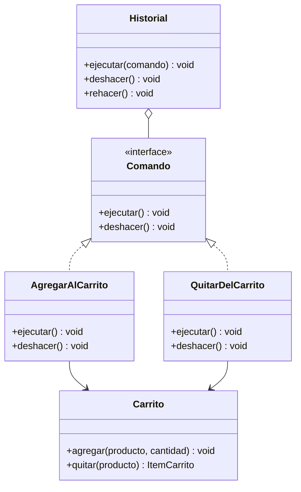
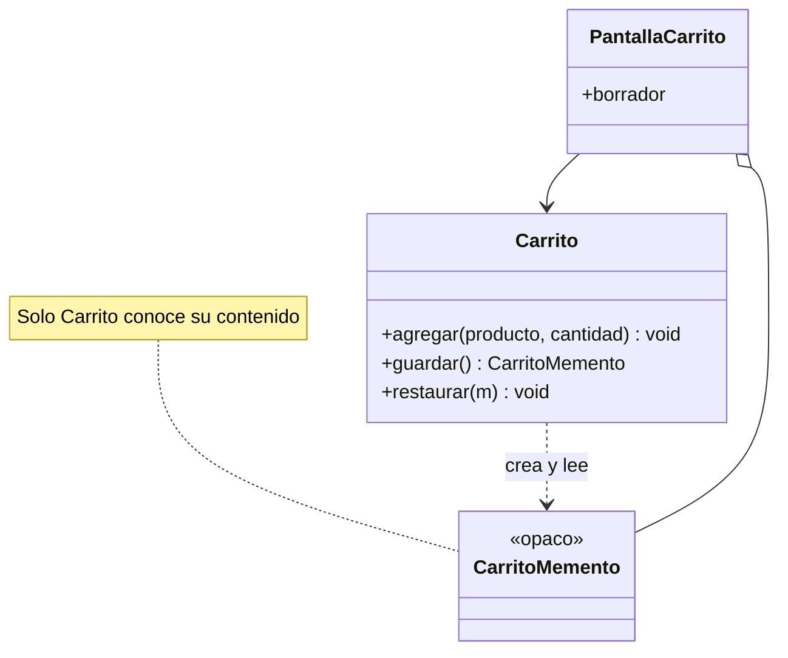
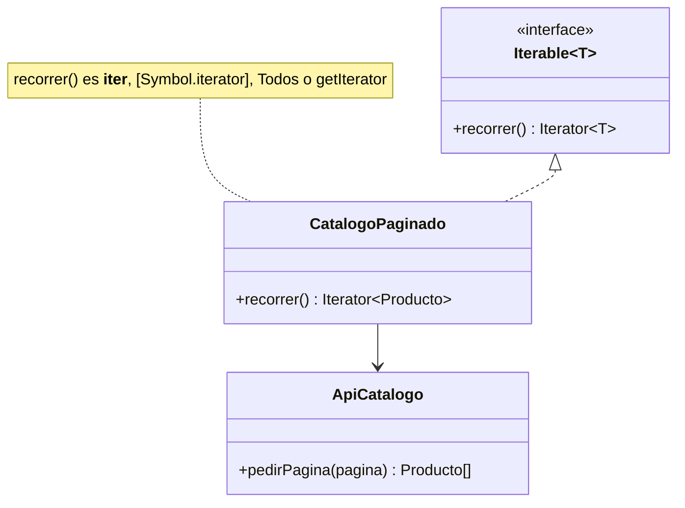

# De comportamiento: Command, Memento e Iterator

Los tres patrones de este módulo tratan **acciones, estados y recorridos como objetos que se pueden guardar y manipular**. **Command** convierte una acción en un objeto con `ejecutar` y `deshacer`, **Memento** captura el estado interno de un objeto para restaurarlo luego sin exponerlo e **Iterator** recorre una colección sin que quien la usa conozca su estructura. Retoman la idea de copiar un objeto mutable del [módulo 11](11-prototype.md) (`Pedido.clonar()`), cuya comparación con el snapshot opaco de Memento está al final; la idea de encapsular un comportamiento en un objeto intercambiable del [módulo 16](16-strategy-state-template-method.md), que la comparación usa para separar Command de Strategy; y las colaboraciones entre objetos del [módulo 17](17-observer-mediator-chain.md). Refuerzan el [SRP](02-srp.md), el [OCP](03-ocp.md) y el [ISP](05-isp.md). Producen `Comando` (con `ejecutar()` y `deshacer()`) con `AgregarAlCarrito`, `QuitarDelCarrito` e `Historial`; `CarritoMemento` con `Carrito.guardar()` y `Carrito.restaurar(m)`; y `CatalogoPaginado`, un catálogo iterable.

En Go, cada patrón de este módulo forma su propio `main.go` lógico: los bloques Go de una sección se leen de corrido y no repiten `package` ni `import`. El Iterator usa `iter.Seq`, que exige **Go 1.23** como mínimo. Para ser autocontenida, cada sección declara su propia versión mínima de `Carrito` (la de Command tiene `quitar`, la de Memento tiene `guardar`/`restaurar`).

## Command

### El problema

El carrito de la tienda necesita un botón "deshacer" (y uno de "rehacer"). Hoy las acciones son llamadas directas a métodos: se ejecutan y desaparecen, no queda nada que guardar ni que revertir. La primera versión intenta recordar a mano cuál fue la última acción.

```python
class Carrito:
    def __init__(self):
        self.items = []

    def agregar(self, producto, cantidad):
        self.items.append((producto, cantidad))

    def quitar(self, producto):
        self.items = [i for i in self.items if i[0] != producto]


def deshacer(carrito, ultima):
    if ultima[0] == "agregar":
        carrito.quitar(ultima[1])
    elif ultima[0] == "quitar":
        carrito.agregar(ultima[1], 1)  # ¿cuántas unidades había? Ya no se sabe
```

Hay tres dolores. La acción se describe con una **tupla** (`("agregar", producto)`) que el código interpreta con `if`/`elif`, y cada acción nueva (aplicar cupón, cambiar cantidad) obliga a editar `deshacer`. Para revertir un `quitar` falta información que la llamada original no guardó (la cantidad). Y solo se recuerda **una** acción: un historial completo exigiría una lista de tuplas cada vez más enredada.

### La idea en pocas palabras

Piensa en la comanda de un restaurante: el mesero no cocina; anota el pedido en un papel que viaja a la cocina, se puede archivar, repetir o anular. La solicitud pasó de ser un grito a ser un objeto.

**Command** es un patrón de comportamiento que encapsula una solicitud como un objeto, con todo lo necesario para ejecutarla y para revertirla ([glosario](../glosario.md#command)). Como cada acción es un objeto, se pueden apilar en un historial y habilitar **undo/redo** (deshacer y rehacer, es decir, retroceder o repetir acciones ya hechas; [glosario](../glosario.md#undoredo)).

- **Command** (interfaz) → `Comando`: declara `ejecutar()` y `deshacer()`.
- **Comandos concretos** → `AgregarAlCarrito` y `QuitarDelCarrito`: cada uno guarda sus datos y sabe revertirse.
- **Receptor** → `Carrito`: quien hace el trabajo real.
- **Invocador** → `Historial`: ejecuta comandos y guarda una pila de hechos y otra de deshechos.

La clave de `QuitarDelCarrito` es que **recuerda lo que quitó** en el momento de ejecutar, justo la información que faltaba en el código malo.

### Diagrama



### Código

El uso es el mismo en los cuatro lenguajes: se agregan dos productos, se deshace, se rehace, y luego se quita la polera y se deshace el quitar. Si `deshacer` no revirtiera, el primer resultado diría 2 items; si `QuitarDelCarrito` no recordara lo quitado, la polera volvería con otra cantidad. Una acción nueva borra la pila de "rehacer", como en cualquier editor.

#### Python

```python
from dataclasses import dataclass, field


@dataclass(frozen=True)
class Producto:
    id: int
    nombre: str
    precio: int


@dataclass
class ItemCarrito:
    producto: Producto
    cantidad: int


@dataclass
class Carrito:
    items: list[ItemCarrito] = field(default_factory=list)

    def agregar(self, producto: Producto, cantidad: int) -> None:
        self.items.append(ItemCarrito(producto, cantidad))

    def quitar(self, producto: Producto) -> ItemCarrito:
        for posicion, item in enumerate(self.items):
            if item.producto == producto:
                return self.items.pop(posicion)
        raise ValueError(f"{producto.nombre} no está en el carrito")

    def resumen(self) -> str:
        n = len(self.items)
        return f"{n} item" if n == 1 else f"{n} items"
```

```python
from typing import Protocol


class Comando(Protocol):
    def ejecutar(self) -> None: ...
    def deshacer(self) -> None: ...


class AgregarAlCarrito:
    def __init__(self, carrito: Carrito, producto: Producto, cantidad: int) -> None:
        self.carrito, self.producto, self.cantidad = carrito, producto, cantidad

    def ejecutar(self) -> None:
        self.carrito.agregar(self.producto, self.cantidad)

    def deshacer(self) -> None:
        self.carrito.quitar(self.producto)


class QuitarDelCarrito:
    def __init__(self, carrito: Carrito, producto: Producto) -> None:
        self.carrito, self.producto = carrito, producto
        self.quitado: ItemCarrito | None = None  # lo que se quitó, para devolverlo

    def ejecutar(self) -> None:
        self.quitado = self.carrito.quitar(self.producto)

    def deshacer(self) -> None:
        if self.quitado:
            self.carrito.agregar(self.quitado.producto, self.quitado.cantidad)
```

```python
class Historial:
    def __init__(self) -> None:
        self._hechos: list[Comando] = []
        self._deshechos: list[Comando] = []

    def ejecutar(self, comando: Comando) -> None:
        comando.ejecutar()
        self._hechos.append(comando)
        self._deshechos.clear()  # una acción nueva invalida el "rehacer"

    def deshacer(self) -> None:
        if self._hechos:
            comando = self._hechos.pop()
            comando.deshacer()
            self._deshechos.append(comando)

    def rehacer(self) -> None:
        if self._deshechos:
            comando = self._deshechos.pop()
            comando.ejecutar()
            self._hechos.append(comando)
```

```python
polera = Producto(1, "Polera", 12990)
gorro = Producto(2, "Gorro", 5990)
carrito, historial = Carrito(), Historial()
historial.ejecutar(AgregarAlCarrito(carrito, polera, 2))
historial.ejecutar(AgregarAlCarrito(carrito, gorro, 1))
historial.deshacer()
print(f"agregar, agregar, deshacer -> {carrito.resumen()}")  # => agregar, agregar, deshacer -> 1 item
historial.rehacer()
print(f"rehacer -> {carrito.resumen()}")  # => rehacer -> 2 items
historial.ejecutar(QuitarDelCarrito(carrito, polera))
historial.deshacer()
print(f"quitar, deshacer -> {carrito.resumen()}, polera x{carrito.items[-1].cantidad}")
# => quitar, deshacer -> 2 items, polera x2
```

#### TypeScript

```typescript
interface Producto {
  id: number;
  nombre: string;
  precio: number;
}

interface ItemCarrito {
  producto: Producto;
  cantidad: number;
}

class Carrito {
  items: ItemCarrito[] = [];

  agregar(producto: Producto, cantidad: number): void {
    this.items.push({ producto, cantidad });
  }

  quitar(producto: Producto): ItemCarrito {
    const posicion = this.items.findIndex((i) => i.producto.id === producto.id);
    if (posicion < 0) throw new Error(`${producto.nombre} no está en el carrito`);
    return this.items.splice(posicion, 1)[0];
  }

  resumen(): string {
    const n = this.items.length;
    return n === 1 ? "1 item" : `${n} items`;
  }
}
```

```typescript
interface Comando {
  ejecutar(): void;
  deshacer(): void;
}

class AgregarAlCarrito implements Comando {
  constructor(private carrito: Carrito, private producto: Producto, private cantidad: number) {}

  ejecutar(): void { this.carrito.agregar(this.producto, this.cantidad); }
  deshacer(): void { this.carrito.quitar(this.producto); }
}

class QuitarDelCarrito implements Comando {
  private quitado?: ItemCarrito; // lo que se quitó, para devolverlo

  constructor(private carrito: Carrito, private producto: Producto) {}

  ejecutar(): void { this.quitado = this.carrito.quitar(this.producto); }
  deshacer(): void {
    if (this.quitado) this.carrito.agregar(this.quitado.producto, this.quitado.cantidad);
  }
}
```

```typescript
class Historial {
  private hechos: Comando[] = [];
  private deshechos: Comando[] = [];

  ejecutar(comando: Comando): void {
    comando.ejecutar();
    this.hechos.push(comando);
    this.deshechos = []; // una acción nueva invalida el "rehacer"
  }

  deshacer(): void {
    const comando = this.hechos.pop();
    if (!comando) return;
    comando.deshacer();
    this.deshechos.push(comando);
  }

  rehacer(): void {
    const comando = this.deshechos.pop();
    if (!comando) return;
    comando.ejecutar();
    this.hechos.push(comando);
  }
}
```

```typescript
const polera: Producto = { id: 1, nombre: "Polera", precio: 12990 };
const gorro: Producto = { id: 2, nombre: "Gorro", precio: 5990 };
const carrito = new Carrito();
const historial = new Historial();
historial.ejecutar(new AgregarAlCarrito(carrito, polera, 2));
historial.ejecutar(new AgregarAlCarrito(carrito, gorro, 1));
historial.deshacer();
console.log(`agregar, agregar, deshacer -> ${carrito.resumen()}`); // => agregar, agregar, deshacer -> 1 item
historial.rehacer();
console.log(`rehacer -> ${carrito.resumen()}`); // => rehacer -> 2 items
historial.ejecutar(new QuitarDelCarrito(carrito, polera));
historial.deshacer();
console.log(`quitar, deshacer -> ${carrito.resumen()}, polera x${carrito.items[carrito.items.length - 1].cantidad}`);
// => quitar, deshacer -> 2 items, polera x2
```

#### Go

```go
package main

import "fmt"

type Producto struct {
	ID     int
	Nombre string
	Precio int
}

type ItemCarrito struct {
	Producto Producto
	Cantidad int
}

type Carrito struct{ Items []ItemCarrito }

func (c *Carrito) Agregar(p Producto, cantidad int) {
	c.Items = append(c.Items, ItemCarrito{p, cantidad})
}

// Quitar devuelve la línea quitada y false si el producto no estaba.
func (c *Carrito) Quitar(p Producto) (ItemCarrito, bool) {
	for i, item := range c.Items {
		if item.Producto == p {
			c.Items = append(c.Items[:i], c.Items[i+1:]...)
			return item, true
		}
	}
	return ItemCarrito{}, false
}

func (c *Carrito) Resumen() string {
	if len(c.Items) == 1 {
		return "1 item"
	}
	return fmt.Sprintf("%d items", len(c.Items))
}
```

```go
type Comando interface {
	Ejecutar()
	Deshacer()
}

type AgregarAlCarrito struct {
	Carrito  *Carrito
	Producto Producto
	Cantidad int
}

func (a AgregarAlCarrito) Ejecutar() { a.Carrito.Agregar(a.Producto, a.Cantidad) }
func (a AgregarAlCarrito) Deshacer() { a.Carrito.Quitar(a.Producto) }

type QuitarDelCarrito struct {
	Carrito  *Carrito
	Producto Producto
	quitado  ItemCarrito // lo que se quitó, para devolverlo
}

func (q *QuitarDelCarrito) Ejecutar() { q.quitado, _ = q.Carrito.Quitar(q.Producto) }

func (q *QuitarDelCarrito) Deshacer() {
	if q.quitado.Cantidad > 0 {
		q.Carrito.Agregar(q.quitado.Producto, q.quitado.Cantidad)
	}
}
```

```go
type Historial struct{ hechos, deshechos []Comando }

func (h *Historial) Ejecutar(c Comando) {
	c.Ejecutar()
	h.hechos = append(h.hechos, c)
	h.deshechos = nil // una acción nueva invalida el "rehacer"
}

func (h *Historial) Deshacer() {
	if len(h.hechos) == 0 {
		return
	}
	c := h.hechos[len(h.hechos)-1]
	h.hechos = h.hechos[:len(h.hechos)-1]
	c.Deshacer()
	h.deshechos = append(h.deshechos, c)
}

func (h *Historial) Rehacer() {
	if len(h.deshechos) == 0 {
		return
	}
	c := h.deshechos[len(h.deshechos)-1]
	h.deshechos = h.deshechos[:len(h.deshechos)-1]
	c.Ejecutar()
	h.hechos = append(h.hechos, c)
}
```

> **Nota Go:** como las funciones son valores, un comando no necesita ser un tipo con métodos: puede ser un struct con dos campos de función, `type Comando struct{ Ejecutar, Deshacer func() }`, o un par de closures que capturan el carrito y el producto. Es más corto para comandos pequeños; un tipo con métodos conviene cuando el comando guarda estado propio, como el `quitado` de `QuitarDelCarrito`.

```go
func main() {
	polera := Producto{1, "Polera", 12990}
	gorro := Producto{2, "Gorro", 5990}
	carrito, historial := &Carrito{}, &Historial{}
	historial.Ejecutar(AgregarAlCarrito{carrito, polera, 2})
	historial.Ejecutar(AgregarAlCarrito{carrito, gorro, 1})
	historial.Deshacer()
	fmt.Println("agregar, agregar, deshacer ->", carrito.Resumen()) // => agregar, agregar, deshacer -> 1 item
	historial.Rehacer()
	fmt.Println("rehacer ->", carrito.Resumen()) // => rehacer -> 2 items
	historial.Ejecutar(&QuitarDelCarrito{Carrito: carrito, Producto: polera})
	historial.Deshacer()
	ultimo := carrito.Items[len(carrito.Items)-1]
	fmt.Printf("quitar, deshacer -> %s, polera x%d\n", carrito.Resumen(), ultimo.Cantidad)
	// => quitar, deshacer -> 2 items, polera x2
}
```

#### PHP

```php
<?php
final class Producto
{
    public function __construct(public readonly int $id, public readonly string $nombre, public readonly int $precio) {}
}

final class ItemCarrito
{
    public function __construct(public readonly Producto $producto, public readonly int $cantidad) {}
}

class Carrito
{
    /** @var ItemCarrito[] */
    public array $items = [];

    public function agregar(Producto $producto, int $cantidad): void
    {
        $this->items[] = new ItemCarrito($producto, $cantidad);
    }

    public function quitar(Producto $producto): ItemCarrito
    {
        foreach ($this->items as $posicion => $item) {
            if ($item->producto->id === $producto->id) {
                array_splice($this->items, $posicion, 1);
                return $item;
            }
        }
        throw new RuntimeException("{$producto->nombre} no está en el carrito");
    }

    public function resumen(): string
    {
        $n = count($this->items);
        return $n === 1 ? '1 item' : "$n items";
    }
}
```

```php
<?php
interface Comando
{
    public function ejecutar(): void;
    public function deshacer(): void;
}

class AgregarAlCarrito implements Comando
{
    public function __construct(private Carrito $carrito, private Producto $producto, private int $cantidad) {}

    public function ejecutar(): void { $this->carrito->agregar($this->producto, $this->cantidad); }
    public function deshacer(): void { $this->carrito->quitar($this->producto); }
}

class QuitarDelCarrito implements Comando
{
    private ?ItemCarrito $quitado = null; // lo que se quitó, para devolverlo

    public function __construct(private Carrito $carrito, private Producto $producto) {}

    public function ejecutar(): void { $this->quitado = $this->carrito->quitar($this->producto); }

    public function deshacer(): void
    {
        if ($this->quitado) {
            $this->carrito->agregar($this->quitado->producto, $this->quitado->cantidad);
        }
    }
}
```

```php
<?php
class Historial
{
    /** @var Comando[] */
    private array $hechos = [];
    /** @var Comando[] */
    private array $deshechos = [];

    public function ejecutar(Comando $comando): void
    {
        $comando->ejecutar();
        $this->hechos[] = $comando;
        $this->deshechos = []; // una acción nueva invalida el "rehacer"
    }

    public function deshacer(): void
    {
        if ($comando = array_pop($this->hechos)) {
            $comando->deshacer();
            $this->deshechos[] = $comando;
        }
    }

    public function rehacer(): void
    {
        if ($comando = array_pop($this->deshechos)) {
            $comando->ejecutar();
            $this->hechos[] = $comando;
        }
    }
}
```

```php
<?php
$polera = new Producto(1, 'Polera', 12990);
$gorro = new Producto(2, 'Gorro', 5990);
$carrito = new Carrito();
$historial = new Historial();
$historial->ejecutar(new AgregarAlCarrito($carrito, $polera, 2));
$historial->ejecutar(new AgregarAlCarrito($carrito, $gorro, 1));
$historial->deshacer();
echo "agregar, agregar, deshacer -> {$carrito->resumen()}\n"; // => agregar, agregar, deshacer -> 1 item
$historial->rehacer();
echo "rehacer -> {$carrito->resumen()}\n"; // => rehacer -> 2 items
$historial->ejecutar(new QuitarDelCarrito($carrito, $polera));
$historial->deshacer();
echo "quitar, deshacer -> {$carrito->resumen()}, polera x" . end($carrito->items)->cantidad . "\n";
// => quitar, deshacer -> 2 items, polera x2
```

### Cuándo usarlo y cuándo no

**Úsalo** cuando necesites deshacer y rehacer, registrar acciones para auditarlas, ponerlas en una cola para ejecutarlas después o reintentarlas (una cola de trabajos es una cola de comandos). Refuerza el **SRP**: el `Carrito` sabe agregar y quitar, y cada comando sabe cómo hacer y deshacer una operación concreta, en vez de que `deshacer` mezcle la lógica de todas. Refuerza el **OCP**: una acción nueva (aplicar cupón) es un comando nuevo y `Historial` no se edita.

**No lo uses** si las acciones nunca se deshacen, encolan ni registran: llamar al método directamente es más simple, y envolver cada operación en una clase es ceremonia. Tampoco si deshacer es imposible (enviar un email no se puede "desenviar"); allí el comando solo sirve para encolar, y conviene decirlo.

## Memento

### El problema

El cliente arma un carrito y quiere guardar un "borrador" para volver a él si prueba una combinación que no le gusta. La primera versión deja que el código cliente guarde los campos del carrito por su cuenta.

```python
class Carrito:
    def __init__(self):
        self.items = []


carrito = Carrito()
carrito.items.append(["Polera", 2])
carrito.items.append(["Gorro", 1])
borrador = carrito.items.copy()  # el cliente decide qué campos guardar...
carrito.items[0][1] = 5          # ...y la copia superficial comparte las líneas
carrito.items = borrador         # ...y también cómo restaurarlos
print(f"Polera en el borrador: {borrador[0][1]}")
# => Polera en el borrador: 5
```

Para guardar el borrador el cliente tuvo que **conocer el interior** del carrito (`items`), lo que rompe el encapsulamiento (ocultar los datos internos de un objeto y exponer solo operaciones; [glosario](../glosario.md#encapsulamiento)). Si mañana `Carrito` suma un `cupon` o una `direccion`, cada borrador silenciosamente los pierde. Y, peor, el borrador **no es una foto**: la copia superficial comparte las líneas con el carrito vivo, y cambiar la cantidad de la polera cambió también el borrador.

### La idea en pocas palabras

Piensa en el punto de guardado de un videojuego: el juego captura todo su estado (posición, vidas, inventario), te entrega una "ranura" que no puedes abrir ni editar y, cuando quieres volver, el propio juego la lee y se restaura.

**Memento** es un patrón de comportamiento que captura y externaliza el estado interno de un objeto para poder restaurarlo después, **sin romper su encapsulamiento** ([glosario](../glosario.md#memento)). El memento es un **snapshot** (una foto inmutable del estado en un instante; [glosario](../glosario.md#snapshot)) que solo el objeto original sabe leer.

- **Originador** → `Carrito`: crea el memento con `guardar()` y vuelve a un estado con `restaurar(m)`.
- **Memento** → `CarritoMemento`: guarda el estado y es **opaco**: quien lo sostiene no puede leerlo ni modificarlo.
- **Cuidador** → `PantallaCarrito`, el código que guarda el memento hasta que el cliente lo pida; solo lo conserva y se lo devuelve al carrito.

### Diagrama



### Código

El uso es el mismo en los cuatro lenguajes: se guardan 2 items, se agrega un tercero (3 items) y al restaurar vuelven los 2. En Python y TypeScript, si `guardar` no copiara el estado (guardara la misma lista que sigue cambiando), el carrito restaurado diría 3 items; en Go y PHP la demo no lo delataría (un array de PHP se copia por valor, y el memento de Go guarda su propio `len`). En los cuatro, las líneas del carrito son **inmutables**, así que copiar la lista de líneas basta para que el memento sea una foto; para estado mutable habría que copiar también cada elemento, que es donde entra la copia profunda del [módulo 11](11-prototype.md).

#### Python

Python no tiene miembros privados: el guion bajo y `__slots__` son una convención, y `memento._estado` sigue siendo accesible para quien quiera romperla. La opacidad aquí es un contrato entre programadores, no una garantía del lenguaje.

```python
from dataclasses import dataclass


@dataclass(frozen=True)
class Producto:
    id: int
    nombre: str
    precio: int


@dataclass(frozen=True)
class ItemCarrito:
    producto: Producto
    cantidad: int


class CarritoMemento:
    """Opaco por convención: solo Carrito lee _estado."""

    __slots__ = ("_estado",)

    def __init__(self, estado: tuple[ItemCarrito, ...]) -> None:
        self._estado = estado
```

```python
class Carrito:
    def __init__(self) -> None:
        self._items: list[ItemCarrito] = []

    def agregar(self, producto: Producto, cantidad: int) -> None:
        self._items.append(ItemCarrito(producto, cantidad))

    def guardar(self) -> CarritoMemento:
        return CarritoMemento(tuple(self._items))  # copia: la tupla no cambia después

    def restaurar(self, memento: CarritoMemento) -> None:
        self._items = list(memento._estado)

    def resumen(self) -> str:
        n = len(self._items)
        return f"{n} item" if n == 1 else f"{n} items"
```

```python
carrito = Carrito()
carrito.agregar(Producto(1, "Polera", 12990), 2)
carrito.agregar(Producto(2, "Gorro", 5990), 1)
borrador = carrito.guardar()  # el cuidador solo sostiene el memento
carrito.agregar(Producto(3, "Calcetines", 2990), 1)
print(f"antes: {carrito.resumen()}")  # => antes: 3 items
carrito.restaurar(borrador)
print(f"restaurado: {carrito.resumen()}")  # => restaurado: 2 items
```

#### TypeScript

`private` solo protege en tiempo de compilación; en ejecución el campo existe. Para una opacidad real, el estado vive en un `WeakMap` que no se exporta del módulo: `CarritoMemento` es una clase **sin campos** y solo `Carrito` puede consultar el mapa. Esto vale mientras el módulo exporte únicamente `Carrito` y el tipo `CarritoMemento`. Como TypeScript tipa de forma estructural, cualquier objeto `{}` pasaría por un `CarritoMemento`; por eso `restaurar` ignora un memento que el mapa no conoce.

```typescript
interface Producto {
  id: number;
  nombre: string;
  precio: number;
}

interface ItemCarrito {
  readonly producto: Producto;
  readonly cantidad: number;
}

class CarritoMemento {} // sin campos: el cuidador no puede leer nada

const estados = new WeakMap<CarritoMemento, readonly ItemCarrito[]>(); // no exportado

class Carrito {
  private items: ItemCarrito[] = [];

  agregar(producto: Producto, cantidad: number): void {
    this.items.push({ producto, cantidad });
  }

  guardar(): CarritoMemento {
    const memento = new CarritoMemento();
    estados.set(memento, [...this.items]); // copia: el arreglo guardado no cambia
    return memento;
  }

  restaurar(memento: CarritoMemento): void {
    const estado = estados.get(memento);
    if (estado) this.items = [...estado];
  }

  resumen(): string {
    return this.items.length === 1 ? "1 item" : `${this.items.length} items`;
  }
}
```

```typescript
const carrito = new Carrito();
carrito.agregar({ id: 1, nombre: "Polera", precio: 12990 }, 2);
carrito.agregar({ id: 2, nombre: "Gorro", precio: 5990 }, 1);
const borrador = carrito.guardar(); // el cuidador solo sostiene el memento
carrito.agregar({ id: 3, nombre: "Calcetines", precio: 2990 }, 1);
console.log(`antes: ${carrito.resumen()}`); // => antes: 3 items
carrito.restaurar(borrador);
console.log(`restaurado: ${carrito.resumen()}`); // => restaurado: 2 items
```

#### Go

En Go la privacidad es **por paquete**, no por tipo. `CarritoMemento` tiene un campo no exportado (`items`): desde otro paquete se puede guardar y devolver el valor, pero no leer ni cambiar su contenido. Además, en Go el memento guarda su propio `len`, así que con un `Carrito` que solo agrega, la demo no delataría la falta de copia. El riesgo real aparece si otro método reescribe el arreglo subyacente en el lugar (por ejemplo, un `Quitar` que desplaza elementos), porque memento y carrito compartirían ese arreglo; por eso `Guardar` y `Restaurar` copian igual. Como este `main.go` es un solo paquete, aquí cualquiera podría leer `m.items`; en un proyecto real `Carrito` y `CarritoMemento` irían juntos en un paquete propio (por ejemplo `carrito`) y el cuidador, en otro.

```go
package main

import "fmt"

type Producto struct {
	ID     int
	Nombre string
	Precio int
}

type ItemCarrito struct {
	Producto Producto
	Cantidad int
}

// CarritoMemento: el campo items no exportado lo hace opaco fuera del paquete.
type CarritoMemento struct{ items []ItemCarrito }

type Carrito struct{ items []ItemCarrito }

func (c *Carrito) Agregar(p Producto, cantidad int) {
	c.items = append(c.items, ItemCarrito{p, cantidad})
}

func (c *Carrito) Guardar() CarritoMemento {
	return CarritoMemento{append([]ItemCarrito(nil), c.items...)}
}

// Restaurar copia otra vez: así los cambios posteriores no tocan el memento.
func (c *Carrito) Restaurar(m CarritoMemento) {
	c.items = append([]ItemCarrito(nil), m.items...)
}
```

```go
func (c *Carrito) Resumen() string {
	if len(c.items) == 1 {
		return "1 item"
	}
	return fmt.Sprintf("%d items", len(c.items))
}

func main() {
	carrito := &Carrito{}
	carrito.Agregar(Producto{1, "Polera", 12990}, 2)
	carrito.Agregar(Producto{2, "Gorro", 5990}, 1)
	borrador := carrito.Guardar() // el cuidador solo sostiene el memento
	carrito.Agregar(Producto{3, "Calcetines", 2990}, 1)
	fmt.Println("antes:", carrito.Resumen()) // => antes: 3 items
	carrito.Restaurar(borrador)
	fmt.Println("restaurado:", carrito.Resumen()) // => restaurado: 2 items
}
```

#### PHP

PHP no tiene un modificador "amigo" que deje a `Carrito` leer los campos privados de otra clase. La salida es que el memento guarde un `Closure` creado dentro de `Carrito` (que sí puede escribir sus propiedades privadas) y exponga solo `aplicarA`. El estado queda atrapado en el closure: el cuidador no puede leerlo ni modificarlo (salvo con Reflection) y `final` impide que otra clase herede y lo destape.

```php
<?php
final class Producto
{
    public function __construct(public readonly int $id, public readonly string $nombre, public readonly int $precio) {}
}

final class ItemCarrito
{
    public function __construct(public readonly Producto $producto, public readonly int $cantidad) {}
}

final class CarritoMemento
{
    public function __construct(private readonly Closure $restaurador) {}

    public function aplicarA(Carrito $carrito): void
    {
        ($this->restaurador)($carrito); // solo permite restaurar, nunca leer
    }
}
```

```php
<?php
class Carrito
{
    /** @var ItemCarrito[] */
    private array $items = [];

    public function agregar(Producto $producto, int $cantidad): void
    {
        $this->items[] = new ItemCarrito($producto, $cantidad);
    }

    public function guardar(): CarritoMemento
    {
        $copia = $this->items; // los arreglos se copian por valor
        return new CarritoMemento(function (Carrito $destino) use ($copia): void {
            $destino->items = $copia; // el closure nace dentro de Carrito: puede escribir lo privado
        });
    }

    public function restaurar(CarritoMemento $memento): void
    {
        $memento->aplicarA($this);
    }

    public function resumen(): string
    {
        $n = count($this->items);
        return $n === 1 ? '1 item' : "$n items";
    }
}
```

```php
<?php
$carrito = new Carrito();
$carrito->agregar(new Producto(1, 'Polera', 12990), 2);
$carrito->agregar(new Producto(2, 'Gorro', 5990), 1);
$borrador = $carrito->guardar(); // el cuidador solo sostiene el memento
$carrito->agregar(new Producto(3, 'Calcetines', 2990), 1);
echo "antes: {$carrito->resumen()}\n"; // => antes: 3 items
$carrito->restaurar($borrador);
echo "restaurado: {$carrito->resumen()}\n"; // => restaurado: 2 items
```

El costo es **memoria**: cada `guardar()` copia el estado. Un historial de 50 borradores de un carrito de 10 000 líneas guarda 50 listas de 10 000 referencias. Se mitiga limitando cuántos mementos se conservan, compartiendo las líneas inmutables entre ellos (como aquí: solo se copia la lista, no cada línea) o, si el estado es enorme, guardando solo lo que cambió, que es justo lo que hace un Command con `deshacer`.

### Cuándo usarlo y cuándo no

**Úsalo** cuando necesites volver a un estado anterior (borradores, puntos de restauración, "cancelar" en un formulario largo) y el estado interno no deba ser público. Refuerza el **SRP** y el encapsulamiento: el objeto es el único que sabe cómo serializar y restaurar su interior, y el cuidador solo guarda; si el carrito agrega un campo, solo cambian `guardar` y `restaurar`, no los clientes.

**No lo uses** si el estado es tan grande que guardar copias completas es prohibitivo (conviene un Command que revierta solo el cambio) o si el objeto ya es un valor inmutable: no hay nada que restaurar, basta con conservar la referencia anterior.

## Iterator

### El problema

El catálogo de la tienda tiene 100 000 productos y la API los entrega **paginados**. El cliente que quiere recorrerlos tiene que manejar páginas, límites y la condición de término. Aquí `ApiCatalogo` simula la API: entrega una página de `tamano_pagina` productos y cuenta cuántas le piden (con 3 por página, para que el ejemplo sea corto).

```python
from dataclasses import dataclass


@dataclass(frozen=True)
class Producto:
    id: int
    nombre: str
    precio: int


class ApiCatalogo:
    def __init__(self, total: int, tamano_pagina: int) -> None:
        self.total, self.tamano_pagina, self.paginas_pedidas = total, tamano_pagina, 0

    def pedir_pagina(self, pagina: int) -> list[Producto]:
        self.paginas_pedidas += 1
        inicio = (pagina - 1) * self.tamano_pagina + 1
        fin = min(pagina * self.tamano_pagina, self.total)
        return [Producto(n, f"Producto {n}", 1000 + n) for n in range(inicio, fin + 1)]


def listar_todo(api: ApiCatalogo) -> list[Producto]:
    productos, pagina = [], 1
    while lote := api.pedir_pagina(pagina):
        productos.extend(lote)
        pagina += 1
    return productos


api = ApiCatalogo(total=100_000, tamano_pagina=3)
primeros = listar_todo(api)[:5]
print(f"{len(primeros)} productos, {api.paginas_pedidas} páginas pedidas")
# => 5 productos, 33335 páginas pedidas
```

Para mostrar 5 productos, el código pidió **33 335 páginas** y cargó los 100 000 en memoria. Y cada pantalla que recorra el catálogo repetirá el bucle de páginas. La alternativa de hacer el bucle en cada cliente con un `break` tampoco sirve: cada uno vuelve a conocer cómo se pagina la API.

### La idea en pocas palabras

Piensa en pasar las páginas de un libro: lees una hoja, pasas a la siguiente y no necesitas saber cómo está encuadernado ni cuántas hojas quedan; si cierras el libro a la mitad, las hojas que no leíste no te costaron nada.

**Iterator** es un patrón de comportamiento que permite recorrer los elementos de una colección sin exponer su estructura interna ([glosario](../glosario.md#iterator)). El cliente solo pide "el siguiente"; la colección decide cómo obtenerlo. Aquí la colección además es **perezosa** (pide los datos a medida que se consumen, no todos de golpe; es la misma idea de [lazy loading](../glosario.md#lazy-loading)), y los lenguajes modernos la escriben con un **generador** (una función que entrega valores uno a uno con `yield` y se pausa entre uno y otro; [glosario](../glosario.md#generador)).

- **Iterable / Aggregate** → `CatalogoPaginado`: sabe cómo se pagina la API.
- **Iterator** → el recorrido que produce: en cada lenguaje lo genera el propio lenguaje (`yield` en Python, TypeScript y PHP; `iter.Seq` en Go).
- **Cliente** → cualquier código con un `for`: no ve páginas.

### Diagrama



### Código

El uso es el mismo en los cuatro lenguajes: con 3 productos por página y 100 000 en total, se toman los primeros 5 y se corta el recorrido. Los 5 salen de **2 páginas**, la tercera nunca se pide. Si el iterador fuera ansioso (cargara todo primero, como `listar_todo`), el contador diría 33 335.

#### Python

La clase solo necesita `__iter__` escrito como generador: `yield from lote` entrega los productos de la página uno por uno y la ejecución se pausa entre entregas. Reutiliza `ApiCatalogo` del problema.

```python
from collections.abc import Iterator
from itertools import islice


class CatalogoPaginado:
    def __init__(self, api: ApiCatalogo) -> None:
        self._api = api

    def __iter__(self) -> Iterator[Producto]:
        pagina = 1
        while lote := self._api.pedir_pagina(pagina):
            yield from lote
            pagina += 1


api = ApiCatalogo(total=100_000, tamano_pagina=3)
primeros = list(islice(CatalogoPaginado(api), 5))
print(f"{len(primeros)} productos, {api.paginas_pedidas} páginas pedidas")
# => 5 productos, 2 páginas pedidas
```

#### TypeScript

`[Symbol.iterator]` es el método que `for...of` busca; escrito como generador (`*`) es una línea de `yield*` por página.

```typescript
interface Producto {
  id: number;
  nombre: string;
  precio: number;
}

class ApiCatalogo {
  paginasPedidas = 0;

  constructor(private total: number, private tamanoPagina: number) {}

  pedirPagina(pagina: number): Producto[] {
    this.paginasPedidas++;
    const inicio = (pagina - 1) * this.tamanoPagina + 1;
    const fin = Math.min(pagina * this.tamanoPagina, this.total);
    const lote: Producto[] = [];
    for (let n = inicio; n <= fin; n++) lote.push({ id: n, nombre: `Producto ${n}`, precio: 1000 + n });
    return lote;
  }
}
```

```typescript
class CatalogoPaginado implements Iterable<Producto> {
  constructor(private api: ApiCatalogo) {}

  *[Symbol.iterator](): Iterator<Producto> {
    for (let pagina = 1; ; pagina++) {
      const lote = this.api.pedirPagina(pagina);
      if (lote.length === 0) return;
      yield* lote;
    }
  }
}

const api = new ApiCatalogo(100_000, 3);
const primeros: Producto[] = [];
for (const producto of new CatalogoPaginado(api)) {
  primeros.push(producto);
  if (primeros.length === 5) break;
}
console.log(`${primeros.length} productos, ${api.paginasPedidas} páginas pedidas`);
// => 5 productos, 2 páginas pedidas
```

#### Go

Requiere **Go 1.23** o superior (`iter.Seq` y `range` sobre funciones). `Todos()` devuelve una función que recibe `yield`; el `for p := range catalogo.Todos()` del cliente llama a esa función y su cuerpo se convierte en `yield`. Cuando el cliente hace `break`, `yield` devuelve `false` y el iterador debe terminar.

```go
package main

import (
	"fmt"
	"iter"
)

type Producto struct {
	ID     int
	Nombre string
	Precio int
}

type ApiCatalogo struct{ Total, TamanoPagina, PaginasPedidas int }

func (a *ApiCatalogo) PedirPagina(pagina int) []Producto {
	a.PaginasPedidas++
	inicio := (pagina-1)*a.TamanoPagina + 1
	fin := min(pagina*a.TamanoPagina, a.Total)
	var lote []Producto
	for n := inicio; n <= fin; n++ {
		lote = append(lote, Producto{n, fmt.Sprintf("Producto %d", n), 1000 + n})
	}
	return lote
}
```

```go
type CatalogoPaginado struct{ api *ApiCatalogo }

// Todos devuelve un iterador perezoso: pide cada página solo cuando hace falta.
func (c CatalogoPaginado) Todos() iter.Seq[Producto] {
	return func(yield func(Producto) bool) {
		for pagina := 1; ; pagina++ {
			lote := c.api.PedirPagina(pagina)
			if len(lote) == 0 {
				return
			}
			for _, p := range lote {
				if !yield(p) {
					return
				}
			}
		}
	}
}
```

> **Nota Go:** desde Go 1.23, `range` acepta funciones: un `iter.Seq[T]` **es** el Iterator, sin interfaz ni clase iteradora. Es un iterador de tipo "push" (la colección empuja los valores al cuerpo del `for`); para el estilo "pull" (`siguiente()` manual) existe `iter.Pull`. Antes de 1.23, la alternativa era un canal con una goroutine productora, que funciona pero tiene un costo: si el cliente deja de leer antes del final, la goroutine queda bloqueada para siempre enviando (una fuga). La función de `iter.Seq` no tiene ese problema.

```go
func main() {
	api := &ApiCatalogo{Total: 100_000, TamanoPagina: 3}
	catalogo := CatalogoPaginado{api}
	var primeros []Producto
	for p := range catalogo.Todos() {
		primeros = append(primeros, p)
		if len(primeros) == 5 {
			break
		}
	}
	fmt.Printf("%d productos, %d páginas pedidas\n", len(primeros), api.PaginasPedidas)
	// => 5 productos, 2 páginas pedidas
}
```

#### PHP

`IteratorAggregate` pide un solo método, `getIterator()`, y un generador lo satisface sin escribir una clase iteradora.

```php
<?php
final class Producto
{
    public function __construct(public readonly int $id, public readonly string $nombre, public readonly int $precio) {}
}

class ApiCatalogo
{
    public int $paginasPedidas = 0;

    public function __construct(private int $total, private int $tamanoPagina) {}

    /** @return Producto[] */
    public function pedirPagina(int $pagina): array
    {
        $this->paginasPedidas++;
        $inicio = ($pagina - 1) * $this->tamanoPagina + 1;
        $fin = min($pagina * $this->tamanoPagina, $this->total);
        $lote = [];
        for ($n = $inicio; $n <= $fin; $n++) {
            $lote[] = new Producto($n, "Producto $n", 1000 + $n);
        }
        return $lote;
    }
}
```

```php
<?php
class CatalogoPaginado implements IteratorAggregate
{
    public function __construct(private ApiCatalogo $api) {}

    public function getIterator(): Generator
    {
        for ($pagina = 1; ; $pagina++) {
            $lote = $this->api->pedirPagina($pagina);
            if ($lote === []) {
                return;
            }
            yield from $lote;
        }
    }
}

$api = new ApiCatalogo(100_000, 3);
$primeros = [];
foreach (new CatalogoPaginado($api) as $producto) {
    $primeros[] = $producto;
    if (count($primeros) === 5) {
        break;
    }
}
echo count($primeros) . " productos, {$api->paginasPedidas} páginas pedidas\n";
// => 5 productos, 2 páginas pedidas
```

### Cuándo usarlo y cuándo no

**Úsalo** cuando quieras recorrer una colección sin que el cliente conozca cómo se guarda o se obtiene (páginas de una API, filas de una base de datos, un árbol), o cuando la colección sea tan grande que cargarla entera no tenga sentido. Refuerza el **SRP**: la lógica de paginación vive en `CatalogoPaginado` y el cliente solo recorre. Refuerza el **ISP**: el cliente depende de una interfaz mínima, "algo que se puede recorrer", y no de todas las operaciones de la colección.

**No lo uses** si la colección ya es una lista en memoria: el `for` del lenguaje la recorre sin ceremonia. Tampoco si necesitas acceso aleatorio (el elemento 5 000) o recorrer hacia atrás: un iterador está pensado para avanzar de uno en uno.

## Comparación

Dos pares se confunden con frecuencia: Command con Strategy, porque ambos son "un objeto que representa algo que se hace", y Memento con Prototype, porque ambos "copian" un objeto.

| | Command | Strategy |
|---|---|---|
| Qué encapsula | Una **acción concreta** con sus datos (agregar la polera, cantidad 2) | Un **algoritmo** intercambiable (calcular el envío) |
| ¿Se puede deshacer? | Sí: `ejecutar()` y `deshacer()` | No: solo calcula, sin efectos que revertir |
| Ciclo de vida | Se crea por cada acción y se guarda en un historial o cola | Se elige y se reutiliza para muchas llamadas |
| Ejemplo de la tienda | `AgregarAlCarrito` | `EnvioExpress` del [módulo 16](16-strategy-state-template-method.md) |

| | Memento | Prototype |
|---|---|---|
| Propósito | **Volver** a un estado anterior | **Crear** un objeto nuevo igual a otro |
| Qué devuelve | Un snapshot **opaco**: nadie puede leerlo ni usarlo, solo restaurarlo | Un objeto **completo y usable**, que el cliente lee y modifica |
| ¿Quién lo interpreta? | Solo el originador | Cualquiera |
| Ejemplo de la tienda | `Carrito.guardar()` | `Pedido.clonar()` del [módulo 11](11-prototype.md) |

Pueden combinarse: un memento puede guardar internamente un `clonar()` del estado, y ahí está la diferencia, porque el cuidador solo ve una caja cerrada.

## Preguntas de entrevista

**P1. ¿Cómo implementas undo/redo?**
Con el patrón Command: cada acción es un objeto con `ejecutar()` y `deshacer()`, y un historial mantiene dos pilas. Ejecutar apila el comando en "hechos" y vacía "deshechos"; deshacer saca de "hechos", llama a `deshacer()` y lo apila en "deshechos"; rehacer hace lo inverso. Cada comando debe guardar lo que necesita para revertirse, como `QuitarDelCarrito`, que recuerda la línea quitada.

**P2. ¿En qué se diferencian Command y Strategy?**
Ambos convierten comportamiento en un objeto, pero con intención distinta. Strategy es un algoritmo intercambiable que el cliente elige y reutiliza (calcular el envío); Command es una acción concreta, con sus datos, que se crea, se guarda y puede deshacerse o encolarse. Un Strategy suele no tener estado ni deshacer; un Command casi siempre lleva los parámetros de la solicitud.

**P3. ¿Memento rompe el encapsulamiento?**
No, si está bien hecho: el memento es opaco y solo el originador sabe leer su contenido, así que el cuidador puede guardarlo pero no inspeccionarlo ni modificarlo. Rompería el encapsulamiento si el memento expusiera getters públicos para que otros lo lean. Cada lenguaje lo logra con sus mecanismos (convención en Python, módulo y `WeakMap` en TypeScript, campos no exportados en Go, un closure en PHP), y ninguno es infalible frente a quien quiera forzarlo.

**P4. ¿Qué diferencia hay entre un iterador interno y uno externo?**
En el externo el cliente controla el avance: pide "el siguiente" y decide cuándo parar, como `next()` en Python, `for...of` en TypeScript o `iter.Pull` en Go. En el interno la colección controla el bucle y llama a una función del cliente por cada elemento, como `forEach` o un `iter.Seq` de Go, donde el cuerpo del `for` es el callback. El externo es más flexible (puedes recorrer dos colecciones a la vez); el interno es más simple de escribir.

**P5. ¿Por qué los generadores simplifican Iterator?**
El Iterator clásico exige una clase iteradora con estado explícito (posición, página actual, si terminó) y un método `siguiente`. Un generador deja que el lenguaje guarde ese estado: el código se escribe como un bucle normal con `yield` y la ejecución se pausa entre elementos. Además son perezosos de forma natural: `CatalogoPaginado` pide una página solo cuando el cliente necesita el siguiente producto.

**P6. Dame un ejemplo real que combine estos patrones.**
Un editor de texto: cada edición (insertar, borrar) es un Command con `deshacer()`, lo que da el undo/redo con Ctrl+Z; guardar una versión completa del documento para volver a ella es un Memento; y recorrer sus líneas o los resultados de una búsqueda sin cargar todo el archivo es un Iterator. Una cola de trabajos es la misma idea de Command aplicada a tareas que se ejecutan después, con reintentos, y cuya lista de pendientes se recorre con un iterador.
