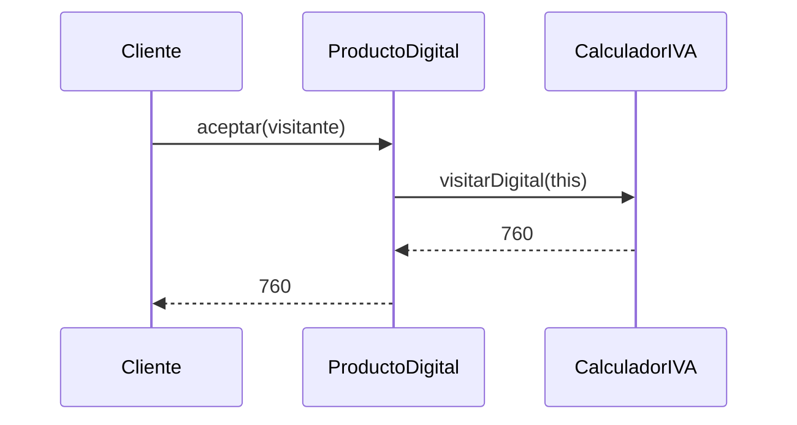
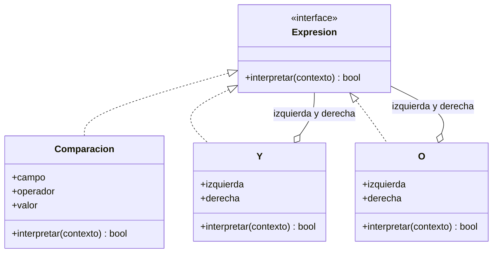

# Comportamiento sobre estructuras: Visitor e Interpreter

En el [módulo 18](18-command-memento-iterator.md) vimos patrones que convierten acciones y recorridos en objetos. Este módulo cierra los patrones de comportamiento con dos que **operan sobre estructuras de objetos**. **Visitor** saca las operaciones fuera de las clases de una estructura para poder agregar operaciones nuevas sin tocarlas. **Interpreter** representa las reglas de un lenguaje pequeño como un árbol de objetos que se evalúa solo. Visitor refuerza el [OCP](03-ocp.md) y el [SRP](02-srp.md); Interpreter se apoya en el OCP y en el [LSP](04-lsp.md). El primer patrón reutiliza `ProductoFisico` y `ProductoDigital` del [módulo 04](04-lsp.md) y el `Combo` del [módulo 14](14-composite-flyweight.md); el segundo se queda con la tienda a través de las reglas de **cupones**.

## Visitor

### El problema

El carrito mezcla tres tipos de elementos: productos físicos, productos digitales y combos (un combo contiene más elementos). Contabilidad pide calcular el IVA, donde los digitales llevan otra tasa. Integraciones pide exportar el carrito a JSON. Marketing quiere un resumen en texto. Cada operación se escribe como una función que pregunta por el tipo de cada elemento.

```python
def iva_total(items: list) -> int:
    total = 0
    for item in items:
        if isinstance(item, ProductoFisico):
            total += item.precio * 19 // 100
        elif isinstance(item, ProductoDigital):
            total += item.precio * 10 // 100
        elif isinstance(item, Combo):
            total += iva_total(item.hijos)
    return total


def a_json(item) -> str:
    if isinstance(item, ProductoFisico):
        return f'{{"tipo":"fisico","nombre":"{item.nombre}"}}'
    if isinstance(item, ProductoDigital):
        return f'{{"tipo":"digital","nombre":"{item.nombre}"}}'
    if isinstance(item, Combo):
        return '{"tipo":"combo","hijos":[' + ",".join(a_json(h) for h in item.hijos) + "]}"
    return ""  # una Suscripcion nueva llega aquí y desaparece del JSON sin avisar
```

Hay dos dolores. Cada operación repite la cadena de `isinstance` y su propio recorrido del combo. Y cuando alguien agrega un tipo nuevo (una `Suscripcion`), nada obliga a actualizar las funciones: `iva_total` la ignora y cobra 0 de IVA, y `a_json` la omite. La alternativa, poner `iva()`, `a_json()` y `resumen()` dentro de cada clase de producto, mezcla en los productos reglas de contabilidad, formato de integración y texto de marketing, y cada operación nueva obliga a editar todas las clases.

### La idea en pocas palabras

Piensa en un inspector municipal que visita distintos negocios: una panadería, una farmacia, un restaurante. Cada negocio lo recibe y le dice "soy una panadería"; el inspector, según el tipo, aplica la revisión que corresponde. Para inspeccionar otra cosa (sanidad, extintores) basta contratar a otro inspector; los negocios no cambian.

**Visitor** es un patrón de comportamiento que separa una operación de la estructura de objetos sobre la que actúa ([glosario](../glosario.md#visitor)). Lo logra con **doble despacho** (elegir qué método se ejecuta según el tipo de **dos** objetos, no de uno; [glosario](../glosario.md#doble-despacho)). El primer despacho ocurre cuando el cliente llama `elemento.aceptar(visitante)`: el polimorfismo elige la versión de `aceptar` según el tipo del elemento. El segundo ocurre dentro de ese `aceptar`, que llama `visitante.visitarFisico(this)`, `visitarDigital(this)` o `visitarCombo(this)`: como en esa línea el tipo del elemento ya es conocido, se elige el método correcto del visitante sin ningún `isinstance`.

- **Visitante** → `VisitanteCarrito`: un método por tipo de elemento (`visitarFisico`, `visitarDigital`, `visitarCombo`).
- **Visitantes concretos** → `CalculadorIVA` y `ExportadorJSON`.
- **Elemento** → `ElementoCarrito`: `aceptar(visitante)`.
- **Elementos concretos** → `ProductoFisico`, `ProductoDigital` y `Combo`.

Para el ejemplo se simplifica el dominio: los productos solo guardan `nombre` y `precio` (se omiten `id` y `url_descarga` de los módulos anteriores) y el `Combo` no lleva descuento (no hay precio que ajustar: el IVA se calcula sobre lo que vale cada hijo). Las tasas son 19 % para los físicos y 10 % para los digitales; el IVA se trunca a pesos enteros. El combo se recorre **visitando a sus hijos**: `visitarCombo` llama `aceptar` en cada uno, igual que el compuesto del módulo 14 llama `precio()`.

### Diagrama

El diagrama usa los nombres de TypeScript y PHP; en Python son `visitar_fisico`, `aceptar`, etc., y en Go `VisitarFisico`, `Aceptar`.

```mermaid
classDiagram
    class VisitanteCarrito {
        <<interface>>
        +visitarFisico(producto)
        +visitarDigital(producto)
        +visitarCombo(combo)
    }
    class CalculadorIVA
    class ExportadorJSON
    class ElementoCarrito {
        <<interface>>
        +aceptar(visitante)
    }
    class ProductoFisico
    class ProductoDigital
    class Combo {
        +hijos
    }
    VisitanteCarrito <|.. CalculadorIVA
    VisitanteCarrito <|.. ExportadorJSON
    ElementoCarrito <|.. ProductoFisico
    ElementoCarrito <|.. ProductoDigital
    ElementoCarrito <|.. Combo
    Combo o-- ElementoCarrito : hijos
```

El doble despacho, paso a paso, para un producto digital:



### Código

En los cuatro lenguajes el carrito tiene unas zapatillas físicas (14000) y un "Pack Runner" que contiene una polera física (10000) y una guía digital (7600). IVA: 14000 × 19 % = 2660, 10000 × 19 % = 1900 y 7600 × 10 % = 760, en total 5320. Si `visitarCombo` no recorriera a los hijos el resultado sería 2660, y si todos los productos usaran la misma tasa el número también cambiaría. La exportación del combo muestra que el recorrido anidado funciona.

#### Python

```python
from dataclasses import dataclass
from typing import Any, Protocol


class VisitanteCarrito(Protocol):
    def visitar_fisico(self, producto: "ProductoFisico") -> Any: ...
    def visitar_digital(self, producto: "ProductoDigital") -> Any: ...
    def visitar_combo(self, combo: "Combo") -> Any: ...


@dataclass(frozen=True)
class ProductoFisico:
    nombre: str
    precio: int

    def aceptar(self, visitante: VisitanteCarrito) -> Any:
        return visitante.visitar_fisico(self)


@dataclass(frozen=True)
class ProductoDigital:
    nombre: str
    precio: int

    def aceptar(self, visitante: VisitanteCarrito) -> Any:
        return visitante.visitar_digital(self)


@dataclass(frozen=True)
class Combo:
    nombre: str
    hijos: list

    def aceptar(self, visitante: VisitanteCarrito) -> Any:
        return visitante.visitar_combo(self)
```

```python
class CalculadorIVA:
    def visitar_fisico(self, p: ProductoFisico) -> int:
        return p.precio * 19 // 100

    def visitar_digital(self, p: ProductoDigital) -> int:
        return p.precio * 10 // 100

    def visitar_combo(self, combo: Combo) -> int:
        return sum(hijo.aceptar(self) for hijo in combo.hijos)


class ExportadorJSON:
    def visitar_fisico(self, p: ProductoFisico) -> str:
        return f'{{"tipo":"fisico","nombre":"{p.nombre}","precio":{p.precio}}}'

    def visitar_digital(self, p: ProductoDigital) -> str:
        return f'{{"tipo":"digital","nombre":"{p.nombre}","precio":{p.precio}}}'

    def visitar_combo(self, combo: Combo) -> str:
        hijos = ",".join(hijo.aceptar(self) for hijo in combo.hijos)
        return f'{{"tipo":"combo","nombre":"{combo.nombre}","hijos":[{hijos}]}}'
```

```python
zapatillas = ProductoFisico("Zapatillas", 14000)
pack = Combo("Pack Runner", [ProductoFisico("Polera", 10000), ProductoDigital("Guía", 7600)])
carrito = [zapatillas, pack]
iva = sum(elemento.aceptar(CalculadorIVA()) for elemento in carrito)
print(f"IVA total: {iva}")  # => IVA total: 5320
print(pack.aceptar(ExportadorJSON()))
# => {"tipo":"combo","nombre":"Pack Runner","hijos":[{"tipo":"fisico","nombre":"Polera","precio":10000},{"tipo":"digital","nombre":"Guía","precio":7600}]}
```

#### TypeScript

```typescript
interface VisitanteCarrito<R> {
  visitarFisico(producto: ProductoFisico): R;
  visitarDigital(producto: ProductoDigital): R;
  visitarCombo(combo: Combo): R;
}

interface ElementoCarrito {
  aceptar<R>(visitante: VisitanteCarrito<R>): R;
}

class ProductoFisico implements ElementoCarrito {
  constructor(readonly nombre: string, readonly precio: number) {}

  aceptar<R>(visitante: VisitanteCarrito<R>): R {
    return visitante.visitarFisico(this);
  }
}

class ProductoDigital implements ElementoCarrito {
  constructor(readonly nombre: string, readonly precio: number) {}

  aceptar<R>(visitante: VisitanteCarrito<R>): R {
    return visitante.visitarDigital(this);
  }
}

```

```typescript
class Combo implements ElementoCarrito {
  constructor(readonly nombre: string, readonly hijos: ElementoCarrito[]) {}

  aceptar<R>(visitante: VisitanteCarrito<R>): R {
    return visitante.visitarCombo(this);
  }
}
```

```typescript
class CalculadorIVA implements VisitanteCarrito<number> {
  visitarFisico(p: ProductoFisico): number {
    return Math.trunc((p.precio * 19) / 100);
  }

  visitarDigital(p: ProductoDigital): number {
    return Math.trunc((p.precio * 10) / 100);
  }

  visitarCombo(combo: Combo): number {
    return combo.hijos.reduce((total, hijo) => total + hijo.aceptar(this), 0);
  }
}

class ExportadorJSON implements VisitanteCarrito<string> {
  visitarFisico(p: ProductoFisico): string {
    return `{"tipo":"fisico","nombre":"${p.nombre}","precio":${p.precio}}`;
  }

  visitarDigital(p: ProductoDigital): string {
    return `{"tipo":"digital","nombre":"${p.nombre}","precio":${p.precio}}`;
  }

  visitarCombo(combo: Combo): string {
    const hijos = combo.hijos.map((hijo) => hijo.aceptar(this)).join(",");
    return `{"tipo":"combo","nombre":"${combo.nombre}","hijos":[${hijos}]}`;
  }
}
```

```typescript
const zapatillas = new ProductoFisico("Zapatillas", 14000);
const pack = new Combo("Pack Runner", [new ProductoFisico("Polera", 10000), new ProductoDigital("Guía", 7600)]);
const carrito: ElementoCarrito[] = [zapatillas, pack];
const iva = carrito.reduce((total, elemento) => total + elemento.aceptar(new CalculadorIVA()), 0);
console.log(`IVA total: ${iva}`); // => IVA total: 5320
console.log(pack.aceptar(new ExportadorJSON()));
// => {"tipo":"combo","nombre":"Pack Runner","hijos":[{"tipo":"fisico","nombre":"Polera","precio":10000},{"tipo":"digital","nombre":"Guía","precio":7600}]}
```

#### Go

Los bloques Go de este módulo forman un solo `main.go`: el de Visitor define `demoVisitor`, el de Interpreter define `demoInterpreter`, y `main` llama a las dos al final. Por eso el primer bloque ya importa `strings`, que se usa en `ExportadorJSON`. Como los métodos de Go no admiten parámetros de tipo, los visitantes **acumulan** su resultado en un campo (`Total`, `Partes`) en vez de devolverlo.

```go
package main

import (
	"fmt"
	"strings"
)

type VisitanteCarrito interface {
	VisitarFisico(p ProductoFisico)
	VisitarDigital(p ProductoDigital)
	VisitarCombo(c Combo)
}

type ElementoCarrito interface {
	Aceptar(v VisitanteCarrito)
}

type ProductoFisico struct {
	Nombre string
	Precio int
}

func (p ProductoFisico) Aceptar(v VisitanteCarrito) { v.VisitarFisico(p) }

type ProductoDigital struct {
	Nombre string
	Precio int
}

func (p ProductoDigital) Aceptar(v VisitanteCarrito) { v.VisitarDigital(p) }

type Combo struct {
	Nombre string
	Hijos  []ElementoCarrito
}

func (c Combo) Aceptar(v VisitanteCarrito) { v.VisitarCombo(c) }
```

```go
type CalculadorIVA struct{ Total int }

func (c *CalculadorIVA) VisitarFisico(p ProductoFisico)   { c.Total += p.Precio * 19 / 100 }
func (c *CalculadorIVA) VisitarDigital(p ProductoDigital) { c.Total += p.Precio * 10 / 100 }
func (c *CalculadorIVA) VisitarCombo(combo Combo) {
	for _, hijo := range combo.Hijos {
		hijo.Aceptar(c)
	}
}

type ExportadorJSON struct{ Partes []string }

func (e *ExportadorJSON) VisitarFisico(p ProductoFisico) {
	e.Partes = append(e.Partes, fmt.Sprintf(`{"tipo":"fisico","nombre":"%s","precio":%d}`, p.Nombre, p.Precio))
}

func (e *ExportadorJSON) VisitarDigital(p ProductoDigital) {
	e.Partes = append(e.Partes, fmt.Sprintf(`{"tipo":"digital","nombre":"%s","precio":%d}`, p.Nombre, p.Precio))
}

func (e *ExportadorJSON) VisitarCombo(combo Combo) {
	interno := &ExportadorJSON{}
	for _, hijo := range combo.Hijos {
		hijo.Aceptar(interno)
	}
	e.Partes = append(e.Partes, fmt.Sprintf(`{"tipo":"combo","nombre":"%s","hijos":[%s]}`, combo.Nombre, strings.Join(interno.Partes, ",")))
}
```

```go
func demoVisitor() {
	zapatillas := ProductoFisico{"Zapatillas", 14000}
	pack := Combo{"Pack Runner", []ElementoCarrito{ProductoFisico{"Polera", 10000}, ProductoDigital{"Guía", 7600}}}
	carrito := []ElementoCarrito{zapatillas, pack}
	calculador := &CalculadorIVA{}
	for _, elemento := range carrito {
		elemento.Aceptar(calculador)
	}
	fmt.Printf("IVA total: %d\n", calculador.Total) // => IVA total: 5320
	exportador := &ExportadorJSON{}
	pack.Aceptar(exportador)
	fmt.Println(exportador.Partes[0])
	// => {"tipo":"combo","nombre":"Pack Runner","hijos":[{"tipo":"fisico","nombre":"Polera","precio":10000},{"tipo":"digital","nombre":"Guía","precio":7600}]}
}
```

> **Nota Go:** muchas veces el Visitor completo sobra en Go: un `switch` sobre el tipo (type switch) hace lo mismo con menos código, porque el type switch elige la rama en tiempo de ejecución según el tipo dinámico de la interfaz.
>
> ```go
> func ivaConSwitch(e ElementoCarrito) int {
> 	switch x := e.(type) {
> 	case ProductoFisico:
> 		return x.Precio * 19 / 100
> 	case ProductoDigital:
> 		return x.Precio * 10 / 100
> 	case Combo:
> 		total := 0
> 		for _, hijo := range x.Hijos {
> 			total += ivaConSwitch(hijo)
> 		}
> 		return total
> 	}
> 	return 0 // un tipo nuevo cae aquí sin avisar
> }
> ```
>
> Es la versión Go del `isinstance` del problema, y tiene su mismo riesgo: si agregas un tipo, el compilador no te avisa que falta un `case`. El Visitor vale la pena cuando quieres esa garantía (una interfaz con un método por tipo obliga a cada visitante a cubrirlos todos) o cuando el conjunto de operaciones lo extienden otros paquetes que no pueden editar tu `switch`. Para dos o tres operaciones internas, el type switch suele ser más simple.

#### PHP

```php
<?php
interface VisitanteCarrito
{
    public function visitarFisico(ProductoFisico $producto): mixed;
    public function visitarDigital(ProductoDigital $producto): mixed;
    public function visitarCombo(Combo $combo): mixed;
}

interface ElementoCarrito
{
    public function aceptar(VisitanteCarrito $visitante): mixed;
}

class ProductoFisico implements ElementoCarrito
{
    public function __construct(public readonly string $nombre, public readonly int $precio) {}

    public function aceptar(VisitanteCarrito $visitante): mixed
    {
        return $visitante->visitarFisico($this);
    }
}

class ProductoDigital implements ElementoCarrito
{
    public function __construct(public readonly string $nombre, public readonly int $precio) {}

    public function aceptar(VisitanteCarrito $visitante): mixed
    {
        return $visitante->visitarDigital($this);
    }
}

```

```php
<?php
class Combo implements ElementoCarrito
{
    /** @param ElementoCarrito[] $hijos */
    public function __construct(public readonly string $nombre, public readonly array $hijos) {}

    public function aceptar(VisitanteCarrito $visitante): mixed
    {
        return $visitante->visitarCombo($this);
    }
}
```

```php
<?php
class CalculadorIVA implements VisitanteCarrito
{
    public function visitarFisico(ProductoFisico $p): int
    {
        return intdiv($p->precio * 19, 100);
    }

    public function visitarDigital(ProductoDigital $p): int
    {
        return intdiv($p->precio * 10, 100);
    }

    public function visitarCombo(Combo $combo): int
    {
        return array_sum(array_map(fn (ElementoCarrito $hijo) => $hijo->aceptar($this), $combo->hijos));
    }
}

class ExportadorJSON implements VisitanteCarrito
{
    public function visitarFisico(ProductoFisico $p): string
    {
        return sprintf('{"tipo":"fisico","nombre":"%s","precio":%d}', $p->nombre, $p->precio);
    }

    public function visitarDigital(ProductoDigital $p): string
    {
        return sprintf('{"tipo":"digital","nombre":"%s","precio":%d}', $p->nombre, $p->precio);
    }

    public function visitarCombo(Combo $combo): string
    {
        $hijos = implode(',', array_map(fn (ElementoCarrito $hijo) => $hijo->aceptar($this), $combo->hijos));
        return sprintf('{"tipo":"combo","nombre":"%s","hijos":[%s]}', $combo->nombre, $hijos);
    }
}
```

```php
<?php
$zapatillas = new ProductoFisico('Zapatillas', 14000);
$pack = new Combo('Pack Runner', [new ProductoFisico('Polera', 10000), new ProductoDigital('Guía', 7600)]);
$carrito = [$zapatillas, $pack];
$iva = array_sum(array_map(fn (ElementoCarrito $e) => $e->aceptar(new CalculadorIVA()), $carrito));
echo "IVA total: $iva\n"; // => IVA total: 5320
echo $pack->aceptar(new ExportadorJSON()), "\n";
// => {"tipo":"combo","nombre":"Pack Runner","hijos":[{"tipo":"fisico","nombre":"Polera","precio":10000},{"tipo":"digital","nombre":"Guía","precio":7600}]}
```

### Cuándo usarlo y cuándo no

**Úsalo** cuando la estructura de elementos es **estable** (físico, digital, combo) y las operaciones sobre ella crecen: IVA, exportación, resumen, y mañana peso o stock. Refuerza **OCP** respecto de las operaciones: una operación nueva es una clase visitante nueva, sin tocar `ProductoFisico`, `ProductoDigital` ni `Combo`. Refuerza **SRP**: las reglas de contabilidad viven en `CalculadorIVA` y el formato de integración en `ExportadorJSON`, no repartidas dentro de los productos, que solo guardan datos y saben aceptar visitas.

**No lo uses** si los tipos de elemento cambian seguido. Es el **trade-off** central: agregar un tipo nuevo (la `Suscripcion`) obliga a agregar un método a `VisitanteCarrito` y a implementarlo en **todos** los visitantes. El OCP se cumple para las operaciones, no para los tipos. Si lo que crece es la cantidad de tipos y no la de operaciones, el polimorfismo simple (un método en cada clase) es mejor. Tampoco compensa con una sola operación o con una estructura pequeña, y obliga a que los elementos expongan sus datos para que el visitante los lea.

## Interpreter

### El problema

Marketing quiere cupones con reglas como `total > 50000 Y categoria = "ropa"`, y mañana `categoria = "calzado" O total > 100000`. Hoy cada cupón es un `if` escrito a mano.

```python
def cupon_aplicable(codigo: str, total: int, categoria: str) -> bool:
    if codigo == "ROPA50":
        return total > 50000 and categoria == "ropa"
    if codigo == "CALZADO":
        return categoria == "calzado" or total > 100000
    if codigo == "VERANO":
        return (total > 30000 and categoria == "ropa") or categoria == "playa"
    return False
```

Cada cupón nuevo es una edición del código y un despliegue. Las reglas se parecen entre sí (comparar un dato y combinar con "y" / "o"), pero esa estructura común está escondida dentro de los `if`: no se puede guardar una regla, mostrarla, combinarla con otra ni armarla a partir de datos.

### La idea en pocas palabras

Piensa en una calculadora que lee `(2 + 3) * 4`: no tiene una función por cada cuenta posible; entiende unas pocas piezas (números, suma, producto) y las combina en un árbol que sabe resolver.

**Interpreter** es un patrón de comportamiento que representa las reglas de un lenguaje pequeño como un árbol de objetos, uno por cada elemento de la **gramática** (el conjunto de reglas que dice qué expresiones son válidas y cómo se combinan; [glosario](../glosario.md#gramática)), y que evalúa la expresión recorriendo ese árbol ([glosario](../glosario.md#interpreter)). El árbol se llama **AST** (árbol de sintaxis abstracta: la expresión ya organizada como objetos, sin el texto original; [glosario](../glosario.md#ast)). Cada nodo implementa `interpretar(contexto)`: las hojas resuelven un dato concreto y los nodos compuestos combinan lo que responden sus hijos.

- **Expresión** → `Expresion`: `interpretar(contexto) -> bool`.
- **Expresión terminal** → `Comparacion(campo, operador, valor)`: compara un dato del contexto (`>`, `<` o `=`).
- **Expresiones no terminales** → `Y(izquierda, derecha)` y `O(izquierda, derecha)`: combinan dos expresiones.
- **Contexto** → los datos del pedido: `{total, categoria}`.

En este módulo el AST se **construye a mano**, sin parser de texto (la pieza que convertiría la cadena `total > 50000 Y ...` en objetos). Eso deja el foco en el patrón; el parser sería un paso aparte. En el diagrama y en el texto los métodos se escriben como en TypeScript y PHP (`interpretar`); en Go es `Interpretar`.

### Diagrama



### Código

En los cuatro lenguajes se arma la regla `total > 50000 Y categoria = "ropa"` y la regla `esa regla O categoria = "calzado"`, y se evalúan contra contextos distintos. Si `Y` se implementara como `O` (o al revés), los resultados cambiarían: el pedido de 30000 en ropa pasaría la regla `Y` y fallaría donde se espera lo contrario. Los resultados son los mismos en los cuatro lenguajes; cambia solo cómo imprimen el booleano (`True` en Python, `true` en el resto).

#### Python

```python
import operator
from dataclasses import dataclass
from typing import Protocol

OPERADORES = {">": operator.gt, "<": operator.lt, "=": operator.eq}


class Expresion(Protocol):
    def interpretar(self, contexto: dict) -> bool: ...


@dataclass(frozen=True)
class Comparacion:
    campo: str
    operador: str
    valor: int | str

    def interpretar(self, contexto: dict) -> bool:
        return OPERADORES[self.operador](contexto[self.campo], self.valor)


@dataclass(frozen=True)
class Y:
    izquierda: Expresion
    derecha: Expresion

    def interpretar(self, contexto: dict) -> bool:
        return self.izquierda.interpretar(contexto) and self.derecha.interpretar(contexto)


@dataclass(frozen=True)
class O:
    izquierda: Expresion
    derecha: Expresion

    def interpretar(self, contexto: dict) -> bool:
        return self.izquierda.interpretar(contexto) or self.derecha.interpretar(contexto)
```

```python
ropa_cara = Y(Comparacion("total", ">", 50000), Comparacion("categoria", "=", "ropa"))
ropa_o_calzado = O(ropa_cara, Comparacion("categoria", "=", "calzado"))
print(f"cupón aplicable: {ropa_cara.interpretar({'total': 65000, 'categoria': 'ropa'})}")  # => cupón aplicable: True
print(f"cupón aplicable: {ropa_cara.interpretar({'total': 30000, 'categoria': 'ropa'})}")  # => cupón aplicable: False
print(f"cupón aplicable: {ropa_o_calzado.interpretar({'total': 30000, 'categoria': 'calzado'})}")  # => cupón aplicable: True
print(f"cupón aplicable: {ropa_o_calzado.interpretar({'total': 30000, 'categoria': 'ropa'})}")  # => cupón aplicable: False
```

#### TypeScript

```typescript
type Contexto = Record<string, number | string>;

interface Expresion {
  interpretar(contexto: Contexto): boolean;
}

class Comparacion implements Expresion {
  constructor(
    readonly campo: string,
    readonly operador: ">" | "<" | "=",
    readonly valor: number | string,
  ) {}

  interpretar(contexto: Contexto): boolean {
    const actual = contexto[this.campo];
    switch (this.operador) {
      case ">":
        return Number(actual) > Number(this.valor);
      case "<":
        return Number(actual) < Number(this.valor);
      case "=":
        return actual === this.valor;
    }
  }
}

```

```typescript
class Y implements Expresion {
  constructor(readonly izquierda: Expresion, readonly derecha: Expresion) {}

  interpretar(contexto: Contexto): boolean {
    return this.izquierda.interpretar(contexto) && this.derecha.interpretar(contexto);
  }
}

class O implements Expresion {
  constructor(readonly izquierda: Expresion, readonly derecha: Expresion) {}

  interpretar(contexto: Contexto): boolean {
    return this.izquierda.interpretar(contexto) || this.derecha.interpretar(contexto);
  }
}
```

```typescript
const ropaCara = new Y(new Comparacion("total", ">", 50000), new Comparacion("categoria", "=", "ropa"));
const ropaOCalzado = new O(ropaCara, new Comparacion("categoria", "=", "calzado"));
console.log(`cupón aplicable: ${ropaCara.interpretar({ total: 65000, categoria: "ropa" })}`); // => cupón aplicable: true
console.log(`cupón aplicable: ${ropaCara.interpretar({ total: 30000, categoria: "ropa" })}`); // => cupón aplicable: false
console.log(`cupón aplicable: ${ropaOCalzado.interpretar({ total: 30000, categoria: "calzado" })}`); // => cupón aplicable: true
console.log(`cupón aplicable: ${ropaOCalzado.interpretar({ total: 30000, categoria: "ropa" })}`); // => cupón aplicable: false
```

#### Go

```go
type Contexto map[string]any

type Expresion interface {
	Interpretar(ctx Contexto) bool
}

type Comparacion struct {
	Campo    string
	Operador string
	Valor    any
}

func (c Comparacion) Interpretar(ctx Contexto) bool {
	switch actual := ctx[c.Campo].(type) {
	case int:
		limite, ok := c.Valor.(int)
		switch {
		case !ok:
			return false
		case c.Operador == ">":
			return actual > limite
		case c.Operador == "<":
			return actual < limite
		}
		return c.Operador == "=" && actual == limite
	case string:
		return c.Operador == "=" && actual == c.Valor
	}
	return false
}
```

> **Nota Go:** `Expresion` es una interfaz de un solo método, y `Comparacion`, `Y` y `O` la cumplen sin declararlo. El contexto es un `map[string]any` y el `type switch` decide cómo comparar según el tipo del dato: números con `>`, `<`, `=` y textos solo con `=`. Un dato ausente o de otro tipo da `false` en vez de provocar un `panic`.

```go
type Y struct{ Izquierda, Derecha Expresion }

func (y Y) Interpretar(ctx Contexto) bool {
	return y.Izquierda.Interpretar(ctx) && y.Derecha.Interpretar(ctx)
}

type O struct{ Izquierda, Derecha Expresion }

func (o O) Interpretar(ctx Contexto) bool {
	return o.Izquierda.Interpretar(ctx) || o.Derecha.Interpretar(ctx)
}

func demoInterpreter() {
	ropaCara := Y{Comparacion{"total", ">", 50000}, Comparacion{"categoria", "=", "ropa"}}
	ropaOCalzado := O{ropaCara, Comparacion{"categoria", "=", "calzado"}}
	fmt.Printf("cupón aplicable: %t\n", ropaCara.Interpretar(Contexto{"total": 65000, "categoria": "ropa"}))        // => cupón aplicable: true
	fmt.Printf("cupón aplicable: %t\n", ropaCara.Interpretar(Contexto{"total": 30000, "categoria": "ropa"}))        // => cupón aplicable: false
	fmt.Printf("cupón aplicable: %t\n", ropaOCalzado.Interpretar(Contexto{"total": 30000, "categoria": "calzado"})) // => cupón aplicable: true
	fmt.Printf("cupón aplicable: %t\n", ropaOCalzado.Interpretar(Contexto{"total": 30000, "categoria": "ropa"}))    // => cupón aplicable: false
}

func main() {
	demoVisitor()
	demoInterpreter()
}
```

#### PHP

```php
<?php
interface Expresion
{
    /** @param array<string, int|string> $contexto */
    public function interpretar(array $contexto): bool;
}

class Comparacion implements Expresion
{
    public function __construct(
        public readonly string $campo,
        public readonly string $operador,
        public readonly int|string $valor,
    ) {}

    public function interpretar(array $contexto): bool
    {
        $actual = $contexto[$this->campo];
        return match ($this->operador) {
            '>' => $actual > $this->valor,
            '<' => $actual < $this->valor,
            '=' => $actual === $this->valor,
        };
    }
}

```

```php
<?php
class Y implements Expresion
{
    public function __construct(public readonly Expresion $izquierda, public readonly Expresion $derecha) {}

    public function interpretar(array $contexto): bool
    {
        return $this->izquierda->interpretar($contexto) && $this->derecha->interpretar($contexto);
    }
}

class O implements Expresion
{
    public function __construct(public readonly Expresion $izquierda, public readonly Expresion $derecha) {}

    public function interpretar(array $contexto): bool
    {
        return $this->izquierda->interpretar($contexto) || $this->derecha->interpretar($contexto);
    }
}
```

```php
<?php
$texto = fn (bool $valor): string => $valor ? 'true' : 'false';
$ropaCara = new Y(new Comparacion('total', '>', 50000), new Comparacion('categoria', '=', 'ropa'));
$ropaOCalzado = new O($ropaCara, new Comparacion('categoria', '=', 'calzado'));
echo 'cupón aplicable: ', $texto($ropaCara->interpretar(['total' => 65000, 'categoria' => 'ropa'])), "\n"; // => cupón aplicable: true
echo 'cupón aplicable: ', $texto($ropaCara->interpretar(['total' => 30000, 'categoria' => 'ropa'])), "\n"; // => cupón aplicable: false
echo 'cupón aplicable: ', $texto($ropaOCalzado->interpretar(['total' => 30000, 'categoria' => 'calzado'])), "\n"; // => cupón aplicable: true
echo 'cupón aplicable: ', $texto($ropaOCalzado->interpretar(['total' => 30000, 'categoria' => 'ropa'])), "\n"; // => cupón aplicable: false
```

### Cuándo usarlo y cuándo no

**Úsalo** cuando tienes un lenguaje **pequeño** y estable, con pocas construcciones, cuyas expresiones conviene guardar, combinar o armar desde datos: reglas de cupones, filtros de búsqueda, reglas de validación. Refuerza **OCP**: un tipo de expresión nuevo (`No`, o una comparación `>=`) es una clase nueva que implementa `Expresion`, sin modificar las existentes. Refuerza **LSP**: `Y` y `O` reciben cualquier `Expresion` (una `Comparacion`, otra `Y`, una `O`) y todas cumplen el mismo contrato, devolver un booleano sin fallar por el tipo del nodo, así que se pueden anidar a cualquier profundidad.

**No lo uses** para gramáticas grandes o complejas: cada regla de la gramática es una clase, y el número de clases crece con ella; además el patrón no resuelve la lectura del texto. Para un lenguaje de verdad se usan **generadores de parsers** (herramientas como ANTLR que producen el analizador a partir de la gramática). Tampoco compensa si las reglas son pocas y casi nunca cambian: el `if` de siempre es más simple (YAGNI). Y si necesitas muchas operaciones sobre el mismo árbol (evaluar, imprimir, optimizar), combínalo con Visitor en vez de agregar métodos a cada nodo.

## Comparación

**Visitor vs Strategy.** Los dos sacan un comportamiento fuera de un objeto y lo ponen en otra clase, pero responden a preguntas distintas.

| | Visitor | Strategy ([módulo 16](16-strategy-state-template-method.md)) |
|---|---|---|
| Qué varía | La **operación** que se aplica a una estructura de tipos distintos | El **algoritmo** que usa un solo objeto |
| Quién elige el método | El tipo del elemento, mediante doble despacho (un método por tipo) | El cliente, que inyecta la estrategia |
| Cuántos tipos conoce | Todos los de la estructura | Uno solo, a través de una interfaz |
| Ejemplo de la tienda | `CalculadorIVA` recorre físicos, digitales y combos | `ReglaDescuento` elegida para un pedido |

**Interpreter vs Composite.** En el código se ven casi iguales, porque el AST **es un Composite** (el del [módulo 14](14-composite-flyweight.md)): `Y` y `O` son compuestos que contienen `Expresion`, y `Comparacion` es una hoja.

| | Interpreter | Composite |
|---|---|---|
| Intención | Evaluar las expresiones de un lenguaje | Tratar igual a una parte y a un todo |
| Qué significan los nodos | Reglas de una gramática (`Y`, `O`, `Comparacion`) | Partes de una jerarquía (`Combo`, `ProductoHoja`) |
| Qué devuelve el recorrido | El valor de la expresión (un `bool`) | Un valor combinado (la suma de precios) |
| Relación | Usa la estructura de Composite para su árbol | Es una técnica de estructura, sin gramática |

## Preguntas de entrevista

**P1. ¿Qué es el doble despacho y por qué lo usa Visitor?**
Es elegir el método según el tipo de dos objetos en vez de uno. Primero `elemento.aceptar(visitante)` despacha por el tipo del elemento; dentro, `visitante.visitarDigital(this)` despacha por el tipo del visitante con el tipo del elemento ya resuelto. Así se llega al método correcto sin `isinstance`, aunque la mayoría de los lenguajes solo despachan por el tipo del receptor.

**P2. ¿Cuándo elegirías Visitor y cuándo no?**
Lo elijo cuando la jerarquía de elementos es estable y las operaciones crecen (IVA, exportación, resumen), porque cada operación nueva es una clase sin tocar los elementos. No lo uso cuando cambian los tipos: agregar uno obliga a modificar la interfaz del visitante y todos los visitantes. Es el trade-off del OCP: se cumple para las operaciones, no para los tipos.

**P3. ¿En qué se diferencia Visitor de poner un método en cada clase (polimorfismo simple)?**
Con polimorfismo simple, agregar un tipo es fácil (una clase nueva) pero agregar una operación obliga a editar todas las clases y a mezclar responsabilidades en ellas. Visitor invierte el costo: agregar una operación es fácil y agregar un tipo es caro. La elección depende de qué eje crece más seguido.

**P4. ¿Para qué sirve Interpreter y cuándo es excesivo?**
Sirve para evaluar un lenguaje pequeño y estable representando cada regla de su gramática como una clase que forma un árbol, como las reglas de cupones con `Y`, `O` y comparaciones. Es excesivo si las reglas son pocas y no cambian (basta un `if`) o si la gramática es grande: el número de clases crece y hace falta un parser, para lo que se usan generadores como ANTLR.

**P5. ¿Qué relación hay entre Interpreter y Composite?**
El árbol sintáctico de un Interpreter es un Composite: los nodos terminales son las hojas (`Comparacion`) y los no terminales son los compuestos (`Y`, `O`), que delegan `interpretar` en sus hijos. La diferencia es la intención: Composite trata igual al todo y a la parte; Interpreter le da a cada nodo el significado de una regla de la gramática y evalúa la expresión completa.
