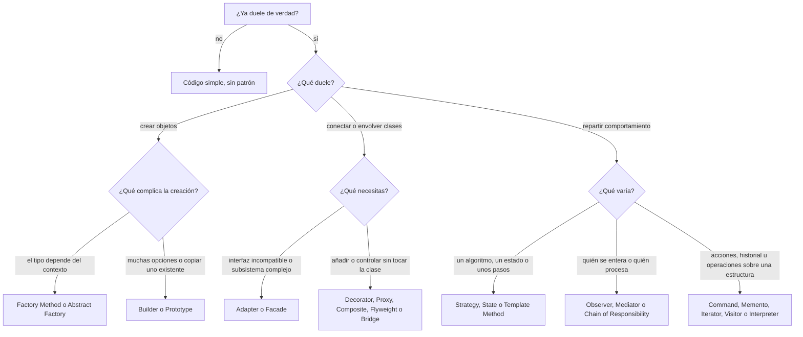
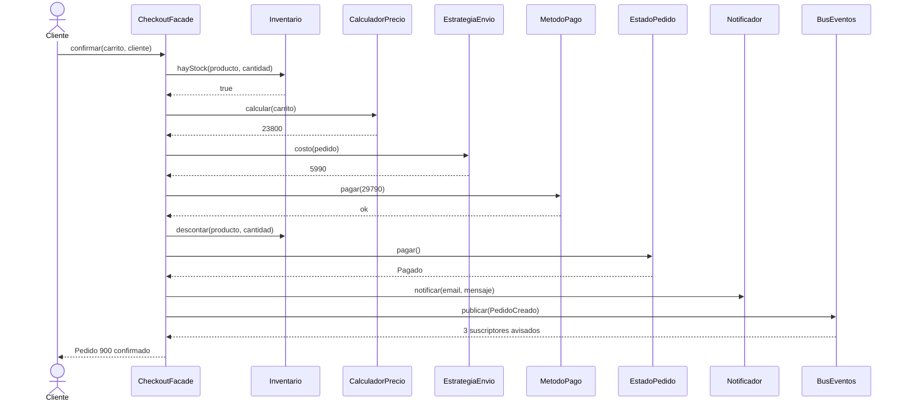

# Módulo 20: Antipatrones y caso de cierre

Este módulo cierra el curso con tres cosas. Primero, los **antipatrones**: lo que se ve cuando los patrones (o la falta de ellos) salen mal. Después, el criterio para decidir cuándo **no** usar un patrón, con un diagrama de decisión y una tabla que resume los 23 patrones del libro de la Banda de los Cuatro (GoF) que viste en los módulos 07 a 19. Y al final, un **caso de cierre**: el checkout de la tienda armado con cinco patrones que ya conoces, para ver cómo colaboran en un solo flujo.

## Antipatrones

Un **antipatrón** es una solución que parece razonable, se repite mucho y casi siempre produce más problemas de los que resuelve ([glosario](../glosario.md#antipatrón)). Es el espejo de un patrón: también tiene nombre, y por eso se puede reconocer y discutir en una revisión de código. Muchos son un patrón bueno aplicado sin criterio, o la ausencia de diseño.

| Antipatrón | Síntoma | Por qué duele | Remedio en el curso |
|---|---|---|---|
| **God Object** (una clase que lo sabe y lo hace todo; [glosario](../glosario.md#god-object)) | `Tienda` o `Pedido` con 40 métodos: calcula precios, cobra, envía correos y guarda en la base | Cada cambio toca la misma clase, las pruebas necesitan montar todo y varias personas pisan el mismo archivo | Separar por razón para cambiar: [módulo 02](02-srp.md) (SRP). Que una fachada coordine sin acumular reglas: [módulo 12](12-adapter-facade.md) |
| **Golden Hammer** (martillo de oro: aplicar la herramienta favorita a todo problema; [glosario](../glosario.md#golden-hammer)) | Todo es un Singleton, o todo pasa por una Factory, solo porque fue lo último que se aprendió | El patrón se fuerza donde no encaja y el código se llena de estructura sin motivo | Partir del problema y no de la herramienta: el diagrama y la tabla de este módulo, y la sección "Cuándo usarlo y cuándo no" de cada patrón. Ver también [módulo 01](01-buenas-practicas.md) (KISS) |
| **Spaghetti code** (flujo enredado, sin estructura clara; [glosario](../glosario.md#spaghetti-code)) | Un método de 300 líneas con `if` anidados por estado, tipo de cliente y país | Nadie se atreve a tocarlo; un cambio en un `if` rompe otro lejano | Dar nombre a cada decisión: State y Strategy en el [módulo 16](16-strategy-state-template-method.md); funciones pequeñas en el [módulo 01](01-buenas-practicas.md) |
| **Lava flow** (código muerto que nadie borra por miedo; [glosario](../glosario.md#lava-flow)) | Clases `PagoV1`, `PagoTemporal` y flags que nadie sabe si se usan | Se endurece como lava: se lee, se mantiene y se teme cambiar algo que quizá no hace nada | Borrar con pruebas y control de versiones, sin miedo; no construir "por si acaso" ([YAGNI](../glosario.md#yagni), [módulo 01](01-buenas-practicas.md)) |
| **Sobreingeniería** (más abstracción de la que el problema pide; [glosario](../glosario.md#sobreingeniería)) | `AbstractFactoryFactory`, una interfaz con una única implementación y tres capas para sumar dos números | Hay que atravesar cinco archivos para entender una línea, y la flexibilidad prometida nunca llega | KISS y YAGNI ([módulo 01](01-buenas-practicas.md)); el riesgo de pasarse en el [módulo 03](03-ocp.md) |
| **Cargo cult** (copiar la forma de una práctica sin entender su razón; [glosario](../glosario.md#cargo-cult)) | "Aquí se usa Repository porque en el proyecto anterior se usaba", sin preguntarse qué problema resuelve | Se paga el costo del patrón sin recibir su beneficio, y nadie sabe explicar por qué está | Antes de aplicar un patrón, escribir el problema que resuelve; es lo que enseña cada "El problema" de los módulos 07 a 19 y el [módulo 00](00-introduccion.md) |
| **Copy-paste programming** (duplicar bloques en lugar de abstraerlos) | El mismo cálculo de IVA pegado en cuatro controladores | Un error o un cambio de regla hay que corregirlo en cada copia, y siempre se olvida una | DRY en el [módulo 01](01-buenas-practicas.md) (con la [regla de tres](../glosario.md#regla-de-tres)); Template Method para flujos casi iguales, en el [módulo 16](16-strategy-state-template-method.md) |
| **Singleton abuse** (usar [Singleton](../glosario.md#singleton) como si fuera una variable global) | `Config.instancia()` llamado desde 50 archivos | Dependencias ocultas, [estado global](../glosario.md#estado-global) y pruebas que se contaminan entre sí | Una sola instancia, pero inyectada desde el punto de arranque: [módulo 07](07-singleton.md) y DIP en el [módulo 06](06-dip.md) |

Fíjate en que ninguno es un error de sintaxis. Son decisiones de diseño que compilan, pasan las pruebas y se descubren meses después, cuando el cambio es caro. Por eso conviene saber nombrarlos: decir "esto es un God Object, separémoslo por responsabilidad" es mucho más útil en una revisión que decir "este código no me gusta".

## Cuándo no usar patrones

Un patrón es un **costo** que se paga para comprar un beneficio: flexibilidad, pruebas más fáciles, menos duplicación. Si el beneficio no existe todavía, solo queda el costo. Estos cinco criterios ayudan a decidir.

**YAGNI y regla de tres.** [YAGNI](../glosario.md#yagni) (*You Aren't Gonna Need It*: no construyas lo que nadie pidió) y la [regla de tres](../glosario.md#regla-de-tres) (la primera vez lo escribes, la segunda lo toleras, la tercera lo abstraes) dicen lo mismo desde dos lados: no generalices con una sola variante a la vista. Con dos formas de calcular el envío, un `if` es más claro que una interfaz y tres clases; cuando aparece la tercera, ya conoces la forma real del problema y el Strategy sale casi solo.

**El patrón como último paso de un refactor.** Un **refactor** es reordenar el código sin cambiar lo que hace. La secuencia sana es: escribir lo simple, notar el dolor (un `if` por tipo repetido en cuatro lugares, una clase que cambia por cinco razones) y recién entonces aplicar el patrón que lo resuelve. Los módulos del curso siguen ese orden a propósito: primero el código que duele ("El problema") y luego el patrón. Diseñar con los 23 patrones antes de escribir la primera línea es la receta del cargo cult.

**El costo de la indirección.** **Indirección** es todo lo que se interpone entre quien llama y quien hace el trabajo: una interfaz, un decorador, un bus de eventos. Cada capa se paga con saltos extra al depurar, más archivos que abrir y más nombres que memorizar. Observer hace que leer `confirmar()` no diga qué ocurre después; Decorator obliga a recorrer varias capas para ver un precio. Vale la pena cuando la capa aísla algo que cambia; no cuando solo "podría cambiar algún día".

**Patrones que el lenguaje ya trae.** Varios patrones nacieron para compensar lo que los lenguajes de los años noventa no tenían. Hoy muchos son una característica del lenguaje:

| Patrón | En lugar de la jerarquía de clases | Dónde se vio |
|---|---|---|
| Iterator | Python: `for` y generadores con `yield`; TypeScript: `for...of` y `function*`; Go 1.23: `iter.Seq` con `range` | [módulo 18](18-command-memento-iterator.md) |
| Strategy | TypeScript y Go: una función (`type CostoEnvio func(Pedido) int`) en lugar de una interfaz con clases; Python: cualquier objeto invocable | [módulo 16](16-strategy-state-template-method.md) |
| Factory Method | Go: una función `NuevoX` que devuelve una interfaz; Python y TypeScript: una función o una tabla de funciones | [módulo 08](08-factory-method.md) |
| Builder | Go: functional options; Python y TypeScript: argumentos con nombre y valores por defecto | [módulo 10](10-builder.md) |
| Singleton | Un módulo de Python o de TypeScript se evalúa una sola vez; en Go, un valor creado en `main` y pasado a quien lo necesita | [módulo 07](07-singleton.md) |

Reconocer el patrón sigue siendo útil (es vocabulario compartido con tu equipo y en entrevistas), pero implementarlo con clases cuando el lenguaje tiene una forma más corta es sobreingeniería.

**¿Qué patrón para qué problema?** Si el problema ya duele de verdad, este diagrama te lleva al candidato. Es un punto de partida: cada hoja nombra varios patrones y la decisión final se toma leyendo "Cuándo usarlo y cuándo no" en su módulo.



Singleton queda fuera a propósito: casi nunca es el candidato correcto (módulo 07).

### Los 23 patrones en una tabla

| Patrón | Familia | Problema que resuelve | SOLID asociado | Módulo |
|---|---|---|---|---|
| Singleton | Creacional | Garantizar una única instancia con acceso global (con costos serios) | Tensiona SRP y DIP | [07](07-singleton.md) |
| Factory Method | Creacional | Decidir qué clase concreta crear sin que el cliente la nombre | OCP, DIP | [08](08-factory-method.md) |
| Abstract Factory | Creacional | Crear familias de objetos que deben usarse juntas | DIP, OCP | [09](09-abstract-factory.md) |
| Builder | Creacional | Armar paso a paso un objeto con muchas opciones y validar que sea válido | SRP | [10](10-builder.md) |
| Prototype | Creacional | Crear un objeto copiando uno existente | OCP | [11](11-prototype.md) |
| Adapter | Estructural | Hacer que una interfaz incompatible encaje con la que el código espera | OCP, DIP | [12](12-adapter-facade.md) |
| Facade | Estructural | Ofrecer una entrada simple a un subsistema que exige coordinar varias clases | SRP, ISP | [12](12-adapter-facade.md) |
| Decorator | Estructural | Añadir responsabilidades combinables a un objeto sin subclases | OCP, SRP | [13](13-decorator-proxy.md) |
| Proxy | Estructural | Controlar el acceso a un objeto (caché, carga diferida, permisos) | OCP, DIP | [13](13-decorator-proxy.md) |
| Composite | Estructural | Tratar igual a un elemento y a un grupo de elementos (estructura de árbol) | OCP, LSP | [14](14-composite-flyweight.md) |
| Flyweight | Estructural | Ahorrar memoria compartiendo el estado repetido entre muchos objetos | SRP | [14](14-composite-flyweight.md) |
| Bridge | Estructural | Variar de forma independiente dos dimensiones de una clase | OCP | [15](15-bridge.md) |
| Strategy | Comportamiento | Intercambiar algoritmos en tiempo de ejecución detrás de una interfaz | OCP | [16](16-strategy-state-template-method.md) |
| State | Comportamiento | Cambiar el comportamiento de un objeto según su estado interno | SRP, OCP | [16](16-strategy-state-template-method.md) |
| Template Method | Comportamiento | Fijar el esqueleto de un algoritmo y dejar que las subclases rellenen pasos | DIP (principio de Hollywood) | [16](16-strategy-state-template-method.md) |
| Observer | Comportamiento | Avisar a muchos interesados de un cambio sin que el emisor los conozca | OCP, DIP | [17](17-observer-mediator-chain.md) |
| Mediator | Comportamiento | Reemplazar una red de objetos que se hablan entre sí por un coordinador | SRP | [17](17-observer-mediator-chain.md) |
| Chain of Responsibility | Comportamiento | Pasar una solicitud por una fila de manejadores independientes | SRP, OCP | [17](17-observer-mediator-chain.md) |
| Command | Comportamiento | Convertir una acción en un objeto para deshacerla, encolarla o registrarla | SRP, OCP | [18](18-command-memento-iterator.md) |
| Memento | Comportamiento | Guardar y restaurar el estado de un objeto sin exponer su interior | SRP | [18](18-command-memento-iterator.md) |
| Iterator | Comportamiento | Recorrer una colección sin conocer cómo se guarda o se obtiene | SRP, ISP | [18](18-command-memento-iterator.md) |
| Visitor | Comportamiento | Agregar operaciones a una estructura estable sin tocar sus clases | OCP, SRP | [19](19-visitor-interpreter.md) |
| Interpreter | Comportamiento | Representar y evaluar las reglas de un lenguaje pequeño | OCP, LSP | [19](19-visitor-interpreter.md) |

Los principios SOLID de la columna son los que cada módulo destaca en "Cuándo usarlo y cuándo no"; casi todos refuerzan más de uno, y Singleton es el único que los tensiona en lugar de reforzarlos.

## Caso de cierre

Hora de juntar las piezas. El checkout de la tienda es el sitio natural: cobra, descuenta stock, calcula el precio, envía y avisa. Cada responsabilidad la resuelve un patrón que ya viste:

- **`CheckoutFacade`** ([módulo 12](12-adapter-facade.md)) es la puerta única y coordina el orden de los pasos.
- **`CalculadorPrecio`** decorado, `ConIVA(ConCupon(PrecioBase()))` ([módulo 13](13-decorator-proxy.md)), calcula el precio con cupón e IVA.
- **`EstrategiaEnvio`** ([módulo 16](16-strategy-state-template-method.md)) decide el costo del envío (aquí, `EnvioExpress`).
- **`crearNotificador`** ([módulo 08](08-factory-method.md)) entrega el canal de aviso al cliente.
- **`EstadoPedido`** ([módulo 16](16-strategy-state-template-method.md)) lleva al pedido de `Pendiente` a `Pagado`.
- **`BusEventos`** con `PedidoCreado` ([módulo 17](17-observer-mediator-chain.md)) avisa a quien quiera enterarse, sin que la fachada los conozca.

Los números: el carrito tiene una mochila de 15000 y dos gorros de 5000, así que el subtotal es 25000. El cupón resta 5000 (20000) y el IVA del 19 % suma 3800 (**23800**). El envío express cuesta 5990, de modo que el cobro es 23800 + 5990 = **29790**.

### Diagrama



### Código

Para que el ejemplo corra solo y quepa en pantalla, cada pieza viene **simplificada** respecto de su módulo, y las simplificaciones son las mismas en los cuatro lenguajes:

- `EstadoPedido` solo tiene `Pendiente` y `Pagado` (el [módulo 16](16-strategy-state-template-method.md) agrega `Enviado`, `Entregado` y `Cancelado`).
- `EstrategiaEnvio` solo tiene `costo(pedido)` y la clase `EnvioExpress`; faltan `nombre`, `EnvioEstandar` y `RetiroEnTienda`.
- `crearNotificador` solo conoce el canal `email` (el [módulo 08](08-factory-method.md) incluye `sms` y `push`).
- `BusEventos` solo tiene `suscribir` y `publicar`, sin dar de baja.
- `Pedido` solo guarda `id` y el total de la mercadería; el cobro suma el envío aparte.
- En Python los identificadores son `id_producto`, `id_pedido` y `id_cliente`, para no usar `id`, que ya es una función del lenguaje.

El uso confirma el pedido 900 y luego **intenta confirmar el mismo carrito otra vez**. El inventario inicial tiene solo 2 gorros, de modo que la segunda confirmación falla antes de cobrar. Si el orden de la fachada estuviera mal (cobrar antes de revisar el stock), `cobrado` tendría dos montos; si el bus no funcionara, la lista de avisados estaría vacía; si los decoradores se compusieran al revés, el total no sería 29790.

#### Python

Primero el dominio y el precio decorado.

```python
from dataclasses import dataclass, field


@dataclass(frozen=True)
class Producto:
    id_producto: int
    nombre: str
    precio: int


@dataclass(frozen=True)
class ItemCarrito:
    producto: Producto
    cantidad: int


@dataclass
class Carrito:
    items: list[ItemCarrito] = field(default_factory=list)

    def agregar(self, producto: Producto, cantidad: int) -> None:
        self.items.append(ItemCarrito(producto, cantidad))

    def subtotal(self) -> int:
        return sum(i.producto.precio * i.cantidad for i in self.items)


@dataclass(frozen=True)
class Cliente:
    id_cliente: int
    nombre: str
    email: str
```

```python
from typing import Protocol


class CalculadorPrecio(Protocol):
    def calcular(self, carrito: Carrito) -> int: ...


class PrecioBase:
    def calcular(self, carrito: Carrito) -> int:
        return carrito.subtotal()


class ConCupon:
    def __init__(self, interno: CalculadorPrecio, descuento: int) -> None:
        self._interno, self._descuento = interno, descuento

    def calcular(self, carrito: Carrito) -> int:
        return max(0, self._interno.calcular(carrito) - self._descuento)


class ConIVA:
    def __init__(self, interno: CalculadorPrecio, tasa: int = 19) -> None:
        self._interno, self._tasa = interno, tasa

    def calcular(self, carrito: Carrito) -> int:
        neto = self._interno.calcular(carrito)
        return neto + neto * self._tasa // 100
```

Después el estado del pedido, con `Pedido` como contexto.

```python
class TransicionInvalida(Exception):
    pass


class EstadoPedido:
    nombre = ""

    def pagar(self) -> "EstadoPedido":
        raise TransicionInvalida(f"no se puede pagar un pedido {self.nombre}")


class Pendiente(EstadoPedido):
    nombre = "Pendiente"

    def pagar(self) -> EstadoPedido:
        return Pagado()


class Pagado(EstadoPedido):
    nombre = "Pagado"


class Pedido:
    def __init__(self, id_pedido: int, total: int) -> None:
        self.id_pedido, self.total = id_pedido, total
        self.estado: EstadoPedido = Pendiente()

    def calcular_total(self) -> int:
        return self.total

    def pagar(self) -> None:
        self.estado = self.estado.pagar()
```

La estrategia de envío y la fábrica de notificadores.

```python
from typing import Protocol


class EstrategiaEnvio(Protocol):
    def costo(self, pedido: Pedido) -> int: ...


class EnvioExpress:
    def costo(self, pedido: Pedido) -> int:
        return 5990


class Notificador(Protocol):
    def notificar(self, destinatario: str, mensaje: str) -> None: ...


class NotificadorEmail:
    def notificar(self, destinatario: str, mensaje: str) -> None:
        print(f"Email enviado a {destinatario}")


def crear_notificador(canal: str) -> Notificador:
    if canal != "email":  # simplificado: el módulo 08 admite más canales
        raise ValueError(f"canal desconocido: {canal}")
    return NotificadorEmail()
```

El pago y el inventario, que la fachada coordina.

```python
from dataclasses import dataclass
from typing import Protocol


@dataclass(frozen=True)
class ResultadoPago:
    ok: bool
    referencia: str


class MetodoPago(Protocol):
    def pagar(self, monto: int) -> ResultadoPago: ...


class PagoFalso:
    def __init__(self) -> None:
        self.cobrado: list[int] = []

    def pagar(self, monto: int) -> ResultadoPago:
        self.cobrado.append(monto)
        return ResultadoPago(True, "FALSO-001")


class Inventario:
    def __init__(self, stock: dict[int, int]) -> None:
        self._stock = stock

    def hay_stock(self, id_producto: int, cantidad: int) -> bool:
        return self._stock.get(id_producto, 0) >= cantidad

    def descontar(self, id_producto: int, cantidad: int) -> None:
        self._stock[id_producto] -= cantidad
```

El bus de eventos.

```python
from collections import defaultdict
from dataclasses import dataclass
from typing import Callable


@dataclass(frozen=True)
class PedidoCreado:
    id_pedido: int
    total: int


class BusEventos:
    def __init__(self) -> None:
        self._manejadores: dict[type, list[Callable]] = defaultdict(list)

    def suscribir(self, tipo: type, manejador: Callable) -> None:
        self._manejadores[tipo].append(manejador)

    def publicar(self, evento: object) -> None:
        for manejador in self._manejadores[type(evento)]:
            manejador(evento)
```

La fachada y el ensamblado.

```python
class CheckoutFacade:
    def __init__(self, inventario: Inventario, pago: MetodoPago, envio: EstrategiaEnvio,
                 precio: CalculadorPrecio, notificador: Notificador,
                 bus: BusEventos, siguiente_id: int) -> None:
        self._inventario, self._pago, self._envio = inventario, pago, envio
        self._precio, self._notificador, self._bus = precio, notificador, bus
        self._siguiente_id = siguiente_id

    def confirmar(self, carrito: Carrito, cliente: Cliente) -> str:
        for item in carrito.items:
            if not self._inventario.hay_stock(item.producto.id_producto, item.cantidad):
                return f"Sin stock de {item.producto.nombre}"
        pedido = Pedido(self._siguiente_id, self._precio.calcular(carrito))
        monto = pedido.calcular_total() + self._envio.costo(pedido)
        if not self._pago.pagar(monto).ok:
            return "Pago rechazado"
        for item in carrito.items:
            self._inventario.descontar(item.producto.id_producto, item.cantidad)
        pedido.pagar()
        self._siguiente_id += 1
        self._notificador.notificar(cliente.email, f"Pedido {pedido.id_pedido} confirmado")
        self._bus.publicar(PedidoCreado(pedido.id_pedido, monto))
        return (f"Pedido {pedido.id_pedido} confirmado, total {monto}, "
                f"estado {pedido.estado.nombre}")
```

```python
avisados: list[str] = []
bus = BusEventos()
for nombre in ("inventario", "email", "analítica"):
    bus.suscribir(PedidoCreado, lambda evento, quien=nombre: avisados.append(quien))
pago, inventario = PagoFalso(), Inventario({20: 5, 21: 2})
checkout = CheckoutFacade(inventario, pago, EnvioExpress(),
                          ConIVA(ConCupon(PrecioBase(), 5000)),
                          crear_notificador("email"), bus, 900)
ana = Cliente(1, "Ana", "ana@correo.cl")
carrito = Carrito()
carrito.agregar(Producto(20, "Mochila", 15000), 1)
carrito.agregar(Producto(21, "Gorro", 5000), 2)
print(checkout.confirmar(carrito, ana))
# => Email enviado a ana@correo.cl
# => Pedido 900 confirmado, total 29790, estado Pagado
print(checkout.confirmar(carrito, ana))  # => Sin stock de Gorro
print(pago.cobrado, avisados)  # => [29790] ['inventario', 'email', 'analítica']
```

#### TypeScript

Dominio y precio decorado.

```typescript
interface Producto {
  id: number;
  nombre: string;
  precio: number;
}

interface ItemCarrito {
  producto: Producto;
  cantidad: number;
}

interface Cliente {
  id: number;
  nombre: string;
  email: string;
}

class Carrito {
  readonly items: ItemCarrito[] = [];

  agregar(producto: Producto, cantidad: number): void {
    this.items.push({ producto, cantidad });
  }

  subtotal(): number {
    return this.items.reduce((suma, i) => suma + i.producto.precio * i.cantidad, 0);
  }
}
```

```typescript
interface CalculadorPrecio {
  calcular(carrito: Carrito): number;
}

class PrecioBase implements CalculadorPrecio {
  calcular(carrito: Carrito): number {
    return carrito.subtotal();
  }
}

class ConCupon implements CalculadorPrecio {
  constructor(private interno: CalculadorPrecio, private descuento: number) {}

  calcular(carrito: Carrito): number {
    return Math.max(0, this.interno.calcular(carrito) - this.descuento);
  }
}

class ConIVA implements CalculadorPrecio {
  constructor(private interno: CalculadorPrecio, private tasa = 19) {}

  calcular(carrito: Carrito): number {
    const neto = this.interno.calcular(carrito);
    return neto + Math.floor((neto * this.tasa) / 100);
  }
}
```

Estado del pedido, estrategia de envío y fábrica de notificadores.

```typescript
class TransicionInvalida extends Error {}

abstract class EstadoPedido {
  abstract readonly nombre: string;

  pagar(): EstadoPedido {
    throw new TransicionInvalida(`no se puede pagar un pedido ${this.nombre}`);
  }
}

class Pendiente extends EstadoPedido {
  readonly nombre = "Pendiente";

  pagar(): EstadoPedido {
    return new Pagado();
  }
}

class Pagado extends EstadoPedido {
  readonly nombre = "Pagado";
}

class Pedido {
  estado: EstadoPedido = new Pendiente();

  constructor(readonly id: number, readonly total: number) {}

  calcularTotal(): number {
    return this.total;
  }

  pagar(): void {
    this.estado = this.estado.pagar();
  }
}
```

```typescript
interface EstrategiaEnvio {
  costo(pedido: Pedido): number;
}

class EnvioExpress implements EstrategiaEnvio {
  costo(pedido: Pedido): number {
    return 5990;
  }
}

interface Notificador {
  notificar(destinatario: string, mensaje: string): void;
}

class NotificadorEmail implements Notificador {
  notificar(destinatario: string, mensaje: string): void {
    console.log(`Email enviado a ${destinatario}`);
  }
}

function crearNotificador(canal: string): Notificador {
  if (canal !== "email") {
    // simplificado: el módulo 08 admite más canales
    throw new Error(`canal desconocido: ${canal}`);
  }
  return new NotificadorEmail();
}
```

Pago, inventario y bus de eventos.

```typescript
interface ResultadoPago {
  ok: boolean;
  referencia: string;
}

interface MetodoPago {
  pagar(monto: number): ResultadoPago;
}

class PagoFalso implements MetodoPago {
  cobrado: number[] = [];

  pagar(monto: number): ResultadoPago {
    this.cobrado.push(monto);
    return { ok: true, referencia: "FALSO-001" };
  }
}

class Inventario {
  constructor(private stock: Map<number, number>) {}

  hayStock(idProducto: number, cantidad: number): boolean {
    return (this.stock.get(idProducto) ?? 0) >= cantidad;
  }

  descontar(idProducto: number, cantidad: number): void {
    this.stock.set(idProducto, (this.stock.get(idProducto) ?? 0) - cantidad);
  }
}
```

```typescript
class PedidoCreado {
  readonly tipo = "PedidoCreado";
  constructor(readonly idPedido: number, readonly total: number) {}
}

type Manejador = (evento: PedidoCreado) => void;

class BusEventos {
  private manejadores = new Map<string, Manejador[]>();

  suscribir(tipo: string, manejador: Manejador): void {
    this.manejadores.set(tipo, [...(this.manejadores.get(tipo) ?? []), manejador]);
  }

  publicar(evento: PedidoCreado): void {
    for (const manejador of this.manejadores.get(evento.tipo) ?? []) manejador(evento);
  }
}
```

La fachada y el ensamblado.

```typescript
class CheckoutFacade {
  constructor(
    private inventario: Inventario,
    private pago: MetodoPago,
    private envio: EstrategiaEnvio,
    private precio: CalculadorPrecio,
    private notificador: Notificador,
    private bus: BusEventos,
    private siguienteId: number,
  ) {}

  confirmar(carrito: Carrito, cliente: Cliente): string {
    for (const item of carrito.items) {
      if (!this.inventario.hayStock(item.producto.id, item.cantidad)) {
        return `Sin stock de ${item.producto.nombre}`;
      }
    }
    const pedido = new Pedido(this.siguienteId, this.precio.calcular(carrito));
    const monto = pedido.calcularTotal() + this.envio.costo(pedido);
    if (!this.pago.pagar(monto).ok) return "Pago rechazado";
    for (const item of carrito.items) {
      this.inventario.descontar(item.producto.id, item.cantidad);
    }
    pedido.pagar();
    this.siguienteId++;
    this.notificador.notificar(cliente.email, `Pedido ${pedido.id} confirmado`);
    this.bus.publicar(new PedidoCreado(pedido.id, monto));
    return `Pedido ${pedido.id} confirmado, total ${monto}, estado ${pedido.estado.nombre}`;
  }
}
```

```typescript
const avisados: string[] = [];
const bus = new BusEventos();
for (const nombre of ["inventario", "email", "analítica"]) {
  bus.suscribir("PedidoCreado", () => { avisados.push(nombre); });
}
const pago = new PagoFalso();
const inventario = new Inventario(new Map([[20, 5], [21, 2]]));
const precio = new ConIVA(new ConCupon(new PrecioBase(), 5000));
const checkout = new CheckoutFacade(inventario, pago, new EnvioExpress(),
  precio, crearNotificador("email"), bus, 900);
const ana: Cliente = { id: 1, nombre: "Ana", email: "ana@correo.cl" };
const carrito = new Carrito();
carrito.agregar({ id: 20, nombre: "Mochila", precio: 15000 }, 1);
carrito.agregar({ id: 21, nombre: "Gorro", precio: 5000 }, 2);
console.log(checkout.confirmar(carrito, ana));
// => Email enviado a ana@correo.cl
// => Pedido 900 confirmado, total 29790, estado Pagado
console.log(checkout.confirmar(carrito, ana)); // => Sin stock de Gorro
console.log(pago.cobrado, avisados); // => [ 29790 ] [ 'inventario', 'email', 'analítica' ]
```

#### Go

Los bloques Go forman un solo `main.go`: el primero abre con `package main` y el `import` que usa todo el conjunto, y `main` está en el último.

```go
package main

import (
	"errors"
	"fmt"
)

type Producto struct {
	ID     int
	Nombre string
	Precio int
}

type ItemCarrito struct {
	Producto Producto
	Cantidad int
}

type Cliente struct {
	ID     int
	Nombre string
	Email  string
}

type Carrito struct {
	Items []ItemCarrito
}

func (c *Carrito) Agregar(producto Producto, cantidad int) {
	c.Items = append(c.Items, ItemCarrito{producto, cantidad})
}

func (c *Carrito) Subtotal() int {
	total := 0
	for _, item := range c.Items {
		total += item.Producto.Precio * item.Cantidad
	}
	return total
}
```

```go
type CalculadorPrecio interface {
	Calcular(carrito *Carrito) int
}

type PrecioBase struct{}

func (PrecioBase) Calcular(carrito *Carrito) int { return carrito.Subtotal() }

type ConCupon struct {
	interno   CalculadorPrecio
	descuento int
}

func (d ConCupon) Calcular(carrito *Carrito) int {
	return max(0, d.interno.Calcular(carrito)-d.descuento)
}

type ConIVA struct {
	interno CalculadorPrecio
	tasa    int
}

func (d ConIVA) Calcular(carrito *Carrito) int {
	neto := d.interno.Calcular(carrito)
	return neto + neto*d.tasa/100
}
```

```go
var ErrTransicionInvalida = errors.New("transición inválida")

type EstadoPedido interface {
	Nombre() string
	Pagar() (EstadoPedido, error)
}

type Pendiente struct{}

func (Pendiente) Nombre() string { return "Pendiente" }

func (Pendiente) Pagar() (EstadoPedido, error) { return Pagado{}, nil }

type Pagado struct{}

func (Pagado) Nombre() string { return "Pagado" }

func (Pagado) Pagar() (EstadoPedido, error) {
	return nil, fmt.Errorf("%w: pagar en Pagado", ErrTransicionInvalida)
}

type Pedido struct {
	ID     int
	Total  int
	Estado EstadoPedido
}

func (p *Pedido) CalcularTotal() int { return p.Total }

func (p *Pedido) Pagar() error {
	siguiente, err := p.Estado.Pagar()
	if err != nil {
		return err
	}
	p.Estado = siguiente
	return nil
}
```

```go
type EstrategiaEnvio interface {
	Costo(pedido *Pedido) int
}

type EnvioExpress struct{}

func (EnvioExpress) Costo(pedido *Pedido) int { return 5990 }

type Notificador interface {
	Notificar(destinatario, mensaje string) error
}

type NotificadorEmail struct{}

func (NotificadorEmail) Notificar(destinatario, mensaje string) error {
	fmt.Println("Email enviado a " + destinatario)
	return nil
}

func NuevoNotificador(canal string) (Notificador, error) {
	if canal != "email" { // simplificado: el módulo 08 admite más canales
		return nil, fmt.Errorf("canal desconocido: %s", canal)
	}
	return NotificadorEmail{}, nil
}
```

```go
type ResultadoPago struct {
	Ok         bool
	Referencia string
}

type MetodoPago interface {
	Pagar(monto int) ResultadoPago
}

type PagoFalso struct {
	Cobrado []int
}

func (p *PagoFalso) Pagar(monto int) ResultadoPago {
	p.Cobrado = append(p.Cobrado, monto)
	return ResultadoPago{Ok: true, Referencia: "FALSO-001"}
}

type Inventario struct {
	stock map[int]int
}

func NewInventario(stock map[int]int) *Inventario {
	return &Inventario{stock: stock}
}

func (i *Inventario) HayStock(idProducto, cantidad int) bool {
	return i.stock[idProducto] >= cantidad
}

func (i *Inventario) Descontar(idProducto, cantidad int) {
	i.stock[idProducto] -= cantidad
}
```

```go
type Evento interface{ Tipo() string }

type PedidoCreado struct{ IDPedido, Total int }

func (PedidoCreado) Tipo() string { return "PedidoCreado" }

type Manejador func(Evento)

type BusEventos struct {
	manejadores map[string][]Manejador
}

func NuevoBus() *BusEventos {
	return &BusEventos{manejadores: map[string][]Manejador{}}
}

func (b *BusEventos) Suscribir(tipo string, m Manejador) {
	b.manejadores[tipo] = append(b.manejadores[tipo], m)
}

func (b *BusEventos) Publicar(e Evento) {
	for _, m := range b.manejadores[e.Tipo()] {
		m(e)
	}
}
```

```go
type CheckoutFacade struct {
	inventario  *Inventario
	pago        MetodoPago
	envio       EstrategiaEnvio
	precio      CalculadorPrecio
	notificador Notificador
	bus         *BusEventos
	siguienteID int
}

func (c *CheckoutFacade) Confirmar(carrito *Carrito, cliente Cliente) (string, error) {
	for _, item := range carrito.Items {
		if !c.inventario.HayStock(item.Producto.ID, item.Cantidad) {
			return "Sin stock de " + item.Producto.Nombre, nil
		}
	}
	pedido := &Pedido{c.siguienteID, c.precio.Calcular(carrito), Pendiente{}}
	monto := pedido.CalcularTotal() + c.envio.Costo(pedido)
	if !c.pago.Pagar(monto).Ok {
		return "Pago rechazado", nil
	}
	for _, item := range carrito.Items {
		c.inventario.Descontar(item.Producto.ID, item.Cantidad)
	}
	if err := pedido.Pagar(); err != nil {
		return "", err
	}
	c.siguienteID++
	aviso := fmt.Sprintf("Pedido %d confirmado", pedido.ID)
	if err := c.notificador.Notificar(cliente.Email, aviso); err != nil {
		return "", err
	}
	c.bus.Publicar(PedidoCreado{pedido.ID, monto})
	return fmt.Sprintf("%s, total %d, estado %s", aviso, monto, pedido.Estado.Nombre()), nil
}
```

```go
func main() {
	var avisados []string
	bus := NuevoBus()
	for _, nombre := range []string{"inventario", "email", "analítica"} {
		bus.Suscribir("PedidoCreado", func(Evento) { avisados = append(avisados, nombre) })
	}
	notificador, err := NuevoNotificador("email")
	if err != nil {
		fmt.Println(err)
		return
	}
	pago := &PagoFalso{}
	precio := ConIVA{ConCupon{PrecioBase{}, 5000}, 19}
	checkout := &CheckoutFacade{NewInventario(map[int]int{20: 5, 21: 2}), pago,
		EnvioExpress{}, precio, notificador, bus, 900}
	ana := Cliente{ID: 1, Nombre: "Ana", Email: "ana@correo.cl"}
	carrito := &Carrito{}
	carrito.Agregar(Producto{20, "Mochila", 15000}, 1)
	carrito.Agregar(Producto{21, "Gorro", 5000}, 2)
	resultado, _ := checkout.Confirmar(carrito, ana)
	fmt.Println(resultado)
	// => Email enviado a ana@correo.cl
	// => Pedido 900 confirmado, total 29790, estado Pagado
	resultado, _ = checkout.Confirmar(carrito, ana)
	fmt.Println(resultado)                // => Sin stock de Gorro
	fmt.Println(pago.Cobrado, avisados) // => [29790] [inventario email analítica]
}
```

> **Nota Go:** hay tres diferencias de forma y ninguna de fondo. `EstadoPedido.Pagar` devuelve `(EstadoPedido, error)` en lugar de lanzar una excepción; `EstrategiaEnvio.Costo` recibe `*Pedido` porque el pedido es mutable (cambia de estado); y la fábrica se llama `NuevoNotificador` y devuelve un `error`, como en el módulo 08. Como en el módulo 17, la suscripción es una slice de funciones, y la alternativa a las interfaces con un solo método (`EstrategiaEnvio`, `Manejador`) es usar directamente una función.

#### PHP

Dominio y precio decorado.

```php
<?php
class Producto
{
    public function __construct(
        public readonly int $id,
        public readonly string $nombre,
        public readonly int $precio,
    ) {}
}

class ItemCarrito
{
    public function __construct(public readonly Producto $producto, public readonly int $cantidad) {}
}

class Cliente
{
    public function __construct(
        public readonly int $id,
        public readonly string $nombre,
        public readonly string $email,
    ) {}
}

class Carrito
{
    /** @var ItemCarrito[] */
    public array $items = [];

    public function agregar(Producto $producto, int $cantidad): void
    {
        $this->items[] = new ItemCarrito($producto, $cantidad);
    }

    public function subtotal(): int
    {
        return array_sum(array_map(fn($i) => $i->producto->precio * $i->cantidad, $this->items));
    }
}
```

```php
<?php
interface CalculadorPrecio
{
    public function calcular(Carrito $carrito): int;
}

class PrecioBase implements CalculadorPrecio
{
    public function calcular(Carrito $carrito): int
    {
        return $carrito->subtotal();
    }
}

class ConCupon implements CalculadorPrecio
{
    public function __construct(private CalculadorPrecio $interno, private int $descuento) {}

    public function calcular(Carrito $carrito): int
    {
        return max(0, $this->interno->calcular($carrito) - $this->descuento);
    }
}

class ConIVA implements CalculadorPrecio
{
    public function __construct(private CalculadorPrecio $interno, private int $tasa = 19) {}

    public function calcular(Carrito $carrito): int
    {
        $neto = $this->interno->calcular($carrito);
        return $neto + intdiv($neto * $this->tasa, 100);
    }
}
```

Estado del pedido, estrategia de envío y fábrica de notificadores.

```php
<?php
class TransicionInvalida extends RuntimeException {}

abstract class EstadoPedido
{
    abstract public function nombre(): string;

    public function pagar(): EstadoPedido
    {
        throw new TransicionInvalida("no se puede pagar un pedido {$this->nombre()}");
    }
}

class Pendiente extends EstadoPedido
{
    public function nombre(): string { return 'Pendiente'; }
    public function pagar(): EstadoPedido { return new Pagado(); }
}

class Pagado extends EstadoPedido
{
    public function nombre(): string { return 'Pagado'; }
}

class Pedido
{
    public EstadoPedido $estado;

    public function __construct(public readonly int $id, public readonly int $total)
    {
        $this->estado = new Pendiente();
    }

    public function calcularTotal(): int { return $this->total; }

    public function pagar(): void { $this->estado = $this->estado->pagar(); }
}
```

```php
<?php
interface EstrategiaEnvio
{
    public function costo(Pedido $pedido): int;
}

class EnvioExpress implements EstrategiaEnvio
{
    public function costo(Pedido $pedido): int { return 5990; }
}

interface Notificador
{
    public function notificar(string $destinatario, string $mensaje): void;
}

class NotificadorEmail implements Notificador
{
    public function notificar(string $destinatario, string $mensaje): void
    {
        echo "Email enviado a $destinatario\n";
    }
}

function crearNotificador(string $canal): Notificador
{
    return match ($canal) {
        'email' => new NotificadorEmail(), // simplificado: el módulo 08 admite más canales
        default => throw new InvalidArgumentException("canal desconocido: $canal"),
    };
}
```

Pago, inventario y bus de eventos.

```php
<?php
class ResultadoPago
{
    public function __construct(public readonly bool $ok, public readonly string $referencia) {}
}

interface MetodoPago
{
    public function pagar(int $monto): ResultadoPago;
}

class PagoFalso implements MetodoPago
{
    /** @var int[] */
    public array $cobrado = [];

    public function pagar(int $monto): ResultadoPago
    {
        $this->cobrado[] = $monto;
        return new ResultadoPago(true, 'FALSO-001');
    }
}

class Inventario
{
    /** @param array<int, int> $stock */
    public function __construct(private array $stock) {}

    public function hayStock(int $idProducto, int $cantidad): bool
    {
        return ($this->stock[$idProducto] ?? 0) >= $cantidad;
    }

    public function descontar(int $idProducto, int $cantidad): void
    {
        $this->stock[$idProducto] -= $cantidad;
    }
}
```

```php
<?php
interface Evento {}

class PedidoCreado implements Evento
{
    public function __construct(public readonly int $idPedido, public readonly int $total) {}
}

class BusEventos
{
    /** @var array<string, callable[]> */
    private array $manejadores = [];

    public function suscribir(string $tipo, callable $manejador): void
    {
        $this->manejadores[$tipo][] = $manejador;
    }

    public function publicar(Evento $evento): void
    {
        foreach ($this->manejadores[$evento::class] ?? [] as $manejador) {
            $manejador($evento);
        }
    }
}
```

La fachada y el ensamblado.

```php
<?php
class CheckoutFacade
{
    public function __construct(
        private Inventario $inventario,
        private MetodoPago $pago,
        private EstrategiaEnvio $envio,
        private CalculadorPrecio $precio,
        private Notificador $notificador,
        private BusEventos $bus,
        private int $siguienteId,
    ) {}

    public function confirmar(Carrito $carrito, Cliente $cliente): string
    {
        foreach ($carrito->items as $item) {
            if (!$this->inventario->hayStock($item->producto->id, $item->cantidad)) {
                return "Sin stock de {$item->producto->nombre}";
            }
        }
        $pedido = new Pedido($this->siguienteId, $this->precio->calcular($carrito));
        $monto = $pedido->calcularTotal() + $this->envio->costo($pedido);
        if (!$this->pago->pagar($monto)->ok) {
            return 'Pago rechazado';
        }
        foreach ($carrito->items as $item) {
            $this->inventario->descontar($item->producto->id, $item->cantidad);
        }
        $pedido->pagar();
        $this->siguienteId++;
        $this->notificador->notificar($cliente->email, "Pedido {$pedido->id} confirmado");
        $this->bus->publicar(new PedidoCreado($pedido->id, $monto));
        return "Pedido {$pedido->id} confirmado, total $monto, estado {$pedido->estado->nombre()}";
    }
}
```

```php
<?php
$avisados = [];
$bus = new BusEventos();
foreach (['inventario', 'email', 'analítica'] as $nombre) {
    $bus->suscribir(PedidoCreado::class, function () use (&$avisados, $nombre) {
        $avisados[] = $nombre;
    });
}
$pago = new PagoFalso();
$precio = new ConIVA(new ConCupon(new PrecioBase(), 5000));
$checkout = new CheckoutFacade(new Inventario([20 => 5, 21 => 2]), $pago, new EnvioExpress(),
    $precio, crearNotificador('email'), $bus, 900);
$ana = new Cliente(1, 'Ana', 'ana@correo.cl');
$carrito = new Carrito();
$carrito->agregar(new Producto(20, 'Mochila', 15000), 1);
$carrito->agregar(new Producto(21, 'Gorro', 5000), 2);
echo $checkout->confirmar($carrito, $ana) . "\n";
// => Email enviado a ana@correo.cl
// => Pedido 900 confirmado, total 29790, estado Pagado
echo $checkout->confirmar($carrito, $ana) . "\n"; // => Sin stock de Gorro
echo json_encode($pago->cobrado) . ' ' . implode(',', $avisados) . "\n";
// => [29790] inventario,email,analítica
```

El resultado es idéntico en los cuatro lenguajes: se imprime el aviso al cliente, el pedido 900 queda `Pagado` con total 29790, el segundo intento responde "Sin stock de Gorro", se cobró una sola vez (29790) y el bus avisó a los tres suscriptores.

### Qué patrón hizo qué

| Pieza | Patrón | Qué resolvió en el checkout | Qué pasaría sin él |
|---|---|---|---|
| `CheckoutFacade` | Facade | Un solo lugar con el orden correcto: stock, precio, cobro, estado, aviso | Cada controlador (web, móvil, admin) repetiría la secuencia y la haría distinta |
| `ConIVA(ConCupon(PrecioBase()))` | Decorator | Combinar cupón e IVA en el orden elegido, en tiempo de ejecución | Una clase por cada combinación o un `calcular` con `if` por regla |
| `EnvioExpress` | Strategy | Cambiar el costo de envío sin tocar la fachada | Un `if tipo_envio == ...` dentro del checkout |
| `crearNotificador("email")` | Factory Method (en su forma de función creadora) | Elegir el canal de aviso sin que la fachada nombre una clase concreta | La fachada atada a `NotificadorEmail` |
| `Pendiente` → `Pagado` | State | Que las transiciones del pedido las valide el propio estado | `if estado == ...` repartidos por el sistema |
| `BusEventos` y `PedidoCreado` | Observer | Avisar a inventario, correo y analítica sin que la fachada los conozca | La fachada llamando a cada interesado, y editada con cada nuevo suscriptor |

Tres de los patrones (Decorator, Strategy y Factory Method) se apoyan en el mismo principio: la fachada depende de **interfaces**, no de clases concretas, y quien arma el programa decide qué entra (es el *composition root*, [glosario](../glosario.md#composition-root), del [módulo 06](06-dip.md)). En el uso, la llamada que construye la fachada es el único sitio donde aparecen los nombres concretos. Agregar "retiro en tienda", un cupón nuevo o un suscriptor de puntos significa cambiar esa línea y no la fachada.

Y fíjate en lo que **no** se usó: ni Singleton, ni Abstract Factory, ni Visitor. Un checkout de este tamaño no los necesita, y es la lección de la sección anterior: el criterio vale más que la lista.

## Preguntas de entrevista

**P1. ¿Cuál es el peor mal uso de patrones que has visto?**
El caso típico es el patrón aplicado "por si acaso": una `AbstractFactory` con una sola familia, o un Singleton para cada servicio, que esconde dependencias y hace imposible probar una clase sin las demás. El costo aparece meses después, cuando hay que recorrer cinco capas para cambiar una línea. Lo arreglo con el camino inverso: volver al código simple y volver a introducir el patrón solo donde el dolor es real.

**P2. ¿Cómo decides si un patrón vale la pena?**
Me hago tres preguntas: qué problema concreto resuelve aquí (no "algún día"), cuántas variantes existen hoy (con una o dos suele bastar un `if`; con la tercera, la regla de tres, abstraigo) y cuánto cuesta la indirección frente a lo que gana. Si no puedo escribir el dolor en una frase, no lo uso. Y si el lenguaje ya trae la solución (un generador, una función), uso eso.

**P3. Nombra tres antipatrones y su remedio.**
God Object: una clase con muchas responsabilidades; se separa por razón de cambio (SRP). Spaghetti code: `if` anidados por estado o tipo; se reemplazan con State o Strategy y funciones pequeñas. Singleton abuse: estado global escondido; se inyecta una única instancia desde el punto de arranque (DIP). Otros dos habituales son Golden Hammer y sobreingeniería, cuyo remedio es partir del problema, con KISS y YAGNI.

**P4. ¿Qué patrones usarías para un checkout y por qué?**
Una Facade como entrada única que coordina stock, precio, pago y estado, para que web, móvil y admin no repitan el protocolo. Decorator para el precio (cupón e IVA combinables), Strategy para el envío, Factory Method para elegir el notificador y State para el ciclo de vida del pedido. Observer (un bus de eventos) para avisar a inventario, correo y analítica sin acoplarlos. No usaría Singleton: la unicidad la da quien arma el programa.

**P5. ¿Qué patrones desaparecen en tu lenguaje favorito?**
En Python, Iterator es el `for` con generadores y Strategy suele ser pasar una función; Singleton casi es un módulo. En Go, Strategy es un tipo función, Builder es functional options, Factory Method es una función `NuevoX` y Iterator es `iter.Seq`. En TypeScript, Strategy, Command y Observer se resuelven bien con funciones y closures. No desaparece la idea, solo la jerarquía de clases que la implementaba.

**P6. Explica SOLID con un ejemplo en un minuto.**
Con la tienda: SRP, `Pedido` calcula su total y no envía correos; OCP, un envío nuevo es una clase nueva que implementa `EstrategiaEnvio`, sin editar el checkout. LSP, un `Combo` se usa donde se espera un producto sin sorpresas; ISP, quien solo notifica depende de `Notificador` y no de una interfaz gorda. DIP, el servicio depende de `MetodoPago` y no de `Webpay`.
